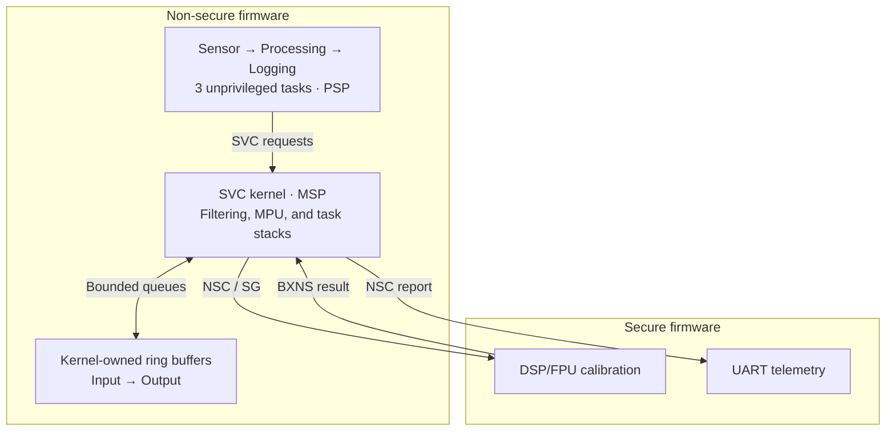

# ARM Cortex-M Lab

[](https://github.com/Merd0/ARM-Cortex-M-Lab/actions/workflows/ci.yml)
[](https://github.com/Merd0/ARM-Cortex-M-Lab/releases/tag/v1.0.0)

**English** · [Türkçe](README.tr.md)

A practical **Arm Cortex-M33 / Armv8-M Mainline** engineering lab built with
bare-metal C and Thumb assembly. Sixteen lessons lead into five integration
projects and a working TrustZone sensor node, with reproducible QEMU/GDB
experiments and automated regression tests across three build presets.

## Project at a Glance

- **16 lessons:** architecture, protection, exceptions, build tools, debugging,
  synchronization, DSP/FPU, scheduling, and TrustZone.
- **5 integration projects:** protected application, fault analyzer, startup,
  profiling, and an educational mini-kernel.
- **1 final system:** a Secure/Non-secure sensor-processing-logging pipeline.
- **Released checkpoint:** [v1.0.0](https://github.com/Merd0/ARM-Cortex-M-Lab/releases/tag/v1.0.0),
  commit [2b2e1dc](https://github.com/Merd0/ARM-Cortex-M-Lab/commit/2b2e1dc752c74f07f0550437b4b879763602daa7).

The learning method is **TEACH → SHOW → RUN → OBSERVE → MODIFY → BREAK → DEBUG → VERIFY**.
Lessons include working examples, controlled failures, incomplete exercises,
and separate reference solutions. Code and identifiers are English; most lesson
explanations are Turkish. The [Turkish overview](README.tr.md) retains the
original learning guide.

## Engineering Highlights

- **Core architecture and ABI:** MSP/PSP, exception stacking, EXC_RETURN,
  AAPCS stack alignment, and C/assembly register preservation.
- **Memory protection:** MPU permissions, unprivileged Thread mode, SVC services,
  and bounded task stacks with PSPLIM and explicit software-save checks.
- **Scheduling:** SysTick preemption, deferred PendSV, and R4–R11/context
  save/restore in an educational mini-kernel.
- **TrustZone:** separate Secure/Non-secure firmware, SAU/IDAU/MPC partitioning,
  NSC gateways, and compiler-generated CMSE entry/return sequences.
- **DSP/FPU:** controlled eager/lazy FP experiments and a bounded Secure
  calibration service with an integer ABI and explicit FP-state handling.
- **Diagnostics:** conservative fault-frame capture, validity-aware MMFAR/BFAR
  reporting, GDB helpers, and negative tests for unsupported or corrupt frames.

## Secure Sensor Node Architecture

Three unprivileged Non-secure tasks request operations through SVC. The
privileged kernel owns the ring buffers, filtering state, task stacks, and MPU
mapping. Secure code provides bounded DSP/FPU calibration and UART reporting.



The arrows describe the data/service flow: queue access, filtering, and the
Secure calibration call execute inside the kernel's SVC service. Tasks do not
access the kernel buffers directly. The normal scenario processes **32 synthetic
samples**, checks a filtered/calibrated sum of **298**, and verifies telemetry
against an independent integer oracle.

See the [final system](final-project/secure-real-time-sensor-node/) for memory
boundaries, fault scenarios, and the limits of Secure-call scheduling.

## Verification & Testing

The [v1.0.0 main CI run](https://github.com/Merd0/ARM-Cortex-M-Lab/actions/runs/40545977241)
passed **Debug (`-Og`), Release (`-O2`), and MinSize (`-Os`)**. Per preset:

- **566 smoke checks** and **47 build probes**.
- **13 GDB integration sessions**, including context save/restore, SG-entry
  interruption boundaries, frame alignment, MPU faults, and Secure transitions.
- **15 integration-project scenarios** and **7 final-system scenarios**.
- Lesson 12–16 debugger, ABI, FP, scheduling, and security checks.

Tests check exact expected outcomes, including deliberate failures and unfinished
exercises. An END marker alone is insufficient. Build probes cover libgcc
ordering and FLASH load-image bounds. The SG-entry regression accepts only the
two known gateway entries and rejects SG+4.

Local clean builds produced **109 ELF images per preset with no compiler warnings
or errors**. These are recorded results, not guarantees for every toolchain.
See [test commands](tests/README.md), [tool versions](docs/TOOL_VERSIONS.md), and
the [internal engineering audit](docs/ENGINEERING_AUDIT.md).

## Quick Start

Install **Arm GNU Toolchain**, **CMake ≥ 3.21**, **Ninja**, **QEMU with mps2-an505**,
**Arm GDB** (or `gdb-multiarch`), and **Python 3**. Bash scripts require Bash;
Windows can use MSYS2. Platform details: [environment setup](docs/ENVIRONMENT.md).

```bash
git clone https://github.com/Merd0/ARM-Cortex-M-Lab.git
cd ARM-Cortex-M-Lab
cmake --preset debug
cmake --build --preset debug
```

Run the programmer-model example:

```bash
qemu-system-arm -M mps2-an505 -cpu cortex-m33 -nographic -monitor none -serial stdio \
  -kernel build/debug/lessons/02-programmer-model/02-programmer-model.elf
```

Exit QEMU with **Ctrl-A, then X**. For debugging, start QEMU paused in terminal 1:

```bash
./scripts/debug-qemu.sh build/debug/lessons/02-programmer-model/02-programmer-model.elf
```

Connect in terminal 2 (`gdb-multiarch` can replace `arm-none-eabi-gdb`):

```bash
arm-none-eabi-gdb -x scripts/gdb/cortex-m.gdb \
  build/debug/lessons/02-programmer-model/02-programmer-model.elf
```

```gdb
cm-connect
break main
continue
cm-regs
```

Run the integration scenarios, including the two-image Secure/Non-secure system:

```bash
python3 tests/system-smoke.py --preset debug
python3 tests/integration-check.py --preset debug
```

Use `release` or `minsize` in place of `debug` for the other presets. The full
regression commands are listed in [tests/README.md](tests/README.md).

## Lessons & Integration Projects

Start with the [Bootcamp guide](BOOTCAMP.md), then follow the numbered lessons:

- **Foundations:** [01 Cortex-M family](lessons/01-cortex-m-family/),
  [02 programmer model](lessons/02-programmer-model/),
  [03 C and assembly](lessons/03-c-and-assembly/),
  [04 MSP/PSP stacks](lessons/04-stack-msp-psp/).
- **Protection and exceptions:** [05 privilege and SVC](lessons/05-privilege-svc/),
  [06 MPU](lessons/06-mpu/), [07 exceptions and NVIC](lessons/07-exceptions/),
  [08 faults](lessons/08-faults/).
- **Toolchain and debugging:** [09 compiler and AAPCS](lessons/09-compiler-aapcs/),
  [10 linker and ELF](lessons/10-linker-elf-memory/),
  [11 startup](lessons/11-startup/), [12 debugging and DWT](lessons/12-debug-dwt/).
- **Advanced mechanisms:** [13 synchronization, FPU and DSP](lessons/13-sync-fpu-dsp/),
  [14 SysTick and PendSV](lessons/14-systick-pendsv/),
  [15 mini-kernel](lessons/15-mini-kernel/), [16 TrustZone](lessons/16-trustzone-advanced/).

Integration projects:
[Protected Application](projects/protected-application/) ·
[Fault Analyzer](projects/fault-analyzer/) ·
[From Reset to Main](projects/from-reset-to-main/) ·
[Performance Profiler](projects/performance-profiler/) ·
[Educational Mini Kernel](projects/mini-kernel/).

The [Secure Sensor Node](final-project/secure-real-time-sensor-node/) combines
these mechanisms into the final application.

## Repository Structure

```text
lessons/        16 lessons, experiments, exercises, and reference solutions
projects/       5 integration projects
final-project/  Secure/Non-secure sensor node
platform/       MPS2-AN505 startup, linker script, and UART
common/         Console and minimal freestanding library support
external/       Vendored CMSIS-Core, including license and provenance
core/           Minimal teaching register definitions
scripts/        Environment checks, QEMU runners, and GDB helpers
tests/          Behavioral, build, debugger, and integration checks
tools/          Target capability probe
docs/           Architecture, evidence, references, and limitations
cmake/          Cross-toolchain and firmware build helpers
.github/        Three-preset GitHub Actions workflow
```

## Scope & Limitations

- Validated on **QEMU mps2-an505**; no physical-board validation or independent
  third-party audit has been performed.
- QEMU is **not cycle-accurate**. DWT CYCCNT does not advance on the tested
  target; the lab makes no cycle, throughput, or WCET guarantee.
- The mini-kernel is educational. General TrustZone/FP-aware task switching
  and production RTOS reliability are outside the verified scope.
- The sensor is synthetic. Secure calibration provides no cryptographic
  authentication, secure boot, signature, or attestation.
- Physical attacks, DMA/debugger attacks, and code injection/ROP are outside
  the verified security scope. Simulator behavior is not a silicon guarantee.

See [target capabilities](docs/TARGET_CAPABILITIES.md),
[known limitations](docs/LIMITATIONS.md), and
[hardware migration notes](docs/REAL_HARDWARE_MIGRATION.md).

## Documentation & References

[Architecture](docs/ARCHITECTURE.md) · [Memory map](docs/MEMORY_MAP.md) ·
[Debugging](docs/DEBUGGING.md) · [Measurement methodology](docs/PERFORMANCE_MEASUREMENT.md) ·
[Progress](docs/PROGRESS.md) · [Roadmap](docs/ROADMAP.md) ·
[Official references](docs/REFERENCES.md) · [CMSIS provenance](external/README.md).

The [v1.0.0 release](https://github.com/Merd0/ARM-Cortex-M-Lab/releases/tag/v1.0.0)
and its commit remain the historical delivery checkpoint. Later documentation
changes do not alter that release.

## License

[MIT](LICENSE). Vendored CMSIS-Core files retain their
[Apache-2.0 license](external/CMSIS/LICENSE).
