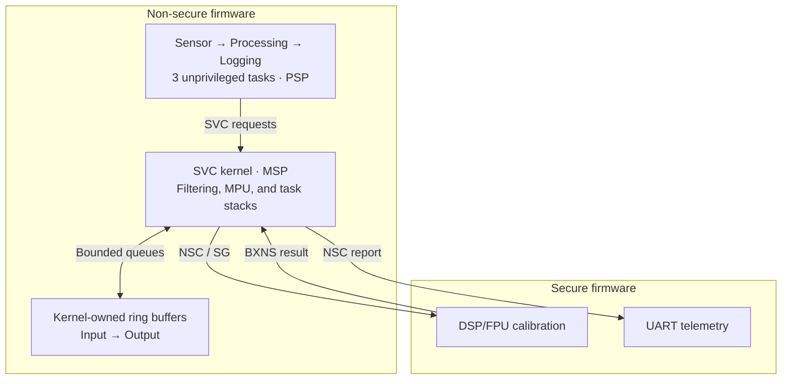
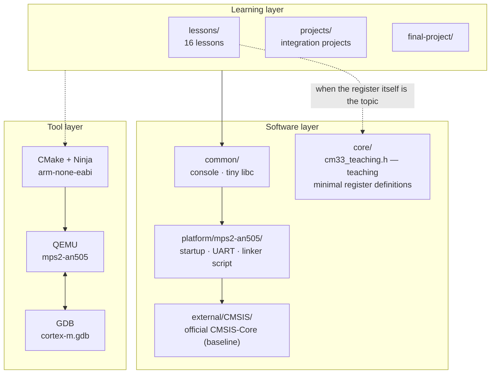

**Language:** English | [Türkçe](README.tr.md)

# ARM Cortex-M Lab

[](https://github.com/Merd0/ARM-Cortex-M-Lab/actions/workflows/ci.yml)
[](https://github.com/Merd0/ARM-Cortex-M-Lab/releases/tag/v1.0.0)

A practical **Arm Cortex-M33 / Armv8-M Mainline** engineering lab built with
bare-metal C and Thumb assembly. Sixteen lessons lead into five integration
projects and a working TrustZone sensor node, with reproducible QEMU/GDB
experiments and automated regression tests across three build presets.

## Project at a Glance

- **16 lessons:** architecture, protection, exceptions, build tools, debugging,
  synchronization, DSP/FPU, scheduling, and TrustZone.
- **5 integration projects:** protected application, fault analyzer, startup,
  profiling, and an educational mini-kernel.
- **1 final system:** a Secure/Non-secure sensor-processing-logging pipeline.
- **Released checkpoint:** [v1.0.0](https://github.com/Merd0/ARM-Cortex-M-Lab/releases/tag/v1.0.0),
  commit [2b2e1dc](https://github.com/Merd0/ARM-Cortex-M-Lab/commit/2b2e1dc752c74f07f0550437b4b879763602daa7).

The learning method is **TEACH → SHOW → RUN → OBSERVE → MODIFY → BREAK → DEBUG → VERIFY**.
Lessons include working examples, controlled failures, incomplete exercises,
and separate reference solutions. Code and identifiers are English. Full bilingual documentation is in progress;
the [coverage manifest](docs/documentation-coverage.json) distinguishes completed
pairs from drafts and pending translations. Turkish source documents are preserved.
Use the language switch at the beginning of each completed document.

## Engineering Highlights

- **Core architecture and ABI:** MSP/PSP, exception stacking, EXC_RETURN,
  AAPCS stack alignment, and C/assembly register preservation.
- **Memory protection:** MPU permissions, unprivileged Thread mode, SVC services,
  and bounded task stacks with PSPLIM and explicit software-save checks.
- **Scheduling:** SysTick preemption, deferred PendSV, and R4–R11/context
  save/restore in an educational mini-kernel.
- **TrustZone:** separate Secure/Non-secure firmware, SAU/IDAU/MPC partitioning,
  NSC gateways, and compiler-generated CMSE entry/return sequences.
- **DSP/FPU:** controlled eager/lazy FP experiments and a bounded Secure
  calibration service with an integer ABI and explicit FP-state handling.
- **Diagnostics:** conservative fault-frame capture, validity-aware MMFAR/BFAR
  reporting, GDB helpers, and negative tests for unsupported or corrupt frames.

## Secure Sensor Node Architecture

Three unprivileged Non-secure tasks request operations through SVC. The
privileged kernel owns the ring buffers, filtering state, task stacks, and MPU
mapping. Secure code provides bounded DSP/FPU calibration and UART reporting.



The arrows describe the data/service flow: queue access, filtering, and the
Secure calibration call execute inside the kernel's SVC service. Tasks do not
access the kernel buffers directly. The normal scenario processes **32 synthetic
samples**, checks a filtered/calibrated sum of **298**, and verifies telemetry
against an independent integer oracle.

See the [final system](final-project/secure-real-time-sensor-node/) for memory
boundaries, fault scenarios, and the limits of Secure-call scheduling.

## Verification & Testing

The [v1.0.0 main CI run](https://github.com/Merd0/ARM-Cortex-M-Lab/actions/runs/40545977241)
passed **Debug (`-Og`), Release (`-O2`), and MinSize (`-Os`)**. Per preset:

- **566 smoke checks** and **47 build probes**.
- **13 GDB integration sessions**, including context save/restore, SG-entry
  interruption boundaries, frame alignment, MPU faults, and Secure transitions.
- **15 integration-project scenarios** and **7 final-system scenarios**.
- Lesson 12–16 debugger, ABI, FP, scheduling, and security checks.

Tests check exact expected outcomes, including deliberate failures and unfinished
exercises. An END marker alone is insufficient. Build probes cover libgcc
ordering and FLASH load-image bounds. The SG-entry regression accepts only the
two known gateway entries and rejects SG+4.

Local clean builds produced **109 ELF images per preset with no compiler warnings
or errors**. These are recorded results, not guarantees for every toolchain.
See [test commands](tests/README.md), [tool versions](docs/TOOL_VERSIONS.md), and
the [internal engineering audit](docs/ENGINEERING_AUDIT.md).

## Quick Start

Install **Arm GNU Toolchain**, **CMake ≥ 3.21**, **Ninja**, **QEMU with mps2-an505**,
**Arm GDB** (or `gdb-multiarch`), and **Python 3**. Bash scripts require Bash;
Windows can use MSYS2. Platform details: [environment setup](docs/ENVIRONMENT.md).

```bash
git clone https://github.com/Merd0/ARM-Cortex-M-Lab.git
cd ARM-Cortex-M-Lab
cmake --preset debug
cmake --build --preset debug
```

Run the programmer-model example:

```bash
qemu-system-arm -M mps2-an505 -cpu cortex-m33 -nographic -monitor none -serial stdio \
  -kernel build/debug/lessons/02-programmer-model/02-programmer-model.elf
```

Exit QEMU with **Ctrl-A, then X**. For debugging, start QEMU paused in terminal 1:

```bash
./scripts/debug-qemu.sh build/debug/lessons/02-programmer-model/02-programmer-model.elf
```

Connect in terminal 2 (`gdb-multiarch` can replace `arm-none-eabi-gdb`):

```bash
arm-none-eabi-gdb -x scripts/gdb/cortex-m.gdb \
  build/debug/lessons/02-programmer-model/02-programmer-model.elf
```

```gdb
cm-connect
break main
continue
cm-regs
```

Run the integration scenarios, including the two-image Secure/Non-secure system:

```bash
python3 tests/system-smoke.py --preset debug
python3 tests/integration-check.py --preset debug
```

Use `release` or `minsize` in place of `debug` for the other presets. The full
regression commands are listed in [tests/README.md](tests/README.md).

## Lessons & Integration Projects

Start with the [Bootcamp guide](BOOTCAMP.md), then follow the numbered lessons:

- **Foundations:** [01 Cortex-M family](lessons/01-cortex-m-family/),
  [02 programmer model](lessons/02-programmer-model/),
  [03 C and assembly](lessons/03-c-and-assembly/),
  [04 MSP/PSP stacks](lessons/04-stack-msp-psp/).
- **Protection and exceptions:** [05 privilege and SVC](lessons/05-privilege-svc/),
  [06 MPU](lessons/06-mpu/), [07 exceptions and NVIC](lessons/07-exceptions/),
  [08 faults](lessons/08-faults/).
- **Toolchain and debugging:** [09 compiler and AAPCS](lessons/09-compiler-aapcs/),
  [10 linker and ELF](lessons/10-linker-elf-memory/),
  [11 startup](lessons/11-startup/), [12 debugging and DWT](lessons/12-debug-dwt/).
- **Advanced mechanisms:** [13 synchronization, FPU and DSP](lessons/13-sync-fpu-dsp/),
  [14 SysTick and PendSV](lessons/14-systick-pendsv/),
  [15 mini-kernel](lessons/15-mini-kernel/), [16 TrustZone](lessons/16-trustzone-advanced/).

Integration projects:
[Protected Application](projects/protected-application/) ·
[Fault Analyzer](projects/fault-analyzer/) ·
[From Reset to Main](projects/from-reset-to-main/) ·
[Performance Profiler](projects/performance-profiler/) ·
[Educational Mini Kernel](projects/mini-kernel/).

The [Secure Sensor Node](final-project/secure-real-time-sensor-node/) combines
these mechanisms into the final application.

## Repository Structure

```text
lessons/        16 lessons, experiments, exercises, and reference solutions
projects/       5 integration projects
final-project/  Secure/Non-secure sensor node
platform/       MPS2-AN505 startup, linker script, and UART
common/         Console and minimal freestanding library support
external/       Vendored CMSIS-Core, including license and provenance
core/           Minimal teaching register definitions
scripts/        Environment checks, QEMU runners, and GDB helpers
tests/          Behavioral, build, debugger, and integration checks
tools/          Target capability probe
docs/           Architecture, evidence, references, and limitations
cmake/          Cross-toolchain and firmware build helpers
.github/        Three-preset GitHub Actions workflow
```

## Scope & Limitations

- Validated on **QEMU mps2-an505**; no physical-board validation or independent
  third-party audit has been performed.
- QEMU is **not cycle-accurate**. DWT CYCCNT does not advance on the tested
  target; the lab makes no cycle, throughput, or WCET guarantee.
- The mini-kernel is educational. General TrustZone/FP-aware task switching
  and production RTOS reliability are outside the verified scope.
- The sensor is synthetic. Secure calibration provides no cryptographic
  authentication, secure boot, signature, or attestation.
- Physical attacks, DMA/debugger attacks, and code injection/ROP are outside
  the verified security scope. Simulator behavior is not a silicon guarantee.

See [target capabilities](docs/TARGET_CAPABILITIES.md),
[known limitations](docs/LIMITATIONS.md), and
[hardware migration notes](docs/REAL_HARDWARE_MIGRATION.md).

## Documentation & References

[Architecture](docs/ARCHITECTURE.md) · [Memory map](docs/MEMORY_MAP.md) ·
[Debugging](docs/DEBUGGING.md) · [Measurement methodology](docs/PERFORMANCE_MEASUREMENT.md) ·
[Progress](docs/PROGRESS.md) · [Roadmap](docs/ROADMAP.md) ·
[Official references](docs/REFERENCES.md) · [CMSIS provenance](external/README.md).

The [v1.0.0 release](https://github.com/Merd0/ARM-Cortex-M-Lab/releases/tag/v1.0.0)
and its commit remain the historical delivery checkpoint. Later documentation
changes do not alter that release.

## License

[MIT](LICENSE). Vendored CMSIS-Core files retain their
[Apache-2.0 license](external/CMSIS/LICENSE).

<details>
<summary>Complete original learning guide — English translation</summary>

The complete guide below preserves the Turkish source's teaching sequence,
checklists, commands, and historical checkpoint wording. The release status above
is current; the dated progress and original language policy below describe the
preserved source. Source inconsistencies are recorded separately in
[the bilingual review findings](docs/documentation-review-findings.json).

<!-- i18n-original-guide:start -->
# ARM Cortex-M — Practical Learning Lab

A laboratory for learning Cortex-M33 architecture **by running, debugging, and
deliberately breaking it**. Every topic corresponds to firmware that runs in
QEMU and behavior that can be observed in GDB.

No physical development board is required. Target: **Cortex-M33 / QEMU `mps2-an505`**.

---

## What is this repository?

The repository serves three purposes:

1. **Personal Cortex-M laboratory** — a measured, observed experiment for each concept.
2. **Hands-on educational resource** — written so a developer new to Cortex-M
   can follow along.
3. **Portfolio project** — a record of implementation, fault diagnosis, and verification.

Every lesson follows this cycle:

```text
TEACH → SHOW → RUN → OBSERVE → MODIFY → BREAK → DEBUG → VERIFY
```

A topic is not merely explained: it is run, observed in the debugger, broken in
a controlled way, and diagnosed.

---

## What does it teach?

| Area | Topics |
|---|---|
| **Architecture** | Programmer model, registers, MSP/PSP, Thread/Handler Mode, privilege, CONTROL |
| **Protection** | MPU, SVC, privileged/unprivileged separation, TrustZone |
| **Exceptions** | Vector table, NVIC, hardware stacking, EXC_RETURN, faults and escalation |
| **Build** | Compiler, optimization, AAPCS, linker script, ELF, map file, startup |
| **Debug** | GDB diagnostic workflow, disassembly, watchpoints, fault analysis |
| **Real-time** | SysTick, PendSV, context switching, educational mini-kernel |

---

## Architecture



Why the layers are separated this way: [`docs/ARCHITECTURE.md`](docs/ARCHITECTURE.md)

---

## Getting started

### 1. Check the environment

```powershell
.\scripts\check-environment.ps1     # Windows
```

```bash
./scripts/check-environment.sh      # Linux / macOS / WSL
```

If something is missing: [`docs/ENVIRONMENT.md`](docs/ENVIRONMENT.md)

Required: Arm GNU Toolchain (`arm-none-eabi`), CMake, Ninja, QEMU, GDB.

### 2. Build

```bash
cmake --preset debug
cmake --build --preset debug
```

### 3. Run

```bash
./scripts/run-qemu.sh build/debug/lessons/02-programmer-model/02-programmer-model.elf
```

Exit: `Ctrl-A`, then `X`.

### 4. Debug

```bash
# Terminal 1
./scripts/debug-qemu.sh build/debug/lessons/02-programmer-model/02-programmer-model.elf

# Terminal 2
arm-none-eabi-gdb -x scripts/gdb/cortex-m.gdb \
    build/debug/lessons/02-programmer-model/02-programmer-model.elf
(gdb) cm-connect
(gdb) cm-regs
```

### 5. Where should I start?

**[`BOOTCAMP.md`](BOOTCAMP.md)** — the daily study plan.
First lesson: [`lessons/01-cortex-m-family/`](lessons/01-cortex-m-family/) — it starts
by reading how the target identifies itself, without writing code.
Then [`lessons/02-programmer-model/`](lessons/02-programmer-model/).

Daily plan: [BOOTCAMP.md](BOOTCAMP.md) — the entry point, beginning with `lessons/01`.

---

## Target

| | |
|---|---|
| Processor | Cortex-M33 (Armv8-M Mainline, TrustZone + DSP + FPU) |
| Platform | QEMU `mps2-an505` (Arm Application Note AN505 / IoT Kit) |
| Code region | `0x10000000` (Secure alias), 512 KB |
| RAM | `0x30000000` (Secure alias), 32 KB |
| Console | CMSDK APB UART0 @ `0x50200000` |
| Verified MPU | 8 regions (measured) |
| Verified SAU | 8 regions (measured) |

**Simulator and real-hardware behavior can differ.** Features and limitations
measured on this target are recorded in:

- [`docs/TARGET_CAPABILITIES.md`](docs/TARGET_CAPABILITIES.md) — measured capability matrix
- [`docs/LIMITATIONS.md`](docs/LIMITATIONS.md) — simulator/hardware differences

The most important limitation: **the DWT cycle counter does not count on this
target** (measured). The profiling lesson therefore uses alternative measurement methods.

---

## Progress

This section shows current progress. Only completed, verified work is checked;
other items remain open.

2026-10-24 technical delivery: 16 lessons, five integration projects, and a working
Secure Sensor Node were implemented. Debug/Release/MinSize clean builds, broad
regressions, and critical GDB gates PASS locally. Lesson 13 was merged through
[PR #9](https://github.com/Merd0/ARM-Cortex-M-Lab/pull/9) after three-preset CI.
Lessons 14–16 were also merged through
[PR #10](https://github.com/Merd0/ARM-Cortex-M-Lab/pull/10) after three-preset CI.
The five projects and final integration are on main through
[PR #11](https://github.com/Merd0/ARM-Cortex-M-Lab/pull/11).
[Post-merge three-preset CI](https://github.com/Merd0/ARM-Cortex-M-Lab/actions/runs/40105930630)
PASS for `11fde900835d4443a55d0e7da64438ea4da4c690`.
Final internal-audit fixes are tracked through
[PR #12](https://github.com/Merd0/ARM-Cortex-M-Lab/pull/12). Technical record:
[Engineering Audit](docs/ENGINEERING_AUDIT.md).
Local and CI validation are not presented as independent third-party audit or
real-board validation. Staged delivery order: [Roadmap](docs/ROADMAP.md).

### Infrastructure

- [x] Build system (CMake + Ninja + arm-none-eabi)
- [x] MPS2-AN505 platform port (startup, linker script, UART)
- [x] Firmware running in QEMU
- [x] GDB connection + Cortex-M helper commands
- [x] Target capability probe (measured)
- [x] Documentation foundation

### Fundamentals

- [x] Cortex-M family & processor selection
- [x] Programmer model & registers
- [x] C ↔ Assembly
- [x] Stack / MSP / PSP

### Architecture

- [x] Privilege & SVC
- [x] MPU
- [x] Exceptions & NVIC
- [x] Faults (the integration Fault Analyzer project is tracked separately below)

### Software Development

- [x] Compiler & AAPCS
- [x] Linker / ELF / memory layout
- [x] Startup from scratch
- [x] Debugging & DWT

### Advanced Topics

- [x] Synchronization / FPU / DSP (Lesson 13: PR #9 merged, three-preset CI PASS)
- [x] SysTick & PendSV (three-preset QEMU/GDB and main CI PASS)
- [x] Mini kernel & context switching (three-preset QEMU/GDB and main CI PASS)
- [x] TrustZone & advanced features (two images / gateway / violation experiment; main CI PASS)

### Projects

- [x] Protected Application (main three-preset CI PASS)
- [x] Fault Analyzer (main three-preset CI PASS)
- [x] From Reset to Main (main three-preset CI PASS)
- [x] Performance Profiler (main three-preset CI PASS)
- [x] Educational Mini Kernel (main three-preset CI PASS)
- [x] Final Project (main three-preset CI PASS)

The projects/final three-preset CI result belongs to the main commit above.
The audit delivery's local tests are recorded separately from PR #12 CI and merge records.

Detailed tracking: [`docs/PROGRESS.md`](docs/PROGRESS.md)

---

## Major Projects

Projects combining topics from multiple lessons, each with its own README:

| Project | Combined topics | Status |
|---|---|---|
| [Protected Application](projects/protected-application/) | PSP + unprivileged Thread Mode + MPU + SVC + fault handling | Main three-preset CI PASS |
| [Fault Analyzer](projects/fault-analyzer/) | Exception frame decoding + CFSR/HFSR analysis | Main three-preset CI PASS |
| [From Reset to Main](projects/from-reset-to-main/) | Vector table + startup + linker script | Main three-preset CI PASS |
| [Performance Profiler](projects/performance-profiler/) | Measurement methodology + compiler optimization | Main three-preset CI PASS |
| [Mini Kernel](projects/mini-kernel/) | SysTick + PendSV + SVC + context switch | Main three-preset CI PASS |
| [Final Project](final-project/) | Integration of all of them | Main three-preset CI PASS |

---

## Repository structure

```text
lessons/        16 lessons — each understandable on its own
projects/       projects combining multiple lessons
final-project/  end-of-specialization integration
external/       vendored CMSIS-Core (Arm, Apache-2.0) — baseline core API
core/           cm33_teaching.h — minimal teaching register definitions
platform/       board-specific code: startup, UART, linker script
common/         console and minimal libc components
tools/          capability probe
cmake/          toolchain file and build helpers
scripts/        environment check, QEMU, GDB
docs/           permanent reference documents
tests/          smoke test
.github/        CI workflow
.vscode/        build/run/debug task and launch definitions
```

---

## Documentation

| Document | Contents |
|---|---|
| [BOOTCAMP.md](BOOTCAMP.md) | 7-day study plan and checklist |
| [docs/ENVIRONMENT.md](docs/ENVIRONMENT.md) | Windows setup from scratch |
| [docs/ARCHITECTURE.md](docs/ARCHITECTURE.md) | Repository architecture and design rationale |
| [docs/MEMORY_MAP.md](docs/MEMORY_MAP.md) | Verified memory map |
| [docs/TARGET_CAPABILITIES.md](docs/TARGET_CAPABILITIES.md) | Measured capability matrix |
| [docs/DEBUGGING.md](docs/DEBUGGING.md) | Cortex-M diagnostic workflows |
| [docs/LIMITATIONS.md](docs/LIMITATIONS.md) | Simulator limitations |
| [docs/PERFORMANCE_MEASUREMENT.md](docs/PERFORMANCE_MEASUREMENT.md) | Measurement methodology |
| [docs/GLOSSARY.md](docs/GLOSSARY.md) | English terms + brief Turkish equivalents |
| [docs/COURSE_MAP.md](docs/COURSE_MAP.md) | Course topics ↔ lesson mapping |
| [docs/ROADMAP.md](docs/ROADMAP.md) | Long-term plan |
| [docs/REAL_HARDWARE_MIGRATION.md](docs/REAL_HARDWARE_MIGRATION.md) | What changes when a board is obtained |
| [docs/REFERENCES.md](docs/REFERENCES.md) | Official sources |
| [docs/TOOL_VERSIONS.md](docs/TOOL_VERSIONS.md) | Verified tool versions |
| [docs/PROGRESS.md](docs/PROGRESS.md) | Progress table |
| [external/README.md](external/README.md) | Vendored CMSIS-Core: version and updates |
| [projects/README.md](projects/README.md) | Integration projects |
| [tests/README.md](tests/README.md) | Smoke test |

---

## Language policy

Code, identifiers, and filenames are **English**. Explanations are predominantly
**Turkish**; technical terms remain English, with a short Turkish equivalent at
first use:

> `exception entry (istisnaya giriş)`, `callee-saved register (çağrılan
> fonksiyonun koruması gereken register)`

The aim is to learn both the subject and the English terminology needed to read
official documentation.

---

## Originality

Explanations, diagrams, code, and experiments were prepared for this repository.
Technical explanations are checked against official Arm / CMSIS / QEMU
documentation; measurable behavior is checked through experiments
([`docs/REFERENCES.md`](docs/REFERENCES.md)).

Output from code that has not been run is not presented as "actual output."
Unverified information is marked `OLCULMEDI`.

---

## License

MIT — see [LICENSE](LICENSE).

Files under `external/CMSIS/` belong to Arm and are licensed under Apache-2.0;
their own license text is preserved ([external/CMSIS/LICENSE](external/CMSIS/LICENSE)).
<!-- i18n-original-guide:end -->

</details>
