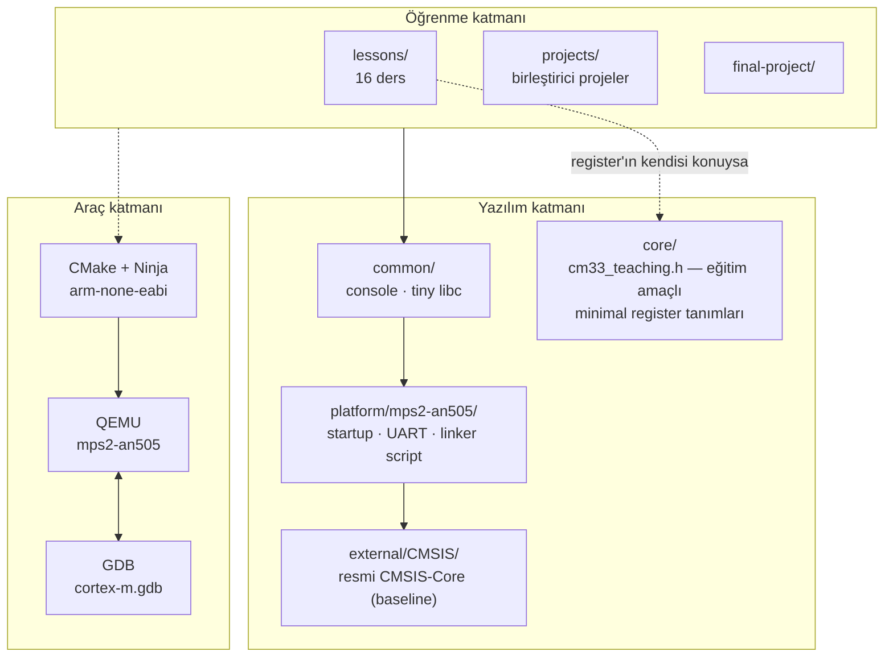

# ARM Cortex-M — Practical Learning Lab

Cortex-M33 mimarisini **çalıştırarak, debug ederek ve bilerek bozarak**
öğrenmek için kurulmuş bir laboratuvar. Her konu QEMU'da çalışan bir
firmware'e ve GDB'de gözlemlenebilir bir davranışa karşılık gelir.

Fiziksel geliştirme kartı gerekmez. Target: **Cortex-M33 / QEMU `mps2-an505`**.

---

## Bu repo ne?

Üç şey aynı anda:

1. **Kişisel Cortex-M laboratuvarı** — her kavram için ölçülmüş, gözlemlenmiş
   bir deney.
2. **Uygulamalı eğitim kaynağı** — daha önce Cortex-M görmemiş bir geliştirici
   de takip edebilsin diye yazıldı.
3. **Portfolyo projesi** — "kurs izledim" değil, "çalıştım, bozdum, debug ettim".

Her ders şu döngüyü izler:

```text
TEACH → SHOW → RUN → OBSERVE → MODIFY → BREAK → DEBUG → VERIFY
```

Yani bir konu sadece anlatılmaz: çalıştırılır, debugger'da görülür,
kontrollü şekilde bozulur ve hata teşhis edilir.

---

## Ne öğretiyor?

| Alan | Konular |
|---|---|
| **Mimari** | Programmer model, register'lar, MSP/PSP, Thread/Handler Mode, privilege, CONTROL |
| **Koruma** | MPU, SVC, privileged/unprivileged ayrımı, TrustZone |
| **Exception** | Vector table, NVIC, hardware stacking, EXC_RETURN, fault'lar ve escalation |
| **Build** | Compiler, optimizasyon, AAPCS, linker script, ELF, map file, startup |
| **Debug** | GDB ile teşhis akışı, disassembly, watchpoint, fault analizi |
| **Gerçek zamanlı** | SysTick, PendSV, context switching, eğitim amaçlı mini kernel |

---

## Mimari



Katmanların neden böyle ayrıldığı: [`docs/ARCHITECTURE.md`](docs/ARCHITECTURE.md)

---

## Başlarken

### 1. Ortamı kontrol et

```powershell
.\scripts\check-environment.ps1     # Windows
```

```bash
./scripts/check-environment.sh      # Linux / macOS / WSL
```

Eksik varsa: [`docs/ENVIRONMENT.md`](docs/ENVIRONMENT.md)

Gerekenler: Arm GNU Toolchain (`arm-none-eabi`), CMake, Ninja, QEMU, GDB.

### 2. Build et

```bash
cmake --preset debug
cmake --build --preset debug
```

### 3. Çalıştır

```bash
./scripts/run-qemu.sh build/debug/lessons/02-programmer-model/02-programmer-model.elf
```

Çıkış: `Ctrl-A` sonra `X`.

### 4. Debug et

```bash
# Terminal 1
./scripts/debug-qemu.sh build/debug/lessons/02-programmer-model/02-programmer-model.elf

# Terminal 2
arm-none-eabi-gdb -x scripts/gdb/cortex-m.gdb \
    build/debug/lessons/02-programmer-model/02-programmer-model.elf
(gdb) cm-connect
(gdb) cm-regs
```

### 5. Nereden başlamalı?

**[`BOOTCAMP.md`](BOOTCAMP.md)** — günlük çalışma ekranın.
İlk ders: [`lessons/01-cortex-m-family/`](lessons/01-cortex-m-family/) — kod
yazmadan, hedefin kendini nasıl tanıttığını okuyarak başlar.
Ardından [`lessons/02-programmer-model/`](lessons/02-programmer-model/).

Günlük plan: [BOOTCAMP.md](BOOTCAMP.md) — giriş noktası orasıdır ve
`lessons/01` ile başlar.

---

## Target

| | |
|---|---|
| İşlemci | Cortex-M33 (Armv8-M Mainline, TrustZone + DSP + FPU) |
| Platform | QEMU `mps2-an505` (Arm Application Note AN505 / IoT Kit) |
| Kod bölgesi | `0x10000000` (Secure alias), 512 KB |
| RAM | `0x30000000` (Secure alias), 32 KB |
| Konsol | CMSDK APB UART0 @ `0x50200000` |
| Doğrulanan MPU | 8 bölge (ölçüldü) |
| Doğrulanan SAU | 8 bölge (ölçüldü) |

**Simülatör gerçek silikon değildir.** Neyin çalıştığı, neyin çalışmadığı
tahmin edilmeden ölçülüp yazıldı:

- [`docs/TARGET_CAPABILITIES.md`](docs/TARGET_CAPABILITIES.md) — ölçülmüş capability matrisi
- [`docs/LIMITATIONS.md`](docs/LIMITATIONS.md) — simülatör ile donanım farkları

En önemli sınır: **DWT cycle counter bu target'ta saymıyor** (ölçüldü).
Profiling dersi bunu gizlemek yerine alternatif ölçülere geçer.

---

## Progress

Durum gerçek. Tamamlanmayan hiçbir şeye ✅ konmadı.

```text
Altyapı
✅ Build sistemi (CMake + Ninja + arm-none-eabi)
✅ MPS2-AN505 platform portu (startup, linker script, UART)
✅ QEMU'da çalışan firmware
✅ GDB bağlantısı + Cortex-M yardımcı komutları
✅ Target capability probe (ölçülmüş)
✅ Dokümantasyon temeli

Foundation
✅ Cortex-M family & processor selection
✅ Programmer model & registers
⬜ C ↔ Assembly
⬜ Stack / MSP / PSP

Architecture
⬜ Privilege & SVC
⬜ MPU
⬜ Exceptions & NVIC
⬜ Faults & fault analyzer

Software Development
⬜ Compiler & AAPCS
⬜ Linker / ELF / memory layout
⬜ Startup from scratch
⬜ Debugging & DWT

Advanced
⬜ Synchronization / FPU / DSP
⬜ SysTick & PendSV
⬜ Mini kernel & context switching
⬜ TrustZone & advanced features

Projects
⬜ Protected Application
⬜ Fault Analyzer
⬜ From Reset to Main
⬜ Performance Profiler
⬜ Educational Mini Kernel
⬜ Final Project
```

Ayrıntılı takip: [`docs/PROGRESS.md`](docs/PROGRESS.md)

---

## Major Projects

Dersler ilerledikçe birleşen büyük işler — her biri kendi README'sine sahip:

| Proje | Birleştirdiği konular | Durum |
|---|---|---|
| [Protected Application](projects/protected-application/) | PSP + unprivileged Thread Mode + MPU + SVC + fault handling | Planlandı |
| [Fault Analyzer](projects/fault-analyzer/) | Exception frame decode + CFSR/HFSR analizi | Planlandı |
| [From Reset to Main](projects/from-reset-to-main/) | Vector table + startup + linker script | Planlandı |
| [Performance Profiler](projects/performance-profiler/) | Ölçüm metodolojisi + compiler optimizasyonu | Planlandı |
| [Mini Kernel](projects/mini-kernel/) | SysTick + PendSV + SVC + context switch | Planlandı |
| [Final Project](final-project/) | Hepsinin entegrasyonu | Planlandı |

---

## Repo yapısı

```text
lessons/        16 ders — her biri kendi başına anlaşılır
projects/       birden fazla dersi birleştiren projeler
final-project/  specialization sonu entegrasyon
external/       vendored CMSIS-Core (Arm, Apache-2.0) — baseline core API
core/           cm33_teaching.h — eğitim amaçlı minimal register tanımları
platform/       board'a özel kod: startup, UART, linker script
common/         console ve minimal libc parçaları
tools/          capability probe
cmake/          toolchain dosyası ve build yardımcıları
scripts/        environment check, QEMU, GDB
docs/           kalıcı referans belgeler
tests/          smoke test
.github/        CI workflow
.vscode/        build/run/debug task ve launch tanımları
```

---

## Dokümantasyon

| Belge | İçerik |
|---|---|
| [BOOTCAMP.md](BOOTCAMP.md) | 7 günlük çalışma planı ve kontrol listesi |
| [docs/ENVIRONMENT.md](docs/ENVIRONMENT.md) | Sıfırdan Windows kurulumu |
| [docs/ARCHITECTURE.md](docs/ARCHITECTURE.md) | Repo mimarisi ve tasarım gerekçeleri |
| [docs/MEMORY_MAP.md](docs/MEMORY_MAP.md) | Doğrulanmış bellek haritası |
| [docs/TARGET_CAPABILITIES.md](docs/TARGET_CAPABILITIES.md) | Ölçülmüş capability matrisi |
| [docs/DEBUGGING.md](docs/DEBUGGING.md) | Cortex-M teşhis akışları |
| [docs/LIMITATIONS.md](docs/LIMITATIONS.md) | Simülatör sınırları |
| [docs/PERFORMANCE_MEASUREMENT.md](docs/PERFORMANCE_MEASUREMENT.md) | Ölçüm metodolojisi |
| [docs/GLOSSARY.md](docs/GLOSSARY.md) | İngilizce terim + kısa Türkçe karşılık |
| [docs/COURSE_MAP.md](docs/COURSE_MAP.md) | Kurs konuları ↔ ders eşlemesi |
| [docs/ROADMAP.md](docs/ROADMAP.md) | Uzun vadeli plan |
| [docs/REAL_HARDWARE_MIGRATION.md](docs/REAL_HARDWARE_MIGRATION.md) | Board alınınca ne değişir |
| [docs/REFERENCES.md](docs/REFERENCES.md) | Resmi kaynaklar |
| [docs/TOOL_VERSIONS.md](docs/TOOL_VERSIONS.md) | Doğrulanan araç sürümleri |
| [docs/PROGRESS.md](docs/PROGRESS.md) | İlerleme tablosu |
| [external/README.md](external/README.md) | Vendored CMSIS-Core: sürüm ve güncelleme |
| [projects/README.md](projects/README.md) | Birleştirici projeler |
| [tests/README.md](tests/README.md) | Smoke test |

---

## Dil politikası

Kod, tanımlayıcılar ve dosya isimleri **İngilizce**. Anlatım ağırlıklı
**Türkçe**, teknik terimler İngilizce korunur ve ilk kullanımda kısa Türkçe
karşılığı verilir:

> `exception entry (istisnaya giriş)`, `callee-saved register (çağrılan
> fonksiyonun koruması gereken register)`

Amaç: hem konuyu hem de resmi dokümantasyonu okumak için gereken
İngilizce terminolojiyi öğrenmek.

---

## Özgünlük

Bu repo bir kurs kopyası değildir. Tüm açıklamalar, diyagramlar, kod ve
deneyler özgündür. Teknik iddialar resmi Arm / CMSIS / QEMU dokümantasyonuyla
doğrulanır; ölçülebilen her şey **gerçekten ölçülür**
([`docs/REFERENCES.md`](docs/REFERENCES.md)).

Çalıştırılmamış bir kodun çıktısı "gerçek çıktı" olarak sunulmaz.
Doğrulanmamış bilgi `OLCULMEDI` olarak işaretlenir.

---

## Lisans

MIT — bkz. [LICENSE](LICENSE).

`external/CMSIS/` altındaki dosyalar Arm'a aittir ve Apache-2.0 ile
lisanslıdır; kendi lisans metni korunur ([external/CMSIS/LICENSE](external/CMSIS/LICENSE)).
