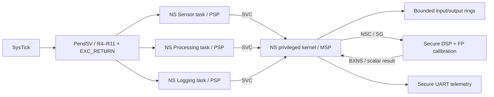

**Language:** English | [Türkçe](README.tr.md)

# Final — Secure Real-Time Sensor Node

**STATUS: on main; Debug/Release/MinSize CI PASS (11fde900)**

Working system: three unprivileged Non-secure tasks collect and process synthetic
sensor data and produce UART telemetry. The privileged Non-secure kernel manages
queues, the MPU, and task stacks. The Secure gateway offers only a limited scalar
calibration service. Here, “real-time” is an architectural subject of study;
a QEMU result is not a physical deadline or WCET guarantee.

## Architecture



- Sensor task: 32 ramp samples of 0..15; it does not write to a full queue.
- Processing task: an integer moving average of the last four samples; the Secure
  service computes 3*x with SMLAD, multiplies by 0.5 using the FPU, and truncates
  to produce the result.
- Logging task: consumes the output ring; triggers a scalar telemetry record every
  eight samples. The processed data is not calculated only for a separate demo check.
- Queue headers and history are in kernel-only RAM. A task has RW/XN access only
  to its own stack and RO/execute access to NS FLASH; other tasks' stacks are not open.
- The kernel checks the SVC opcode and task identity. Unknown ops are rejected;
  the application cannot request privileged stores through arbitrary pointers.
- PendSV uses the same assembly save/restore code as Lesson 15.
  The NS variant requires the exact EXC_RETURN=0xFFFFFFBC; contexts other than a
  basic same-state NS frame are not silently accepted. FP task context switching
  is not implemented.
- The FPU is used only inside the Secure service. NS CPACR/NSACR permissions are
  disabled. An integer-ABI assembly leaf preserves FPSCR and clears the S0/S1
  payload; S16–S31 are unused. A general-register-only Secure C hook restores the
  previous FPCA/SFPA state. The compiler generates CMSE gateway/return code.
  This limited Handler service is not a general-purpose Secure FP context manager.
- The same SAU/IDAU/MPC/NSC boot and linker partition as Lesson 16 are used.
  NS vectors/handlers are separate for the kernel; .data/.bss reset code is reused.

Secure/Non-secure separation and privileged/unprivileged separation are two
distinct boundaries. The calibration API accepts inputs in [0,15] only from the
NS SVC Handler context; a Thread-origin request returns L16_DENIED before any FP
instruction executes. This is a context access policy, not identity/cryptographic
authentication. The diagnostic channel accepts UART/completion commands only from
privileged NS Thread or Handler. The gateway caller flag is captured at the actual
CMSE entry; it is not inferred from an ordinary C helper's LR.
The integrity of Secure calibration code is isolated from NS memory errors.
Secret keys, signatures, MACs, secure boot, and remote attestation are not implemented.

## Build / run

```bash
cmake --preset debug
cmake --build --preset debug
python tests/system-smoke.py --group final
```

A single scenario requires two ELFs:

```bash
qemu-system-arm -M mps2-an505 -cpu cortex-m33 -nographic -monitor none -serial stdio \
  -kernel build/debug/final-project/secure-real-time-sensor-node/node-normal-secure.elf \
  -device loader,file=build/debug/final-project/secure-real-time-sensor-node/node-normal-nonsecure.elf
```

## Measured Debug results

In normal operation, PRODUCED=PROCESSED=LOGGED=32, FILTERED_SUM=298,
SECURE_PROCESS_CALLS=32. UART telemetry sequence/value pairs:
8/7, 16/19, 24/7, 32/19. The test recalculates the sliding-average/gain result
using an integer oracle independent of the firmware.

Measured values were Thread CONTROL=0x3 and Handler CONTROL=0x1. It would be wrong
to equate the SPSEL read in Handler with 0x3 in Thread; Handler privilege is not
derived from CONTROL. SVC return=0xFFFFFFBC; task stack guards and R4–R11 canaries PASS.
Tick/switch/iteration values vary with the model. MAX_MODEL_AGE is the SysTick
difference between sample production and logging; it checks a 16-tick
**model-local** budget. UART is included in this end-to-end latency;
this is not a cycle-benchmark measurement window.

## Negative firmware scenarios

Each runs with its own Secure/NS image pair:

- node-kernel-write: a task cannot write kernel data; MemManage, CFSR=0x82,
  correct MMFAR, HFSR=0. Kernel magic/stack guards are preserved.
- node-cross-task: a store into another task's stack is rejected in the same way.
- node-secure-read: NS **Thread** directly reads Secure RAM; SecureFault,
  SFSR.AUVIOL=1. If SFARVALID is clear, SFAR is not used as an address.
- node-stack-limit: an actual SP update crosses PSPLIM; STKOF,
  the frame is rejected as untrustworthy. Kernel MSP/guards remain intact.
- node-spin: a fourth background task loops indefinitely without yielding;
  while the timer preempts it, the three pipeline tasks finish 32 samples.
- node-bad-svc: an unknown op and a task's bootstrap SVC #1 request return NODE_ERROR.
  Unprivileged diagnostic/end requests have no effect; a direct FP service request
  is rejected. By making NS SysTick pending in a controlled way inside Secure
  Thread, the test verifies that PendSV returns without changing owner/token/PSP.
  Normal data flow and results remain unchanged.

These seven QEMU scenarios produced the expected results in Debug/Release/MinSize.
Fault tests do not provide automatic recovery in normal operation:
execution stops after the fault snapshot.

## Critical boundaries

The stack limit does not protect indirect STM; PendSV checks bounds before the
first store. Bootstrap does not return to the old main/MSP frame; it starts a new
task from the first synthetic frame. The scheduler updates MPU mappings in a short
masked section and restores the previous PRIMASK. MSP is 8-byte aligned at public
C call boundaries.

An NS IRQ can interrupt a Thread-origin Secure gateway. PendSV does not mistake
such a context for a task stack and save it: it returns to the same Secure call
using the original hardware EXC_RETURN, and a later tick/yield requests scheduling
again. GDB verifies that the owner, TCB SP, NS PSP/PSPLIM, and token remain unchanged
and that execution returns to the Secure continuation point. Secure calls must be
bounded; general TrustZone-aware task switching for long/infinite Secure operations
is not supported.

If SG has not yet executed, the interrupted context remains Non-secure; the
stacked PC can point to the NSC entry. In addition to normal NS flash, the scheduler
accepts only the two imported SG entry addresses. The Secure function body and
SG+4 are not accepted. The earlier panic at this boundary and its regression test
are described in the [internal audit record](../../docs/ENGINEERING_AUDIT.md).

Fault Analyzer supports same-state basic frames. FP/cross-security frames are not
guessed and dereferenced. SFSR/SFAR validity is reported for SecureFault; an
unexpected Secure HardFault stops with raw status and an explicit FAIL.

In QEMU 11.1.0, a separate Secure-read probe from an NS SVC Handler escalated to a
FORCED HardFault; this experiment cannot replace the Thread-origin test.
The final negative firmware tests an actual unprivileged Thread access.
This model observation is not generalized to all Cortex-M33 hardware.

In CI QEMU 8.2.2, accessing the NS SysTick alias from the Secure side causes a
BusFault due to the model's reentrancy-guard bug
([upstream fix](https://github.com/qemu/qemu/commit/4a934d284dfac9fa19b0f47874f12d9b3519c21c)).
The NS kernel stops its own timer during normal/fault termination; Secure reporting
does not repeat this through the alias. Terminal Secure paths mask interrupts and
do not return. This model bug does not mean the alias address is architecturally
invalid; runtime/fault expectations are not relaxed because of it.

Debugger/DMA, code injection/ROP, real boards, cryptographic identity, and production
RTOS reliability are outside this educational system's verified security scope.
DWT CYCCNT does not advance here; no performance/WCET result is fabricated.

## Combined quality gate

[System smoke](../../tests/system-smoke.py), the [GDB gate](../../tests/integration-check.py),
and existing lesson/probe tests passed on all three presets.
Raw evidence is stored under ignored build/<preset>/system-evidence.
GDB records separately show context save, MPU violations, and SecureFault transitions;
local checks are not presented as an independent third-party audit.

[Projects](../../projects/README.md) · [Roadmap](../../docs/ROADMAP.md)
