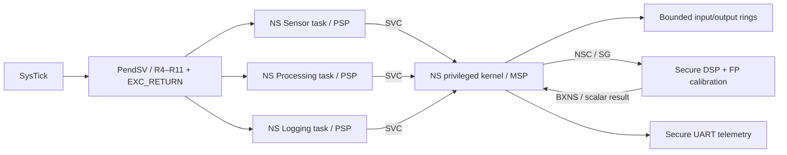

# Final — Secure Real-Time Sensor Node

**STATUS: Debug temel entegrasyon kapısı PASS; toplu kalite kapısı sürüyor.**

Çalışan sistem: üç unprivileged Non-secure task sentetik sensör verisini toplar,
işler ve UART telemetry üretir. Privileged Non-secure kernel queue'ları, MPU'yu
ve task stack'lerini yönetir. Secure gateway yalnız sınırlı scalar kalibrasyon
servisi sunar. Buradaki “real-time” bir mimari çalışma konusudur; QEMU sonucu
fiziksel deadline veya WCET garantisi değildir.

## Mimari



- Sensor task: 32 adet 0..15 ramp örneği; dolu queue'ya yazmaz.
- Processing task: son dört örneğin integer moving average'i; Secure servis
  SMLAD ile 3*x hesaplar, FPU ile 0.5 çarpar ve truncation ile sonuç üretir.
- Logging task: output ring'i tüketir; her sekiz örnekte bir scalar telemetry
  kaydı tetikler. İşlenen veri yalnız ayrı demo check'i için hesaplanmaz.
- Queue başlıkları ve geçmiş, kernel-only RAM'dedir. Task yalnız kendi stack'ine
  RW/XN ve NS FLASH'a RO/execute erişir; diğer task stack'leri açık değildir.
- SVC op kodu ve task kimliği kernel tarafından denetlenir. Unknown op reddedilir;
  uygulama keyfi pointer üzerinden privileged store yaptırmaz.
- PendSV, Lesson 15'in aynı ASM kaydet/geri-yükle kodunu kullanır.
  NS varyantı tam EXC_RETURN=0xFFFFFFBC ister; basic same-state NS frame dışında
  context sessizce kabul edilmez. FP task context switching uygulanmaz.
- FPU yalnız Secure servis içinde kullanılır. NS CPACR/NSACR izni kapalıdır.
  FPSCR çağıranın durumu korunur; S16–S31 kullanılmaz. CMSE dönüşünü derleyici üretir.
- Lesson 16'nın aynı SAU/IDAU/MPC/NSC boot'u ve linker bölümü kullanılır.
  NS vector/handler'ları kernel için ayrıdır; .data/.bss reset kodu yeniden kullanılır.

Secure/Non-secure ayrımı ile privileged/unprivileged ayrımı iki ayrı sınırdır.
NSC scalar API bütün NS çağıranlar için güvenli girdi sınırını uygular;
çağıranın kimliğini doğrulamaz. UART diagnostic kanalı da public scalar kanaldır.
Secure kalibrasyon kodunun bütünlüğü NS bellek hatalarından ayrılır. Gizli anahtar,
imza, MAC, secure boot veya uzaktan attestation uygulanmadı.

## Build / run

```bash
cmake --preset debug
cmake --build --preset debug
python tests/system-smoke.py --group final
```

Tek senaryo, iki ELF gerektirir:

```bash
qemu-system-arm -M mps2-an505 -cpu cortex-m33 -nographic -monitor none -serial stdio \
  -kernel build/debug/final-project/secure-real-time-sensor-node/node-normal-secure.elf \
  -device loader,file=build/debug/final-project/secure-real-time-sensor-node/node-normal-nonsecure.elf
```

## Ölçülen Debug sonuçları

Normal akışta PRODUCED=PROCESSED=LOGGED=32, FILTERED_SUM=298,
SECURE_PROCESS_CALLS=32. UART telemetry sıra/değer çiftleri:
8/7, 16/19, 24/7, 32/19. Test, sliding-average/gain sonucunu firmware'den
bağımsız integer oracle ile yeniden hesaplar.

Thread CONTROL=0x3, Handler CONTROL=0x1 ölçüldü. Handler içinde SPSEL okumasını
Thread'deki 0x3'e eşitlemek yanlış olur; Handler'ın privilege'i CONTROL'den
türetilmez. SVC return=0xFFFFFFBC; task stack guard'ları ve R4–R11 canary'leri PASS.
Tick/switch/iteration değerleri modele göre değişir. MAX_MODEL_AGE örnek üretimiyle
logging arasındaki SysTick farkıdır; 16 tick'lik **model-local** bütçe kontrolüdür.
UART bu uçtan uca gecikmenin içindedir; cycle benchmark ölçüm penceresi değildir.

## Negatif firmware'ler

Hepsi kendi Secure/NS imaj çiftiyle çalışır:

- node-kernel-write: task kernel verisine yazamaz; MemManage, CFSR=0x82,
  doğru MMFAR, HFSR=0. Kernel magic/stack guard'ları korunur.
- node-cross-task: başka task'ın stack'ine store aynı şekilde reddedilir.
- node-secure-read: NS **Thread** doğrudan Secure RAM okur; SecureFault,
  SFSR.AUVIOL=1. SFARVALID temizse SFAR adres diye kullanılmaz.
- node-stack-limit: gerçek SP güncellemesi PSPLIM'i aşar; STKOF,
  frame güvenilmez olarak reddedilir. Kernel MSP/guard'ları sağlam kalır.
- node-spin: dördüncü background task yield etmeden sonsuz döngüde kalır;
  timer onu preempt ederken üç pipeline task'ı 32 örneği bitirir.
- node-bad-svc: bilinmeyen SVC op kodları NODE_ERROR döndürür; normal veri
  akışı ve sonuç değişmez.

Bu yedi QEMU senaryosu Debug'da beklenen sonuçları verdi. Fault testleri normal
sistemde otomatik iyileşme sağlamaz: fault snapshot'ından sonra durulur.

## Kritik sınırlar

Stack limiti indirect STM'yi korumaz; PendSV ilk store'dan önce bounds kontrolü
yapar. Bootstrap eski main/MSP frame'ine dönmez; ilk sentetik frame'den yeni
task başlatır. Scheduler MPU mapping'ini kısa maskeli bölümde günceller, önceki
PRIMASK'ı geri getirir. Public C çağrı sınırında MSP 8-byte hizalıdır.

Fault Analyzer same-state basic frame'leri destekler. FP/cross-security frame
tahmin edilerek dereference edilmez. SecureFault için SFSR/SFAR validity
raporlanır; beklenmeyen Secure HardFault raw status ve açık FAIL ile durur.

QEMU 11.1.0'da NS SVC Handler içinden ayrı Secure-read probe'u FORCED
HardFault'a yükseldi; bu deneme Thread-origin testinin yerine kullanılamaz.
Final negatif firmware gerçek unprivileged Thread erişimini sınar.
Bu model gözlemi tüm Cortex-M33 donanımlarına genellenmez.

Debugger/DMA, code injection/ROP, gerçek kart, kriptografik kimlik ve üretim
RTOS güvenilirliği bu eğitim sisteminin doğrulanmış güvenlik kapsamı değildir.
DWT CYCCNT burada ilerlemez; performans/WCET sonucu uydurulmaz.

## Toplu kalite kapısı

[System smoke](../../tests/system-smoke.py), [GDB gate](../../tests/integration-check.py)
ve mevcut lesson/probe testleriyle üç preset üzerinde doğrulama yapılacak.
Ham kanıtlar ignored build/<preset>/system-evidence altında saklanır.
GDB kayıtları context save, MPU ihlali ve SecureFault geçişini ayrı gösterir;
yerel kontrol bağımsız üçüncü taraf audit diye sunulmaz.

[Projects](../../projects/README.md) · [Roadmap](../../docs/ROADMAP.md)
