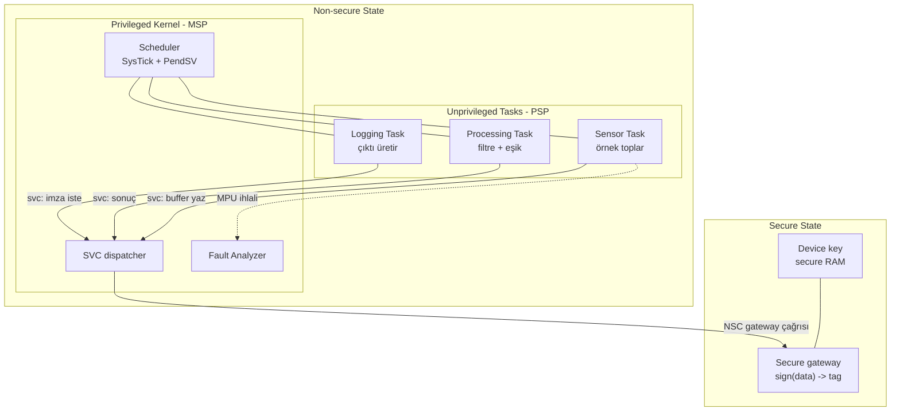

# Final Project — Secure Real-Time Sensor Node

**STATUS: planned** · Önkoşul: ders 01–16 ve `projects/` altındaki beş proje

---

## Senaryo

Bir cihaz, sensörden veri okuyor, işliyor ve bir dış kanala gönderiyor.
Cihazın içinde bir cihaz kimlik anahtarı var ve bu anahtar **hiçbir koşulda**
uygulama katmanına sızmamalı — uygulama kodunda bir bug olsa bile.

Bu senaryo yapay değil: güvenli IoT düğümlerinin, akıllı sayaçların ve
endüstriyel gateway'lerin temel şekli budur.

---

## Her özellik hangi probleme karşılık geliyor?

Bu tablo projenin en önemli kısmı. Karşılığı olmayan özellik projeye girmez.

| Özellik | Çözdüğü somut problem |
|---|---|
| TrustZone (SAU + secure gateway) | Uygulama kodundaki bir bug anahtarı okuyamasın |
| Privileged kernel / unprivileged task | Görev kodu doğrudan donanıma dokunamasın |
| MPU | Bir görevin bug'ı başka görevin verisini bozmasın |
| PSP / MSP ayrımı | Kernel stack'i görev stack taşmasından etkilenmesin |
| SVC | Görev ile kernel arasında **tek** kontrollü giriş noktası olsun |
| SysTick | Zamanlama kaynağı belirli ve tek olsun |
| PendSV | Switch, diğer tüm handler'lar bittikten sonra yapılsın |
| Fault Analyzer | Alanda oluşan crash teşhis edilebilir olsun |
| Profiler | Sensör okuma deadline'ını kaçırıp kaçırmadığını bilelim |
| DSP / FPU | Filtreleme bütçe içinde kalsın (hedef desteğine bağlı) |

---

## Architecture



Veri akışı:

```text
synthetic sensor  ->  ring buffer  ->  moving average / eşik
                                            |
                                            v
                                   secure sign()  ->  log çıktısı
```

---

## Doğrulanacak güvenlik iddiaları

Proje "çalışıyor" demek yetmez. Şunlar **deneyle** gösterilecek:

- [ ] Non-secure koddan secure RAM'e doğrudan okuma denemesi → SecureFault.
- [ ] Görev, kernel veri alanına yazmaya çalışınca → MemManage.
- [ ] Bir görev sonsuz döngüye girerse diğerleri çalışmaya devam ediyor.
- [ ] Görev stack taşması kernel stack'ini bozmuyor.
- [ ] Anahtar, uygulama katmanının erişebildiği hiçbir adres aralığında yok
      (map file + MPU/SAU konfigürasyonu ile gösterilecek).

---

## Hedef kısıtı — önceden bilinen

TrustZone'un tamamı QEMU mps2-an505 üzerinde denenemeyebilir. SAU'nun var
olduğu ölçüldü (`SAU_TYPE = 0x00000008`, 8 bölge), ancak secure/non-secure
ikili imaj akışı ders 16'da doğrulanacak. Desteklenmeyen bir parça çıkarsa
projede o parça:

```text
NOT SUPPORTED ON CURRENT TARGET
```

olarak işaretlenir, sahte çalıştırılmaz ve FVP / gerçek donanım geçiş yolu
[`docs/REAL_HARDWARE_MIGRATION.md`](../../docs/REAL_HARDWARE_MIGRATION.md)
içinde yazılır.

---

## Teslim kriteri

Projeyi bitirdiğinde README'sinde şunlar bulunmalı: mimari diyagram, gerçek
konsol çıktısı, en az üç GDB oturum kaydı (context switch, MPU ihlali,
secure erişim denemesi), ve bilinen sınırlamalar listesi.

---

[← final-project/](../README.md) · [Ders 16 — TrustZone](../../lessons/16-trustzone-advanced/README.md)
