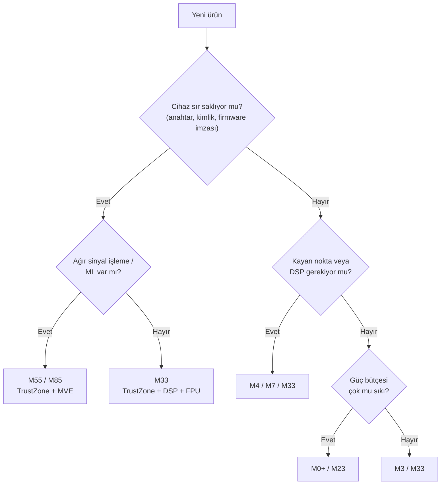

# Lesson 01 — Cortex-M Family & Processor Selection

`[QUICK]` · Day 1 · Tahmini süre: 25–35 dk

---

## Why This Matters

Bir ürün projesinde işlemci seçimi genelde **geri dönülmesi en pahalı**
karardır. Yanlış seçim, iki yıl sonra "bu işlemcide TrustZone yok, güvenlik
sertifikasyonundan geçemiyoruz" veya "DSP komutları yok, filtreyi
yetiştiremiyoruz" şeklinde geri döner.

Bu ders tablo ezberletmez. Amaç: birisi sana "neden M33 seçtin?" diye
sorduğunda **gerekçe** üretebilmek.

---

## Core Idea

Cortex-M ailesinde işlemciler birbirinin "daha hızlı" versiyonu değildir.
Farklı **mimari uzantılar** taşırlar. Seçim, ihtiyacın olan uzantıya göre yapılır.

| Uzantı | Ne sağlar | Nerede kritik |
|---|---|---|
| **TrustZone-M** (Security Extension) | Secure / Non-secure ayrımı, SAU | Sır saklayan, güncellenebilir, sertifikasyon gereken cihazlar |
| **DSP extension** | SIMD ve doygun (saturating) aritmetik komutları | Filtreleme, sensör füzyonu, ses |
| **FPU** | Donanımsal kayan nokta | Kontrol döngüleri, kinematik |
| **MVE / Helium** | M-profile vektör uzantısı | ML çıkarımı, ağır sinyal işleme |
| **MPU** | Bölge bazlı erişim denetimi | Task izolasyonu; ayrıcalıksız koda karşı koruma |
| **Cache** | Komut/veri önbelleği | Yüksek saat hızı + harici bellek |

Kabaca yerleşim:

```text
 güç / basitlik                                   performans / özellik
 <--------------------------------------------------------------->
 M0+          M23            M33            M55            M85
 minimal      minimal        Armv8-M        MVE'li          MVE + daha
 Armv6-M      + TrustZone    Mainline       M-profile       yüksek perf.
                             DSP+FPU
                             TrustZone
```

Bu bir "kalite sıralaması" değildir. Pil ömrü kritikse M0+/M23,
M85'ten **daha doğru** seçimdir.

---

## İki ayrı soru: mimari ne izin verir, silikon ne içerir

Bu dersin en kolay atlanan ama en pahalı yanlışı burada. İki farklı katman var
ve karıştırılırsa datasheet okurken yanlış karar verirsin.

**1. Architecture support (mimari destek).** Armv8-M Mainline, Cortex-M33'ün
uyguladığı mimaridir. Mimari, hangi uzantıların *var olabileceğini* tanımlar:
Security Extension, Floating-point Extension, DSP Extension, Debug Extension.

**2. Implementation configuration (uygulama konfigürasyonu).** Çip üreticisi
işlemci çekirdeğini sentezlerken bu uzantıların her birini **açıp
kapatabilir**. Arm'ın Cortex-M33 Integration and Implementation Manual'ında
bunlar açık parametrelerdir: `FPU`, `DSP`, `SECEXT`, `MPU_S`, `MPU_NS`, `CPIF`
ve benzerleri.

Arm'ın Cortex-M33 Technical Reference Manual'ının kendi ifadesiyle: işlemci
Armv8-M'i Main Extension ile uygular ve Security, Floating-point, DSP ve Debug
uzantılarının **her biri için opsiyonel destek** sunar. Aynı belge MPU_NS, WIC,
CTI ve FPU'nun **her zaman opsiyonel** olduğunu, MPU_S'in Security Extension
varsa opsiyonel olduğunu, SAU'nun ise Security Extension varsa dahil edildiğini
söyler.

Pratikte bunun anlamı:

> **"Cortex-M33 seçtim, demek ki FPU'm ve TrustZone'um var" cümlesi yanlıştır.**
> Belirli bir MCU'da ne olduğunu üreticinin datasheet'i söyler — ve son sözü
> silikonun kendisi söyler.

| Özellik | Armv8-M Mainline / M33'te | Belirli bir MCU'da |
|---|---|---|
| Security Extension (TrustZone, SAU) | opsiyonel | olabilir de olmayabilir de |
| FPU | opsiyonel | olabilir de olmayabilir de |
| DSP extension | opsiyonel | olabilir de olmayabilir de |
| MPU (secure/non-secure) | opsiyonel, bölge sayısı konfigüre edilir | 0, 4, 8 … 16 bölge |
| Main Extension | zorunlu | her M33'te var |

Bu yüzden bu repoda hiçbir capability tahmin edilmez. Aşağıda gördüğün her
değer, **çalıştırılarak ID register'larından okundu**.

---

## Mental Model

İşlemci seçimini **araç seçimi** gibi düşün:

- Şehir içi kurye → küçük motosiklet (M0+): ucuz, az yakar, yeterli.
- Kıymetli yük taşıyan araç → kasası kilitli kamyonet (M23/M33): TrustZone.
- Sürekli hesap yapan mühendislik aracı → güçlü motor + özel ekipman
  (M55/M85): MVE/DSP.

Kimse şehir içi kuryeye tır vermez. Fazla özellik = fazla maliyet,
fazla güç tüketimi, fazla karmaşıklık, bazen fazla sertifikasyon yükü.

---

## Visual



Bu diyagram bir **başlangıç noktasıdır**, kural kitabı değil. Gerçek
kararda tedarik, fiyat, ekosistem ve sertifikasyon da tartıya girer.

---

## Üç senaryo — gerekçe üret

Her senaryoda tek doğru cevap aramıyoruz. **Trade-off** yazıyoruz.

> Referans tartışmalar burada değil:
> [`answers/reference-answers.md`](answers/reference-answers.md).
> Önce kendi gerekçeni yaz — sonra karşılaştır. Farklı seçim yaptıysan ve
> gerekçen sağlamsa cevabın doğrudur.

### Senaryo A — Secure Smart Lock

Kapı kilidi. Telefonla açılıyor, OTA firmware güncellemesi alıyor,
içinde kriptografik anahtar barındırıyor. Pil ile çalışıyor.

Belirleyici baskılar:

- Anahtar, uygulama kodundan **izole** olmalı. Uygulamada bir buffer overflow
  anahtarı sızdırmamalı.
- OTA güncelleme → imza doğrulama → güvenli bootloader.
- Ağır matematik yok; radyo ve GPIO işi.
- Pil ömrü önemli.

Düşünmen gerekenler:

- TrustZone burada "güzel olurdu" değil, **gereklilik** mi?
- M23 (TrustZone var, DSP/FPU yok) yeterli mi, yoksa kripto hızlandırma
  ve daha yüksek performans için M33 mü?
- TrustZone olmadan MPU + dikkatli mimari ile aynı izolasyon sağlanabilir mi?
  Sağlanırsa **neyi kaybedersin**?

### Senaryo B — Low-Power Wearable

Bileklik. İvmeölçerden adım sayıyor, BLE ile telefona gönderiyor.
Küçük pil, aylarca çalışması bekleniyor.

Belirleyici baskılar:

- Güç tüketimi her şeyin önünde.
- Basit sinyal işleme (eşikleme, ortalama, belki basit filtre).
- Maliyet hassasiyeti yüksek — milyonlarca adet.

Düşünmen gerekenler:

- Adım sayma gerçekten FPU istiyor mu, yoksa sabit noktalı aritmetik
  (fixed-point) yeter mi?
- FPU eklemek güç bütçesine ne yapar?
- M0+ seçersen yazılım tarafında ne **kaybedersin** (MPU seçilen parçada
  olmayabilir, atomik
  işlemler sınırlı, debug imkânları daha az)?
- Ürün 2 yıl sonra "sağlık verisi" saklamaya başlarsa TrustZone'suzluk
  seni nereye sıkıştırır?

### Senaryo C — Robotics / Signal Processing Node

Robot eklem kontrolcüsü. IMU'dan yüksek hızda veri okuyor, sensör füzyonu
yapıyor, kontrol döngüsünü sabit periyotta çalıştırıyor, CAN üzerinden
haberleşiyor.

Belirleyici baskılar:

- Sert gerçek zamanlı kısıt: kontrol döngüsü **asla** geç kalamaz.
- Kayan noktalı matematik yoğun (kinematik, filtre).
- Deterministik gecikme, ortalama hızdan daha önemli.

Düşünmen gerekenler:

- FPU burada tartışmasız mı? Sabit noktalı kodla mı çıkardın?
- **Cache'li** bir işlemci (M7) daha hızlıdır ama cache determinizmi bozar.
  Sert gerçek zamanlı sistemde bu iyi mi kötü mü?
- MVE gerçekten gerekli mi, yoksa DSP komutları yetiyor mu?
- Güvenlik ihtiyacı var mı? Robot ağa bağlıysa cevap değişir mi?

---

## Build & Run

Bu derste yazacağın firmware yok — ama üstünde çalışacağın işlemcinin
**kendini nasıl tanıttığını** görmen faydalı. Yukarıdaki ayrımın pratik
karşılığı tam olarak budur: mimari ne izin veriyor sorusunu belgeden,
bu silikonda ne var sorusunu **register'dan** öğrenirsin.

```bash
cmake --preset debug
cmake --build --preset debug --target capability-probe
./scripts/run-qemu.sh build/debug/tools/capability-probe/capability-probe.elf
```

---

## Expected Output

Gerçek çıktı (kısaltılmış):

```text
===== TARGET CAPABILITY PROBE =====
[CPUID] 0x410FD213
[CPUID.PARTNO] 0x00000D21
[MPU_REGIONS] 8
[SAU_REGIONS] 8
[MVFR1.MVE] 0x00000000
[DWT_CYCCNT_COUNTING] NO
===== PROBE COMPLETE =====
```

Bu çıktı **bizim hedefimize aittir**: QEMU 8.2.2, `-M mps2-an505
-cpu cortex-m33`. Başka bir M33 MCU'da bu değerlerin bir kısmı farklı çıkar —
ve farklı çıkması bir hata değil, konfigürasyon farkıdır.

Okuması:

- `PARTNO = 0xD21` → Cortex-M33.
- `MPU_REGIONS = 8` → 8 bölgelik MPU var. Ders 06'da bunları kullanacağız.
- `SAU_REGIONS = 8` → SAU var → **TrustZone mevcut**. Ders 16.
- `MVFR1.MVE = 0` → MVE yok. Bu bir eksiklik değil: **MVE (Helium),
  Armv8.1-M ile gelen bir uzantıdır ve Cortex-M33'ün uyguladığı Armv8-M
  Mainline'da yoktur.** Yani bu, konfigürasyonla açılabilecek bir şey değil;
  mimari sınırdır. MVE istiyorsan M55/M85'e geçmen gerekir — işlemci
  seçiminin somut sonucu tam olarak budur.

  Bu iki durumu ayırt etmeyi öğren: `MPU_REGIONS = 0` görsen bu
  **konfigürasyon** kararı olurdu (başka bir M33'te 8 çıkabilirdi).
  `MVE = 0` ise **mimari** gerçek; hiçbir M33'te 1 çıkmaz.
- `DWT_CYCCNT_COUNTING = NO` → bu simülatörde cycle sayacı çalışmıyor
  (`docs/TARGET_CAPABILITIES.md`).

Tam matris: [`docs/TARGET_CAPABILITIES.md`](../../docs/TARGET_CAPABILITIES.md)

---

## Observe in GDB

Seri çıktı, firmware'in **sana anlattığı** şeydir. Aynı bilgiyi debugger ile
doğrudan okumak, aradaki kodu ortadan kaldırır: işlemciye kendin sorarsın.

Terminal 1 — QEMU'yu durdurulmuş halde başlat:

```bash
cmake --build --preset debug --target debug-capability-probe
```

Terminal 2 — bağlan ve üç register'ı oku:

```bash
gdb-multiarch -q build/debug/tools/capability-probe/capability-probe.elf
```

```gdb
set architecture armv8-m.main
target remote :3333
printf "CPUID    = 0x%08X\n", *(unsigned int*)0xE000ED00
printf "MPU_TYPE = 0x%08X\n", *(unsigned int*)0xE000ED90
printf "SAU_TYPE = 0x%08X\n", *(unsigned int*)0xE000EDD4
```

Gerçek çıktı (bu repoda ölçüldü):

```text
CPUID    = 0x410FD213
MPU_TYPE = 0x00000800
SAU_TYPE = 0x00000008
```

Dikkat: firmware'in **tek bir komutu bile çalışmadan** bu değerleri okuduk.
Çünkü bunlar yazılımın kurduğu bir şey değil, silikonun sabit kimliği.

> `SAU_TYPE` neden `0xE000EDD4`? SAU bloğu `0xE000EDD0`'da başlar, ama ilk
> register `SAU_CTRL`'dür; `SAU_TYPE` ikinci sıradadır (+0x04). Bu offset'i
> karıştırmak sessizce yanlış cevap verir — bu repoda tam olarak bu hata bir
> kez yapıldı ve ölçüm 8 yerine 0 gösterdi.

---

## Exercise

**Exercise 01 — Kendi kararını yaz.**

Üç senaryo için birer paragraf yaz. Format:

```text
Senaryo: ...
Seçim: ...
Birincil gerekçe: ...
Neyi feda ettim: ...
Bu seçim 2 yıl sonra hangi durumda pişmanlık olur: ...
```

Son satır en önemlisi. İşlemci seçimini zorlaştıran şey bugünkü gereksinim
değil, **ürünün ileride nereye gideceğidir**.

---

## Experiment

**Deney 1 — ID register'larından okumayı öğren.**

`capability-probe` çıktısındaki `MPU_TYPE` değerine bak. `0x00000800`.
Bit 15:8 alanını çıkar. Neden 8 çıkıyor? Aynı mantıkla `SAU_TYPE = 0x8`
değerini yorumla.

**Deney 2 — Karşılaştır.**

```bash
qemu-system-arm -cpu help | grep cortex-m
```

Bu QEMU hangi Cortex-M çekirdeklerini modelliyor? Listede olmayan hangi
üyeler var ve bu senin öğrenme planını nasıl sınırlıyor?
(İpucu: `docs/TARGET_CAPABILITIES.md` içindeki M85 satırı.)

Bu makinede ölçülen liste:

```text
cortex-m0  cortex-m3  cortex-m4  cortex-m7  cortex-m33  cortex-m55
```

Listede olmayanlara dikkat: M0+, M23, M35P, M85. Yani TrustZone'lu *Baseline*
(M23) davranışını bu kurulumda deneyemezsin — M33 üzerinden öğrenip farkı
belgeden okumak zorundasın.

---

## Reference Solution

Bu derste derlenecek kod yok; "çözüm" bir muhakeme metnidir.

Üç senaryonun referans tartışması ve Quick Check cevapları:
[`answers/reference-answers.md`](answers/reference-answers.md)

---

## What I Learned

> Bu bölüm senin.

**Üç senaryo için verdiğim kararlar:**

<!-- A: ... / B: ... / C: ... -->

**Değiştirmek zorunda kaldığım ilk varsayım:**

<!-- -->

**"Daha güçlü işlemci her zaman daha iyi" fikrine karşı argümanım:**

<!-- -->

---

## Quick Check

1. TrustZone ile MPU arasındaki fark nedir? İkisi birbirinin yerine geçer mi?

2. Bir cihazda FPU var ama firmware hiç kayan nokta kullanmıyor.
   Bu durumun somut maliyeti nedir?

3. `MVFR1.MVE = 0` okudun. Bu simülatörün eksikliği mi, işlemcinin özelliği mi?
   Nasıl ayırt edersin?

4. **(Reasoning)** Sert gerçek zamanlı bir kontrol döngüsü için M7 (cache'li,
   yüksek saat) ile M33 (cache'siz, daha düşük saat) arasında seçim yapıyorsun.
   Ortalama performans M7'de daha iyi. Hangi durumda **M33 daha doğru seçim**
   olur ve bunu nasıl ölçerek savunursun?

5. **(Reasoning)** Ekip "güvenlik lazım ama TrustZone'lu parça pahalı, MPU ile
   hallederiz" diyor. Bu argümanın hangi kısmı doğru, hangi kısmı tehlikeli?

> Cevaplar: [`answers/reference-answers.md`](answers/reference-answers.md)
> — kendi cevabını yazdıktan sonra aç.

---

## Takeaway

- Cortex-M üyeleri hız sıralaması değil, **farklı mimari uzantı kümeleridir**.
- Seçimi belirleyen şey genelde performans değil: **güvenlik, güç, determinizm.**
- **Mimari destek ile implementasyon konfigürasyonu ayrı şeylerdir.**
  "M33 aldım, FPU'm ve TrustZone'um var" demek yanlıştır; ikisi de opsiyoneldir.
- İşlemcinin ne desteklediği tahmin edilmez — **ID register'larından okunur**
  (`CPUID`, `MPU_TYPE`, `SAU_TYPE`, `MVFR*`).
- Doğru soru "hangisi daha iyi" değil, **"neyi feda ediyorum"**.

---

## References

- Cortex-M33 Devices Generic User Guide (Arm 100235) — CPUID Base Register
- Cortex-M33 Technical Reference Manual — opsiyonel uzantılar (Security,
  Floating-point, DSP, Debug); MPU_NS/WIC/CTI/FPU'nun her zaman opsiyonel
  olması, SAU'nun Security Extension ile birlikte gelmesi
- Cortex-M33 Integration and Implementation Manual — `FPU`, `DSP`, `SECEXT`,
  `MPU_S`, `MPU_NS` konfigürasyon parametreleri
- Armv8-M Architecture Reference Manual (Arm DDI 0553) — Security Extension,
  MPU, ID register tanımları
- Arm Cortex-M karşılaştırma sayfaları — <https://developer.arm.com/Processors>
- `docs/TARGET_CAPABILITIES.md` — bu repodaki ölçülmüş capability matrisi

---

**Previous:** [BOOTCAMP](../../BOOTCAMP.md)
**Next:** [02 — Programmer Model & Registers](../02-programmer-model/)
