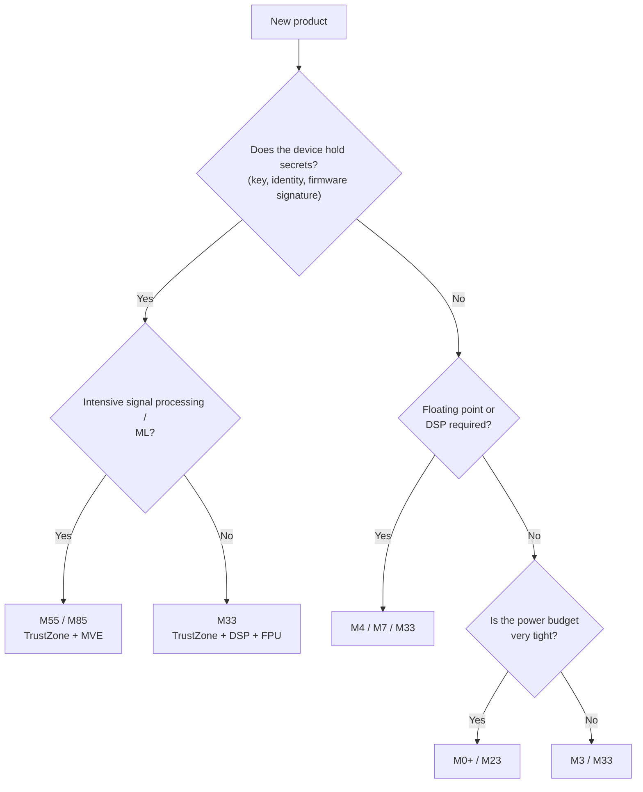

**Language:** English | [Türkçe](README.tr.md)

# Lesson 01 — Cortex-M Family & Processor Selection

`[QUICK]` · Day 1 · Estimated time: 25–35 min

---

## Why This Matters

In a product project, processor selection is usually the **most expensive decision
to reverse**. A poor choice comes back two years later as "this processor has no
TrustZone; we cannot pass security certification" or "there are no DSP instructions;
we cannot finish the filter in time."

The goal of this lesson is to justify a processor choice using product requirements.

---

## Core Idea

Members of the Cortex-M family are not simply "faster" versions of each other.
They carry different **architectural extensions**. Choose according to the extension
you need.

| Extension | What it provides | Where it matters |
|---|---|---|
| **TrustZone-M** (Security Extension) | Secure / Non-secure separation, SAU | Devices holding secrets, supporting updates, or requiring certification |
| **DSP extension** | SIMD and saturating arithmetic instructions | Filtering, sensor fusion, audio |
| **FPU** | Hardware floating point | Control loops, kinematics |
| **MVE / Helium** | M-profile vector extension | ML inference, intensive signal processing |
| **MPU** | Region-based access control | Task isolation; protection against unprivileged code |
| **Cache** | Instruction/data cache | High clock rates + external memory |

Rough positioning:

```text
 power / simplicity                              performance / features
 <--------------------------------------------------------------->
 M0+          M23            M33            M55            M85
 minimal      minimal        Armv8-M        M-profile      MVE + higher
 Armv6-M      + TrustZone    Mainline       with MVE       performance
                             DSP+FPU
                             TrustZone
```

This is not a "quality ranking." If battery life is critical, M0+/M23 is a
**better fit** than M85.

---

## Two separate questions: what the architecture allows and what the silicon contains

Here lies the easiest mistake to overlook in this lesson, and the most expensive.
There are two different layers; confusing them leads to wrong decisions when
reading datasheets.

**1. Architecture support.** Armv8-M Mainline is the architecture implemented by
Cortex-M33. The architecture defines which extensions *can exist*: Security
Extension, Floating-point Extension, DSP Extension, Debug Extension.

**2. Implementation configuration.** When synthesizing the processor core, the
chip manufacturer can **enable or disable** each extension. These are explicit
parameters in Arm's Cortex-M33 Integration and Implementation Manual: `FPU`, `DSP`,
`SECEXT`, `MPU_S`, `MPU_NS`, `CPIF`, and others.

As described by Arm's Cortex-M33 Technical Reference Manual, the processor
implements Armv8-M with the Main Extension and offers **optional support for each**
of the Security, Floating-point, DSP, and Debug extensions. The same document says
MPU_NS, WIC, CTI, and FPU are **always optional**, MPU_S is optional when the Security
Extension is present, and the SAU is included when the Security Extension is present.

In practice, this means:

> **"I chose Cortex-M33, so I have an FPU and TrustZone" is incorrect.**
> The manufacturer's datasheet tells you what is in a particular MCU — and the
> silicon itself has the final say.

| Feature | In Armv8-M Mainline / M33 | In a particular MCU |
|---|---|---|
| Security Extension (TrustZone, SAU) | optional | may or may not be present |
| FPU | optional | may or may not be present |
| DSP extension | optional | may or may not be present |
| MPU (secure/non-secure) | optional, configurable region count | 0, 4, 8 … 16 regions |
| Main Extension | mandatory | present in every M33 |

This is why no capability is guessed in this repository. Every value below was
**read from ID registers by running the firmware**.

---

## Mental Model

Think of processor selection as **choosing a vehicle**:

- Urban courier → small motorcycle (M0+): inexpensive, economical, sufficient.
- Vehicle carrying valuables → van with a locked cargo compartment (M23/M33): TrustZone.
- Engineering vehicle doing continuous calculations → powerful engine + specialized
  equipment (M55/M85): MVE/DSP.

Nobody gives an urban courier a heavy truck. More features mean more cost, power,
complexity, and sometimes more certification work.

---

## Visual



This diagram is a **starting point**, not a rulebook. Supply, price, ecosystem,
and certification also weigh into a real decision.

---

## Three scenarios — develop a justification

We are not looking for one correct answer per scenario. We are writing **trade-offs**.

> The reference discussions are not here:
> [`answers/reference-answers.md`](answers/reference-answers.md).
> Write your own justification first, then compare. A different choice is correct
> if its justification is sound.

### Scenario A — Secure Smart Lock

A door lock. It opens via a phone, receives OTA firmware updates, and holds a
cryptographic key. It runs on a battery.

Decisive pressures:

- The key must be **isolated** from application code. A buffer overflow in the
  application must not leak the key.
- OTA update → signature verification → secure bootloader.
- No heavy mathematics; radio and GPIO work.
- Battery life matters.

Questions to consider:

- Is TrustZone a **requirement** here, rather than "nice to have"?
- Is M23 (TrustZone, no DSP/FPU) sufficient, or is M33 needed for crypto acceleration
  and higher performance?
- Can MPU + careful architecture provide the same isolation without TrustZone?
  If so, **what do you lose**?

### Scenario B — Low-Power Wearable

A wristband. It counts steps from accelerometer data and sends them to a phone
over BLE. A small battery is expected to last for months.

Decisive pressures:

- Power consumption comes before everything else.
- Simple signal processing (thresholding, averaging, perhaps a simple filter).
- High cost sensitivity — millions of units.

Questions to consider:

- Does step counting really require an FPU, or is fixed-point arithmetic sufficient?
- What does adding an FPU do to the power budget?
- What do you **lose** in software by choosing M0+ (the selected part may lack an
  MPU, atomic operations are limited, fewer debug facilities)?
- If the product starts storing "health data" in 2 years, where does the absence
  of TrustZone leave you?

### Scenario C — Robotics / Signal Processing Node

A robot joint controller. It reads high-rate IMU data, performs sensor fusion,
runs a control loop at a fixed period, and communicates over CAN.

Decisive pressures:

- Hard real-time constraint: the control loop must **never** be late.
- Heavy floating-point mathematics (kinematics, filtering).
- Deterministic latency matters more than average speed.

Questions to consider:

- Is an FPU beyond debate here? Could you accomplish it with fixed-point code?
- A processor **with cache** (M7) is faster, but cache harms determinism.
  Is that good or bad in a hard real-time system?
- Is MVE actually necessary, or are DSP instructions sufficient?
- Is security required? Does the answer change if the robot is network-connected?

---

## Build & Run

There is no firmware to write in this lesson, but seeing **how the processor
identifies itself** is useful. This is exactly the practical meaning of the
distinction above: documentation tells you what the architecture permits;
**registers** tell you what is present in this silicon.

```bash
cmake --preset debug
cmake --build --preset debug --target capability-probe
./scripts/run-qemu.sh build/debug/tools/capability-probe/capability-probe.elf
```

---

## Expected Output

Actual output (abbreviated):

```text
===== TARGET CAPABILITY PROBE =====
[CPUID] 0x410FD213
[CPUID.PARTNO] 0x00000D21
[MPU_REGIONS] 8
[SAU_REGIONS] 8
[MVFR1.MVE] 0x00000000
[DWT_CYCCNT_COUNTING] NO
===== PROBE COMPLETE =====
```

This output belongs to **our target**: QEMU 8.2.2, `-M mps2-an505
-cpu cortex-m33`. Some values will differ on another M33 MCU — a difference is
not an error, but a configuration difference.

Reading it:

- `PARTNO = 0xD21` → Cortex-M33.
- `MPU_REGIONS = 8` → an 8-region MPU is present. We will use these in Lesson 06.
- `SAU_REGIONS = 8` → SAU present → **TrustZone is present**. Lesson 16.
- `MVFR1.MVE = 0` → no MVE. This is not a missing implementation feature:
  **MVE (Helium) is an extension introduced with Armv8.1-M and is absent from the
  Armv8-M Mainline architecture implemented by Cortex-M33.** It cannot be enabled
  through configuration; it is an architectural boundary. For MVE you must move
  to M55/M85 — precisely a concrete consequence of processor selection.

  Learn to distinguish the two cases: `MPU_REGIONS = 0` would be a
  **configuration** decision (another M33 could report 8).
  `MVE = 0` is an **architectural** fact; no M33 will report 1.
- `DWT_CYCCNT_COUNTING = NO` → the cycle counter does not work in this simulator
  (`docs/TARGET_CAPABILITIES.md`).

Full matrix: [`docs/TARGET_CAPABILITIES.md`](../../docs/TARGET_CAPABILITIES.md)

---

## Observe in GDB

Serial output is what the firmware **tells you**. Reading the same information
directly with a debugger removes the intervening code: you ask the processor yourself.

Terminal 1 — start QEMU halted:

```bash
cmake --build --preset debug --target debug-capability-probe
```

Terminal 2 — connect and read three registers:

```bash
gdb-multiarch -q build/debug/tools/capability-probe/capability-probe.elf
```

```gdb
set architecture armv8-m.main
target remote :3333
printf "CPUID    = 0x%08X\n", *(unsigned int*)0xE000ED00
printf "MPU_TYPE = 0x%08X\n", *(unsigned int*)0xE000ED90
printf "SAU_TYPE = 0x%08X\n", *(unsigned int*)0xE000EDD4
```

Actual output (measured in this repository):

```text
CPUID    = 0x410FD213
MPU_TYPE = 0x00000800
SAU_TYPE = 0x00000008
```

Notice that these values were read **before a single firmware instruction ran**.
They are not something software configured, but the silicon's fixed identity.

> Why is `SAU_TYPE` at `0xE000EDD4`? The SAU block starts at `0xE000EDD0`, but
> its first register is `SAU_CTRL`; `SAU_TYPE` is second (+0x04). Confusing this
> offset silently gives a wrong answer — exactly this mistake occurred once in
> this repository, and the measurement showed 0 instead of 8.

---

## Exercise

**Exercise 01 — Write your own decision.**

Write one paragraph for each of the three scenarios. Format:

```text
Scenario: ...
Choice: ...
Primary justification: ...
What I sacrificed: ...
Under what conditions would I regret this choice 2 years later: ...
```

The last line matters most. What makes processor selection difficult is not today's
requirement, but **where the product will go next**.

---

## Experiment

**Experiment 1 — Learn to read ID registers.**

Look at `MPU_TYPE` in the `capability-probe` output: `0x00000800`.
Extract bits 15:8. Why is the result 8? Apply the same reasoning to
`SAU_TYPE = 0x8`.

**Experiment 2 — Compare.**

```bash
qemu-system-arm -cpu help | grep cortex-m
```

Which Cortex-M cores does this QEMU model? Which family members are missing from
the list, and how does that limit your learning plan?
(Hint: the M85 row in `docs/TARGET_CAPABILITIES.md`.)

The list measured on this machine:

```text
cortex-m0  cortex-m3  cortex-m4  cortex-m7  cortex-m33  cortex-m55
```

Notice the missing members: M0+, M23, M35P, M85. You cannot experiment with
TrustZone-enabled *Baseline* (M23) behavior in this setup — you must learn through
M33 and read about the differences in the documentation.

---

## Reference Solution

There is no code to compile in this lesson; the "solution" is a reasoning text.

Reference discussions of the three scenarios and Quick Check answers:
[`answers/reference-answers.md`](answers/reference-answers.md)

---

## What I Learned

> This section is yours.

**My decisions for the three scenarios:**

<!-- A: ... / B: ... / C: ... -->

**The first assumption I had to change:**

<!-- -->

**My argument against "a more powerful processor is always better":**

<!-- -->

---

## Quick Check

1. What is the difference between TrustZone and the MPU? Can they replace each other?

2. A device has an FPU, but its firmware never uses floating point.
   What is the concrete cost?

3. You read `MVFR1.MVE = 0`. Is this a simulator limitation or a processor property?
   How do you distinguish them?

4. **(Reasoning)** For a hard real-time control loop, you are choosing between
   M7 (cache, high clock rate) and M33 (no cache, lower clock rate). M7 has better
   average performance. When is **M33 the better choice**, and how would you
   defend that choice through measurement?

5. **(Reasoning)** The team says, "we need security, but a TrustZone part is expensive;
   we will manage with the MPU." Which part is correct, and which is dangerous?

> Answers: [`answers/reference-answers.md`](answers/reference-answers.md)
> — open it after writing your own answer.

---

## Takeaway

- Cortex-M members are **different sets of architectural extensions**, not a speed ranking.
- The deciding factors are usually not performance: **security, power, determinism.**
- **Architecture support and implementation configuration are separate.**
  "I bought an M33, so I have an FPU and TrustZone" is wrong; both are optional.
- Processor capabilities are not guessed — they are **read from ID registers**
  (`CPUID`, `MPU_TYPE`, `SAU_TYPE`, `MVFR*`).
- The right question is not "which is better," but **"what am I giving up?"**

---

## References

- Cortex-M33 Devices Generic User Guide (Arm 100235) — CPUID Base Register
- Cortex-M33 Technical Reference Manual — optional extensions (Security,
  Floating-point, DSP, Debug); MPU_NS/WIC/CTI/FPU always being optional,
  SAU being included with the Security Extension
- Cortex-M33 Integration and Implementation Manual — `FPU`, `DSP`, `SECEXT`,
  `MPU_S`, `MPU_NS` configuration parameters
- Armv8-M Architecture Reference Manual (Arm DDI 0553) — Security Extension,
  MPU, ID register definitions
- Arm Cortex-M comparison pages — <https://developer.arm.com/Processors>
- `docs/TARGET_CAPABILITIES.md` — measured capability matrix in this repository

---

**Previous:** [BOOTCAMP](../../BOOTCAMP.md)
**Next:** [02 — Programmer Model & Registers](../02-programmer-model/)
