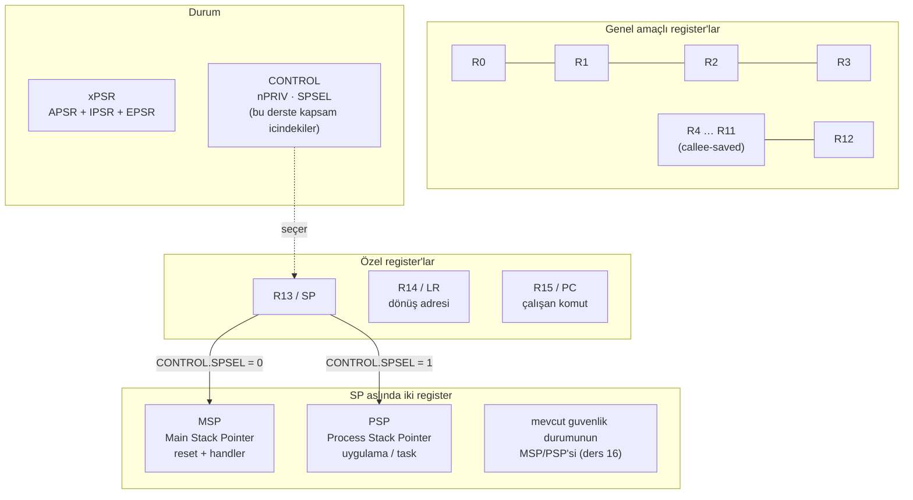

# Lesson 02 — Programmer Model & Registers

`[STANDARD]` · Day 1 · Tahmini sure: 45–60 dk

---

## Why This Matters

Bir Cortex-M firmware'i debug ederken elinde genelde iki sey olur:
**bir adres ve birkaç register değeri.** Başka hiçbir şey yok — `printf` yok,
log dosyası yok, bazen çalışan bir konsol bile yok.

`HardFault` aldığında sana sorulan soru şudur:

> PC neredeydi, hangi stack kullanılıyordu, işlemci hangi mod'daydı?

Bu üç soruya cevap veremiyorsan debug edemezsin. Programmer model
(programcı modeli) tam olarak bu soruların cevabının yaşadığı yerdir.
Bu ders repodaki diğer her şeyin temelidir: stack, exception, MPU, context
switch — hepsi bu register'lar üzerinden konuşur.

---

## Core Idea

Cortex-M33'ün yazılıma gösterdiği register kümesi küçüktür ve tamamı akılda
tutulabilir:

| Register | Ne işe yarar |
|---|---|
| **R0–R12** | Genel amaçlı. R0–R3 fonksiyon argümanları için kullanılır (AAPCS). |
| **R13 / SP** | Stack pointer. Aslında **iki tane** var: MSP ve PSP. Aktif olan biri SP olarak görünür. |
| **R14 / LR** | Link Register — fonksiyondan dönüş adresi. Exception içinde farklı bir anlam kazanır (EXC_RETURN). |
| **R15 / PC** | Program Counter — şu an çalışan komutun adresi. |
| **xPSR** | Program durumu: koşul bayrakları + çalışan exception numarası + Thumb biti. |
| **CONTROL** | Yürütme bağlamını seçen alanlar. Bu derste ikisi kapsam içinde: `nPRIV` (yetki seviyesi) ve `SPSEL` (hangi stack). Register'ın tamamı bu iki bitten ibaret **değildir**. |

Üç özel nokta, ilk bakışta şaşırtıcı olanlar:

1. **İki stack pointer vardır** (banked register — bölünmüş register).
   `MSP` ve `PSP` fiziksel olarak ayrı register'lardır. `SP` yazdığında
   hangisini gördüğünü `CONTROL.SPSEL` belirler.
2. **Mode, IPSR'den okunur.** `IPSR == 0` ise Thread Mode, değilse
   Handler Mode ve değer çalışan exception'ın numarasıdır.
3. **Thumb biti zorunludur.** Cortex-M yalnızca T32 (Thumb) komut setini
   çalıştırır. `xPSR`'deki T biti 0 olursa işlemci anında UsageFault üretir.
   Bu yüzden vector table'daki fonksiyon adreslerinin en düşük biti 1'dir.

---

## Mental Model

İşlemciyi bir **kontrol odası** gibi düşün:

- **R0–R12** → masanın üstündeki not kâğıtları. Hızlı, geçici, sürekli değişir.
- **PC** → "şu an neredeyim" tabelası.
- **LR** → "işim bitince nereye döneceğim" notu.
- **SP** → "not defterimin son sayfası" — defter yukarıdan aşağı doluyor.
- **xPSR** → son işlemin sonucunu gösteren durum lambaları (N, Z, C, V).
- **CONTROL** → odanın kapısındaki anahtarlık. Bu derste ikisini kullanıyoruz:
  *hangi yetkiyle çalışıyorum* (`nPRIV`) ve *hangi defteri kullanıyorum*
  (`SPSEL`). Anahtarlıkta başka anahtarlar da var — mimariye, FP bağlamına ve
  güvenlik uzantısına göre `FPCA` ve `SFPA` gibi alanlar (ders 13 ve 16).
  Bu yüzden `CONTROL` her zaman oku-değiştir-yaz ile güncellenir.

İki defter (MSP/PSP) olmasının sebebi: işletim sistemi/kernel kendi defterini
uygulamanınkinden ayırmak ister. Uygulama kendi defterini taşırsa kernel'in
defteri bozulmasın. Bu ayrım ders 04, 05 ve 15'in tamamının temelidir.

---

## Visual



xPSR'nin içi:

```text
 31  30  29  28  27        24                       8 7            0
+---+---+---+---+---+ ... +---+---------------------+---------------+
| N | Z | C | V | Q |     | T |   (bu derste atlandi)|  exception #  |
+---+---+---+---+---+ ... +---+---------------------+---------------+
 \_______________/         |                         \_____________/
       APSR                |                              IPSR
   koşul bayrakları        |                         0 = Thread Mode
                        T biti                       >0 = Handler Mode
                   her zaman 1 olmalı
```

İki uyarı:

- Ortadaki alan **"rezerve" değildir.** Armv8-M'de orada tanımlı alanlar
  vardır (örneğin `GE[3:0]` ve `ICI/IT` durum bitleri). Bu şemada yalnızca
  **atlanmışlardır**, çünkü bu dersin konusu değiller. "Bu derste kapsam
  dışı" ile "mimaride tanımsız" farklı şeylerdir.
- `CONTROL`'ün de yalnızca iki alanı yoktur. Armv8-M Main Extension'da
  `FPCA` (FP context active) ve Security Extension varsa `SFPA` gibi alanlar
  da bulunur. Bu derste **kapsam içindekiler** `nPRIV` (bit 0) ve `SPSEL`
  (bit 1); diğerlerini ders 13 ve 16'da göreceğiz. Bu yüzden `CONTROL`'ü
  daima oku-değiştir-yaz ile güncelle.

---

## Tiny Example

Ders firmware'i: [`example/main.c`](example/main.c) — eksiksiz çalışır, TODO içermez.

Kalbindeki fikir şu — mode/privilege/stack bilgisinin hepsi iki register'dan
okunur:

```c
uint32_t ipsr    = __get_IPSR();
uint32_t control = __get_CONTROL();

console_kv_str("MODE", (ipsr == 0U) ? "Thread Mode" : "Handler Mode");
console_kv_str("PRIVILEGE",    (control & 0x1U) ? "Unprivileged" : "Privileged");
console_kv_str("ACTIVE_STACK", (control & 0x2U) ? "PSP" : "MSP");
```

`__get_IPSR()` ve `__get_CONTROL()` sarmalayıcılarının nasıl çalıştığını
incelemek için bu derste resmi CMSIS yerine
`core/include/core/cm33_teaching.h` kullanıyoruz. Her biri tek satırlık
inline assembly içeriyor:

```c
static inline uint32_t __get_CONTROL(void)
{ uint32_t r; __asm volatile ("mrs %0, control" : "=r"(r)); return r; }
```

`MRS` (Move from Special Register) özel register'ları okumanın tek yoludur.
Normal `MOV` ile CONTROL okunamaz.

---

## Build & Run

```bash
cmake --preset debug
cmake --build --preset debug --target 02-programmer-model
./scripts/run-qemu.sh build/debug/lessons/02-programmer-model/02-programmer-model.elf
```

Windows:

```powershell
cmake --preset debug
cmake --build --preset debug --target 02-programmer-model
.\scripts\run-qemu.ps1 build\debug\lessons\02-programmer-model\02-programmer-model.elf
```

QEMU'dan çıkış: `Ctrl-A` sonra `X`.

---

## Expected Output

Gerçek çıktı (QEMU 8.2.2, mps2-an505, arm-none-eabi-gcc 13.2.1):

```text
===== LESSON 02: PROGRAMMER MODEL =====
[CPUID] 0x410FD213
[CPUID.PARTNO] 0x00000D21
[PROCESSOR] Cortex-M33
--- execution state ---
[MODE] Thread Mode
[IPSR] 0
[CONTROL] 0x00000000
[PRIVILEGE] Privileged
[ACTIVE_STACK] MSP
--- stack pointers ---
[MSP] 0x30007FE0
[PSP] 0x00000000
[LOCAL_VAR_ADDR] 0x30007FE4
--- pc / lr ---
[PC_APPROX] 0x10000186
[LEAF_RETURN_ADDR] 0x1000018F
--- xpsr flags ---
[APSR_AFTER_5_MINUS_5] 0x60000000
[APSR_AFTER_5_MINUS_7] 0x80000000
===== END =====
```

Şimdiden okunabilecek üç şey:

- `CONTROL = 0` **ve** `IPSR = 0` → reset'ten sonra **privileged Thread Mode**,
  **MSP** aktif. Modu belirleyen `IPSR`'dir; `CONTROL` tek başına Thread mi
  Handler mı olduğunu söylemez. Cortex-M böyle başlar; unprivileged olmak
  isteyen kod bunu bilerek yapar.
- `PSP = 0` → PSP'ye henüz kimse değer yazmadı. Reset'te tanımsızdır.
  Bu "boş" PSP ileride **Break It** bölümünde işimize yarayacak.
- `LOCAL_VAR_ADDR` `MSP` değerinin hemen yanında → yerel değişken
  aktif stack'in içinde bulunuyor.

APSR değerleri:

| İşlem | APSR | Anlamı |
|---|---|---|
| `5 - 5` | `0x60000000` | bit30 (Z) = 1, bit29 (C) = 1 → sonuç sıfır |
| `5 - 7` | `0x80000000` | bit31 (N) = 1 → sonuç negatif |

Örnek firmware ham APSR değerini basıyor ve orada duruyor. Bu bitleri
okunabilir hale getirmek senin işin — aşağıdaki **Exercise** bölümü.

---

## Observe in GDB

İki terminal aç.

Terminal 1:

```bash
./scripts/debug-qemu.sh build/debug/lessons/02-programmer-model/02-programmer-model.elf
```

Terminal 2:

```bash
arm-none-eabi-gdb -x scripts/gdb/cortex-m.gdb \
    build/debug/lessons/02-programmer-model/02-programmer-model.elf
(gdb) cm-connect
```

### 1. Reset anında dur ve bak

```text
(gdb) cm-regs
```

Gerçek çıktı:

```text
sp             0x30008000          0x30008000
lr             0xffffffff          -1
pc             0x10000204          0x10000204 <Reset_Handler>
xpsr           0x41000000          1090519040
--- special registers ---
MSP     = 0x30008000
PSP     = 0x00000000
CONTROL = 0x00000000   (bu derste kapsam icindekiler: bit0 nPRIV, bit1 SPSEL)
IPSR    = 0        (0 = Thread Mode, >0 = exception numarası)
```

**Neye bakmalısın:**

- `pc = 0x10000204` → henüz `main` değil, `Reset_Handler`'dayız.
- `sp = MSP = 0x30008000` → RAM'in tepesi. Bu değeri kimse koda yazmadı;
  donanım vector table'ın 0. girdisinden okudu.
- `xpsr = 0x41000000` → bit 24 (**T biti**) = 1. Thumb state.
  Bit 30 (Z) de set; reset sonrası bayraklar anlamlı değildir.
- `lr = 0xffffffff` → Reset_Handler'a kimse "dönmek üzere" girmedi.

### 2. Vector table'ı gör

```text
(gdb) cm-vectors
```

```text
--- vector table (VTOR = 0x10000000) ---
[0]  Initial MSP  = 0x30008000
[1]  Reset        = 0x10000205
[2]  NMI          = 0x10000201
[3]  HardFault    = 0x10000201
...
```

**Neye bakmalısın:** `[1] = 0x10000205` ama `Reset_Handler` sembolü
`0x10000204`'te. Aradaki 1, **Thumb bitidir**. Tüm handler adresleri tek
sayıdır. `[3] HardFault` ile `[2] NMI` aynı adresi gösteriyor çünkü ikisi de
`Default_Handler`'a bağlı (weak alias).

### 3. main'e kadar git

```text
(gdb) break main
(gdb) continue
(gdb) cm-mode
```

```text
Mode      : Thread Mode
Privilege : Privileged
Stack     : MSP (0x30007ff8)
```

**Neye bakmalısın:** MSP artık `0x30008000` değil `0x30007ff8` —
8 byte aşağı inmiş. Stack **full descending** (tam azalan): aşağı doğru
büyüyor. Fark, `Reset_Handler`'ın `main`'i çağırırken yaptığı push'tan geliyor.

### 4. Stack'in içine bak

```text
(gdb) break show_stack_pointers
(gdb) continue
(gdb) p/x $sp
(gdb) x/4wx $sp
```

```text
$1 = 0x30007ff0
0x30007ff0:  0x30000000  0x10000233  0x00000000  0xffffffff
```

**Neye bakmalısın:** `0x10000233` FLASH aralığında (`0x10000000`+) ve tek
sayı → bu bir **dönüş adresi** (`Reset_Handler` içinde `main`'den sonraki
komut). `0xffffffff` ise reset'ten kalan `LR`.
Stack'e bakıp "buraya nasıl geldim" sorusunu cevaplamanın en ham yolu budur.
`bt` komutunun altında olan şey de budur.

### 5. C ile assembly arasındaki bağı kur

```text
(gdb) disassemble /s show_execution_state
```

`__get_CONTROL()` çağrısının yerinde tek bir `mrs r3, CONTROL` komutu
göreceksin — fonksiyon çağrısı yok, çünkü `static inline`.

---

## Experiment

Bunlar küçük, hızlı denemeler. Asıl görev **Exercise** bölümünde.

**Deney 1 — PSP'ye gerçek bir değer ver.**

`main`'in başına ekle:

```c
extern uint32_t __stack_limit;
__set_PSP((uint32_t)&__stack_limit);
```

Tekrar çalıştır. `[PSP]` artık 0 değil. Ama `[ACTIVE_STACK]` hâlâ `MSP` —
çünkü PSP'ye değer yazmak onu **aktif etmez**. Aktif eden `CONTROL.SPSEL`'dir.
Bu ayrım ders 04'ün ana konusu.

**Deney 2 — Thumb bitini gör.**

```text
(gdb) p/x $xpsr
(gdb) p ($xpsr >> 24) & 1
```

Sonuç her zaman 1. Cortex-M'de bu bitin 0 olduğu geçerli bir durum yoktur.

**Deney 3 — PC okuma gerçekten ne veriyor?**

`[PC_APPROX]` değerini not al, sonra:

```bash
arm-none-eabi-objdump -d -S build/debug/lessons/02-programmer-model/02-programmer-model.elf \
    | grep -A5 "<show_pc_and_lr>"
```

Yazdırılan değer ile okuma komutunun kendi adresi arasındaki farkı ölç.
Neden tam olarak komutun adresi değil?

Dikkat — üç farklı "PC" var, karıştırma:

| Nereden | Ne verir |
|---|---|
| `mov rX, pc` gibi bir komutla **mimari okuma** | Komuta özgü bir sapma (offset) içerir; komutun kendi adresi değildir |
| GDB'nin `$pc` göstergesi | Debugger'ın **duraklatılmış** çekirdekte gösterdiği, çalıştırılacak sonraki komutun adresi |
| Exception frame'indeki *stacked PC* | Kesilen bağlamın dönüş adresi (ders 07/08) |

Bu derste `[PC_APPROX]` adının sonundaki `APPROX` tam olarak bunun içindir.
Kesin adres istiyorsan kaynak mimari okuma değil, debugger veya
disassembly'dir.

---

## Break It

Bilerek bozulmuş sürüm ayrı bir hedef olarak derleniyor. Onarımdan sonra
tetikleyici C'de değil, küçük bir assembly parçasında —
[`example/break_trigger.S`](example/break_trigger.S):

```asm
break_invalid_psp:
    movs    r0, #0
    msr     psp, r0         /* 1) PSP ACIKCA gecersiz          */
    mrs     r1, control
    orr     r1, r1, #2      /* 2) SPSEL = 1 -> aktif stack PSP */
    msr     control, r1
    isb
    movs    r2, #0x11
    push    {r2}            /* 3) KONTROLLU gecersiz erisim    */
    b       .
```

> **Neden böyle değişti?** İlk sürüm `SPSEL`'i sıradan bir C fonksiyonunun
> ortasında değiştiriyordu ve hatanın tam olarak nerede oluşacağı derleyicinin
> ürettiği koda bağlıydı. Ayrıca PSP'nin reset değerinin `0` olmasına
> güveniyordu — bu **mimari bir garanti değildir**; reset sonrası PSP değeri
> belirtilmemiştir. Artık her iki varsayım da ortadan kalktı: `0` değerini
> biz yazıyoruz ve hata tek bir `push` komutunda oluşuyor.

`PSP = 0` iken `push` `SP`'yi 4 azaltır ve `0xFFFFFFFC`'ye yazmaya çalışır.
Bu adres sistem adres alanının ayrılmış kısmındadır ve bu hedefte yazılabilir
değildir.

```bash
cmake --build --preset debug --target 02-programmer-model-broken
./scripts/run-qemu.sh build/debug/lessons/02-programmer-model/02-programmer-model-broken.elf
```

Gerçek çıktı (son satırlar):

```text
[APSR_AFTER_5_MINUS_5] 0x60000000
[APSR_AFTER_5_MINUS_7] 0x80000000

--- BREAK IT: PSP bilerek gecersiz, sonra SPSEL=1 ---
bir sonraki store gecersiz bir adrese gidecek...
```

Ve orada duruyor. `===== END =====` basılmıyor.

---

## Debug It

Cevabı burada vermiyorum — ama ölçümü veriyorum, çünkü araç da onarıldı.

```bash
cmake --build --preset debug --target debug-02-programmer-model-broken
```

```gdb
set architecture armv8-m.main
target remote :3333
source scripts/gdb/cortex-m.gdb
break Default_Handler
continue
cm-mode
cm-fault
p/x $lr
cm-exc-return $lr
```

Gerçek ölçüm (onarım sonrası):

```text
Mode      : Handler Mode (exception 3)
Privilege : Privileged (Handler Mode her zaman ayricaliklidir)
Stack     : MSP (0x30007fe8)  (Handler Mode MSP kullanir)
            PSP = 0xffffffe0   (kesilen Thread baglaminin stack'i olabilir)

CFSR  = 0x00009200  (MMFSR=0x00 BFSR=0x92 UFSR=0x0000)
HFSR  = 0x40000000  FORCED=1 -> baska bir fault HardFault'a yukseltildi (escalation)
MMFAR = 0x00000000  (MMARVALID=0 -> icerik ANLAMSIZ, kullanma)
BFAR  = 0xfffffffc  (BFARVALID=1 -> adres GECERLI)
UYARI: STACKING hatasi bildirilmis (STKOF/STKERR/MSTKERR).

$lr = 0xfffffffd
```

### Burada **üç ayrı olay** var — karıştırma

Bu ayrım dersin asıl noktası ve ilk sürümde yapılmamıştı.

**1. Asıl geçersiz erişim.** `push {r2}` `0xFFFFFFFC`'ye yazmaya çalıştı.
Bu bir BusFault üretir.

**2. Stacking'in kendisi başarısız oldu.** Exception'a girerken donanım
8 word'lük frame'i o an aktif olan stack'e (PSP) yazmaya çalışır. PSP zaten
geçersiz olduğu için bu yazma da başarısız — `BFSR.STKERR` bunu söylüyor.

**3. Escalation.** BusFault handler'ı etkin değil (`SHCSR.BUSFAULTENA = 0`),
bu yüzden fault HardFault'a yükseltildi — `HFSR.FORCED = 1`.

**Geçerli bir frame var mı? Hayır.** `STKERR` set olduğu için bellekte
güvenilir bir exception frame yoktur. Bu yüzden:

```gdb
(gdb) set $er = $lr              # handler girisinde: 0xFFFFFFFD
(gdb) cm-frame $psp $er
REDDEDILDI [STACKING HATASI]: CFSR = 0x00009200
```

> **Önemli onarım notu.** Bu dersin ilk sürümü `cm-frame`'in anlamsız çıktı
> vermesini "araç hatası değil, bir ipucu" diye sunuyordu. Bu **yanlıştı**:
> gerçek bir stacking hatası ile hatalı bir debugger yardımcısı aynı anda var
> olabilir — ve ikisi de vardı. Eski `cm-frame` aktif `$sp`'den sekiz word
> okuyup uydurma register değerleri basıyordu.
>
> Artık `cm-frame <adres> <EXC_RETURN>` şeklinde iki argüman alıyor, `$sp`'den
> tahmin etmiyor ve desteklemediği durumları açıkça reddediyor. Ama dikkat:
> bu bir **doğrulayıcı değil**, sınırlı bir çözücüdür. Bir adresin gerçekten
> geçmişte yazılmış bir frame olduğunu kanıtlayamaz; yalnızca desteklenmeyen
> türleri ve geçersiz değerleri eler. `EXC_RETURN` değeri de mimari kodlamaya
> göre sıkı doğrulanır — `0xFFFFFFxx` görünümünde olması yetmez; örneğin
> `0xFFFFFFFF` (bit 1 = 1) ve `0xFFFFFFF5` (Handler + PSP) geçersizdir.
> Tam liste `docs/DEBUGGING.md` içinde.

### Cevaplaman gereken sorular

1. `IPSR = 3` hangi exception? (`cm-vectors` indekslerini hatırla.)
2. `CFSR`'de dolu olan bayt hangisi? `0x92` içinde hangi üç bit set ve
   adları ne? (Tablo: `docs/DEBUGGING.md`)
3. `BFAR = 0xFFFFFFFC` hangi erişime ait — yukarıdaki üç olaydan hangisi?
   Emin olabilir misin, yoksa iki aday da mı var? Gerekçelendir.
4. `PSP = 0xFFFFFFE0`. `0xFFFFFFFC`'den buraya nasıl gelindi? (İpucu:
   donanım exception girişinde kaç word yazmaya çalışır?)
5. `cm-frame` neden reddetti? Reddetmeseydi okuduğun değerlere güvenebilir
   miydin?

### Kendi cümlelerinle yaz

"What I Learned" bölümüne şu zinciri tamamla:

```text
PSP'ye ___ yazildi → SPSEL=1 → aktif SP artik ___ →
push ___ adresine gitti → ___ fault'u → handler kapali → ___ →
frame ___ cunku ___
```

---

## Exercise

### Exercise 01 — `decode_apsr_flags()`

Örnek firmware ham APSR değerini basıyor:

```text
[APSR_AFTER_5_MINUS_5] 0x60000000
```

Bu bir insan için okunabilir değil. Görevin: bu değeri bayrak bayrak açan
bir fonksiyon yazmak ve şu satırı üretmek:

```text
[FLAGS] N=0 Z=1 C=1 V=0
```

Başlangıç dosyası (örneğin kopyası + boş bırakılmış fonksiyon):

```text
exercises/01-decode-apsr-flags/main.c
```

Build ve çalıştır:

```bash
cmake --build --preset debug --target 02-exercise-apsr
./scripts/run-qemu.sh build/debug/lessons/02-programmer-model/02-exercise-apsr.elf
```

Dolduracağın hâliyle başlangıç çıktısı:

```text
[APSR_AFTER_5_MINUS_5] 0x60000000
[FLAGS] TODO(student): decode_apsr_flags() doldurulmadi
```

**Doğrulama ölçütü:** `5 - 5` için `Z=1`, `5 - 7` için `N=1` görmelisin.
`C` ve `V` için beklentini **çalıştırmadan önce yaz**, sonra karşılaştır.
Tahminin tutmazsa asıl ders orada.

**İpucu:** `console_puts()` ve `console_putc()` yeterli; yeni yardımcı
fonksiyon yazmana gerek yok. Bit konumları: N=31, Z=30, C=29, V=28.

---

## Reference Solution

Referans çözüm hazır ve çalışıyor — ama **ne zaman bakacağın senin kararın**.

```text
solutions/01-decode-apsr-flags/
```

```bash
cmake --build --preset debug --target 02-solution-apsr
./scripts/run-qemu.sh build/debug/lessons/02-programmer-model/02-solution-apsr.elf
```

Çözümün gerçek çıktısı (ölçüldü):

```text
[APSR_AFTER_5_MINUS_5] 0x60000000
[FLAGS] N=0 Z=1 C=1 V=0
[APSR_AFTER_5_MINUS_7] 0x80000000
[FLAGS] N=1 Z=0 C=0 V=0
```

Çözüm dosyasının başındaki yorum, *neden* bit kaydırma kullanıldığını
(C bitfield'larının bellek yerleşiminin garanti edilmemesi) açıklıyor —
kodun kendisinden daha önemli olan kısım o.

---

## What I Learned

> Bu bölüm senin. Deneyi yaptıktan sonra doldur.

**Beni şaşırtan şey:**

<!-- örn: PSP'ye değer yazmanın onu aktif etmemesi -->

**Yaptığım hata:**

<!-- -->

**Debugger'da gördüğüm davranış:**

<!-- örn: MSP reset'te 0x30008000, main'de 0x30007ff8 -->

**Kurs anlatımıyla uygulama arasındaki bağlantı:**

<!-- -->

**Kendi cümlemle: CONTROL register'ı nedir?**

<!-- -->

---

## Quick Check

1. `CONTROL = 0x00000000` **ve** `IPSR = 0` okudun. İşlemci hangi mod'da,
   hangi yetkiyle ve hangi stack'i kullanarak çalışıyor?
   Yalnızca `CONTROL = 0` verilseydi bu soruyu cevaplayabilir miydin?

2. Vector table'daki `Reset` girdisi `0x10000205`, ama `Reset_Handler`
   sembolü `0x10000204`. Bu 1 farkı nereden geliyor ve bu bit 0 olsaydı
   reset'te ne olurdu?

3. `MSP` reset'te `0x30008000` iken `main` içinde `0x30007ff8` oldu.
   Bu 8 byte nereye gitti ve hangi yöne doğru "büyüdü"?

4. **(Reasoning)** `PSP`'ye geçerli bir adres yazdın ama `CONTROL.SPSEL`'i
   değiştirmedin. `SP` register'ını okuduğunda hangi değeri görürsün, neden?

5. **(Reasoning)** Thread Mode'da PSP kullanılırken bir exception oluşuyor.
   Donanımın otomatik yığdığı stack frame hangi stack'in üzerine yazılır?
   Bu neden böyle tasarlanmış olabilir?
   *(Cevabı ders 07'de doğrulayacaksın — şimdilik tahmin et ve yaz.)*

> Cevaplar bilerek burada değil: [`answers/quick-check.md`](answers/quick-check.md).
> Önce kendi cevabını yaz, sonra aç.

---

## Takeaway

- Cortex-M'de **iki stack pointer** vardır (MSP/PSP); `CONTROL.SPSEL` hangisinin
  `SP` olarak göründüğünü belirler. Değer yazmak ≠ aktif etmek.
- **`IPSR == 0` → Thread Mode**, `!= 0` → Handler Mode ve değer exception
  numarasıdır.
- Reset'ten sonra işlemci **privileged Thread Mode + MSP** ile başlar.
- **Thumb biti (xPSR bit 24) her zaman 1'dir**; vector table adreslerinin tek
  sayı olmasının sebebi budur.
- Bir fault'un ilk üç sorusu her zaman aynı: **PC neredeydi, hangi stack,
  hangi mod.**

---

## References

- Armv8-M Architecture Reference Manual (Arm DDI 0553) — "The Armv8-M
  programmers' model", "Special-purpose registers", "APSR/IPSR/EPSR"
- Cortex-M33 Devices Generic User Guide (Arm 100235) — "Processor mode and
  privilege levels", "Core registers", "CPUID Base Register"
- `core/include/core/cm33_teaching.h` — bu derste kullanılan `MRS`/`MSR`
  sarmalayıcıları (eğitim header'ı; repo'nun baseline'ı CMSIS'tir —
  bkz. `docs/ARCHITECTURE.md`)
- `docs/MEMORY_MAP.md` — `0x30008000` ve `0x10000000` değerlerinin nereden geldiği
- `docs/DEBUGGING.md` — CFSR/HFSR bit tabloları

---

**Previous:** [01 — Cortex-M Family & Processor Selection](../01-cortex-m-family/)
**Next:** [03 — C and Assembly](../03-c-and-assembly/)
