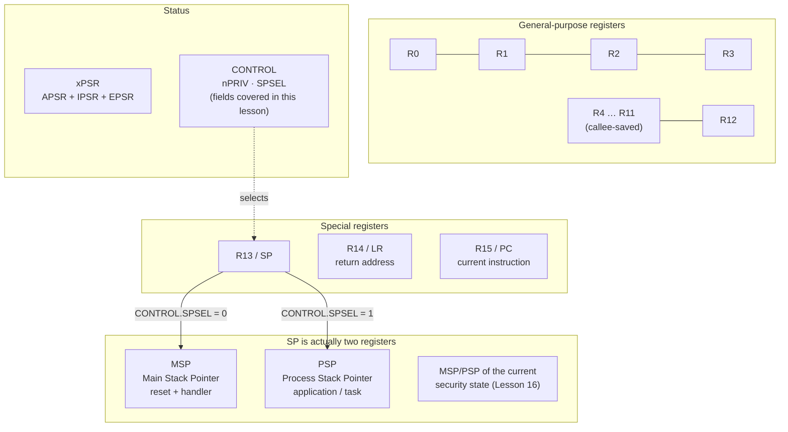

**Language:** English | [Türkçe](README.tr.md)

# Lesson 02 — Programmer Model & Registers

`[STANDARD]` · Day 1 · Estimated time: 45–60 min

---

## Why This Matters

When debugging Cortex-M firmware, you usually have two things:
**an address and a few register values.** Nothing else — no `printf`, no log file,
sometimes not even a working console.

When you get a `HardFault`, the question is:

> Where was PC, which stack was in use, and which mode was the processor in?

If you cannot answer these three questions, you cannot debug. The programmer model
is precisely where their answers live. This lesson underpins everything else in
the repository: stacks, exceptions, the MPU, context switches — all communicate
through these registers.

---

## Core Idea

The register set Cortex-M33 exposes to software is small enough to keep in mind:

| Register | Purpose |
|---|---|
| **R0–R12** | General purpose. R0–R3 are used for function arguments (AAPCS). |
| **R13 / SP** | Stack pointer. There are actually **two**: MSP and PSP. The active one appears as SP. |
| **R14 / LR** | Link Register — function return address. It acquires a different meaning in an exception (EXC_RETURN). |
| **R15 / PC** | Program Counter — address of the instruction currently executing. |
| **xPSR** | Program status: condition flags + active exception number + Thumb bit. |
| **CONTROL** | Fields selecting execution context. This lesson covers two: `nPRIV` (privilege level) and `SPSEL` (which stack). The entire register does **not** consist of only these two bits. |

Three points that can initially be surprising:

1. **There are two stack pointers** (banked registers). `MSP` and `PSP` are
   physically separate registers. `CONTROL.SPSEL` determines which you see as `SP`.
2. **Mode is read from IPSR.** `IPSR == 0` means Thread Mode; otherwise it is
   Handler Mode, and the value is the active exception's number.
3. **The Thumb bit is mandatory.** Cortex-M executes only the T32 (Thumb)
   instruction set. If the T bit in `xPSR` becomes 0, the processor immediately
   generates UsageFault. This is why function addresses in the vector table have
   their least-significant bit set to 1.

---

## Mental Model

Think of the processor as a **control room**:

- **R0–R12** → notes on the desk. Fast, temporary, constantly changing.
- **PC** → the "where am I now?" sign.
- **LR** → the "where do I return when finished?" note.
- **SP** → "the last page of my notebook" — the notebook fills from top to bottom.
- **xPSR** → status lights showing the last operation's result (N, Z, C, V).
- **CONTROL** → a key ring by the door. This lesson uses two keys:
  *what privilege am I running with?* (`nPRIV`) and *which notebook am I using?*
  (`SPSEL`). There are other keys — fields such as `FPCA` and `SFPA`, depending
  on architecture, FP context, and the Security Extension (Lessons 13 and 16).
  Therefore, always update `CONTROL` through read–modify–write.

There are two notebooks (MSP/PSP) because the operating system/kernel wants to
separate its notebook from the application's. If the application overflows its
notebook, the kernel's should remain intact. This separation underpins Lessons
04, 05, and 15.

---

## Visual



Inside xPSR:

```text
 31  30  29  28  27        24                       8 7            0
+---+---+---+---+---+ ... +---+---------------------+---------------+
| N | Z | C | V | Q |     | T |   (not covered here)|  exception #  |
+---+---+---+---+---+ ... +---+---------------------+---------------+
 \_______________/         |                         \_____________/
       APSR                |                              IPSR
   condition flags        |                         0 = Thread Mode
                        T bit                       >0 = Handler Mode
                   must always be 1
```

Two cautions:

- The middle area is **not "reserved."** Armv8-M defines fields there (for example,
  `GE[3:0]` and `ICI/IT` state bits). They are merely **omitted** from this diagram
  because they are outside this lesson's scope. "Outside this lesson's scope"
  and "undefined in the architecture" are different things.
- `CONTROL` also has more than two fields. The Armv8-M Main Extension includes
  `FPCA` (FP context active), and the Security Extension adds fields such as
  `SFPA`. The fields **in scope here** are `nPRIV` (bit 0) and `SPSEL` (bit 1);
  the others appear in Lessons 13 and 16. Always update `CONTROL` through
  read–modify–write for this reason.

---

## Tiny Example

Lesson firmware: [`example/main.c`](example/main.c) — complete and working, with no TODOs.

The central idea: mode/privilege/stack information is read from just two registers:

```c
uint32_t ipsr    = __get_IPSR();
uint32_t control = __get_CONTROL();

console_kv_str("MODE", (ipsr == 0U) ? "Thread Mode" : "Handler Mode");
console_kv_str("PRIVILEGE",    (control & 0x1U) ? "Unprivileged" : "Privileged");
console_kv_str("ACTIVE_STACK", (control & 0x2U) ? "PSP" : "MSP");
```

To examine how the `__get_IPSR()` and `__get_CONTROL()` wrappers work, this lesson
uses `core/include/core/cm33_teaching.h` instead of official CMSIS. Each contains
one line of inline assembly:

```c
static inline uint32_t __get_CONTROL(void)
{ uint32_t r; __asm volatile ("mrs %0, control" : "=r"(r)); return r; }
```

`MRS` (Move from Special Register) is the way to read special registers.
An ordinary `MOV` cannot read CONTROL.

---

## Build & Run

```bash
cmake --preset debug
cmake --build --preset debug --target 02-programmer-model
./scripts/run-qemu.sh build/debug/lessons/02-programmer-model/02-programmer-model.elf
```

Windows:

```powershell
cmake --preset debug
cmake --build --preset debug --target 02-programmer-model
.\scripts\run-qemu.ps1 build\debug\lessons\02-programmer-model\02-programmer-model.elf
```

Exit QEMU: `Ctrl-A`, then `X`.

---

## Expected Output

Actual output (QEMU 8.2.2, mps2-an505, arm-none-eabi-gcc 13.2.1):

```text
===== LESSON 02: PROGRAMMER MODEL =====
[CPUID] 0x410FD213
[CPUID.PARTNO] 0x00000D21
[PROCESSOR] Cortex-M33
--- execution state ---
[MODE] Thread Mode
[IPSR] 0
[CONTROL] 0x00000000
[PRIVILEGE] Privileged
[ACTIVE_STACK] MSP
--- stack pointers ---
[MSP] 0x30007FE0
[PSP] 0x00000000
[LOCAL_VAR_ADDR] 0x30007FE4
--- pc / lr ---
[PC_APPROX] 0x10000186
[LEAF_RETURN_ADDR] 0x1000018F
--- xpsr flags ---
[APSR_AFTER_5_MINUS_5] 0x60000000
[APSR_AFTER_5_MINUS_7] 0x80000000
===== END =====
```

Three things you can already infer:

- `CONTROL = 0` **and** `IPSR = 0` → after reset, **privileged Thread Mode**,
  **MSP** active. `IPSR` determines mode; `CONTROL` alone does not tell you
  whether execution is in Thread or Handler. Cortex-M starts this way; code
  that wants to become unprivileged does so deliberately.
- `PSP = 0` → nobody has written PSP yet. Its reset value is unspecified.
  This "empty" PSP will be useful later in **Break It**.
- `LOCAL_VAR_ADDR` is immediately adjacent to `MSP` → the local variable lies
  inside the active stack.

APSR values:

| Operation | APSR | Meaning |
|---|---|---|
| `5 - 5` | `0x60000000` | bit30 (Z) = 1, bit29 (C) = 1 → result is zero |
| `5 - 7` | `0x80000000` | bit31 (N) = 1 → result is negative |

The example firmware prints raw APSR values and stops there. Making these bits
readable is your job — see **Exercise** below.

---

## Observe in GDB

Open two terminals.

Terminal 1:

```bash
./scripts/debug-qemu.sh build/debug/lessons/02-programmer-model/02-programmer-model.elf
```

Terminal 2:

```bash
arm-none-eabi-gdb -x scripts/gdb/cortex-m.gdb \
    build/debug/lessons/02-programmer-model/02-programmer-model.elf
(gdb) cm-connect
```

### 1. Stop at reset and inspect

```text
(gdb) cm-regs
```

Actual output:

```text
sp             0x30008000          0x30008000
lr             0xffffffff          -1
pc             0x10000204          0x10000204 <Reset_Handler>
xpsr           0x41000000          1090519040
--- special registers ---
MSP     = 0x30008000
PSP     = 0x00000000
CONTROL = 0x00000000   (bu derste kapsam icindekiler: bit0 nPRIV, bit1 SPSEL)
IPSR    = 0        (0 = Thread Mode, >0 = exception numarası)
```

**What to look for:**

- `pc = 0x10000204` → we are in `Reset_Handler`, not yet `main`.
- `sp = MSP = 0x30008000` → top of RAM. Nobody set this value in code;
  hardware read it from vector-table entry 0.
- `xpsr = 0x41000000` → bit 24 (**T bit**) = 1. Thumb state.
  Bit 30 (Z) is also set; flags after reset are not meaningful.
- `lr = 0xffffffff` → nobody entered Reset_Handler "with a return expected."

### 2. Inspect the vector table

```text
(gdb) cm-vectors
```

```text
--- vector table (VTOR = 0x10000000) ---
[0]  Initial MSP  = 0x30008000
[1]  Reset        = 0x10000205
[2]  NMI          = 0x10000201
[3]  HardFault    = 0x10000201
...
```

**What to look for:** `[1] = 0x10000205`, but the `Reset_Handler` symbol is at
`0x10000204`. The difference of 1 is the **Thumb bit**. All handler addresses
are odd. `[3] HardFault` and `[2] NMI` point to the same address because both
are bound to `Default_Handler` (weak aliases).

### 3. Continue to main

```text
(gdb) break main
(gdb) continue
(gdb) cm-mode
```

```text
Mode      : Thread Mode
Privilege : Privileged
Stack     : MSP (0x30007ff8)
```

**What to look for:** MSP is now `0x30007ff8`, not `0x30008000` — it moved down
8 bytes. The stack is **full descending**: it grows downwards. The difference
comes from the push performed by `Reset_Handler` while calling `main`.

### 4. Look inside the stack

```text
(gdb) break show_stack_pointers
(gdb) continue
(gdb) p/x $sp
(gdb) x/4wx $sp
```

```text
$1 = 0x30007ff0
0x30007ff0:  0x30000000  0x10000233  0x00000000  0xffffffff
```

**What to look for:** `0x10000233` is in the FLASH range (`0x10000000`+) and odd
→ a **return address** (the instruction after `main` in `Reset_Handler`).
`0xffffffff` is the `LR` left from reset. This is the most direct way to inspect
the stack and answer "how did I get here?" It is also what underlies `bt`.

### 5. Connect C and assembly

```text
(gdb) disassemble /s show_execution_state
```

At the `__get_CONTROL()` call, you will see a single `mrs r3, CONTROL`
instruction — no function call, because it is `static inline`.

---

## Experiment

These are small, quick experiments. The main task is in **Exercise**.

**Experiment 1 — Give PSP a real value.**

Add this at the start of `main`:

```c
extern uint32_t __stack_limit;
__set_PSP((uint32_t)&__stack_limit);
```

Run again. `[PSP]` is no longer 0, but `[ACTIVE_STACK]` remains `MSP` — writing
PSP does **not activate it**. `CONTROL.SPSEL` activates it. This distinction is
the central topic of Lesson 04.

**Experiment 2 — See the Thumb bit.**

```text
(gdb) p/x $xpsr
(gdb) p ($xpsr >> 24) & 1
```

The result is always 1. There is no valid Cortex-M state where this bit is 0.

**Experiment 3 — What does reading PC actually return?**

Record `[PC_APPROX]`, then:

```bash
arm-none-eabi-objdump -d -S build/debug/lessons/02-programmer-model/02-programmer-model.elf \
    | grep -A5 "<show_pc_and_lr>"
```

Measure the difference between the printed value and the reading instruction's
own address. Why is it not exactly the instruction's address?

Be careful — there are three different "PCs"; do not confuse them:

| Source | What it gives |
|---|---|
| **Architectural read** with an instruction such as `mov rX, pc` | Includes an instruction-specific offset; not the instruction's own address |
| GDB's `$pc` display | Address of the next instruction to execute, shown by the debugger on the **halted** core |
| *Stacked PC* in an exception frame | Return address of the interrupted context (Lessons 07/08) |

This is exactly why the name `[PC_APPROX]` in this lesson ends in `APPROX`. For an exact
address, use the debugger or disassembly rather than an architectural read.

---

## Break It

The deliberately broken version builds as a separate target. After the repair,
its trigger is in a small assembly fragment rather than C —
[`example/break_trigger.S`](example/break_trigger.S):

```asm
break_invalid_psp:
    movs    r0, #0
    msr     psp, r0         /* 1) PSP ACIKCA gecersiz          */
    mrs     r1, control
    orr     r1, r1, #2      /* 2) SPSEL = 1 -> aktif stack PSP */
    msr     control, r1
    isb
    movs    r2, #0x11
    push    {r2}            /* 3) KONTROLLU gecersiz erisim    */
    b       .
```

> **Why did this change?** The first version changed `SPSEL` midway through an
> ordinary C function, so the exact failure point depended on compiler-generated
> code. It also relied on PSP resetting to `0` — **not an architectural guarantee**;
> PSP is unspecified after reset. Both assumptions are now removed: we write `0`
> ourselves, and the failure occurs in one `push` instruction.

With `PSP = 0`, `push` subtracts 4 from `SP` and attempts a write to
`0xFFFFFFFC`. This address lies in the reserved portion of system address space
and is not writable on this target.

```bash
cmake --build --preset debug --target 02-programmer-model-broken
./scripts/run-qemu.sh build/debug/lessons/02-programmer-model/02-programmer-model-broken.elf
```

Actual output (last lines):

```text
[APSR_AFTER_5_MINUS_5] 0x60000000
[APSR_AFTER_5_MINUS_7] 0x80000000

--- BREAK IT: PSP bilerek gecersiz, sonra SPSEL=1 ---
bir sonraki store gecersiz bir adrese gidecek...
```

Execution stops there. `===== END =====` is not printed.

---

## Debug It

I am not giving the answer here — but I am giving the measurement, because the
tool was repaired too.

```bash
cmake --build --preset debug --target debug-02-programmer-model-broken
```

```gdb
set architecture armv8-m.main
target remote :3333
source scripts/gdb/cortex-m.gdb
break Default_Handler
continue
cm-mode
cm-fault
p/x $lr
cm-exc-return $lr
```

Actual measurement (after repair):

```text
Mode      : Handler Mode (exception 3)
Privilege : Privileged (Handler Mode her zaman ayricaliklidir)
Stack     : MSP (0x30007fe8)  (Handler Mode MSP kullanir)
            PSP = 0xffffffe0   (kesilen Thread baglaminin stack'i olabilir)

CFSR  = 0x00009200  (MMFSR=0x00 BFSR=0x92 UFSR=0x0000)
HFSR  = 0x40000000  FORCED=1 -> baska bir fault HardFault'a yukseltildi (escalation)
MMFAR = 0x00000000  (MMARVALID=0 -> icerik ANLAMSIZ, kullanma)
BFAR  = 0xfffffffc  (BFARVALID=1 -> adres GECERLI)
UYARI: STACKING hatasi bildirilmis (STKOF/STKERR/MSTKERR).

$lr = 0xfffffffd
```

### There are **three separate events** here — do not confuse them

This distinction is the lesson's central point and was missing in the first version.

**1. The original invalid access.** `push {r2}` attempted a write to `0xFFFFFFFC`.
This generates BusFault.

**2. Stacking itself failed.** On exception entry, hardware attempts to write an
8-word frame to the currently active stack (PSP). Since PSP is already invalid,
this write fails too — that is what `BFSR.STKERR` tells us.

**3. Escalation.** The BusFault handler is disabled (`SHCSR.BUSFAULTENA = 0`),
so the fault escalated to HardFault — `HFSR.FORCED = 1`.

**Is there a valid frame? No.** With `STKERR` set, there is no trustworthy
exception frame in memory. Therefore:

```gdb
(gdb) set $er = $lr              # handler girisinde: 0xFFFFFFFD
(gdb) cm-frame $psp $er
REDDEDILDI [STACKING HATASI]: CFSR = 0x00009200
```

> **Important repair note.** The first version presented meaningless `cm-frame`
> output as "not a tool bug, but a clue." That was **wrong**: a real stacking
> error and a faulty debugger helper can coexist — and both did. The old
> `cm-frame` read eight words from active `$sp` and printed fabricated register values.
>
> It now takes two arguments, `cm-frame <adres> <EXC_RETURN>`, does not guess from
> `$sp`, and explicitly rejects unsupported cases. But note: it is **not a
> validator**, only a limited decoder. It cannot prove an address contains a frame
> actually written in the past; it only eliminates unsupported types and invalid
> values. `EXC_RETURN` is also checked strictly against architectural encodings —
> looking like `0xFFFFFFxx` is insufficient; for example, `0xFFFFFFFF` (bit 1 = 1)
> and `0xFFFFFFF5` (Handler + PSP) are invalid. The full list is in `docs/DEBUGGING.md`.

### Questions you must answer

1. Which exception is `IPSR = 3`? (Remember the `cm-vectors` indices.)
2. Which byte in `CFSR` is populated? Which three bits are set in `0x92`, and
   what are their names? (Table: `docs/DEBUGGING.md`)
3. Which access does `BFAR = 0xFFFFFFFC` belong to — which of the three events
   above? Can you be certain, or are there two candidates? Justify your answer.
4. `PSP = 0xFFFFFFE0`. How did it get here from `0xFFFFFFFC`? (Hint: how many
   words does hardware attempt to write on exception entry?)
5. Why did `cm-frame` reject it? Could you trust the values if it had not?

### Write it in your own words

Complete this chain in "What I Learned":

```text
___ written to PSP → SPSEL=1 → active SP now ___ →
push reached address ___ → ___ fault → handler disabled → ___ →
frame ___ because ___
```

---

## Exercise

### Exercise 01 — `decode_apsr_flags()`

The example firmware prints raw APSR:

```text
[APSR_AFTER_5_MINUS_5] 0x60000000
```

This is not human-readable. Your task: write a function that decodes the value
flag by flag and produces this line:

```text
[FLAGS] N=0 Z=1 C=1 V=0
```

Starter file (a copy of the example + a function left empty):

```text
exercises/01-decode-apsr-flags/main.c
```

Build and run:

```bash
cmake --build --preset debug --target 02-exercise-apsr
./scripts/run-qemu.sh build/debug/lessons/02-programmer-model/02-exercise-apsr.elf
```

Initial output of the version you will complete:

```text
[APSR_AFTER_5_MINUS_5] 0x60000000
[FLAGS] TODO(student): decode_apsr_flags() doldurulmadi
```

**Verification criterion:** you should see `Z=1` for `5 - 5`, and `N=1` for
`5 - 7`. **Write your expectations for `C` and `V` before running**, then compare.
If your prediction is wrong, that is where the real learning begins.

**Hint:** `console_puts()` and `console_putc()` suffice; no new helper function
is needed. Bit positions: N=31, Z=30, C=29, V=28.

---

## Reference Solution

The reference solution is ready and working — but **when to look is your decision**.

```text
solutions/01-decode-apsr-flags/
```

```bash
cmake --build --preset debug --target 02-solution-apsr
./scripts/run-qemu.sh build/debug/lessons/02-programmer-model/02-solution-apsr.elf
```

Actual solution output (measured):

```text
[APSR_AFTER_5_MINUS_5] 0x60000000
[FLAGS] N=0 Z=1 C=1 V=0
[APSR_AFTER_5_MINUS_7] 0x80000000
[FLAGS] N=1 Z=0 C=0 V=0
```

The comment at the top of the solution explains *why* shifts are used (C bitfield
layout in memory is not guaranteed) — more important than the code itself.

---

## What I Learned

> This section is yours. Fill it after doing the experiment.

**What surprised me:**

<!-- e.g. writing a value to PSP does not activate it -->

**My mistake:**

<!-- -->

**Behavior I saw in the debugger:**

<!-- e.g. MSP is 0x30008000 at reset, 0x30007ff8 at main -->

**The connection between the course explanation and practice:**

<!-- -->

**In my own words: what is the CONTROL register?**

<!-- -->

---

## Quick Check

1. You read `CONTROL = 0x00000000` **and** `IPSR = 0`. In which mode, at what
   privilege level, and using which stack is the processor running?
   Could you answer if only `CONTROL = 0` were given?

2. The vector table's `Reset` entry is `0x10000205`, but the `Reset_Handler`
   symbol is `0x10000204`. Where does this difference of 1 come from, and what
   would happen at reset if the bit were 0?

3. `MSP` changed from `0x30008000` at reset to `0x30007ff8` inside `main`.
   Where did those 8 bytes go, and in which direction did the stack "grow"?

4. **(Reasoning)** You wrote a valid address to `PSP` but did not change
   `CONTROL.SPSEL`. What value do you see when reading `SP`, and why?

5. **(Reasoning)** An exception occurs while Thread Mode uses PSP. On which
   stack does hardware write the automatic frame? Why might it be designed
   this way? *(You will verify this in Lesson 07 — for now, predict and write.)*

> Answers are deliberately elsewhere: [`answers/quick-check.md`](answers/quick-check.md).
> Write your own answer before opening it.

---

## Takeaway

- Cortex-M has **two stack pointers** (MSP/PSP); `CONTROL.SPSEL` determines which
  appears as `SP`. Writing a value ≠ activating it.
- **`IPSR == 0` → Thread Mode**, `!= 0` → Handler Mode, and the value is the
  exception number.
- After reset, the processor starts in **privileged Thread Mode + MSP**.
- **The Thumb bit (xPSR bit 24) is always 1**; this is why vector-table addresses
  are odd.
- The first three fault questions are always the same: **where was PC, which
  stack, which mode?**

---

## References

- Armv8-M Architecture Reference Manual (Arm DDI 0553) — "The Armv8-M
  programmers' model", "Special-purpose registers", "APSR/IPSR/EPSR"
- Cortex-M33 Devices Generic User Guide (Arm 100235) — "Processor mode and
  privilege levels", "Core registers", "CPUID Base Register"
- `core/include/core/cm33_teaching.h` — `MRS`/`MSR` wrappers used in this lesson
  (teaching header; the repository baseline is CMSIS — see `docs/ARCHITECTURE.md`)
- `docs/MEMORY_MAP.md` — where `0x30008000` and `0x10000000` come from
- `docs/DEBUGGING.md` — CFSR/HFSR bit tables

---

**Previous:** [01 — Cortex-M Family & Processor Selection](../01-cortex-m-family/)
**Next:** [03 — C and Assembly](../03-c-and-assembly/)
