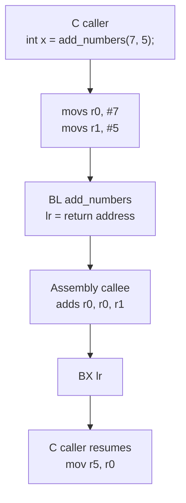

**Language:** English | [Türkçe](README.tr.md)

# Lesson 03 — C and Assembly

`[STANDARD]` · Day 2 · Estimated time: 45–60 min

---

## Why This Matters

In embedded work, sooner or later you read startup code, write a context switch,
or diagnose a crash through disassembly. All three require the same knowledge:
**what a function call means at processor level**.

In C, you write `add_numbers(7, 5)`. The processor knows no such thing as
`add_numbers`. It knows how to put values into two registers and branch to an
address. The contract between these views is **AAPCS**, and this lesson builds
its smallest, most visible piece.

This lesson does not teach all of AAPCS — **Lesson 09** covers the details.
The goal here is intuition: seeing the connection between C and assembly.

---

## Core Idea

A function call consists of three separate agreements:

| Question | Answer (AAPCS32) |
|---|---|
| Where do arguments arrive? | First four **word-sized integers**: `r0, r1, r2, r3` |
| Where is the result returned? | `r0` (`r0:r1` for 64-bit values) |
| Where does execution return? | Address in `lr` (r14) |

Arm's official AAPCS32 document describes the first four registers (`r0-r3`,
also called `a1-a4`) as the registers used to pass arguments to a subroutine
and return results.

**Scope caution:** "the first four arguments go in registers" applies to what
this lesson demonstrates: **word-sized integers**. The general rule is more
complex: 64-bit types require register pairs and alignment rules; large structs
may be passed in memory; floating-point types follow the selected FP ABI.
The complete algorithm appears in Lesson 09.

There is a distinction between two branch instructions:

```text
B   <target>     branch only.       does NOT change lr.
BL  <target>     branch and LINK.     lr = address of the next instruction.
```

The **L** in `BL` means "Link." This is what writes the return address to `lr` —
**the calling instruction itself**, not the called function, fills `lr`.

Return uses `BX lr`: "branch to the address in `lr`." The **X** in `BX` means
"Exchange" (change state), and it examines **bit 0** of the target address —
the Thumb bit from Lesson 02 appears again.

The final piece: some registers **must survive** the call. Under AAPCS32, a
subroutine must preserve `r4-r8`, `r10`, `r11`, and `SP` (`r9` has a platform-defined
role — saying "r4–r11 are callee-saved" is therefore common but not fully accurate).
Details are in Lesson 09; here we see only that the rule **exists** and what
happens when it is violated.

---

## Mental Model

Think of a function call as a **courier delivery**:

- Put parcels in numbered boxes: `r0`, `r1`, `r2`, `r3`.
- Leave a note at the door: "return here when finished" → `lr`.
- The courier does the work and puts the answer in the first box → `r0`.
- The courier follows the note back → `BX lr`.

There are two kinds of boxes: those the courier may use freely (`r0-r3`) and
those that **must be returned exactly as received** (`r4-r8`, `r10`, `r11`).
If the courier damages the latter without restoring them, the person at home
finds their belongings missing. That is exactly what Break It demonstrates.

---

## Visual



Register ownership:

```text
        caller                callee
        ----------------                -----------------
r0-r3   places arguments  -->    may use freely
                                        places result in r0
lr      automatically set by BL    -->    must first stack if overwriting
r4-r8   my own values          -->   SAVE and RESTORE if used
r10,r11
sp      must stay balanced           -->   must remove what it pushed
```

---

## Tiny Example

Two files. One states what C expects; the other states what assembly provides.

C side — [`example/main.c`](example/main.c):

```c
int add_numbers(int a, int b);        /* gövde yok: assembly'de tanımlı */

int asm_result = add_numbers(7, 5);
```

Assembly side — [`example/add_numbers.S`](example/add_numbers.S):

```asm
    .syntax unified
    .thumb

    .global add_numbers
    .type   add_numbers, %function
    .thumb_func
add_numbers:
    adds    r0, r0, r1      /* r0 = a + b */
    bx      lr              /* lr'ye dön  */
```

Every line has a purpose:

| Directive | What it does | If omitted |
|---|---|---|
| `.syntax unified` | Modern unified Arm/Thumb syntax | Old syntax rules apply; instructions may be rejected |
| `.thumb` | Assembles subsequent code as Thumb | Produces code that will not run on Cortex-M |
| `.global` | Makes the symbol visible to the linker | Link error: `undefined reference` |
| `.type ... %function` | Marks the symbol as a function | Debugger and linker may treat it as data |
| `.thumb_func` | Marks the symbol as a Thumb function (address bit 0 = 1) | Usually nothing — see below |

The last row connects to Lesson 02, where you learned why handler addresses
are odd. The same bit is at work here.

**But what happens if `.thumb_func` is omitted?** A common claim is that calling
with `BL` causes UsageFault (INVSTATE); this is **too categorical**. In the GNU
EABI toolchain, `.type sym, %function` plus `.thumb` already suffice to identify
the symbol as Thumb; correct code can be generated without `.thumb_func`.

The actual risk **depends on which declarations coexist**. Measurements in this
repository (arm-none-eabi-gcc 13.2.1, binutils 2.42):

```text
.thumb + .type f,%function  (NO .thumb_func):
    readelf -s -> 6: 00000001  0 FUNC   GLOBAL ... f      <- bit0 = 1, no problem

.thumb, NO type annotation either:
    readelf -s -> 6: 00000000  0 NOTYPE GLOBAL ... g      <- bit0 = 0, INVSTATE risk
```

The determining factor is not `.thumb_func` alone but **whether the symbol is
marked as a function**. The right habit is to write all three and **inspect the
symbol with `nm`/`readelf` rather than assume**:

```bash
arm-none-eabi-nm build/debug/lessons/03-c-and-assembly/03-c-and-assembly.elf \
    | grep add_numbers
```

This function does not push `lr`. It is a **leaf function**: it calls no other
function, so nothing overwrites `lr`.

Distinguish two terms:

- **Leaf function** means a function that **calls no other function**. It does
  not mean "uses no stack"; a leaf can allocate locals with `sub sp, #N`.
- The requirement is to **preserve the return path**, not necessarily to **push**
  `lr`. The stack is the most common method, but not the only one: the compiler
  may move `lr` to a preserved register and restore it later, or make a tail call
  with `b` instead of `bl`, leaving `lr` untouched. "Every non-leaf function
  pushes `lr`" is therefore incorrect.

---

## Build & Run

```bash
cmake --preset debug
cmake --build --preset debug --target 03-c-and-assembly
./scripts/run-qemu.sh build/debug/lessons/03-c-and-assembly/03-c-and-assembly.elf
```

Windows:

```powershell
cmake --build --preset debug --target 03-c-and-assembly
.\scripts\run-qemu.ps1 build\debug\lessons\03-c-and-assembly\03-c-and-assembly.elf
```

Exit QEMU: `Ctrl-A`, then `X`.

### How does the assembly file enter the build?

The `.S` file is added to CMake as an ordinary source:

```cmake
add_firmware(03-c-and-assembly
    SOURCES example/main.c
            example/add_numbers.S
            example/accumulate.S)
```

Three points matter:

1. **Uppercase `.S`**, not lowercase `.s`. The uppercase extension makes the
   file pass through the C preprocessor first — enabling `#ifdef`. Its toolchain
   counterpart is `CMAKE_ASM_FLAGS_INIT ... -x assembler-with-cpp`.
2. Architecture flags (`-mcpu=cortex-m33 -mthumb`) come from the same single
   source as for C. The assembly file need not specify `.cpu`.
3. The compiler sees and trusts the `add_numbers` **declaration** in `main.c`.
   It never sees the body. An incorrect signature need not trigger a warning;
   the error appears at runtime. This declaration is the only link between C
   and assembly.

---

## Expected Output

Actual output (QEMU 8.2.2, mps2-an505, arm-none-eabi-gcc 13.2.1):

```text
===== LESSON 03: C AND ASSEMBLY =====
[ADD_NUMBERS_ASM(7,5)] 12
[ADD_NUMBERS_C(7,5)] 12
[SAME_RESULT] YES
--- callee-saved ---
[ACCUMULATE(7,5)] 12
===== END =====
```

Both additions returned the same result. One was handwritten, the other
compiler-generated — and C called both in the same way, for one reason:
both obey the same ABI contract.

---

## Compiler-generated vs handwritten

Compare their generated code:

```bash
arm-none-eabi-objdump -d build/debug/lessons/03-c-and-assembly/03-c-and-assembly.elf \
    | grep -A3 "<add_numbers>:\|<add_numbers_c>:"
```

Actual output:

```text
10000040 <add_numbers>:            ; handwritten
10000040:  1840        adds  r0, r0, r1
10000042:  4770        bx    lr

10000054 <add_numbers_c>:          ; compiler-generated
10000054:  4408        add   r0, r1
10000056:  4770        bx    lr
```

> Addresses belong to this build. They shift when any part of the code changes.
> What matters is **the instructions**, not the addresses.

Both use two instructions, both have 16-bit encodings, and both return the
result in `r0`. But the instructions are **not identical**:

| | Handwritten | Compiler |
|---|---|---|
| Instruction | `adds r0, r0, r1` | `add r0, r1` |
| Encoding | `0x1840` | `0x4408` |
| Updates APSR flags? | **Yes** | **No** |

Why the difference? In unified syntax, the `s` suffix means "update flags."
I wrote `adds` because it is conventional; the compiler chose `add` because
the C expression `a + b` has nothing to do with flags, avoiding an unnecessary
side effect.

**The lesson is a method, not a generalization.** Do not memorize "Thumb `add`
is this, `adds` is that"; the selected encoding depends on the operands and the
assembler's decisions. The right reflex is to **inspect the emitted encoding**
with `objdump`. Every example shown here was measured this way.

**A limit: C arithmetic and assembly arithmetic are not always equivalent.**
Here `7 + 5` and `12 - 5` do not overflow, so the two match exactly. Overflow
of **signed** C integers is **undefined behavior**: the compiler may optimize
on the assumption that it will not occur. Assembly produces two's-complement
wrapping. Thus "assembly wraps this way, so C must too" is invalid. Unsigned
C wrapping is defined and has no such problem. These examples are unchanged
because they do not overflow.

What both must obey is not debatable: arguments in `r0`/`r1`, result in `r0`,
return through `lr`. This is not a compiler preference, but **a prerequisite
for the two object files combined by the linker to work together**.

---

## Observe in GDB

This is the main part of the lesson. Console output says "the result is right";
the debugger says "how."

Terminal 1:

```bash
cmake --build --preset debug --target debug-03-c-and-assembly
```

Terminal 2:

```bash
gdb-multiarch -q build/debug/lessons/03-c-and-assembly/03-c-and-assembly.elf
```

```gdb
set architecture armv8-m.main
target remote :3333
```

### 1. Call site — how are arguments placed?

```gdb
(gdb) disassemble /s main
```

The three relevant lines (actual output):

```text
10000066:  2105       movs  r1, #5
10000068:  2007       movs  r0, #7
1000006a:  f7ff ffe9  bl    10000040 <add_numbers>
```

**What we inspect and why:** the compiler converted `add_numbers(7, 5)` into
three instructions. `7` and `5` were written directly to `r0` and `r1` —
argument passing is not a data structure or stack operation, just two `mov`s.
The reversed order (`r1` first) does not matter; both are ready before `bl`.

### 2. Function entry — does the contract hold?

```gdb
(gdb) break add_numbers
(gdb) continue
(gdb) info registers r0 r1 lr pc
```

Actual output:

```text
r0    0x7           7
r1    0x5           5
lr    0x1000006f    268435567
pc    0x10000040    0x10000040 <add_numbers>
```

**What we inspect and why:**

- `r0 = 7`, `r1 = 5` → the contract worked. The assembly function *assumed*
  where arguments would arrive, and the assumption held.
- `lr = 0x1000006f` → **odd**. The actual return address is `0x1000006e`;
  bit 0 is the Thumb bit from Lesson 02. `BL` wrote this value automatically.
- `pc = 0x10000040` → we are at the first instruction of `add_numbers`.

### 3. Arithmetic — the moment the result appears

```gdb
(gdb) stepi
(gdb) info registers r0 pc
```

```text
r0    0xc           12
pc    0x10000042    0x10000042 <add_numbers+2>
```

**What we inspect and why:** `r0` is now the **result**, not an argument.
The same register serves both roles. This is the practical benefit of AAPCS
using `r0` for both the first argument and return value: no extra move is needed.

### 4. Return — what does `BX lr` do?

```gdb
(gdb) stepi
(gdb) info registers r0 pc
(gdb) x/1i $pc
```

```text
r0    0xc           12
pc    0x1000006e    0x1000006e <main+22>
=> 0x1000006e <main+22>:  mov  r5, r0
```

**What we inspect and why:** two things were verified together.

1. `pc` returned where `lr` pointed — but to `0x1000006e`, not `0x1000006f`.
   The processor did not use bit 0 as part of the address; it read it as
   "enter Thumb state" and discarded it.
2. The returned-to instruction is `mov r5, r0` — C takes the result from `r0`
   and moves it into its own variable. This completes the caller's side of
   the contract.

A full round trip: `C → r0/r1 → BL → assembly → r0 → BX lr → C`.

---

## Experiment

**Experiment 1 — Where does the third argument go?**

If we wrote `int multiply_add(int a, int b, int c)`, which register would
receive `c`? Predict first, then run the reference solution:

```bash
cmake --build --preset debug --target 03-solution-mla
arm-none-eabi-objdump -d build/debug/lessons/03-c-and-assembly/03-solution-mla.elf \
    | grep -A2 "<multiply_add>:"
```

Actual output:

```text
10000040 <multiply_add>:
10000040:  fb00 2001   mla  r0, r0, r1, r2
10000044:  4770        bx   lr
```

`MLA` (Multiply Accumulate) performs `a*b+c` in one instruction. Note its
**32-bit** encoding (`fb00 2001`), unlike 16-bit `adds`. Also, `MLA` exists in
Armv7-M and later, but **not** Cortex-M0/M0+ (Armv6-M). This makes Lesson 01's
"which instruction on which architecture?" question concrete.

**Experiment 2 — Where does the fifth argument go?**

There are four `r0-r3` registers. Write a C function taking five arguments,
compile it, and inspect it with `objdump`. Where did the fifth go? Write your
prediction before looking.

**Experiment 3 — Is `lr` really overwritten?**

Why does `accumulate` execute `push {r4, lr}` while `add_numbers` does not?
In GDB, use `break accumulate`, step over `bl helper` with `si`, and inspect
with `info registers lr`. What happened to `lr`, and why?

---

## Break It

A deliberately broken version already builds as a separate target. Its only
difference is two lines in `helper()`:

```asm
helper:
#ifdef LESSON03_BREAK_CALLEE_SAVED
    movs    r4, #0       /* HATA: r4 callee-saved, geri yüklenmiyor */
#endif
    bx      lr
```

Run:

```bash
cmake --build --preset debug --target 03-c-and-assembly-broken
./scripts/run-qemu.sh build/debug/lessons/03-c-and-assembly/03-c-and-assembly-broken.elf
```

Actual output (only the last line changes):

```text
[ADD_NUMBERS_ASM(7,5)] 12
[ADD_NUMBERS_C(7,5)] 12
[SAME_RESULT] YES
--- callee-saved ---
[ACCUMULATE(7,5)] 5          <-- should have been 12
===== END =====
```

Notice: **no crash**. No fault, error message, or warning. The program runs
smoothly and gives the wrong answer. This is the most dangerous aspect of ABI
violations in practice — you can diagnose HardFault, but "the result is
sometimes wrong" is much more expensive.

---

## Debug It

I am not giving the answer here. Inspect these in order.

```bash
cmake --build --preset debug --target debug-03-c-and-assembly-broken
```

```gdb
set architecture armv8-m.main
target remote :3333
break accumulate
continue
info registers r0 r1 r4
```

At entry (actual output):

```text
r0    0x7    7
r1    0x5    5
r4    0xc    12        <-- a previous value belonging to the caller
```

Now continue until **after** the `helper` call. Use `disassemble accumulate`
to find the address after `bl` and put a breakpoint there (addresses are
build-specific — in this build it was `0x1000004c`):

```gdb
disassemble accumulate
break *0x1000004c
continue
info registers r0 r1 r4
```

```text
r0    0x7    7
r1    0x5    5
r4    0x0    0         <-- ???
```

Questions to answer:

1. What did `accumulate` do to `r4` at entry, and why?
2. Why does `r4` differ before and after the `helper` call?
3. What does `adds r0, r4, r1` calculate in this situation?
4. Did `helper` or `accumulate` make the mistake? Whose obligation is the rule?
5. Would the result still be wrong if `helper` clobbered `r1` instead of `r4`? Why?

Hint: the **location of the error** and the **location of its symptom** are in
different functions. This is a major reason ABI bugs are hard to diagnose.

---

## Exercise

### Exercise 01 — `sub_numbers`

The C side is ready; the assembly side is yours:

```c
int sub_numbers(int a, int b);        /* a - b */
```

Starter file:

```text
exercises/01-sub-numbers/sub_numbers.S
```

It currently returns a constant `0` — builds, but is wrong. Questions to answer:

- Which registers carry the arguments?
- Where must you put the result?
- How do you return?

Build and run:

```bash
cmake --build --preset debug --target 03-exercise-sub
./scripts/run-qemu.sh build/debug/lessons/03-c-and-assembly/03-exercise-sub.elf
```

Initial output (actual):

```text
[SUB_NUMBERS(12,5)] 0
[SUB_NUMBERS(5,12)] 0
[CHECK_12_MINUS_5] FAIL
[CHECK_5_MINUS_12] FAIL
```

**Verification criterion:** both `CHECK` lines must say `PASS`.

The second test expects `5 - 12 = -7`, but the console prints unsigned.
**Predict what you will see before running** — a small but lasting lesson
in two's-complement representation.

**Hint:** one arithmetic instruction + one return instruction suffice. See
"SUB (register)" in the Armv8-M ARM for the subtraction instruction's name.

---

## Reference Solution

The reference solutions are ready and have been run — when to look is your choice.

| What | Where | Target |
|---|---|---|
| Exercise 01 solution | [`solutions/01-sub-numbers/`](solutions/01-sub-numbers/) | `03-solution-sub` |
| Experiment 1 solution | [`solutions/02-multiply-add/`](solutions/02-multiply-add/) | `03-solution-mla` |

```bash
cmake --build --preset debug --target 03-solution-sub
./scripts/run-qemu.sh build/debug/lessons/03-c-and-assembly/03-solution-sub.elf
```

Actual output:

```text
[SUB_NUMBERS(12,5)] 7
[SUB_NUMBERS(5,12)] 4294967289
[CHECK_12_MINUS_5] PASS
[CHECK_5_MINUS_12] PASS
```

`4294967289` = `0xFFFFFFF9` = `-7`. The value is correct; only our printing
format is inappropriate. A register holds a 32-bit pattern — whether it is
"signed" or "unsigned" depends on **how you interpret it**.

---

## What I Learned

> This section is yours. Fill it after doing the experiments.

**A function call in my own words:**

<!-- -->

**How I will remember the difference between `BL` and `B`:**

<!-- -->

**What most surprised me in Break It:**

<!-- e.g. the absence of a crash -->

**What I noticed between handwritten assembly and compiler output:**

<!-- -->

**The question I am taking into the next lesson:**

<!-- -->

---

## Quick Check

1. What is the key difference between `BL` and `B`? What would happen if you
   used `B lr` instead of `BX lr` to return from an assembly function?

2. Why does `lr` matter on function entry? `add_numbers` does not push `lr`,
   but `accumulate` does — what is the difference?

3. Which registers normally carry two `int` arguments? Where would a fifth go?

4. Why can the return value be taken from `r0`? Is this enabled by hardware
   or an agreement?

5. **(Reasoning)** Why can handwritten assembly not ignore AAPCS? Exactly where
   does "my function, my choice of registers" break down?

6. **(Reasoning)** Break It did not crash; it merely produced a wrong result.
   Which is more dangerous, HardFault or a silent wrong result? Defend your answer.

> Answers: [`answers/quick-check.md`](answers/quick-check.md)
> — open after writing your own answer.

---

## Takeaway

- A function call is a **register contract**, not a language feature: arguments
  in `r0-r3`, result in `r0`, return address in `lr`.
- `BL` **itself** writes the return address to `lr`; `BX lr` uses it and reads
  bit 0 as the Thumb indicator.
- Handwritten and compiler-generated assembly must follow the same ABI, or the
  two pieces combined by the linker cannot communicate.
- AAPCS32 requires preserving `r4-r8`, `r10`, `r11`, and `SP` (`r9` is
  platform-dependent). Violating this rule produces a **silent wrong result**,
  not a crash.
- Instruction selection (`add` / `adds`, 16-bit / 32-bit encoding) is not
  memorized — it is **inspected** with `objdump`.

---

## Official References

- **Procedure Call Standard for the Arm Architecture (AAPCS32)** —
  ARM-software/abi-aa, `aapcs32/aapcs32.rst`: `r0-r3` (`a1-a4`) argument and result
  passing; a subroutine's obligation to preserve `r4-r8`, `r10`, `r11`, and `SP`;
  the platform-specific role of `r9`.
- **Armv8-M Architecture Reference Manual (Arm DDI 0553)** — instruction definitions
  and Thumb encodings for `B`, `BL`, `BX`, `ADD`/`ADDS`, `SUB`/`SUBS`, and `MLA`.
- **Cortex-M33 Devices Generic User Guide (Arm 100235)** — core registers and
  the roles of `LR` and `PC`.
- **GNU as manual** — `.syntax unified`, `.thumb`, `.thumb_func`, `.type`,
  `.size` directives.
- All output shown in this lesson was measured with:
  `arm-none-eabi-gcc 13.2.1`, `QEMU 8.2.2`, `mps2-an505 / cortex-m33`.

---

**Previous:** [02 — Programmer Model & Registers](../02-programmer-model/)
**Next:** [04 — Stack, MSP & PSP](../04-stack-msp-psp/)
