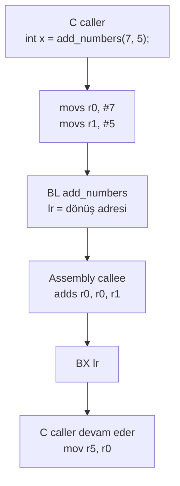

**Dil:** [English](README.md) | Türkçe

# Lesson 03 — C and Assembly

`[STANDARD]` · Day 2 · Tahmini süre: 45–60 dk

---

## Why This Matters

Gömülü tarafta er ya da geç şu üçünden biri başına gelir: bir startup kodunu
okursun, bir context switch yazarsın, ya da bir crash'i disassembly üzerinden
teşhis edersin. Üçü de aynı bilgiyi ister — **bir fonksiyon çağrısının
işlemci seviyesinde ne olduğunu.**

C'de `add_numbers(7, 5)` yazarsın. İşlemci `add_numbers` diye bir şey bilmez.
Onun bildiği şey: iki register'a değer koyup bir adrese dallanmak. Aradaki
sözleşmeye **AAPCS** denir ve bu ders o sözleşmenin en küçük, en görünür
parçasını kuruyor.

Bu ders AAPCS'nin tamamını öğretmez — detaylı hali **ders 09**'da. Buradaki
hedef sezgi: C ile assembly arasındaki bağı gözle görmek.

---

## Core Idea

Bir fonksiyon çağrısı üç ayrı anlaşmadan oluşur:

| Soru | Cevap (AAPCS32) |
|---|---|
| Argümanlar nereden gelir? | İlk dört **word boyutunda tamsayı**: `r0, r1, r2, r3` |
| Sonuç nereden döner? | `r0` (64-bit ise `r0:r1`) |
| Geri nereye dönülür? | `lr` (r14) içindeki adres |

Arm'ın resmi AAPCS32 belgesi bunu şöyle koyar: ilk dört register (`r0-r3`,
takma adlarıyla `a1-a4`) bir altyordama argüman geçirmek ve sonuç döndürmek
için kullanılır.

**Kapsam uyarısı:** "ilk dört argüman register'a gider" kuralı bu derste
gösterilen şeye — **word boyutundaki tamsayılara** — aittir. Genel kural daha
karmaşıktır: 64-bit tipler register çifti ister ve hizalama kuralları devreye
girer, büyük struct'lar bellekten geçirilebilir, kayan nokta tipleri seçilen
FP ABI'sine göre farklı yol izler. Tam algoritma ders 09'da.

Dallanma tarafında iki komut ayrımı var:

```text
B   <hedef>     sadece dallan.       lr'ye DOKUNMAZ.
BL  <hedef>     dallan ve BAGLA.     lr = bir sonraki komutun adresi.
```

`BL`'deki **L**, "Link" demek. Dönüş adresini `lr`'ye yazan şey budur — yani
`lr`'yi dolduran, çağrılan fonksiyon değil, **çağrı komutunun kendisidir.**

Dönüş için `BX lr` kullanılır: "`lr`'deki adrese dallan". `BX`'teki **X**,
"Exchange" (durum değiştir) demek ve hedef adresin **bit 0'ına** bakar —
ders 02'deki Thumb biti burada yeniden karşımıza çıkıyor.

Son parça: bazı register'lar çağrı boyunca **yaşamak zorundadır**. AAPCS32'ye
göre bir altyordam `r4-r8`, `r10`, `r11` ve `SP`'nin içeriğini korumak
zorundadır (`r9`'un rolü platforma göre tanımlanır — bu yüzden "r4–r11
callee-saved" demek yaygın ama tam doğru olmayan bir kısaltmadır). Ayrıntı
ders 09'da; burada sadece kuralın **varlığını** ve ihlal edilince ne olduğunu
göreceğiz.

---

## Mental Model

Fonksiyon çağrısını **kurye teslimatı** gibi düşün:

- Paketleri numaralı kutulara koyarsın: `r0`, `r1`, `r2`, `r3`.
- Kapıya bir not bırakırsın: "işin bitince buraya dön" → `lr`.
- Kurye işi yapar, cevabı ilk kutuya koyar → `r0`.
- Nota bakıp döner → `BX lr`.

Bu modelde iki tür kutu var: kuryenin istediği gibi kullanabildiği kutular
(`r0-r3`) ve **teslim aldığı gibi geri vermek zorunda olduğu** kutular
(`r4-r8`, `r10`, `r11`). İkincisini bozup geri vermezse, evdeki adam kendi
eşyasını kaybolmuş bulur. "Break It" bölümü tam olarak bu.

---

## Visual



Register'ların kim tarafından sahiplenildiği:

```text
        cagiran (caller)                cagrilan (callee)
        ----------------                -----------------
r0-r3   argumanlari yerlestirir  -->    serbestce kullanabilir
                                        sonucu r0'a koyar
lr      BL ile otomatik dolar    -->    bozacaksa once stack'e itmeli
r4-r8   kendi degerlerim          -->   kullanacaksa SAKLA ve GERI VER
r10,r11
sp      dengede kalmali           -->   ittigini geri almali
```

---

## Tiny Example

İki dosya. Biri C'nin ne istediğini söyler, diğeri assembly'nin ne verdiğini.

C tarafı — [`example/main.c`](example/main.c):

```c
int add_numbers(int a, int b);        /* gövde yok: assembly'de tanımlı */

int asm_result = add_numbers(7, 5);
```

Assembly tarafı — [`example/add_numbers.S`](example/add_numbers.S):

```asm
    .syntax unified
    .thumb

    .global add_numbers
    .type   add_numbers, %function
    .thumb_func
add_numbers:
    adds    r0, r0, r1      /* r0 = a + b */
    bx      lr              /* lr'ye dön  */
```

Her satırın bir işi var:

| Direktif | Ne yapar | Atlanırsa |
|---|---|---|
| `.syntax unified` | Modern, tek Arm/Thumb sözdizimi | Eski sözdizimi kuralları uygulanır, komutlar reddedilebilir |
| `.thumb` | Sonraki kod Thumb olarak assemble edilir | Cortex-M'de çalışmayacak kod üretilir |
| `.global` | Sembolü linker'a görünür kılar | Link hatası: `undefined reference` |
| `.type ... %function` | Sembolü fonksiyon olarak işaretler | Debugger ve linker onu veri sanabilir |
| `.thumb_func` | Sembolü Thumb fonksiyonu olarak işaretler (adres bit 0 = 1) | Genelde bir şey olmaz — aşağıya bak |

Son satır ders 02 ile bağlantılı: handler adreslerinin neden tek sayı olduğunu
oradan biliyorsun. Aynı bit burada da iş başında.

**Ama `.thumb_func`'ı atlarsan ne olur?** Yaygın iddia "`BL` ile çağrıldığında
UsageFault (INVSTATE) alırsın" şeklindedir; bu **fazla kesin**. GNU EABI
araç zincirinde `.type sym, %function` + `.thumb` birlikte zaten sembolün
Thumb olduğunu belirtmeye yeter; `.thumb_func` yazmasan da doğru kod
üretilebilir.

Gerçek risk şu: **hangi bildirimlerin bir arada bulunduğuna bağlıdır.** Bu
repoda ölçüldü (arm-none-eabi-gcc 13.2.1, binutils 2.42):

```text
.thumb + .type f,%function  (.thumb_func YOK):
    readelf -s -> 6: 00000001  0 FUNC   GLOBAL ... f      <- bit0 = 1, sorun yok

.thumb, tip isareti de YOK:
    readelf -s -> 6: 00000000  0 NOTYPE GLOBAL ... g      <- bit0 = 0, INVSTATE riski
```

Yani belirleyici olan `.thumb_func`'ın kendisi değil, **sembolün fonksiyon
olarak işaretlenmiş olması**. Doğru alışkanlık üçünü birden yazmak — ve
**varsayım yerine `nm`/`readelf` ile sembolü kontrol etmek**:

```bash
arm-none-eabi-nm build/debug/lessons/03-c-and-assembly/03-c-and-assembly.elf \
    | grep add_numbers
```

Bu fonksiyon `lr`'yi stack'e itmiyor. Çünkü **leaf (yaprak) fonksiyon**:
başka fonksiyon çağırmıyor, dolayısıyla `lr`'yi kimse ezmiyor.

İki terim ayrımı:

- **Leaf fonksiyon** = başka fonksiyon **çağırmayan** fonksiyondur. "Stack
  kullanmayan" demek değildir; bir leaf fonksiyon rahatlıkla `sub sp, #N`
  ile yerel alan açabilir.
- Gereken şey `lr`'yi **itmek** değil, **dönüş yolunu korumaktır**. Stack en
  yaygın yol ama tek yol değil: derleyici `lr`'yi korunan bir register'a
  taşıyıp sonra geri koyabilir, ya da kuyruk çağrısı (tail call) yaparak `bl`
  yerine `b` kullanabilir — o durumda `lr` hiç ezilmez. Yani "her non-leaf
  fonksiyon `lr`'yi push eder" doğru değildir.

---

## Build & Run

```bash
cmake --preset debug
cmake --build --preset debug --target 03-c-and-assembly
./scripts/run-qemu.sh build/debug/lessons/03-c-and-assembly/03-c-and-assembly.elf
```

Windows:

```powershell
cmake --build --preset debug --target 03-c-and-assembly
.\scripts\run-qemu.ps1 build\debug\lessons\03-c-and-assembly\03-c-and-assembly.elf
```

QEMU'dan çıkış: `Ctrl-A` sonra `X`.

### Assembly dosyası build'e nasıl giriyor?

`.S` dosyası CMake'e normal bir kaynak olarak ekleniyor:

```cmake
add_firmware(03-c-and-assembly
    SOURCES example/main.c
            example/add_numbers.S
            example/accumulate.S)
```

Üç nokta önemli:

1. **Büyük harf `.S`** (küçük `.s` değil). Büyük harfli uzantı, dosyanın önce
   C ön-işlemcisinden (preprocessor) geçmesini sağlar — bu yüzden `#ifdef`
   kullanabiliyoruz. Toolchain dosyasındaki karşılığı:
   `CMAKE_ASM_FLAGS_INIT ... -x assembler-with-cpp`.
2. Mimari flag'leri (`-mcpu=cortex-m33 -mthumb`) C ile aynı tek kaynaktan
   geliyor. Assembly dosyasında `.cpu` yazmaya gerek yok.
3. Derleyici `main.c` içindeki `add_numbers` **bildirimine** bakıp ona güvenir.
   Gövdeyi hiç görmez. İmzayı yanlış yazarsan derleyici seni uyarmaz; hata
   çalışma zamanında çıkar. C ile assembly arasındaki tek bağ bu bildirimdir.

---

## Expected Output

Gerçek çıktı (QEMU 8.2.2, mps2-an505, arm-none-eabi-gcc 13.2.1):

```text
===== LESSON 03: C AND ASSEMBLY =====
[ADD_NUMBERS_ASM(7,5)] 12
[ADD_NUMBERS_C(7,5)] 12
[SAME_RESULT] YES
--- callee-saved ---
[ACCUMULATE(7,5)] 12
===== END =====
```

İki toplama aynı sonucu verdi. Biri elle yazıldı, diğerini derleyici üretti —
ve C kodu ikisini de aynı şekilde çağırabildi. Sebebi tek: ikisi de aynı ABI
sözleşmesine uyuyor.

---

## Compiler-generated vs handwritten

İkisinin ürettiği kodu karşılaştıralım:

```bash
arm-none-eabi-objdump -d build/debug/lessons/03-c-and-assembly/03-c-and-assembly.elf \
    | grep -A3 "<add_numbers>:\|<add_numbers_c>:"
```

Gerçek çıktı:

```text
10000040 <add_numbers>:            ; elle yazılmış
10000040:  1840        adds  r0, r0, r1
10000042:  4770        bx    lr

10000054 <add_numbers_c>:          ; derleyici üretti
10000054:  4408        add   r0, r1
10000056:  4770        bx    lr
```

> Adresler build'e özeldir. Kodun herhangi bir yeri değişirse kayarlar.
> Önemli olan adresler değil, **komutların kendisi**.

İkisi de iki komut, ikisi de 16-bit kodlama, ikisi de sonucu `r0`'da
döndürüyor. Ama komutlar **aynı değil**:

| | Elle yazılmış | Derleyici |
|---|---|---|
| Komut | `adds r0, r0, r1` | `add r0, r1` |
| Kodlama | `0x1840` | `0x4408` |
| APSR bayraklarını güncelliyor mu? | **Evet** | **Hayır** |

Neden fark var? Unified syntax'ta `s` soneki "bayrakları güncelle" demektir.
Ben `adds` yazdım çünkü alışılmış olan o; derleyici `add` seçti çünkü C'deki
`a + b` ifadesinin bayraklarla hiçbir ilgisi yok — gereksiz yan etki üretmedi.

**Buradan çıkarılacak ders bir genelleme değil, bir yöntemdir.** "Thumb'da
`add` şöyle, `adds` böyle" diye ezberleme; hangi kodlamanın seçildiği
operand'lara ve assembler'ın kararına bağlıdır. Doğru refleks: `objdump` ile
**üretilen kodlamaya bakmak**. Bu derste gösterilen her şey böyle ölçüldü.

**Bir sınır: C aritmetiği ile assembly aritmetiği her durumda aynı değildir.**
Burada `7 + 5` ve `12 - 5` taşmıyor, dolayısıyla iki taraf birebir örtüşüyor.
Ama **işaretli** C tamsayılarında taşma **tanımsız davranıştır (undefined
behavior)**: derleyici taşmanın olmayacağını varsayarak optimizasyon yapabilir.
Assembly tarafı ise her zaman ikiye tümleyen sarmalama (wrap) üretir. Yani
"assembly şöyle sarmalıyor, demek ki C de öyle yapar" çıkarımı geçersizdir.
İşaretsiz C tamsayılarında sarmalama tanımlıdır ve bu sorun yoktur.
Bu derste gösterilen örnekler taşmadığı için değiştirilmiyor.

İkisinin de uymak zorunda olduğu şey ise tartışmaya açık değil: argümanlar
`r0`/`r1`, sonuç `r0`, dönüş `lr` üzerinden. Bu, derleyicinin bir tercihi
değil, **linker'ın iki nesne dosyasını birleştirebilmesinin ön koşuludur.**

---

## Observe in GDB

Bu dersin asıl kısmı burası. Konsol çıktısı "sonuç doğru" der; debugger
"nasıl" der.

Terminal 1:

```bash
cmake --build --preset debug --target debug-03-c-and-assembly
```

Terminal 2:

```bash
gdb-multiarch -q build/debug/lessons/03-c-and-assembly/03-c-and-assembly.elf
```

```gdb
set architecture armv8-m.main
target remote :3333
```

### 1. Çağrı noktası — argümanlar nasıl yerleşiyor?

```gdb
(gdb) disassemble /s main
```

İlgili üç satır (gerçek çıktı):

```text
10000066:  2105       movs  r1, #5
10000068:  2007       movs  r0, #7
1000006a:  f7ff ffe9  bl    10000040 <add_numbers>
```

**Neye bakıyoruz ve neden:** Derleyici `add_numbers(7, 5)` çağrısını üç komuta
çevirdi. `7` ve `5` doğrudan `r0` ve `r1`'e yazıldı — argüman geçişi bir veri
yapısı ya da stack işlemi değil, sadece iki `mov`. Sıranın ters olması
(`r1` önce) önemsiz; ikisi de `bl`'den önce hazır.

### 2. Fonksiyon girişi — sözleşme tutuyor mu?

```gdb
(gdb) break add_numbers
(gdb) continue
(gdb) info registers r0 r1 lr pc
```

Gerçek çıktı:

```text
r0    0x7           7
r1    0x5           5
lr    0x1000006f    268435567
pc    0x10000040    0x10000040 <add_numbers>
```

**Neye bakıyoruz ve neden:**

- `r0 = 7`, `r1 = 5` → sözleşme işledi. Assembly fonksiyonu argümanların
  nereden geleceğini *varsaydı* ve varsayımı doğru çıktı.
- `lr = 0x1000006f` → **tek sayı.** Dönüş adresi aslında `0x1000006e`;
  bit 0, ders 02'deki Thumb bitidir. Bu değeri `BL` otomatik yazdı.
- `pc = 0x10000040` → `add_numbers`'ın ilk komutundayız.

### 3. Aritmetik — sonucun oluştuğu an

```gdb
(gdb) stepi
(gdb) info registers r0 pc
```

```text
r0    0xc           12
pc    0x10000042    0x10000042 <add_numbers+2>
```

**Neye bakıyoruz ve neden:** `r0` artık argüman değil, **sonuç**. Aynı
register iki rolü de üstleniyor. AAPCS'nin `r0`'ı hem birinci argüman hem
dönüş değeri yapmasının pratik faydası bu: fazladan taşıma komutu gerekmez.

### 4. Dönüş — `BX lr` ne yapıyor?

```gdb
(gdb) stepi
(gdb) info registers r0 pc
(gdb) x/1i $pc
```

```text
r0    0xc           12
pc    0x1000006e    0x1000006e <main+22>
=> 0x1000006e <main+22>:  mov  r5, r0
```

**Neye bakıyoruz ve neden:** İki şey birden doğrulandı.

1. `pc`, `lr`'nin gösterdiği yere döndü — ama `0x1000006f` değil,
   `0x1000006e`. İşlemci bit 0'ı adresin parçası olarak kullanmadı; onu
   "Thumb state'e geç" bilgisi olarak okudu ve attı.
2. Döndüğümüz komut `mov r5, r0` — C kodu sonucu `r0`'dan alıp kendi
   değişkenine taşıyor. Sözleşmenin caller tarafı burada kapanıyor.

Tam bir tur: `C → r0/r1 → BL → assembly → r0 → BX lr → C`.

---

## Experiment

**Deney 1 — Üçüncü argüman nereye gider?**

`int multiply_add(int a, int b, int c)` yazsaydık `c` hangi register'a
gelirdi? Önce tahmin et, sonra referans çözümü çalıştır:

```bash
cmake --build --preset debug --target 03-solution-mla
arm-none-eabi-objdump -d build/debug/lessons/03-c-and-assembly/03-solution-mla.elf \
    | grep -A2 "<multiply_add>:"
```

Gerçek çıktı:

```text
10000040 <multiply_add>:
10000040:  fb00 2001   mla  r0, r0, r1, r2
10000044:  4770        bx   lr
```

`MLA` (Multiply Accumulate) `a*b+c` işini tek komutta yapıyor. Dikkat: bu bir
**32-bit** kodlama (`fb00 2001`), `adds` gibi 16-bit değil. Ayrıca `MLA`
Armv7-M ve sonrasında vardır; Cortex-M0/M0+ (Armv6-M) üzerinde **yoktur**.
Ders 01'deki "hangi komut hangi mimaride" sorusunun somut hali.

**Deney 2 — Beşinci argüman nereye gider?**

`r0-r3` dört tane. Beş argümanlı bir C fonksiyonu yaz, derle ve `objdump` ile
bak. Beşincisi nereye gitti? Tahminini bakmadan önce yaz.

**Deney 3 — `lr` gerçekten eziliyor mu?**

`accumulate` neden `push {r4, lr}` yapıyor da `add_numbers` yapmıyor?
GDB'de `break accumulate`, sonra `si` ile `bl helper` komutunu geç ve
`info registers lr` ile bak. `lr` ne oldu, neden?

---

## Break It

Bilerek bozulmuş sürüm ayrı bir hedef olarak zaten derleniyor. Tek farkı
`helper()` içindeki iki satır:

```asm
helper:
#ifdef LESSON03_BREAK_CALLEE_SAVED
    movs    r4, #0       /* HATA: r4 callee-saved, geri yüklenmiyor */
#endif
    bx      lr
```

Çalıştır:

```bash
cmake --build --preset debug --target 03-c-and-assembly-broken
./scripts/run-qemu.sh build/debug/lessons/03-c-and-assembly/03-c-and-assembly-broken.elf
```

Gerçek çıktı (yalnızca son satır değişiyor):

```text
[ADD_NUMBERS_ASM(7,5)] 12
[ADD_NUMBERS_C(7,5)] 12
[SAME_RESULT] YES
--- callee-saved ---
[ACCUMULATE(7,5)] 5          <-- 12 olmalıydı
===== END =====
```

Dikkat: **crash yok.** Fault yok, hata mesajı yok, uyarı yok. Program
sorunsuz çalışıyor ve yanlış cevap veriyor. ABI ihlallerinin gerçek hayattaki
en tehlikeli tarafı budur — bir HardFault'u teşhis edebilirsin, ama "sonuç
bazen yanlış" çok daha pahalıya patlar.

---

## Debug It

Cevabı burada vermiyorum. Sırayla şunlara bak.

```bash
cmake --build --preset debug --target debug-03-c-and-assembly-broken
```

```gdb
set architecture armv8-m.main
target remote :3333
break accumulate
continue
info registers r0 r1 r4
```

Girişte (gerçek çıktı):

```text
r0    0x7    7
r1    0x5    5
r4    0xc    12        <-- caller'a ait, önceki bir değer
```

Şimdi `helper` çağrısının **sonrasına** kadar ilerle. `disassemble accumulate`
ile `bl` komutundan sonraki adresi bul ve oraya breakpoint koy (adres build'e
özeldir — bu build'de `0x1000004c` idi):

```gdb
disassemble accumulate
break *0x1000004c
continue
info registers r0 r1 r4
```

```text
r0    0x7    7
r1    0x5    5
r4    0x0    0         <-- ???
```

Cevaplaman gereken sorular:

1. `accumulate` girişinde `r4`'e ne yaptı ve neden?
2. `helper` çağrısından önce ve sonra `r4` neden farklı?
3. `adds r0, r4, r1` komutu bu durumda ne hesaplıyor?
4. Hatayı `helper` mı yaptı, `accumulate` mi? Kural kimin tarafında?
5. `helper`, `r4` yerine `r1`'i bozsaydı sonuç yine yanlış olur muydu? Neden?

İpucu: hatanın **yeri** ile belirtisinin **yeri** farklı fonksiyonlarda. ABI
hatalarının teşhisini zorlaştıran ana sebep budur.

---

## Exercise

### Exercise 01 — `sub_numbers`

C tarafı hazır, assembly tarafı sana ait:

```c
int sub_numbers(int a, int b);        /* a - b */
```

Başlangıç dosyası:

```text
exercises/01-sub-numbers/sub_numbers.S
```

Şu an sabit `0` dönüyor — derleniyor ama yanlış. Cevaplaman gerekenler:

- Argümanlar hangi register'lardan geliyor?
- Sonucu nereye koyman gerekiyor?
- Dönüşü nasıl yapıyorsun?

Build ve çalıştır:

```bash
cmake --build --preset debug --target 03-exercise-sub
./scripts/run-qemu.sh build/debug/lessons/03-c-and-assembly/03-exercise-sub.elf
```

Başlangıç çıktısı (gerçek):

```text
[SUB_NUMBERS(12,5)] 0
[SUB_NUMBERS(5,12)] 0
[CHECK_12_MINUS_5] FAIL
[CHECK_5_MINUS_12] FAIL
```

**Doğrulama ölçütü:** iki `CHECK` satırı da `PASS` olmalı.

İkinci test `5 - 12 = -7` bekliyor ama konsol işaretsiz basıyor. Ne
göreceğini **çalıştırmadan önce tahmin et** — ikiye tümleyen (two's
complement) gösterimi hakkında küçük ama kalıcı bir ders.

**İpucu:** tek aritmetik komut + tek dönüş komutu yeterli. Çıkarma komutunun
adı için Armv8-M ARM'da "SUB (register)" başlığına bak.

---

## Reference Solution

Referans çözümler hazır ve çalıştırıldı — ne zaman bakacağın senin kararın.

| Ne | Nerede | Hedef |
|---|---|---|
| Exercise 01 çözümü | [`solutions/01-sub-numbers/`](solutions/01-sub-numbers/README.tr.md) | `03-solution-sub` |
| Deney 1 çözümü | [`solutions/02-multiply-add/`](solutions/02-multiply-add/README.tr.md) | `03-solution-mla` |

```bash
cmake --build --preset debug --target 03-solution-sub
./scripts/run-qemu.sh build/debug/lessons/03-c-and-assembly/03-solution-sub.elf
```

Gerçek çıktı:

```text
[SUB_NUMBERS(12,5)] 7
[SUB_NUMBERS(5,12)] 4294967289
[CHECK_12_MINUS_5] PASS
[CHECK_5_MINUS_12] PASS
```

`4294967289` = `0xFFFFFFF9` = `-7`. Değer doğru; yanlış olan tek şey onu basma
biçimimiz. Register 32 bitlik bir desen tutar — "işaretli" veya "işaretsiz"
olması, o deseni **nasıl yorumladığına** bağlıdır.

---

## What I Learned

> Bu bölüm senin. Deneyleri yaptıktan sonra doldur.

**Bir fonksiyon çağrısını kendi cümlemle anlatırsam:**

<!-- -->

**`BL` ile `B` arasındaki farkı şöyle hatırlayacağım:**

<!-- -->

**Break It'te beni asıl şaşırtan şey:**

<!-- örn: crash olmaması -->

**Elle yazılmış assembly ile derleyici çıktısı arasında fark ettiğim:**

<!-- -->

**Sonraki derse taşıdığım soru:**

<!-- -->

---

## Quick Check

1. `BL` ile `B` arasındaki temel fark nedir? Bir assembly fonksiyonundan
   dönerken `BX lr` yerine `B lr` yazsaydın ne olurdu?

2. Fonksiyon girişinde `lr` neden önemlidir? `add_numbers` `lr`'yi stack'e
   itmiyor ama `accumulate` itiyor — aradaki fark ne?

3. İki `int` argüman normalde hangi register'lara gelir? Beşinci bir argüman
   olsaydı nereye giderdi?

4. Dönüş değeri neden `r0` üzerinden alınabiliyor? Bunu mümkün kılan şey
   donanım mı, yoksa bir anlaşma mı?

5. **(Reasoning)** Elle yazılmış assembly neden AAPCS'i görmezden gelemez?
   "Benim fonksiyonum, istediğim register'ı kullanırım" argümanı tam olarak
   nerede kırılır?

6. **(Reasoning)** Break It'te program crash etmedi, sadece yanlış sonuç
   verdi. Bir HardFault mı yoksa sessiz yanlış sonuç mu daha tehlikelidir?
   Cevabını bir gerekçeyle savun.

> Cevaplar: [`answers/quick-check.md`](answers/quick-check.tr.md)
> — kendi cevabını yazdıktan sonra aç.

---

## Takeaway

- Fonksiyon çağrısı bir dil özelliği değil, bir **register sözleşmesidir**:
  argümanlar `r0-r3`, sonuç `r0`, dönüş adresi `lr`.
- `BL` dönüş adresini `lr`'ye **kendisi** yazar; `BX lr` onu kullanır ve
  bit 0'ı Thumb göstergesi olarak okur.
- Elle yazılmış ve derleyici üretimi assembly aynı ABI'ye uymak zorundadır —
  yoksa linker'ın birleştirdiği iki parça birbiriyle konuşamaz.
- AAPCS32 `r4-r8`, `r10`, `r11` ve `SP`'nin korunmasını şart koşar (`r9`
  platforma bağlıdır). Bu kuralı ihlal etmek **crash üretmez**, sessiz yanlış
  sonuç üretir.
- Komut seçimi (`add` / `adds`, 16-bit / 32-bit kodlama) ezberlenmez —
  `objdump` ile **bakılır**.

---

## Official References

- **Procedure Call Standard for the Arm Architecture (AAPCS32)** —
  ARM-software/abi-aa, `aapcs32/aapcs32.rst`: `r0-r3` (`a1-a4`) argüman ve
  sonuç geçişi; bir altyordamın `r4-r8`, `r10`, `r11` ve `SP`'yi koruma
  zorunluluğu; `r9`'un platforma özel rolü.
- **Armv8-M Architecture Reference Manual (Arm DDI 0553)** — `B`, `BL`, `BX`,
  `ADD`/`ADDS`, `SUB`/`SUBS`, `MLA` komut tanımları ve Thumb kodlamaları.
- **Cortex-M33 Devices Generic User Guide (Arm 100235)** — çekirdek
  register'ları, `LR` ve `PC`'nin rolü.
- **GNU as manual** — `.syntax unified`, `.thumb`, `.thumb_func`, `.type`,
  `.size` direktifleri.
- Bu derste gösterilen tüm çıktılar şu ortamda ölçüldü:
  `arm-none-eabi-gcc 13.2.1`, `QEMU 8.2.2`, `mps2-an505 / cortex-m33`.

---

**Previous:** [02 — Programmer Model & Registers](../02-programmer-model/README.tr.md)
**Next:** [04 — Stack, MSP & PSP](../04-stack-msp-psp/README.tr.md)
