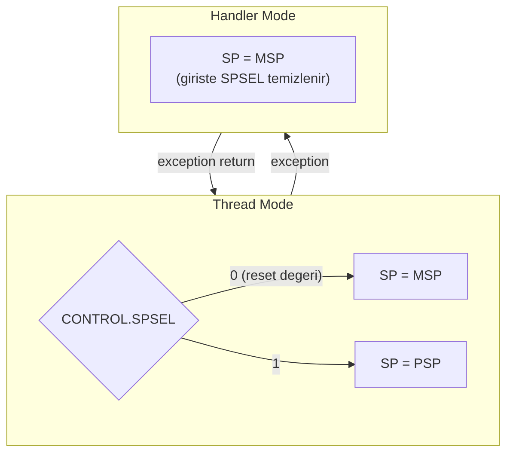

**Language:** English | [Türkçe](README.tr.md)

# Lesson 04 — Stack, MSP & PSP

`[STANDARD]` · Day 2 · Estimated time: 50–70 min

> **Repair note (after independent audit).** The first version changed
> `CONTROL.SPSEL` midway through an ordinary C function. This is invalid and
> caused a write just beyond `task_stack` under `-O2`/`-Os`. The transition now
> uses a small assembly fragment plus a fresh C entry point. All measurements
> below were taken again after the repair.

---

## Why This Matters

In embedded systems, the stack is not simply "where variables live." On Cortex-M,
it is **part of the execution model**: function return addresses, saved registers,
and the state automatically pushed by hardware on exceptions all go there.

The practical consequence: misconfiguring the stack means **corrupting execution
state**, not "running a little slower." Every RTOS task has its own stack;
Cortex-M's two separate stack pointers make this possible. The context switch in
Lessons 14 and 15 is built entirely on these two registers.

This lesson does not cover all exception stacking — that belongs to Lessons
07/08. Here we build the chain:
`fonksiyon çağrısı → SP → PUSH/POP → MSP/PSP → SPSEL`.

---

## Core Idea

### What is a stack, and what does SP point to?

A stack is a memory region used with **last-in, first-out (LIFO)** discipline.
On Cortex-M, it is **full-descending**:

| Term | Meaning |
|---|---|
| **full** | When the stack is not empty, `SP` points to the last word pushed, not the next empty slot |
| **descending** | The stack grows downwards from high addresses; `PUSH` decreases `SP` |

Two subtleties:

- On an **empty stack**, `SP` points **one past** the usable area. That address
  does not belong to the stack and must not be read. Thus "`SP` always points
  to meaningful data" is **false**; it holds only when the stack is nonempty.
- The area **below** `SP` is allocated, but its contents are undefined: remnants
  of data previously pushed and popped. Reading a word that has not been
  `POP`ped therefore does not provide a meaningful value.

### Two stack pointers

`SP` (r13) is not one physical register; it is an **alias** for one of two
registers (banked register):

| | Who uses it |
|---|---|
| **MSP** (Main Stack Pointer) | Everything after reset; Handler Mode |
| **PSP** (Process Stack Pointer) | Optionally Thread Mode |

**`CONTROL.SPSEL`** (bit 1) selects between them:

```text
Thread Mode,  SPSEL = 0  ->  SP, MSP'yi gösterir
Thread Mode,  SPSEL = 1  ->  SP, PSP'yi gösterir
Handler Mode              ->  SP, MSP'yi gösterir (SPSEL'in değeri ne olursa olsun)
```

After reset, `CONTROL = 0`, so MSP is active. On exception entry, the processor
clears `SPSEL`; handlers therefore run on MSP.

> **Deep Dive — TrustZone.** With the Security Extension, these registers double
> (`MSP_S`/`MSP_NS`, `PSP_S`/`PSP_NS`); read the table above as the MSP/PSP of
> *the current security state*. This lesson assumes one security state;
> details are in Lesson 16.

### Writing a value ≠ activating it

The lesson in one sentence:

> **`__set_PSP(x)` changes PSP's contents. It does not change which register
> is used as `SP`. `CONTROL.SPSEL` changes that.**

### Why can the transition itself not be done in C?

This is the important new part introduced by the repair.

The compiler allocates a C function's frame on MSP and emits instructions that
access locals through `[sp, #offset]`. When `SPSEL` changes, `SP` points to a
different region — **the same offsets now refer to different addresses**.
Writing `CONTROL` neither moves the existing frame nor creates a new one.

The correct boundary is:

```text
MSP uzerinde C  ->  kucuk assembly gecisi  ->  PSP uzerinde TAZE bir C girisi
```

The assembly fragment operates without the compiler's frame assumptions;
the new C function establishes its own prologue on the new `SP`. The frame
left on MSP is abandoned and never accessed again.

---

## Mental Model

Think of the stack as **trays stacked downwards from the ceiling**. `SP` points
to the last tray placed; adding one (`PUSH`) moves your hand down one level,
and removing one (`POP`) moves it up one level.

Two stack pointers are **two separate tray stacks**: one for the kitchen
(kernel/handler), one for the table (application task). `SPSEL` selects which
stack your hand reaches for. Even if the table's stack falls over, the kitchen's
remains standing — this is why RTOSes use PSP.

---

## Visual

### 1. Full-descending stack

Live data extends **upwards** from `SP` to the top; below `SP` is available space.

```text
  Yuksek adres
  0x30000200  <-- TASK_STACK_TOP (kullanilabilir alanin BIR OTESI)
              +---------------------+       stack'e ait DEGIL; yazilmaz
  0x300001FC  | en eski itilen word |  ^
              +---------------------+  |
  0x300001F8  |        ...          |  |   CANLI VERI
              +---------------------+  |   (itilmis, henuz cikarilmamis)
  0x300001F4  | en son itilen word  |  v
              +=====================+  <-- SP
  0x300001F0  |  bos / tanimsiz     |
              +---------------------+      KULLANILABILIR ALAN
  0x300001EC  |  bos / tanimsiz     |      (asagi dogru buyur)
              +---------------------+
                       ...
  0x30000000  +---------------------+  <-- TASK_STACK_BASE (dip)
  Dusuk adres
```

On an empty stack, `SP == TASK_STACK_TOP`; at that moment, `SP` points to
**no valid data**.

Result of `PUSH {r4}`: `SP` decreases by 4, and `r4` is written at the new `SP`.
Result of `POP {r4}`: the word at `SP` is read into `r4`, and `SP` increases by 4.

> The architecture defines this through the *effective address*; it does not
> guarantee an atomic micro-operation ordering of "first this, then that."
> The observable result is stated above. In a multi-register `PUSH`, **the
> lowest-numbered register is written to the lowest address**.

### 2. MSP vs PSP



```text
        PSP register'ina deger yazmak   !=   PSP'yi aktif SP yapmak
        ------------------------------        ----------------------
        __set_PSP(0x30000200)                 CONTROL.SPSEL = 1
        (icerik degisti)                      (hangi register SP oldu?)
```

---

## Tiny Example

Sources: [`example/main.c`](example/main.c),
[`example/psp_start.S`](example/psp_start.S),
[`example/push_pop_probe.S`](example/push_pop_probe.S).

A separate stack area and overflow guards:

```c
#define TASK_STACK_WORDS   128u          /* 128 * 4 = 512 byte */
#define GUARD_WORDS        2u
#define GUARD_PATTERN      0xDEADBEEFu

static uint32_t task_stack_block[TASK_STACK_WORDS + GUARD_WORDS]
    __attribute__((aligned(8)));

#define TASK_STACK_BASE ((uint32_t)&task_stack_block[0])
#define TASK_STACK_TOP  ((uint32_t)&task_stack_block[TASK_STACK_WORDS])
```

The two words at the end of the block do not belong to the stack; they are filled
with a known pattern. Their remaining intact after normal execution shows
**these two selected locations were not overwritten** — exactly how the
original bug was caught.

Guard words **do not establish**:

- that no overflow occurred below the lower bound,
- that no stray write occurred elsewhere,
- that `SP` never left its valid range,
- that the guard was not written and then restored to the same pattern.

This check covers only the monitored locations. Use the GDB measurements and
disassembly below for a more detailed examination of stack usage.

Why `aligned(8)`? AAPCS32 requires 8-byte alignment of `SP` at a **public
interface boundary**, meaning an ordinary function call. Aligning the array
to 8 and making its usable size a multiple of 8 also aligns its top to 8 bytes.

> This is an **ABI** rule, not an instruction-alignment rule. Cortex-M33
> `LDRD`/`STRD` require word (4-byte) alignment; 8-byte alignment comes from
> the calling contract, not those instructions. Therefore `SP % 8 == 4` alone
> **does not cause** an `LDRD`/`STRD` fault — it violates an ABI assumption.
> Confusing the two is common.

The transition:

```c
__set_PSP(TASK_STACK_TOP);
report_state("[2] PSP yazildi, SPSEL DEGISMEDI");   /* <-- kanit burada */

psp_start(TASK_STACK_TOP, thread_entry);            /* DONMEZ */
```

```asm
psp_start:
    msr     psp, r0         /* 1) PSP = yeni stack tepesi */
    mrs     r2, control
    orr     r2, r2, #2      /* 2) SPSEL = 1               */
    msr     control, r2
    isb                     /* 3) senkronize et           */
    ldr     lr, =psp_entry_trap
    orr     lr, lr, #1
    bx      r1              /* taze C baglamina dallan    */
```

Three details:

- **Read–modify–write.** Writing `2` directly to `CONTROL` silently clears
  bit 0 (`nPRIV`). Preserve bits you are not changing.
- **The `ISB` is our responsibility here**, because we write `MSR CONTROL`
  manually. Note: the CMSIS `__set_CONTROL()` wrapper **already executes
  `ISB` internally**, as does this repository's `core/cm33_teaching.h`.
  Calling `__set_CONTROL()` from C therefore needs no additional `__ISB()` —
  the wrapper's implementation, not the architecture, removes that need.
  The architectural principle remains: a `CONTROL` write requires an instruction
  synchronization barrier; the only question is **who executes it**.
- **`lr` is set to a trap.** `thread_entry` is `noreturn`; if it returns anyway,
  execution enters a known infinite loop instead of an undefined address.

---

## Build & Run

```bash
cmake --preset debug
cmake --build --preset debug --target 04-stack-msp-psp
./scripts/run-qemu.sh build/debug/lessons/04-stack-msp-psp/04-stack-msp-psp.elf
```

Exit QEMU: `Ctrl-A`, then `X`.

---

## Expected Output

Actual output — **remeasured after the repair**
(arm-none-eabi-gcc 13.2.1, QEMU 8.2.2, mps2-an505, `debug` preset):

```text
===== LESSON 04: STACK, MSP & PSP =====
[1] reset sonrasi
[  MSP] 0x30007FC0
[  PSP] 0x00000000
[  CONTROL] 0x00000000
[  ACTIVE_SP] MSP
[  LOCAL_ADDR] 0x30007FC4
--- fonksiyon cagrisi ---
[  SP_OUTSIDE(approx)] 0x30007FE0
[  SP_INSIDE(approx)] 0x30007FBC
[  SUM] 50
--- push/pop (assembly) ---
[  SP_BEFORE_PUSH] 0x30007FD0
[  SP_AFTER_PUSH] 0x30007FC0
[  SP_AFTER_POP] 0x30007FD0
[  PUSH_DELTA_BYTES] 16
[  SP_RESTORED] YES
--- PSP'ye adres yaziliyor ---
[  TASK_STACK_BASE] 0x30000000
[  TASK_STACK_TOP] 0x30000200
[  TOP_MOD_8] 0
[2] PSP yazildi, SPSEL DEGISMEDI
[  MSP] 0x30007FC0
[  PSP] 0x30000200
[  CONTROL] 0x00000000
[  ACTIVE_SP] MSP
[  LOCAL_ADDR] 0x30007FC4
[3] psp_start() sonrasi -> PSP aktif
[  MSP] 0x30007FD0
[  PSP] 0x300001E0
[  CONTROL] 0x00000002
[  ACTIVE_SP] PSP
[  LOCAL_ADDR] 0x300001E4
--- PSP uzerinde fonksiyon cagrisi ---
[  PSP_NOW] 0x300001F0
[  SP_INSIDE(approx)] 0x300001DC
[  MSP_UNTOUCHED] 0x30007FD0
[  GUARD_ADDR] 0x30000200
[  GUARD_VALUE] 0xDEADBEEF
[  CHECK_STACK_GUARD] PASS
===== END =====
```

> Addresses are build-specific and shift when any code changes. What matters
> is **relationships**, not the numbers. Your output may show different
> addresses, but all five observations below must still hold.

Five observations:

1. **`LOCAL_ADDR` is identical in stages 1 and 2: `0x30007FC4`.** We wrote
   `0x30000200` to PSP; `CONTROL` is still 0 and locals remain in the MSP region.
   Writing PSP alone did not change the active-stack selection.
2. **In stage 3, `LOCAL_ADDR` jumped to `0x300001E4`**, inside `task_stack_block`.
3. **`PUSH_DELTA_BYTES = 16`**: four registers × 4 bytes. After `POP`, `SP`
   returned exactly to its previous value.
4. **`MSP_UNTOUCHED` = `0x30007FD0`.** MSP remains untouched there — handlers
   will need it.
5. **`CHECK_STACK_GUARD` = PASS.** The word just beyond the allocated area is
   still `0xDEADBEEF`. This shows that the original concrete bug did not recur
   (that exact location was written under `-O2`/`-Os`). It still does not prove
   "no bounds violation anywhere" — only that **these monitored locations**
   remained intact. Also measure in GDB that `$psp` stays within bounds.

It is normal for `LOCAL_ADDR` and `PSP_NOW` to differ: one is a local variable's
address within the compiler's frame; the other is `SP` itself at that moment.
Their separation is **compiler- and optimization-specific**, not an architectural
constant.

---

## Observe in GDB

Terminal 1:

```bash
cmake --build --preset debug --target debug-04-stack-msp-psp
```

Terminal 2:

```bash
gdb-multiarch -q build/debug/lessons/04-stack-msp-psp/04-stack-msp-psp.elf
```

```gdb
set architecture armv8-m.main
target remote :3333
source scripts/gdb/cortex-m.gdb
```

`set architecture armv8-m.main` is required: only then do special registers such
as `$msp`, `$psp`, `$control`, and `$psplim` appear. (`set arm force-mode thumb`
affects only disassembly mode; it does not select the architecture.)

### 1. What exactly does `$sp` show on Cortex-M?

```gdb
(gdb) break report_state
(gdb) continue
(gdb) p/x $sp
(gdb) p/x $msp
(gdb) p/x $psp
(gdb) p/x $control
```

Actual measurements at three stops (after repair):

| Stop | `$sp` | `$msp` | `$psp` | `$control` |
|---|---|---|---|---|
| [1] after reset | `0x30007fd0` | `0x30007fd0` | `0x0` | `0x0` |
| [2] PSP written | `0x30007fd0` | `0x30007fd0` | `0x30000200` | `0x0` |
| [3] after `psp_start` | `0x300001f0` | `0x30007fd0` | `0x300001f0` | `0x2` |

**What we inspect and why:**

- **`$sp` is an alias of the active stack pointer.** GDB does not invent a
  separate interpretation. Stage 2: `$sp == $msp`; stage 3: `$sp == $psp`.
- In stage 2, `$psp` changed while `$sp` stayed the same.
- In stage 3, `$msp` did not change at all.

### 2. The transition itself

```gdb
(gdb) disassemble psp_start
```

```text
10000054 <psp_start>:
10000054:  f380 8809   msr   PSP, r0
10000058:  f3ef 8214   mrs   r2, CONTROL
1000005c:  f042 0202   orr.w r2, r2, #2
10000060:  f382 8814   msr   CONTROL, r2
10000064:  f3bf 8f6f   isb   sy
10000068:  f8df e008   ldr.w lr, [pc, #8]
1000006c:  f04e 0e01   orr.w lr, lr, #1
10000070:  4708        bx    r1
```

**What we inspect:** there is no `[sp, #offset]` access here. The function has
no local state dependent on `SP`, so changing what `SP` means is safe. This
cannot be guaranteed in a C function.

Now inspect the target's prologue:

```gdb
(gdb) disassemble thread_entry
```

```text
10000170 <thread_entry>:
10000170:  b500   push  {lr}
10000172:  b083   sub   sp, #12
```

**What we inspect:** `thread_entry` creates its own frame on the **new** `SP`.
`push {lr}` (4 bytes) + `sub sp, #12` = 16 bytes; 8-byte alignment is preserved
at the call boundary. The abandoned MSP frame is never touched.

### 3. Is the allocation boundary really respected?

```gdb
(gdb) p/x task_stack_block[128]
(gdb) p/x $psp
```

`task_stack_block[128]` must remain `0xdeadbeef`, and `$psp` must always stay
within `0x30000000 <= $psp <= 0x30000200`. This was measured in all three presets.

### 4. How far do PUSH/POP move `SP`?

```gdb
(gdb) break push_pop_probe
(gdb) continue
(gdb) p/x $sp
(gdb) disassemble push_pop_probe
```

```text
10000040 <push_pop_probe>:
10000040:  4669   mov   r1, sp
10000042:  6001   str   r1, [r0, #0]
10000044:  b4f0   push  {r4, r5, r6, r7}
10000046:  4669   mov   r1, sp
...
1000004a:  bcf0   pop   {r4, r5, r6, r7}
```

Put a breakpoint at the address after `push` (build-specific):

```gdb
(gdb) break *0x10000046
(gdb) continue
(gdb) p/x $sp
(gdb) x/4wx $sp
(gdb) info registers r4 r5 r6 r7
```

Measured: entry `$sp = 0x30007fd0`, after push `0x30007fc0` (16 bytes lower),
after pop `0x30007fd0` again.

Observation question: which of the four memory words belongs to which register?
`PUSH` writes the lowest-numbered register to the lowest address. Verify with
`info registers`.

### 5. How does a function call use the stack?

```gdb
(gdb) disassemble frame_using_function
```

```text
100000ec <frame_using_function>:
100000ec:  b086   sub   sp, #24
100000ee:  1c43   adds  r3, r0, #1
100000f0:  9305   str   r3, [sp, #20]
```

There is **no** `push`; the compiler allocated space using `sub sp, #24`.
A stack frame has two separate components:

| Component | Purpose | Appearance |
|---|---|---|
| Saved registers | callee-saved registers, `lr` | `push {...}` / `pop {...}` |
| Local-variable area | variables that do not fit in registers (spills) | `sub sp, #N` / `add sp, #N` |

`#24` is a result of this compiler, this source, and this optimization level —
not an architectural value.

### 6. Does every C function use the stack? (No.)

```gdb
(gdb) disassemble active_stack_name
```

```text
100000c4 <active_stack_name>:
100000c4:  f3ef 8305   mrs   r3, IPSR
100000c8:  b933        cbnz  r3, 100000d8
100000ca:  f3ef 8314   mrs   r3, CONTROL
100000ce:  f013 0f02   tst.w r3, #2
100000d6:  4770        bx    lr
```

**Not a single stack operation.** A function touches the stack *if* it calls
another function (`lr` must be saved), uses callee-saved registers, or has local
state that does not fit in registers. If none applies, it does not touch it.

This is true **for this build**; the same source may produce different code
with another compiler or optimization level. The right reflex is to inspect
`objdump`, not infer from source.

---

## Experiment

**Experiment 1 — How does optimization change stack usage?**

```bash
cmake --build --preset debug   --target 04-stack-msp-psp
cmake --build --preset release --target 04-stack-msp-psp

arm-none-eabi-objdump -d build/debug/lessons/04-stack-msp-psp/04-stack-msp-psp.elf \
    | grep -A6 "<frame_using_function>:"
arm-none-eabi-objdump -d build/release/lessons/04-stack-msp-psp/04-stack-msp-psp.elf \
    | grep -A6 "<frame_using_function>:"
```

Did the `sub sp, #N` value change? What would happen if source `volatile` were removed?

**Experiment 2 — How quickly does the stack run out?**

`task_stack_block` provides 512 usable bytes. How many bytes does each call to
`frame_using_function` consume? How many nested levels fit? Calculate, then
verify with `p/x $psp` in GDB.

**Experiment 3 — Does alignment really hold?**

```gdb
(gdb) p $sp % 8
```

Measure at different points: inside `main`, inside a function, immediately after
`push`. At a call boundary, the result must be 0. A result of 4 *mid-function*
is not an ABI violation — the rule applies at **public interface boundaries**.

---

## Break It

Stack limits are an **architectural** feature of the Armv8-M Main Extension:
a lower bound is written to `PSPLIM` / `MSPLIM`; if a **stack-pointer update**
moves `SP` below that bound, UsageFault (`UFSR.STKOF`) occurs.

Keeping the scope narrow matters:

- This checks only **stack-pointer updates**. Memory access through an arbitrary
  pointer is not checked — this is not general memory protection. That is the
  MPU's job (Lesson 06).
- Armv7-M (M3/M4/M7) has no `PSPLIM`/`MSPLIM`. This does not mean "overflow
  always silently corrupts memory": the outcome depends on the destination
  address and any MPU configuration. The correct statement is **the architecture
  provides no automatic detection**.
- With TrustZone, these registers are also banked by security state.

```c
SCB->SHCSR |= SCB_SHCSR_USGFAULTENA_Msk;   /* UsageFault'u ayri gorebilmek icin */
__set_PSPLIM(TASK_STACK_BASE);
__ISB();
(void)recurse(0u);
```

```bash
cmake --build --preset debug --target 04-stack-msp-psp-broken
./scripts/run-qemu.sh build/debug/lessons/04-stack-msp-psp/04-stack-msp-psp-broken.elf
```

Actual output (last lines):

```text
--- BREAK IT: PSPLIM + derin recursion ---
[  PSPLIM] 0x30000000
[  PSP] 0x300001F8
  recursion basliyor...
```

Execution stops there: neither `RESULT` nor `===== END =====` is printed.

---

## Debug It

```bash
cmake --build --preset debug --target debug-04-stack-msp-psp-broken
```

```gdb
set architecture armv8-m.main
target remote :3333
source scripts/gdb/cortex-m.gdb
break Default_Handler
continue
cm-mode
cm-fault
p/x $lr
cm-exc-return $lr
cm-frame $psp $lr
```

Actual measurement (with repaired helpers):

```text
Mode      : Handler Mode (exception 6)
Privilege : Privileged (Handler Mode her zaman ayricaliklidir)
Stack     : MSP (0x30007fd0)  (Handler Mode MSP kullanir)
            PSP = 0x30000000   (kesilen Thread baglaminin stack'i olabilir)

CFSR  = 0x00100000  (MMFSR=0x00 BFSR=0x00 UFSR=0x0010)
HFSR  = 0x00000000  FORCED=0 -> escalation YOK
MMFAR = 0x00000000  (MMARVALID=0 -> icerik ANLAMSIZ, kullanma)
BFAR  = 0x00000000  (BFARVALID=0 -> icerik ANLAMSIZ, kullanma)
UYARI: STACKING hatasi bildirilmis (STKOF/STKERR/MSTKERR).
       Bellekte gecerli bir exception frame olmayabilir.

$lr = 0xfffffffd
EXC_RETURN = 0xfffffffd
  bit3 Mode     = 1 -> Thread Mode'a donus
  bit2 SPSEL    = 1 -> frame PSP uzerinde
  bit4 FType    = 1 -> standart (8 word) frame
```

Trying `cm-frame $psp $lr` is **rejected**, correctly:

```text
REDDEDILDI [STACKING HATASI]: CFSR = 0x00100000
```

> This rejection itself results from a repair. The old `cm-frame` read eight
> words from active `$sp`, printed fabricated values such as `PC = 0` and
> `xPSR = 0`, and labeled zero a "bad instruction."
>
> The new interface is `cm-frame <adres> <EXC_RETURN>`. The second argument
> specifies the frame **type** (standard or FP-extended, which stack). It still
> is not a validator: it cannot prove an address contains a real frame; it only
> eliminates unsupported types and invalid values. `EXC_RETURN` is also checked
> strictly against architectural encodings: looking like `0xFFFFFFxx` is not
> sufficient (`0xFFFFFFFF` and `0xFFFFFFF5` are invalid). Details:
> [`docs/DEBUGGING.md`](../../docs/DEBUGGING.md).

Questions to answer:

1. Which exception is `IPSR = 6`? Which bit does `UFSR = 0x0010` set, and what is it called?
2. What does `HFSR = 0` mean? How does it differ from a case with `FORCED = 1`?
3. Why is `$psp` exactly equal to `$psplim`?
4. At the fault, `$control = 0` and `Stack: MSP`, but just before it
   `SPSEL = 1`. Who cleared it?
5. Why did `cm-frame` reject it? What would you read if it had not?

### Exception preview

```text
Thread Mode, PSP kullaniyor
        |
        v  exception (UsageFault)
donanim, kesilen kodun durumunu O AN AKTIF olan stack'e yazmaya calisir
        |
        v
Handler Mode: SPSEL temizlenir -> handler MSP uzerinde calisir
        |
        v  handler donuyor
islemci hangi stack'e donecegini nereden biliyor?
```

The last answer is in `EXC_RETURN` — we will unpack it in **Lesson 07**.

Two cautions:

- "The frame is written to PSP" and "the frame **was written**" are different.
  In this scenario, `STKOF` says precisely that the write attempt failed.
- The interpretation of `0xFFFFFFFD` applies to this context (one security
  state, standard frame). With TrustZone and FP context, `EXC_RETURN` carries
  additional information.

---

## Exercise

### Exercise 01 — Activate PSP Correctly

The file you complete is **assembly, not C**:

```text
exercises/01-activate-psp/psp_start.S
```

`main.c` is ready: the stack block, guards, `thread_entry`, and three checks
are in place. You write the three steps of the transition.

Questions to answer:

- For a full-descending stack, which address should PSP receive — `&block[0]`,
  `&block[127]`, or `&block[128]`?
- How do you update `CONTROL` without overwriting bit 0?
- Which instruction is required afterwards, and why is it required **here**?

```bash
cmake --build --preset debug --target 04-exercise-psp
./scripts/run-qemu.sh build/debug/lessons/04-stack-msp-psp/04-exercise-psp.elf
```

Initial output (actual):

```text
[MSP] 0x30007FD0
[PSP] 0x00000000
[CONTROL] 0x00000000
[LOCAL_ADDR] 0x30007FD4
[GUARD_VALUE] 0xDEADBEEF
[CHECK_SPSEL] FAIL
[CHECK_REGION] FAIL
[CHECK_STACK_GUARD] PASS
```

**Verification criterion:** `CHECK_SPSEL` and `CHECK_REGION` must become `PASS`,
and `CHECK_STACK_GUARD` must remain `PASS`. All three are necessary: the first
two show that a transition happened, the third that it used the **correct location**.

Also verify with GDB:

```gdb
p/x $sp     p/x $msp     p/x $psp     p/x $control
p/x task_stack_block[128]
```

### Exercise 02 (optional, DEEP) — PSP consumption in nested calls

With PSP active, make three nested function calls and record `PSP` at every
level. How many bytes did each level consume? What changes in the `release`
preset? There is no separate reference solution — your measurement is the answer.

---

## Reference Solution

| What | Where | Target |
|---|---|---|
| Exercise 01 solution | [`solutions/01-activate-psp/`](solutions/01-activate-psp/) | `04-solution-psp` |

```bash
cmake --build --preset debug --target 04-solution-psp
./scripts/run-qemu.sh build/debug/lessons/04-stack-msp-psp/04-solution-psp.elf
```

Actual output (`debug`; also verified with `release` and `minsize`):

```text
===== LESSON 04 SOLUTION 01 =====
[TASK_STACK_BASE] 0x30000000
[TASK_STACK_LIMIT] 0x30000200
[TOP_MOD_8] 0
[MSP] 0x30007FF0
[PSP] 0x300001F0
[CONTROL] 0x00000002
[LOCAL_ADDR] 0x300001F4
[GUARD_VALUE] 0xDEADBEEF
[CHECK_SPSEL] PASS
[CHECK_REGION] PASS
[CHECK_STACK_GUARD] PASS
===== END =====
```

---

## What I Learned

> This section is yours. Fill it after the experiments.

**Full-descending stack in my own words:**

<!-- -->

**Where I might forget "writing a value ≠ activating it":**

<!-- -->

**Why the stack cannot be switched midway through C:**

<!-- -->

**The relationship I saw between `$sp`, `$msp`, and `$psp` in GDB:**

<!-- -->

**The question I am taking into Lesson 07:**

<!-- -->

---

## Quick Check

1. What does full-descending mean? What does each word say?
   What does `SP` point to on an empty stack?

2. How far and in which direction does `PUSH {r4, r5}` move `SP`?
   Which of `r4` and `r5` is written to the lower address?

3. Why does writing `PSP` not make it the active stack? What activates it?

4. Which stack does Thread Mode use after reset? How can you know without writing code?

5. An exception occurs while Thread Mode uses `PSP`. On which `SP` does the
   handler run, and to **which** stack does hardware attempt to write state?
   (These are different answers.) Can you assume the write succeeded?

6. **(Reasoning)** Must every C function use the stack? Justify your answer with
   disassembly from this lesson.

7. **(Reasoning)** Why might 8-byte alignment matter? Is it an instruction-
   alignment rule or a calling-contract rule?

8. **(Reasoning)** What breaks if you change `CONTROL.SPSEL` midway through an
   ordinary C function? Why do `volatile` or an extra `ISB` not fix it?

> Answers: [`answers/quick-check.md`](answers/quick-check.md)
> — open after writing your own answer.

---

## Takeaway

- The stack is **full-descending**: `PUSH` decreases `SP` and writes at the new
  `SP`. On an empty stack, `SP` is one past the usable area.
- Cortex-M `SP` is an alias backed by **MSP** and **PSP**; `CONTROL.SPSEL`
  selects between them. Handler Mode always uses MSP.
- **`__set_PSP()` writes contents; `CONTROL.SPSEL` selects.** The order is
  mandatory: valid address first, then transition.
- **You cannot switch the stack midway through C.** The compiler does not move
  the existing frame. Transition requires a boundary without frame assumptions
  and a fresh C entry.
- **Not every function uses the stack** — inspect generated machine code, not source.
- `PSPLIM`/`MSPLIM` check **stack-pointer updates**; they are not general
  memory protection.

---

## Official References

- **Armv8-M Architecture Reference Manual (Arm DDI 0553)** — stack-pointer
  banking (MSP/PSP), `CONTROL.SPSEL`, `MSPLIM`/`PSPLIM` and `UFSR.STKOF`,
  clearing `SPSEL` on exception entry, `EXC_RETURN`.
  <https://developer.arm.com/documentation/ddi0553/latest/>
- **Cortex-M33 Devices Generic User Guide (Arm 100235)** — core registers,
  `CONTROL`, stack-pointer usage.
  <https://developer.arm.com/documentation/100235/latest/>
- **Procedure Call Standard for the Arm Architecture (AAPCS32)** —
  8-byte stack alignment at public interface boundaries.
  <https://github.com/ARM-software/abi-aa/blob/main/aapcs32/aapcs32.rst>
- **CMSIS-Core (M)** — `__get_MSP`, `__get_PSP`, `__set_PSP`, `__get_CONTROL`,
  `__set_CONTROL` (executes `ISB` internally), `__set_PSPLIM`, `__ISB`.
  <https://arm-software.github.io/CMSIS_6/latest/Core/index.html>
- Measurement environment: `arm-none-eabi-gcc 13.2.1`, `QEMU 8.2.2`,
  `mps2-an505 / cortex-m33`, `debug` preset unless stated otherwise.

---

**Previous:** [03 — C and Assembly](../03-c-and-assembly/)
**Next:** [05 — Privilege & SVC](../05-privilege-svc/)
