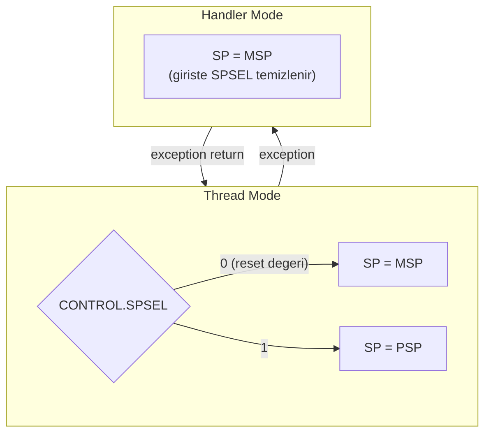

**Dil:** [English](README.md) | Türkçe

# Lesson 04 — Stack, MSP & PSP

`[STANDARD]` · Day 2 · Tahmini süre: 50–70 dk

> **Onarım notu (bağımsız denetim sonrası).** Bu dersin ilk sürümü
> `CONTROL.SPSEL`'i sıradan bir C fonksiyonunun ortasında değiştiriyordu.
> Bu geçersizdir ve `-O2`/`-Os` altında `task_stack`'in bir üstüne yazılmasına
> yol açıyordu. Geçiş artık küçük bir assembly parçası + taze bir C giriş
> noktası ile yapılıyor. Aşağıdaki bütün ölçümler onarımdan sonra yeniden
> alınmıştır.

---

## Why This Matters

Stack, gömülü sistemlerde "değişkenlerin durduğu yer" değildir. Cortex-M'de
**yürütme modelinin bir parçasıdır**: fonksiyon dönüş adresleri, kaydedilmiş
register'lar ve exception geldiğinde donanımın otomatik ittiği durum — hepsi
oraya gider.

Bunun pratik sonucu şu: stack'i yanlış yapılandırmak "biraz yavaş çalışır"
değil, **çalışma durumunun bozulması** demektir. Bir RTOS'ta her görevin ayrı
stack'i vardır; bunu mümkün kılan şey Cortex-M'in iki ayrı stack pointer'a
sahip olmasıdır. Ders 14 ve 15'teki context switch tamamen bu iki register'ın
üzerine kurulu.

Bu ders exception stacking'in tamamını anlatmaz — orası ders 07/08. Burada
zinciri kuruyoruz: `fonksiyon çağrısı → SP → PUSH/POP → MSP/PSP → SPSEL`.

---

## Core Idea

### Stack nedir, SP neyi gösterir?

Stack, **son giren ilk çıkar (LIFO)** disipliniyle kullanılan bir bellek
bölgesidir. Cortex-M'de **full-descending** olarak tanımlıdır:

| Terim | Anlamı |
|---|---|
| **full** | Stack boş değilken `SP`, son itilen word'ü gösterir (bir sonraki boş slotu değil) |
| **descending** | Stack yüksek adresten aşağı doğru büyür; `PUSH` `SP`'yi azaltır |

İki incelik:

- **Boş stack'te** `SP`, kullanılabilir alanın **bir ötesini** gösterir. O
  adres stack'e ait değildir ve okunmamalıdır. Yani "`SP` her zaman anlamlı
  bir veri gösterir" **yanlıştır**; yalnızca stack boş değilken doğrudur.
- `SP`'nin **altındaki**, ayrılmış stack belleği sınırları içindeki alan
  **henüz canlı stack verisi olmayan boş kapasitedir**. İçeriği tanımsızdır;
  geçmiş `PUSH`/`POP` işlemlerinden kalıntılar bulunabilir. `SP` aşağı
  ilerlemeden bu alanı canlı stack verisi gibi okumak doğru değildir.

### İki stack pointer

`SP` (r13) tek bir fiziksel register değildir; ikisinden birinin **takma
adıdır** (banked register):

| | Kim kullanır |
|---|---|
| **MSP** (Main Stack Pointer) | Reset sonrası her şey; Handler Mode |
| **PSP** (Process Stack Pointer) | İsteğe bağlı olarak Thread Mode |

Seçimi **`CONTROL.SPSEL`** (bit 1) yapar:

```text
Thread Mode,  SPSEL = 0  ->  SP, MSP'yi gösterir
Thread Mode,  SPSEL = 1  ->  SP, PSP'yi gösterir
Handler Mode              ->  SP, MSP'yi gösterir (SPSEL'in değeri ne olursa olsun)
```

Reset'ten sonra `CONTROL = 0`, yani MSP aktiftir. Exception'a girerken
işlemci `SPSEL`'i temizler; bu yüzden handler'lar MSP üzerinde çalışır.

> **Deep Dive — TrustZone.** Security Extension varsa bu register'lar
> ikiye katlanır (`MSP_S`/`MSP_NS`, `PSP_S`/`PSP_NS`) ve yukarıdaki tablo
> *mevcut güvenlik durumunun* MSP/PSP'si olarak okunmalıdır. Bu ders tek
> güvenlik durumu varsayar; ayrıntı ders 16'da.

### Değer yazmak ≠ aktif etmek

Bu dersin tek cümlelik özeti:

> **`__set_PSP(x)` PSP'nin içeriğini değiştirir. Hangi register'ın `SP`
> olarak kullanıldığını değiştirmez. Onu `CONTROL.SPSEL` değiştirir.**

### Geçişin kendisi neden C'de yapılamaz?

Bu, onarımın getirdiği yeni ve önemli parça.

Derleyici bir C fonksiyonu için MSP üzerinde bir frame ayırır ve yerel
değişkenlere `[sp, #offset]` ile erişen komutlar üretir. `SPSEL` değişince
`SP` başka bir bölgeyi gösterir — **aynı offset'ler artık başka bir adrese
denk gelir.** `CONTROL` yazmak ne mevcut frame'i taşır ne de yenisini kurar.

Doğru sınır şudur:

```text
MSP uzerinde C  ->  kucuk assembly gecisi  ->  PSP uzerinde TAZE bir C girisi
```

Assembly parçası derleyicinin frame varsayımı olmayan bir yerdedir; yeni C
fonksiyonu kendi prolog'unu yeni `SP` üzerinde kurar. MSP'de kalan frame
terk edilir ve bir daha erişilmez.

---

## Mental Model

Stack'i **tavandan aşağı dizilen tepsiler** gibi düşün. `SP` en son konan
tepsiyi gösterir; yeni tepsi koymak (`PUSH`) elini bir kat aşağı indirmek,
almak (`POP`) bir kat yukarı çıkarmak demek.

İki stack pointer ise **iki ayrı tepsi yığını**: biri mutfağın (kernel /
handler), biri masanın (uygulama görevi). `SPSEL` elinin hangi yığına
uzandığını belirleyen şalter. Masadaki yığın devrilse bile mutfaktaki ayakta
kalır — RTOS'ların PSP kullanmasının sebebi budur.

---

## Visual

### 1. Full-descending stack

Canlı veri `SP`'den **yukarı doğru** tepeye kadar uzanır; `SP`'nin altı
kullanılabilir boş alandır.

```text
  Yuksek adres
  0x30000200  <-- TASK_STACK_TOP (kullanilabilir alanin BIR OTESI)
              +---------------------+       stack'e ait DEGIL; yazilmaz
  0x300001FC  | en eski itilen word |  ^
              +---------------------+  |
  0x300001F8  |        ...          |  |   CANLI VERI
              +---------------------+  |   (itilmis, henuz cikarilmamis)
  0x300001F4  | en son itilen word  |  v
              +=====================+  <-- SP
  0x300001F0  |  bos / tanimsiz     |
              +---------------------+      KULLANILABILIR ALAN
  0x300001EC  |  bos / tanimsiz     |      (asagi dogru buyur)
              +---------------------+
                       ...
  0x30000000  +---------------------+  <-- TASK_STACK_BASE (dip)
  Dusuk adres
```

Boş stack'te `SP == TASK_STACK_TOP`'tur; yani `SP` o anda **hiçbir geçerli
veriyi göstermez.**

`PUSH {r4}` sonucu: `SP` 4 azalır ve `r4` yeni `SP` adresine yazılır.
`POP {r4}` sonucu: `SP` adresindeki word `r4`'e okunur, `SP` 4 artar.

> Mimari bunu *etkin adres* (effective address) üzerinden tanımlar; yani
> "önce şu mikro-işlem, sonra bu" diye atomik bir sıra garanti edilmez.
> Gözlemlenebilir sonuç yukarıdaki iki cümledir. Çok register'lı bir `PUSH`'ta
> **en düşük numaralı register en düşük adrese** yazılır.

### 2. MSP vs PSP



```text
        PSP register'ina deger yazmak   !=   PSP'yi aktif SP yapmak
        ------------------------------        ----------------------
        __set_PSP(0x30000200)                 CONTROL.SPSEL = 1
        (icerik degisti)                      (hangi register SP oldu?)
```

---

## Tiny Example

Kaynaklar: [`example/main.c`](example/main.c),
[`example/psp_start.S`](example/psp_start.S),
[`example/push_pop_probe.S`](example/push_pop_probe.S).

Ayrı stack alanı ve taşma nöbetçileri:

```c
#define TASK_STACK_WORDS   128u          /* 128 * 4 = 512 byte */
#define GUARD_WORDS        2u
#define GUARD_PATTERN      0xDEADBEEFu

static uint32_t task_stack_block[TASK_STACK_WORDS + GUARD_WORDS]
    __attribute__((aligned(8)));

#define TASK_STACK_BASE ((uint32_t)&task_stack_block[0])
#define TASK_STACK_TOP  ((uint32_t)&task_stack_block[TASK_STACK_WORDS])
```

Bloğun sonundaki iki word stack'e ait değildir; bilinen bir desenle doldurulur.
Normal çalışma sonunda hâlâ bozulmamış olmaları, **bu iki seçilmiş konumun
üzerine yazılmadığını gösterir** — ilk sürümdeki hata tam olarak
böyle yakalanmıştı.

Guard word'leri şu durumları **göstermez**:

- alt sınırdan (tabandan) taşma olmadığını,
- başka bir yere kaçak yazma olmadığını,
- `SP`'nin hiçbir an aralık dışına çıkmadığını,
- guard'a yazılıp aynı desenle geri yazılmadığını.

Bu kontrol yalnızca izlenen konumları kapsar. Stack kullanımını daha
ayrıntılı incelemek için aşağıdaki GDB ölçümleri ve disassembly kullanılır.

`aligned(8)` neden? AAPCS32, bir **genel arayüz sınırında** — yani normal bir
fonksiyon çağrısı anında — `SP`'nin 8 byte hizalı olmasını şart koşar. Diziyi
8'e hizalayıp kullanılabilir boyutu 8'in katı tutunca tepe adresi de 8 byte
hizalı çıkar.

> Bu **ABI** kuralıdır, komut hizalama kuralı değildir. Cortex-M33'te
> `LDRD`/`STRD` word (4 byte) hizalama ister; 8 byte hizalama onların
> gereksinimi değil, çağrı sözleşmesinin gereğidir. Dolayısıyla
> `SP % 8 == 4` tek başına bir `LDRD`/`STRD` fault'u **üretmez** — bozulan
> şey ABI varsayımıdır. İkisini karıştırmak yaygın bir hata.

Geçiş:

```c
__set_PSP(TASK_STACK_TOP);
report_state("[2] PSP yazildi, SPSEL DEGISMEDI");   /* <-- kanit burada */

psp_start(TASK_STACK_TOP, thread_entry);            /* DONMEZ */
```

```asm
psp_start:
    msr     psp, r0         /* 1) PSP = yeni stack tepesi */
    mrs     r2, control
    orr     r2, r2, #2      /* 2) SPSEL = 1               */
    msr     control, r2
    isb                     /* 3) senkronize et           */
    ldr     lr, =psp_entry_trap
    orr     lr, lr, #1
    bx      r1              /* taze C baglamina dallan    */
```

Üç ayrıntı:

- **Oku-değiştir-yaz.** `CONTROL`'e doğrudan `2` yazmak bit 0'ı (`nPRIV`)
  sessizce sıfırlar. Dokunmadığın bitleri koru.
- **`ISB` burada bize ait.** Çünkü `MSR CONTROL`'ü elle yazıyoruz. Dikkat:
  CMSIS'in `__set_CONTROL()` sarmalayıcısı **kendi içinde zaten `ISB`
  çalıştırır** (bu repodaki `core/cm33_teaching.h` de öyle). Yani C'den
  `__set_CONTROL()` çağırdığında ayrıca `__ISB()` yazmak gerekli değildir —
  gerekliliği ortadan kaldıran şey mimari değil, sarmalayıcının içeriğidir.
  Mimari ilke geçerliliğini korur: `CONTROL` yazımından sonra bir komut
  senkronizasyon bariyeri gerekir; soru yalnızca **onu kimin çalıştırdığıdır.**
- **`lr` bir tuzağa ayarlanır.** `thread_entry` `noreturn`'dür; yine de
  dönerse tanımsız bir adrese gitmek yerine bilinen bir sonsuz döngüye düşer.

---

## Build & Run

```bash
cmake --preset debug
cmake --build --preset debug --target 04-stack-msp-psp
./scripts/run-qemu.sh build/debug/lessons/04-stack-msp-psp/04-stack-msp-psp.elf
```

QEMU'dan çıkış: `Ctrl-A` sonra `X`.

---

## Expected Output

Gerçek çıktı — **onarım sonrası yeniden ölçüldü**
(arm-none-eabi-gcc 13.2.1, QEMU 8.2.2, mps2-an505, `debug` preset):

```text
===== LESSON 04: STACK, MSP & PSP =====
[1] reset sonrasi
[  MSP] 0x30007FC0
[  PSP] 0x00000000
[  CONTROL] 0x00000000
[  ACTIVE_SP] MSP
[  LOCAL_ADDR] 0x30007FC4
--- fonksiyon cagrisi ---
[  SP_OUTSIDE(approx)] 0x30007FE0
[  SP_INSIDE(approx)] 0x30007FBC
[  SUM] 50
--- push/pop (assembly) ---
[  SP_BEFORE_PUSH] 0x30007FD0
[  SP_AFTER_PUSH] 0x30007FC0
[  SP_AFTER_POP] 0x30007FD0
[  PUSH_DELTA_BYTES] 16
[  SP_RESTORED] YES
--- PSP'ye adres yaziliyor ---
[  TASK_STACK_BASE] 0x30000000
[  TASK_STACK_TOP] 0x30000200
[  TOP_MOD_8] 0
[2] PSP yazildi, SPSEL DEGISMEDI
[  MSP] 0x30007FC0
[  PSP] 0x30000200
[  CONTROL] 0x00000000
[  ACTIVE_SP] MSP
[  LOCAL_ADDR] 0x30007FC4
[3] psp_start() sonrasi -> PSP aktif
[  MSP] 0x30007FD0
[  PSP] 0x300001E0
[  CONTROL] 0x00000002
[  ACTIVE_SP] PSP
[  LOCAL_ADDR] 0x300001E4
--- PSP uzerinde fonksiyon cagrisi ---
[  PSP_NOW] 0x300001F0
[  SP_INSIDE(approx)] 0x300001DC
[  MSP_UNTOUCHED] 0x30007FD0
[  GUARD_ADDR] 0x30000200
[  GUARD_VALUE] 0xDEADBEEF
[  CHECK_STACK_GUARD] PASS
===== END =====
```

> Adresler build'e özeldir; kodun herhangi bir yeri değişirse kayarlar.
> Önemli olan sayılar değil, **ilişkiler**. Kendi çıktın farklı adresler
> gösterebilir — aşağıdaki beş gözlemin hepsi yine de tutmalı.

Beş gözlem:

1. **Aşama 1 ve 2'de `LOCAL_ADDR` aynı: `0x30007FC4`.** PSP'ye `0x30000200`
   yazdık, `CONTROL` hâlâ 0, yerel değişkenler hâlâ MSP bölgesinde. PSP değerinin
   yazılması tek başına aktif stack seçimini değiştirmedi.
2. **Aşama 3'te `LOCAL_ADDR` `0x300001E4`'e atladı** — `task_stack_block`
   bölgesine.
3. **`PUSH_DELTA_BYTES = 16`**: dört register × 4 byte. `POP` sonrası `SP`
   tam olarak eski değerine döndü.
4. **`MSP_UNTOUCHED` = `0x30007FD0`.** MSP orada, dokunulmadan duruyor —
   handler'lar ona ihtiyaç duyacak.
5. **`CHECK_STACK_GUARD` = PASS.** Tahsis edilen alanın bir üstündeki word
   hâlâ `0xDEADBEEF`. Bu, ilk sürümdeki somut hatanın tekrarlanmadığını
   gösterir (`-O2`/`-Os` altında tam oraya yazılıyordu). Yine de bu tek
   başına "hiçbir sınır ihlali yok" demek değildir — yalnızca **izlenen bu
   konumların** bozulmadığını söyler. Ayrıca `$psp`'nin aralık
   içinde kaldığını GDB'de ölçmek gerekir.

`LOCAL_ADDR` ile `PSP_NOW`'un farklı olması normal: biri derleyicinin
frame'i içindeki bir yerel değişkenin adresi, diğeri o an `SP`'nin kendisi.
Aradaki mesafe **derleyiciye ve optimizasyon seviyesine özeldir**, mimari bir
sabit değildir.

---

## Observe in GDB

Terminal 1:

```bash
cmake --build --preset debug --target debug-04-stack-msp-psp
```

Terminal 2:

```bash
gdb-multiarch -q build/debug/lessons/04-stack-msp-psp/04-stack-msp-psp.elf
```

```gdb
set architecture armv8-m.main
target remote :3333
source scripts/gdb/cortex-m.gdb
```

`set architecture armv8-m.main` şart: `$msp`, `$psp`, `$control`, `$psplim`
gibi özel register'lar ancak o zaman görünür. (`set arm force-mode thumb`
yalnızca disassembly modunu etkiler; mimari seçimi değildir.)

### 1. `$sp` Cortex-M'de tam olarak ne gösteriyor?

```gdb
(gdb) break report_state
(gdb) continue
(gdb) p/x $sp
(gdb) p/x $msp
(gdb) p/x $psp
(gdb) p/x $control
```

Gerçek ölçüm, üç duruş (onarım sonrası):

| Duruş | `$sp` | `$msp` | `$psp` | `$control` |
|---|---|---|---|---|
| [1] reset sonrası | `0x30007fd0` | `0x30007fd0` | `0x0` | `0x0` |
| [2] PSP yazıldı | `0x30007fd0` | `0x30007fd0` | `0x30000200` | `0x0` |
| [3] `psp_start` sonrası | `0x300001f0` | `0x30007fd0` | `0x300001f0` | `0x2` |

**Neye bakıyoruz ve neden:**

- **`$sp`, aktif stack pointer'ın takma adıdır.** GDB'nin ayrı bir yorumu yok.
  Aşama 2'de `$sp == $msp`, aşama 3'te `$sp == $psp`.
- Aşama 2'de `$psp` değeri değişti, `$sp` aynı kaldı.
- Aşama 3'te `$msp` hiç değişmedi.

### 2. Geçişin kendisi

```gdb
(gdb) disassemble psp_start
```

```text
10000054 <psp_start>:
10000054:  f380 8809   msr   PSP, r0
10000058:  f3ef 8214   mrs   r2, CONTROL
1000005c:  f042 0202   orr.w r2, r2, #2
10000060:  f382 8814   msr   CONTROL, r2
10000064:  f3bf 8f6f   isb   sy
10000068:  f8df e008   ldr.w lr, [pc, #8]
1000006c:  f04e 0e01   orr.w lr, lr, #1
10000070:  4708        bx    r1
```

**Neye bakıyoruz:** Burada hiç `[sp, #offset]` erişimi yok. Fonksiyonun
`SP`'ye bağlı hiçbir yerel durumu yok, dolayısıyla `SP`'nin anlamını
değiştirmek güvenli. Bir C fonksiyonunda bu garanti edilemez.

Şimdi hedefin prolog'una bak:

```gdb
(gdb) disassemble thread_entry
```

```text
10000170 <thread_entry>:
10000170:  b500   push  {lr}
10000172:  b083   sub   sp, #12
```

**Neye bakıyoruz:** `thread_entry` kendi frame'ini **yeni** `SP` üzerinde
kuruyor. `push {lr}` (4 byte) + `sub sp, #12` = 16 byte; çağrı sınırında 8
byte hizalama korunuyor. Terk edilen MSP frame'ine hiç dokunulmuyor.

### 3. Tahsis sınırı gerçekten korunuyor mu?

```gdb
(gdb) p/x task_stack_block[128]
(gdb) p/x $psp
```

`task_stack_block[128]` `0xdeadbeef` kalmalı ve `$psp` her zaman
`0x30000000 <= $psp <= 0x30000200` aralığında olmalı. Üç preset'te de
böyle ölçüldü.

### 4. PUSH/POP `SP`'yi ne kadar oynatıyor?

```gdb
(gdb) break push_pop_probe
(gdb) continue
(gdb) p/x $sp
(gdb) disassemble push_pop_probe
```

```text
10000040 <push_pop_probe>:
10000040:  4669   mov   r1, sp
10000042:  6001   str   r1, [r0, #0]
10000044:  b4f0   push  {r4, r5, r6, r7}
10000046:  4669   mov   r1, sp
...
1000004a:  bcf0   pop   {r4, r5, r6, r7}
```

`push` komutundan sonraki adrese breakpoint koy (adres build'e özel):

```gdb
(gdb) break *0x10000046
(gdb) continue
(gdb) p/x $sp
(gdb) x/4wx $sp
(gdb) info registers r4 r5 r6 r7
```

Ölçülen: giriş `$sp = 0x30007fd0`, push sonrası `0x30007fc0` (16 byte aşağı),
pop sonrası tekrar `0x30007fd0`.

Gözlem sorusu: bellekteki dört word'den hangisi hangi register?
`PUSH` en düşük numaralı register'ı en düşük adrese yazar. `info registers`
ile doğrula.

### 5. Fonksiyon çağrısı stack'i nasıl kullanıyor?

```gdb
(gdb) disassemble frame_using_function
```

```text
100000ec <frame_using_function>:
100000ec:  b086   sub   sp, #24
100000ee:  1c43   adds  r3, r0, #1
100000f0:  9305   str   r3, [sp, #20]
```

`push` **yok**; derleyici `sub sp, #24` ile alan açtı. Stack frame'in iki
ayrı bileşeni var:

| Bileşen | Ne için | Nasıl görünür |
|---|---|---|
| Kaydedilmiş register'lar | callee-saved register'lar, `lr` | `push {...}` / `pop {...}` |
| Yerel değişken alanı | register'a sığmayan (spill) değişkenler | `sub sp, #N` / `add sp, #N` |

`#24` bu derleyicinin, bu kaynağın, bu optimizasyon seviyesinin sonucudur —
mimari bir değer değildir.

### 6. Her C fonksiyonu stack kullanır mı? (Hayır.)

```gdb
(gdb) disassemble active_stack_name
```

```text
100000c4 <active_stack_name>:
100000c4:  f3ef 8305   mrs   r3, IPSR
100000c8:  b933        cbnz  r3, 100000d8
100000ca:  f3ef 8314   mrs   r3, CONTROL
100000ce:  f013 0f02   tst.w r3, #2
100000d6:  4770        bx    lr
```

**Tek bir stack işlemi yok.** Bir fonksiyon stack'e dokunur *eğer*: başka
fonksiyon çağırıyorsa (`lr` saklanmalı), callee-saved register kullanıyorsa,
veya yerel durumu register'lara sığmıyorsa. Hiçbiri yoksa dokunmaz.

Bu **bu build için** doğrudur; aynı kaynak başka bir derleyici veya
optimizasyon seviyesinde farklı kod üretebilir. Doğru refleks kaynağa değil
`objdump`'a bakmaktır.

---

## Experiment

**Deney 1 — Optimizasyon stack kullanımını nasıl değiştiriyor?**

```bash
cmake --build --preset debug   --target 04-stack-msp-psp
cmake --build --preset release --target 04-stack-msp-psp

arm-none-eabi-objdump -d build/debug/lessons/04-stack-msp-psp/04-stack-msp-psp.elf \
    | grep -A6 "<frame_using_function>:"
arm-none-eabi-objdump -d build/release/lessons/04-stack-msp-psp/04-stack-msp-psp.elf \
    | grep -A6 "<frame_using_function>:"
```

`sub sp, #N` değeri değişti mi? Kaynaktaki `volatile` kaldırılsa ne olurdu?

**Deney 2 — Stack ne kadar hızlı tükeniyor?**

`task_stack_block` 512 byte kullanılabilir alan veriyor. `frame_using_function`
her çağrıda kaç byte tüketiyor? Kaç seviye iç içe çağrı yapılabilir? Hesapla,
sonra GDB'de `p/x $psp` ile doğrula.

**Deney 3 — Hizalama gerçekten tutuyor mu?**

```gdb
(gdb) p $sp % 8
```

Farklı noktalarda ölç: `main` içinde, bir fonksiyonun içinde, `push`'tan hemen
sonra. Bir çağrı sınırında 0 olmalı. Bir fonksiyonun *ortasında* 4 olması ABI
ihlali değildir — kural **genel arayüz sınırları** içindir.

---

## Break It

Armv8-M Main Extension'da stack limiti **mimari** bir özelliktir: `PSPLIM` /
`MSPLIM`'e bir alt sınır yazılır ve bir **stack pointer güncellemesi** `SP`'yi
o sınırın altına indirirse UsageFault (`UFSR.STKOF`) oluşur.

Kapsamı dar tutmak önemli:

- Bu yalnızca **stack pointer güncellemelerini** denetler. Rastgele bir
  pointer'la yapılan bellek erişimi kontrol edilmez — genel bellek koruması
  değildir. O iş MPU'nundur (ders 06).
- Armv7-M'de (M3/M4/M7) `PSPLIM`/`MSPLIM` yoktur. Bu, "taşma her zaman
  sessizce belleği bozar" demek değildir: ne olacağı taşılan adrese ve varsa
  MPU yapılandırmasına bağlıdır. Doğru ifade: **mimari otomatik bir yakalama
  sunmaz.**
- TrustZone varsa bu register'lar da güvenlik durumuna göre bankalanır.

```c
SCB->SHCSR |= SCB_SHCSR_USGFAULTENA_Msk;   /* UsageFault'u ayri gorebilmek icin */
__set_PSPLIM(TASK_STACK_BASE);
__ISB();
(void)recurse(0u);
```

```bash
cmake --build --preset debug --target 04-stack-msp-psp-broken
./scripts/run-qemu.sh build/debug/lessons/04-stack-msp-psp/04-stack-msp-psp-broken.elf
```

Gerçek çıktı (son satırlar):

```text
--- BREAK IT: PSPLIM + derin recursion ---
[  PSPLIM] 0x30000000
[  PSP] 0x300001F8
  recursion basliyor...
```

Ve orada duruyor: `RESULT` de `===== END =====` de basılmıyor.

---

## Debug It

```bash
cmake --build --preset debug --target debug-04-stack-msp-psp-broken
```

```gdb
set architecture armv8-m.main
target remote :3333
source scripts/gdb/cortex-m.gdb
break Default_Handler
continue
cm-mode
cm-fault
p/x $lr
cm-exc-return $lr
cm-frame $psp $lr
```

Gerçek ölçüm (onarılmış yardımcılarla):

```text
Mode      : Handler Mode (exception 6)
Privilege : Privileged (Handler Mode her zaman ayricaliklidir)
Stack     : MSP (0x30007fd0)  (Handler Mode MSP kullanir)
            PSP = 0x30000000   (kesilen Thread baglaminin stack'i olabilir)

CFSR  = 0x00100000  (MMFSR=0x00 BFSR=0x00 UFSR=0x0010)
HFSR  = 0x00000000  FORCED=0 -> escalation YOK
MMFAR = 0x00000000  (MMARVALID=0 -> icerik ANLAMSIZ, kullanma)
BFAR  = 0x00000000  (BFARVALID=0 -> icerik ANLAMSIZ, kullanma)
UYARI: STACKING hatasi bildirilmis (STKOF/STKERR/MSTKERR).
       Bellekte gecerli bir exception frame olmayabilir.

$lr = 0xfffffffd
EXC_RETURN = 0xfffffffd
  bit3 Mode     = 1 -> Thread Mode'a donus
  bit2 SPSEL    = 1 -> frame PSP uzerinde
  bit4 FType    = 1 -> standart (8 word) frame
```

`cm-frame $psp $lr` denersen **reddedilir**, ve bu doğru davranıştır:

```text
REDDEDILDI [STACKING HATASI]: CFSR = 0x00100000
```

> Bu reddin kendisi bir onarım sonucudur. Eski `cm-frame`, aktif `$sp`'den
> sekiz word okuyup `PC = 0`, `xPSR = 0` gibi uydurma değerler basıyor ve
> sıfırı "hatalı komut" diye etiketliyordu.
>
> Yeni arayüz `cm-frame <adres> <EXC_RETURN>`. İkinci argüman frame **türünü**
> söyler (standart mı, FP-genişletilmiş mi, hangi stack). Yine de bu bir
> doğrulayıcı değil: bir adresin gerçek bir frame olduğunu kanıtlayamaz,
> yalnızca desteklenmeyen türleri ve geçersiz değerleri eler. `EXC_RETURN` da
> mimari kodlamaya göre sıkı doğrulanır: `0xFFFFFFxx` biçiminde olmak
> yetmez (`0xFFFFFFFF` ve `0xFFFFFFF5` geçersizdir). Ayrıntı:
> [`docs/DEBUGGING.md`](../../docs/DEBUGGING.tr.md).

Cevaplaman gereken sorular:

1. `IPSR = 6` hangi exception? `UFSR = 0x0010` hangi biti set ediyor, adı ne?
2. `HFSR = 0` ne anlama geliyor? `FORCED = 1` gördüğün bir durumdan farkı ne?
3. `$psp` neden tam olarak `$psplim` ile aynı?
4. Fault anında `$control = 0` ve `Stack: MSP`. Ama hemen öncesinde
   `SPSEL = 1` idi. Kim temizledi?
5. `cm-frame` neden reddetti? Reddetmeseydi ne okurdun?

### Exception preview

```text
Thread Mode, PSP kullaniyor
        |
        v  exception (UsageFault)
donanim, kesilen kodun durumunu O AN AKTIF olan stack'e yazmaya calisir
        |
        v
Handler Mode: SPSEL temizlenir -> handler MSP uzerinde calisir
        |
        v  handler donuyor
islemci hangi stack'e donecegini nereden biliyor?
```

Son sorunun cevabı `EXC_RETURN`'dedir — **ders 07**'de açacağız.

İki uyarı:

- "Frame PSP'ye yazılır" ile "frame **yazıldı**" aynı şey değildir. Bu
  senaryoda `STKOF` tam olarak yazma girişiminin başarısız olduğunu söylüyor.
- `0xFFFFFFFD` yorumu bu bağlam içindir (tek güvenlik durumu, standart frame).
  TrustZone ve FP bağlamı devredeyken `EXC_RETURN` daha fazla bilgi taşır.

---

## Exercise

### Exercise 01 — Activate PSP Correctly

Senin dolduracağın dosya **C değil, assembly**:

```text
exercises/01-activate-psp/psp_start.S
```

`main.c` hazır: stack bloğu, guard'lar, `thread_entry` ve üç kontrol yerinde.
Geçişin üç adımını sen yazacaksın.

Cevaplaman gereken sorular:

- Full-descending stack'te PSP'ye hangi adres yazılmalı — `&block[0]`,
  `&block[127]`, `&block[128]`?
- `CONTROL`'ü nasıl güncellersin ki bit 0'ı ezmeyesin?
- Değişiklikten sonra hangi komut gerekiyor ve neden **burada** gerekiyor?

```bash
cmake --build --preset debug --target 04-exercise-psp
./scripts/run-qemu.sh build/debug/lessons/04-stack-msp-psp/04-exercise-psp.elf
```

Başlangıç çıktısı (gerçek):

```text
[MSP] 0x30007FD0
[PSP] 0x00000000
[CONTROL] 0x00000000
[LOCAL_ADDR] 0x30007FD4
[GUARD_VALUE] 0xDEADBEEF
[CHECK_SPSEL] FAIL
[CHECK_REGION] FAIL
[CHECK_STACK_GUARD] PASS
```

**Doğrulama ölçütü:** `CHECK_SPSEL` ve `CHECK_REGION` `PASS` olmalı ve
`CHECK_STACK_GUARD` `PASS` kalmalı. Üçü birden gerekli: ilk ikisi geçişin
olduğunu, üçüncüsü **doğru yerden** olduğunu gösterir.

GDB ile de doğrula:

```gdb
p/x $sp     p/x $msp     p/x $psp     p/x $control
p/x task_stack_block[128]
```

### Exercise 02 (opsiyonel, DEEP) — İç içe çağrılarda PSP tüketimi

PSP aktifken iç içe üç fonksiyon çağrısı yap ve her seviyede `PSP`'yi kaydet.
Her seviye kaç byte tüketti? `release` preset'inde ne değişiyor? Ayrı referans
çözümü yok — cevabın kendi ölçümün.

---

## Reference Solution

| Ne | Nerede | Hedef |
|---|---|---|
| Exercise 01 çözümü | [`solutions/01-activate-psp/`](solutions/01-activate-psp/README.tr.md) | `04-solution-psp` |

```bash
cmake --build --preset debug --target 04-solution-psp
./scripts/run-qemu.sh build/debug/lessons/04-stack-msp-psp/04-solution-psp.elf
```

Gerçek çıktı (`debug`; `release` ve `minsize` ile de doğrulandı):

```text
===== LESSON 04 SOLUTION 01 =====
[TASK_STACK_BASE] 0x30000000
[TASK_STACK_LIMIT] 0x30000200
[TOP_MOD_8] 0
[MSP] 0x30007FF0
[PSP] 0x300001F0
[CONTROL] 0x00000002
[LOCAL_ADDR] 0x300001F4
[GUARD_VALUE] 0xDEADBEEF
[CHECK_SPSEL] PASS
[CHECK_REGION] PASS
[CHECK_STACK_GUARD] PASS
===== END =====
```

---

## What I Learned

> Bu bölüm senin. Deneyleri yaptıktan sonra doldur.

**Full-descending stack'i kendi cümlemle:**

<!-- -->

**"Değer yazmak ≠ aktif etmek" ayrımını nerede unutabilirim:**

<!-- -->

**Stack değiştirmenin neden C'nin ortasında yapılamadığı:**

<!-- -->

**GDB'de `$sp`, `$msp`, `$psp` arasında gördüğüm ilişki:**

<!-- -->

**Ders 07'ye taşıdığım soru:**

<!-- -->

---

## Quick Check

1. Full-descending stack ne demek? İki kelimenin her biri neyi söylüyor?
   Boş bir stack'te `SP` neyi gösterir?

2. `PUSH {r4, r5}` `SP`'yi ne kadar ve hangi yöne oynatır? `r4` ile `r5`'ten
   hangisi daha düşük adrese yazılır?

3. `PSP` register'ına değer yazmak onu neden aktif stack yapmaz? Aktif yapan
   nedir?

4. Reset sonrası Thread Mode hangi stack'i kullanır? Bunu kod yazmadan nereden
   bilebilirsin?

5. Thread Mode `PSP` kullanırken bir exception oluşuyor. Handler hangi `SP`
   üzerinde çalışır ve donanım durumu **hangi** stack'e yazmaya çalışır?
   (İkisi aynı cevap değil.) Yazmanın başarılı olduğunu varsayabilir misin?

6. **(Reasoning)** Her C fonksiyonu mutlaka stack kullanır mı? Cevabını bu
   derste gördüğün bir disassembly ile gerekçelendir.

7. **(Reasoning)** 8 byte hizalama neden önemli olabilir? Bu bir komut
   hizalama kuralı mı, yoksa çağrı sözleşmesi kuralı mı?

8. **(Reasoning)** `CONTROL.SPSEL`'i sıradan bir C fonksiyonunun ortasında
   değiştirirsen ne bozulur? Neden `volatile` veya fazladan bir `ISB` bunu
   düzeltmez?

> Cevaplar: [`answers/quick-check.md`](answers/quick-check.tr.md)
> — kendi cevabını yazdıktan sonra aç.

---

## Takeaway

- Stack **full-descending**'dir: `PUSH` `SP`'yi azaltır ve yeni `SP` adresine
  yazar. Boş stack'te `SP` kullanılabilir alanın bir ötesindedir.
- Cortex-M'de `SP` bir takma addır; arkasında **MSP** ve **PSP** vardır,
  seçimi `CONTROL.SPSEL` yapar, Handler Mode her zaman MSP kullanır.
- **`__set_PSP()` içerik yazar, `CONTROL.SPSEL` seçim yapar.** Sıra
  zorunludur: önce geçerli adres, sonra geçiş.
- **Stack'i C'nin ortasında değiştiremezsin.** Derleyici mevcut frame'i
  taşımaz. Geçiş için frame varsayımı olmayan bir sınır + taze bir C girişi
  gerekir.
- **Her fonksiyon stack kullanmaz** — bu kaynak koddan değil, üretilen makine
  kodundan görülür.
- `PSPLIM`/`MSPLIM` **stack pointer güncellemelerini** denetler; genel bellek
  koruması değildir.

---

## Official References

- **Armv8-M Architecture Reference Manual (Arm DDI 0553)** — stack pointer
  banking (MSP/PSP), `CONTROL.SPSEL`, `MSPLIM`/`PSPLIM` ve `UFSR.STKOF`,
  exception entry'de `SPSEL`'in temizlenmesi, `EXC_RETURN`.
  <https://developer.arm.com/documentation/ddi0553/latest/>
- **Cortex-M33 Devices Generic User Guide (Arm 100235)** — çekirdek
  register'ları, `CONTROL`, stack pointer kullanımı.
  <https://developer.arm.com/documentation/100235/latest/>
- **Procedure Call Standard for the Arm Architecture (AAPCS32)** —
  genel arayüz sınırında 8 byte stack hizalaması.
  <https://github.com/ARM-software/abi-aa/blob/main/aapcs32/aapcs32.rst>
- **CMSIS-Core (M)** — `__get_MSP`, `__get_PSP`, `__set_PSP`, `__get_CONTROL`,
  `__set_CONTROL` (kendi içinde `ISB` çalıştırır), `__set_PSPLIM`, `__ISB`.
  <https://arm-software.github.io/CMSIS_6/latest/Core/index.html>
- Ölçüm ortamı: `arm-none-eabi-gcc 13.2.1`, `QEMU 8.2.2`,
  `mps2-an505 / cortex-m33`, `debug` preset (aksi belirtilmedikçe).

---

**Previous:** [03 — C and Assembly](../03-c-and-assembly/README.tr.md)
**Next:** [05 — Privilege & SVC](../05-privilege-svc/README.tr.md)
