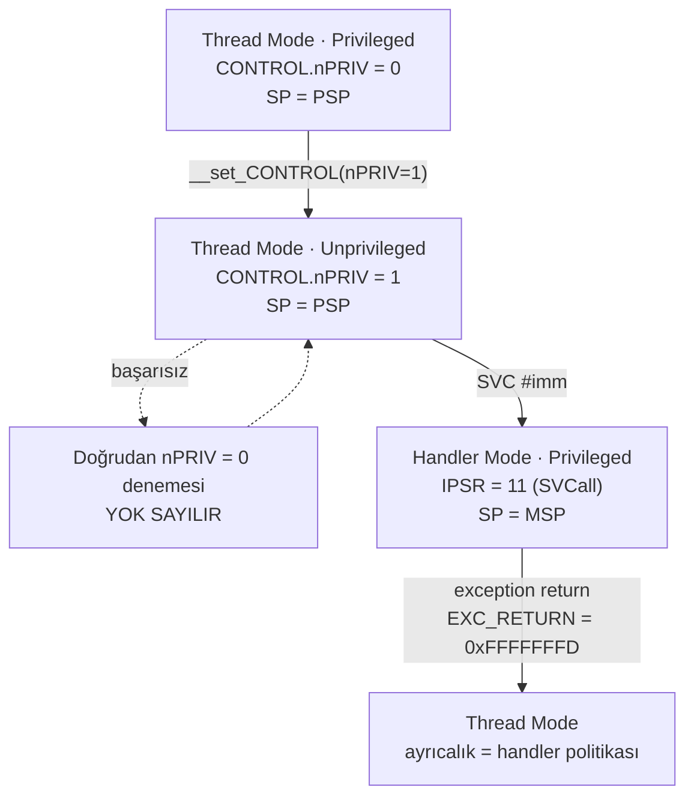

# Lesson 05 — Privilege & SVC

`[STANDARD]` · Day 3 · Tahmini süre: 60–75 dk

---

## Why This Matters

Ders 04'te Thread Mode'u kendi stack'ine (PSP) taşıdık. Bu, bir RTOS görevinin
yarısı. Diğer yarısı şu: görev kodu **ayrıcalıksız** çalışır.

Neden? Çünkü ayrıcalıklı kod her şeye dokunabilir — vektör tablosuna, MPU
yapılandırmasına, `CONTROL`'e, başka görevlerin durumuna. Uygulama katmanında
bir bug varsa (ve olacaktır), o bug'ın çekirdeği bozamaması gerekir.

Ama o zaman bir soru doğar: **ayrıcalıksız kod bir şeye gerçekten ihtiyaç
duyduğunda ne yapacak?** Cevap `SVC`: kontrollü bir kapı. İşletim sistemi
çağrısı (system call) kavramının Cortex-M'deki karşılığı tam olarak budur.

Bu ders ne MPU dersidir (o ders 06) ne de RTOS dersi (14/15). Burada kurulan
tek şey **ayrıcalık akışı**.

---

## Core Idea

### Dört durumun ikisi bağımsız

| | Belirleyen | Değerleri |
|---|---|---|
| **Mod** | `IPSR` | Thread (`IPSR = 0`) / Handler (`IPSR > 0`) |
| **Ayrıcalık** | Thread'de `CONTROL.nPRIV`; Handler'da **her zaman ayrıcalıklı** | Privileged / Unprivileged |

İki temel kural:

1. **Handler Mode her zaman ayrıcalıklıdır.** `CONTROL.nPRIV` handler'ın
   ayrıcalığını tanımlamaz; **kesilen Thread bağlamının** ayrıcalığını
   tanımlar. Handler içinde `nPRIV = 1` okumak "handler ayrıcalıksız" demek
   değildir.
2. **Ayrıcalıklı Thread gönüllü olarak ayrıcalığını bırakabilir**
   (`nPRIV = 1` yazar). Ama **geri alamaz**: ayrıcalıksız Thread'in `CONTROL`
   yazma denemesi yok sayılır.

### Tek yön kapısı

```text
Privileged Thread  --(nPRIV = 1)-->  Unprivileged Thread
Unprivileged Thread --(nPRIV = 0)-->  YOK SAYILIR
```

Geri dönüş yolu yalnızca **ayrıcalıklı bir yürütme yolundan** geçer. `SVC` o
yolun kapısıdır: bir komut, bir exception, ve exception handler'ları Handler
Mode'da — yani ayrıcalıklı — çalışır.

Dikkat: `SVC` **kapıdır, politika değil**. SVC çalıştırmak Thread'i otomatik
olarak ayrıcalıklı yapmaz. Ne olacağına **handler karar verir**. Bunu bu
derste ölçeceğiz.

### `privilege != security state`

Bu iki mekanizma birbirine karıştırılır. Ayrı şeylerdir:

| | Ayrıcalık (privilege) | Güvenlik durumu (security state) |
|---|---|---|
| Kontrol eden | `CONTROL.nPRIV` + mod | TrustZone / SAU |
| Değerleri | Privileged / Unprivileged | Secure / Non-secure |
| Var mı? | Her Cortex-M'de | Yalnızca Security Extension varsa |
| Bu derste | Kapsam içinde | Kapsam dışı (ders 16) |

**"Unprivileged", "Non-secure" demek değildir.** İkisi dikeydir: Secure
tarafın ayrıcalıksız kodu da olabilir, Non-secure tarafın ayrıcalıklı kodu
da. Bu ders tek güvenlik durumunda (Secure) çalışır ve yalnızca ayrıcalık
eksenini değiştirir.

---

## Mental Model

Ayrıcalığı **tek yönlü bir turnike** gibi düşün:

```text
Thread Mode
Privileged                 CONTROL.nPRIV = 0
      |
      |  nPRIV = 1  (ayricalikli kod kendi karariyla geciyor)
      v
Thread Mode
Unprivileged               CONTROL.nPRIV = 1
      |
      |  dogrudan CONTROL yazma denemesi  -->  YOK SAYILIR
      |
      |  SVC #imm
      v
================= exception siniri =================
Handler Mode
Privileged (her zaman)     IPSR = 11 (SVCall)
      |
      |  ayricalikli servis calisir
      |  handler POLITIKAYI belirler
      |  exception return
      v
Thread Mode
(ayricaligi handler'in karari belirler)
```

Turnikeden kendi başına geri dönemezsin. Geri dönmek için görevlinin
(handler'ın) kapıyı açması gerekir — ve görevli açıp açmamakta serbesttir.

---

## Visual



Stack tarafı, ders 04 ile birleşiyor:

```text
Thread PSP uzerinde calisiyordu
        |
        v  SVC
donanim 8 word exception frame'i PSP'ye yazar
        |
        v
Handler MSP uzerinde calisir (giriste SPSEL temizlenir)
        |
        v  exception return
donanim frame'i PSP'den geri yukler, Thread devam eder
```

---

## Tiny Example

Kaynaklar: [`example/main.c`](example/main.c),
[`example/svc_handler.S`](example/svc_handler.S),
[`example/psp_start.S`](example/psp_start.S) (ders 04'ten, değişmeden).

### Handler sınırı

```asm
SVC_Handler:
    tst     lr, #4              /* EXC_RETURN bit2: 0 = MSP, 1 = PSP */
    ite     eq
    mrseq   r0, msp
    mrsne   r0, psp             /* r0 = exception frame adresi        */
    mov     r1, lr              /* r1 = EXC_RETURN                    */
    b       svc_dispatch        /* lr KORUNUR -> donusu o yapar       */
```

Neden assembly? İki sebep. Birincisi `lr`: donanım handler'a girerken oraya
`EXC_RETURN` yazar ve bu, frame'in hangi stack'te olduğunu söyleyen **tek**
kaynaktır; sıradan bir C prologu onu stack'e itip bozabilir. İkincisi frame
adresi: C'den güvenilir biçimde elde edilemez.

`bl` değil `b` kullanılması bilinçli: `lr`'ye dokunmadığımız için hâlâ
`EXC_RETURN`'ü taşıyor. `svc_dispatch` normal bir C fonksiyonu gibi dönmeye
çalıştığında (`pop {..., pc}`) o değer `pc`'ye yazılır ve exception return
gerçekleşir.

**Desteklenen varsayımlar:** standart 8 word frame (soft-float build, FP
bağlamı yok), tek güvenlik durumu, ek durum bağlamı yok (`DCRS = 1`). Bu
genel bir exception çerçevesi **değildir**; her Armv8-M frame biçimini
karşıladığını iddia etmiyoruz.

### SVC numarası nasıl bulunuyor?

```c
const uint8_t *svc_instr = (const uint8_t *)(frame->pc - 2u);
uint32_t svc_number = (uint32_t)svc_instr[0];
```

Yığılmış PC, `SVC` komutundan **sonraki** komutu gösterir. Thumb'da `SVC`'nin
T1 kodlaması **16 bittir**: `0b11011111:imm8`. Yani komut `pc - 2`'dedir ve
düşük byte `imm8`'dir.

Bu build'de ölçülen değerler:

```text
10000194:  df01   svc  1
10000198:  df01   svc  1
100001a2:  df04   svc  4
```

`df01` → `0xDF` üst byte, `0x01` `imm8`. Teknik doğrulandı.

> **Bunu genelleme.** `pc - 2` yalnızca 16 bitlik `SVC` komutu için geçerli
> bir hesaptır. "Her exception'da hatalı komut `pc - 2`'dedir" diye bir kural
> **yoktur** — fault'larda yığılmış PC'nin anlamı exception türüne bağlıdır
> (precise / imprecise). Ders 08 bunu açacak.

### Servisler

```c
#define SVC_INCREMENT      1u
#define SVC_GET_VERSION    2u    /* Exercise 01 */
#define SVC_RESTORE_PRIV   4u
```

Sonuç `frame->r0`'a yazılır. Exception return sırasında donanım o word'ü
Thread'in `R0`'ına geri yükler; çağıran kod onu fonksiyon dönüş değeri gibi
okur (AAPCS: `r0` = dönüş değeri).

---

## Build & Run

```bash
cmake --preset debug
cmake --build --preset debug --target 05-privilege-svc
./scripts/run-qemu.sh build/debug/lessons/05-privilege-svc/05-privilege-svc.elf
```

QEMU'dan çıkış: `Ctrl-A` sonra `X`.

---

## Expected Output

Gerçek çıktı (arm-none-eabi-gcc 13.2.1, QEMU 8.2.2, mps2-an505, `debug`):

```text
===== LESSON 05: PRIVILEGE & SVC =====
[MSP_AT_START] 0x30007FF0
[TASK_STACK_TOP] 0x30000328
[1] Thread Mode, ayricalikli, PSP uzerinde
[  MODE] Thread
[  PRIVILEGE] Privileged
[  CONTROL] 0x00000002
[  IPSR] 0
[  PSP] 0x30000310
[  LOCAL_ADDR] 0x30000314
--- CONTROL.nPRIV = 1 (ayricalikli kod yapiyor) ---
    (buradan sonraki konsol ciktisi SVC'ye kadar susacak)

[2] Ayricaliksiz bolumde kaydedilenler
[  CONTROL_BEFORE_DROP] 0x00000002
[  CONTROL_UNPRIV] 0x00000003
[  IPSR_UNPRIV] 0
[  PSP_UNPRIV] 0x00000000
[  CHECK_PRIV_DROPPED] PASS
[3] Dogrudan kendini yukseltme denemesi
[  CONTROL_AFTER_ATTEMPT] 0x00000003
[  CHECK_SELF_PROMOTION_BLOCKED] PASS
[4] Cevre birimi erisimi: ayni register, iki baglam
[  UART_BAUDDIV_PRIV] 173
[  UART_BAUDDIV_UNPRIV] 0
[  CHECK_PERIPHERAL_BLOCKED_UNPRIV] PASS
[5] SVC uzerinden ayricalikli servis
[  SVC1_RESULT] 1
[  SVC1_RESULT_AGAIN] 2
[  CHECK_SVC_SERVICE] PASS
[  CONTROL_IN_THREAD_AFTER_SVC] 0x00000003
[  CHECK_SVC_DID_NOT_PROMOTE] PASS
[7] Handler nPRIV'i temizledi - Thread yeniden ayricalikli
[  MODE] Thread
[  PRIVILEGE] Privileged
[  CONTROL] 0x00000002
[  IPSR] 0
[  PSP] 0x30000310
[  LOCAL_ADDR] 0x30000314
[  CHECK_PRIV_RESTORED_BY_HANDLER] PASS
===== END =====
```

> Adresler build'e özeldir.

### Neden ayrıcalıksız bölüm sessiz?

Bu tasarımın nedeni, aşağıda incelenen UART erişim davranışı.

İlk sürümde ayrıcalıksız kod doğrudan `console_line()` çağırıyordu ve
**hiçbir şey basılmıyordu**. Program çalışmaya devam ediyor, ama çıktı yok.
Bu yüzden ayrıcalıksız bölüm artık gözlemleri RAM'e kaydediyor ve ayrıcalık
geri geldikten sonra basıyor.

Sebep `[4]` satırlarında ölçülü: aynı UART register'ı ayrıcalıklıyken `173`,
ayrıcalıksızken `0` okunuyor.

Bu **MPU değildir** — MPU bu derste hiç etkinleştirilmedi. Sebep SoC
seviyesinde bir **Peripheral Protection Controller (PPC)**. QEMU v8.2.2
`hw/misc/tz-ppc.c` içindeki `tz_ppc_check()`, erişim "usermode" ise ve o
portun `cfg_ap` (access permission) biti sıfırsa işlemi **bloklar**; blok
davranışı `cfg_sec_resp` sıfırken hata üretmek yerine okumaya `0` döndürmek
(RAZ/WI) şeklindedir. Hiçbir yazılım bu izni açmadığı için varsayılan
"yalnızca ayrıcalıklı".

Buradan çıkarılacak iki ders:

1. **Ayrıcalık sınırı yalnızca çekirdekte değil, sistemde de uygulanır.**
   MPU ve PPC farklı bloklardır.
2. **Sessiz başarısızlık gerçek bir tehlikedir.** Fault yok, uyarı yok;
   sadece yanlış veri (`0`). Ders 03'teki callee-saved ihlaliyle aynı sınıf.

Bir ölçüm daha dikkat çekici: `PSP_UNPRIV = 0x00000000`. Ayrıcalıksız Thread,
`MRS PSP` ile kendi stack pointer'ını **okuyamıyor** — dönen değer sıfır.
Oysa `MRS CONTROL` çalışıyor (`0x3` okundu). Yani hangi özel register'ın
ayrıcalıksız okunabildiği register'a göre değişir; varsayma, ölç.

---

## Observe in GDB

Her durakta mod, ayrıcalık ve stack durumunu kontrol edeceğiz.

Terminal 1:

```bash
cmake --build --preset debug --target debug-05-privilege-svc
```

Terminal 2:

```bash
gdb-multiarch -q build/debug/lessons/05-privilege-svc/05-privilege-svc.elf
```

```gdb
set architecture armv8-m.main
target remote :3333
source scripts/gdb/cortex-m.gdb
```

### A — Düşürmeden önce

```gdb
(gdb) break thread_entry
(gdb) continue
(gdb) cm-mode
(gdb) p/x $control
(gdb) p/x $sp
(gdb) p/x $msp
(gdb) p/x $psp
```

Gerçek çıktı:

```text
Mode      : Thread Mode
Privilege : Privileged (CONTROL.nPRIV = 0)
Stack     : PSP (0x30000330)
$control = 0x2       $sp = 0x30000330
$msp     = 0x30007ff0  $psp = 0x30000330
```

**Gözlem:** Başlangıç durumu ders 04'ün bıraktığı yer — Thread Mode,
ayrıcalıklı, PSP aktif (`CONTROL` bit 1 = 1). `$sp == $psp`, `$msp` ayrı.

### B / C — Ayrıcalık düştükten ve self-promotion denemesinden sonra

```gdb
(gdb) break uart_bauddiv_probe
(gdb) continue          # 1. duruş: hala ayrıcalıklı (referans ölçüm)
(gdb) continue          # 2. duruş: ayrıcalıksız
(gdb) cm-mode
(gdb) p/x $control
```

```text
Mode      : Thread Mode
Privilege : Unprivileged (CONTROL.nPRIV = 1)
Stack     : PSP (0x30000328)
$control = 0x3
```

**Gözlem:** Mod hâlâ **Thread** — ayrıcalık düşmesi
mod değiştirmez. Ve bu duruşa gelinmeden önce kod `nPRIV = 0` yazmayı
denemişti; `$control` hâlâ `0x3`. **Yazma yok sayıldı.**

`0x3` okuması ayrıca `CONTROL`'ün iki alanını bir arada gösteriyor:
bit 0 `nPRIV = 1` (ayrıcalıksız) ve bit 1 `SPSEL = 1` (PSP).

### D — SVC handler girişinde

```gdb
(gdb) delete
(gdb) break svc_dispatch
(gdb) continue
(gdb) cm-mode
(gdb) p/x $control
(gdb) p/x $lr
(gdb) p/x $sp
(gdb) p/x $msp
(gdb) p/x $psp
(gdb) p/x frame
```

```text
Mode      : Handler Mode (exception 11)
Privilege : Privileged (Handler Mode her zaman ayricaliklidir)
            CONTROL.nPRIV = 1 -> KESILEN Thread baglami ayricaliksizdi
Stack     : MSP (0x30007ff0)  (Handler Mode MSP kullanir)
            PSP = 0x30000308

$control = 0x1          $lr  = 0xfffffffd
$sp = 0x30007ff0        $msp = 0x30007ff0     $psp = 0x30000308
frame    = 0x30000308
```

**GDB ile gözlemlenen durum:**

1. `IPSR = 11` → **SVCall**. Vektör tablosunda 11. girdi (`cm-vectors` ile
   doğrula).
2. **Handler ayrıcalıklı.** `CONTROL = 0x1` yani `nPRIV` hâlâ 1 — ama bu
   *kesilen Thread'in* durumu. Handler bundan bağımsız olarak ayrıcalıklıdır.
   `cm-mode` bu ayrımı açıkça yazıyor.
3. **Stack değişti.** `$sp == $msp`, oysa Thread PSP kullanıyordu. `CONTROL`
   bit 1 de temizlendi (`0x3` → `0x1`): **donanım** exception girişinde
   `SPSEL`'i sıfırladı.
4. `frame == $psp` → sarmalayıcının `EXC_RETURN` bit 2'den bulduğu adres,
   kesilen Thread'in stack'i.

### E / F — Kesilen frame

```gdb
(gdb) cm-exc-return $lr
(gdb) cm-frame $psp $lr
```

```text
EXC_RETURN 0xfffffffd -> frame PSP uzerinde, Thread Mode'a donus
R0         = 0x00000000
R1         = 0x3000031c
R2         = 0x100009ac
R3         = 0x50200000
R12        = 0x00000000
LR         = 0x10000193
stacked PC = 0x10000196
xPSR       = 0x61000000
```

`cm-frame`'in ön koşulları burada sağlanıyor: standart frame, tek güvenlik
durumu, stacking hatası yok. (Ön koşullar sağlanmasaydı komut reddederdi —
bkz. `docs/DEBUGGING.md`.)

SVC numarasının nasıl okunduğunu inceleyelim:

```gdb
(gdb) x/2i (*(unsigned int*)($psp+24))-2
```

```text
   0x10000194 <thread_entry+104>:  svc  1
   0x10000196 <thread_entry+106>:  str  r0, [r4, #28]
```

**Gözlem:** Yığılmış PC `0x10000196`, yani `SVC`'den **sonraki**
komut. `pc - 2 = 0x10000194` ve o adreste `svc 1` var. Dispatcher'ın
`frame->pc - 2` hesabı doğru.

### G — Thread'e dönüş

```gdb
(gdb) delete
(gdb) break *(*(unsigned int*)($psp+24))
(gdb) continue
(gdb) cm-mode
(gdb) p/x $control
(gdb) info registers r0
```

```text
Mode      : Thread Mode
Privilege : Unprivileged (CONTROL.nPRIV = 1)
Stack     : PSP (0x30000328)
$control = 0x3
r0 = 0x1
```

**GDB ile gözlemlenen durum:**

1. **Thread hâlâ ayrıcalıksız.** `SVC` çalıştırmak Thread'i otomatik olarak
   yükseltmedi. Kapıdan geçmek yetki kazandırmaz; handler ne yaptıysa o olur.
2. **Servis sonucu geldi.** `r0 = 1` — dispatcher'ın `frame->r0`'a yazdığı
   sayaç değeri, exception return sırasında donanım tarafından `R0`'a geri
   yüklendi.

---

## Experiment

**Deney 1 — Aynı exception, farklı servis.**

Örnek firmware iki farklı immediate kullanıyor: `SVC #1` (increment) ve
`SVC #4` (ayrıcalık geri verme). İkisi de **aynı** SVCall exception'ını
tetikler (`IPSR = 11`); ayrımı dispatcher yapar.

Doğrula: `break svc_dispatch`, sonra her duruşta

```gdb
p/x $psp
p (*(unsigned char*)((*(unsigned int*)($psp+24))-2))
```

İlk iki duruşta `1`, üçüncüde `4` görmelisin.

**Deney 2 — Ayrıcalığı handler geri veriyor.**

`SVC #4` servisi şunu yapıyor:

```c
case SVC_RESTORE_PRIV:
    __set_CONTROL(__get_CONTROL() & ~0x1u);
    __ISB();
```

Bu satırı **kim** çalıştırıyor? Handler — yani ayrıcalıklı kod. Thread kendini
yükseltmiyor; ayrıcalıklı taraf, dönecek bağlam için politika kararı veriyor.

Aynı satır Thread'den çalıştırıldığında yok sayılıyordu (`[3]` bölümü). Aynı
kod, farklı bağlam, farklı sonuç. **Ayrıcalığı belirleyen şey kodun kendisi
değil, nereden çalıştığıdır.**

Gerçek bir RTOS'ta bu genellikle yapılmaz — görevler ayrıcalıksız kalır. Burada
bilerek yapıyoruz ki mekanizma görünsün.

**Deney 3 — `MRS` ayrıcalıksızken ne okuyor?**

`PSP_UNPRIV = 0` ama `CONTROL_UNPRIV = 0x3` ölçüldü. Başka özel register'lar
ne yapıyor? `MSP`, `PRIMASK`, `IPSR`'yi ayrıcalıksız bağlamda okuyup kaydet ve
ayrıcalıklı okumalarla karşılaştır. Hangi kuralı buluyorsun?

---

## Break It

Tanımsız bir servis numarası istendiğinde ne olmalı? **Kesinlikle rastgele bir
iş yapılmamalı.** Bir syscall dispatcher'ının ilk güvenlik özelliği budur.

```bash
cmake --build --preset debug --target 05-privilege-svc-broken
./scripts/run-qemu.sh build/debug/lessons/05-privilege-svc/05-privilege-svc-broken.elf
```

Bozulmuş sürüm `SVC #99` çağırıyor. Gerçek çıktı:

```text
[  UNKNOWN_SVC] 99
...
[6] BREAK IT: SVC #99 (tanimsiz servis)
[  SVC99_RESULT] 0xFFFFFFFF
[  CHECK_UNKNOWN_SVC_REJECTED] PASS
[7] Handler nPRIV'i temizledi - Thread yeniden ayricalikli
...
===== END =====
```

Bu Break It bilerek **fault üretmiyor**. Crash göstermek kolaydır; asıl
öğretici olan, dispatcher'ın tanımadığı isteği reddedip sistemi sağlam
bırakması. Thread normal şekilde devam ediyor ve tanımlı bir hata değeri
alıyor.

`UNKNOWN_SVC` satırının nereden basıldığına dikkat: **handler'dan**. Thread o
sırada ayrıcalıksız olduğu için UART'a yazamıyordu.

---

## Debug It

Cevapları vermiyorum; ölçümü ve soruları veriyorum.

```bash
cmake --build --preset debug --target debug-05-privilege-svc-broken
```

```gdb
set architecture armv8-m.main
target remote :3333
source scripts/gdb/cortex-m.gdb
break svc_dispatch
continue
continue
continue        # SVC #99 çağrısına kadar ilerle
p svc_number
cm-mode
p/x $lr
```

Cevaplaman gereken sorular:

1. `SVC #99` ile `SVC #1` arasında **exception numarası** farkı var mı?
   `IPSR`'yi ikisinde de oku. Ne buldun, neden?
2. Dispatcher `99` sayısını nereden okudu? Bu adres `SVC #1` durumundakinden
   neden farklı?
3. `frame->r0 = SVC_ERROR_UNKNOWN` satırı olmasaydı Thread ne okurdu?
   (İpucu: `R0`'ın exception öncesi değeri neydi?)
4. Dispatcher `default` dalında sessizce hiçbir şey yapmasaydı, bu bir
   **güvenlik açığı** olur muydu? Hangi senaryoda?
5. `UNKNOWN_SVC` satırı handler'dan basılıyor. Aynı `console_kv_u32()`
   çağrısını Thread'den ayrıcalıksızken yapsaydın ne olurdu? Neden?

---

## Exercise

### Exercise 01 — Add an SVC Service

Hazır gelenler: PSP Thread bağlamı, ayrıcalık düşürme, SVC dispatcher ve
çalışan bir servis (`SVC #1`).

Senin ekleyeceğin: **`SVC #2` → `get_service_version()`**

```text
exercises/01-add-svc-service/main.c
```

Gereksinimler:

- istek **ayrıcalıksız** Thread Mode'dan gelsin (zaten öyle çağrılıyor)
- dispatcher `SVC #2`'yi tanısın
- servis **ayrıcalıklı** Handler Mode'da çalışsın
- sonuç `0x00010002` olarak Thread'e dönsün
- Thread normal şekilde devam etsin

```bash
cmake --build --preset debug --target 05-exercise-svc2
./scripts/run-qemu.sh build/debug/lessons/05-privilege-svc/05-exercise-svc2.elf
```

Başlangıç çıktısı (gerçek):

```text
[  UNKNOWN_SVC] 2
...
[6] SVC #2 (get_service_version)
[  SVC2_VERSION] 0xFFFFFFFF
[  CHECK_SVC2_VERSION] FAIL
```

`SVC #2` şu an hiçbir `case`'e uymuyor, `default` dalına düşüyor. Bu
**beklenen başlangıç durumudur**, bir bug değil.

**Doğrulama ölçütü:** `CHECK_SVC2_VERSION` `PASS` olmalı ve diğer bütün
`CHECK_*` satırları `PASS` kalmalı.

Cevaplaman gereken soru: sonucu Thread'e **nasıl** ulaştıracaksın? `return`
yazamazsın — dispatcher'ın dönüş değeri exception return'e gider, Thread'e
değil. `SVC_INCREMENT` servisine bak ve neden oraya yazdığını anla.

---

## Reference Solution

| Ne | Nerede | Hedef |
|---|---|---|
| Exercise 01 çözümü | [`solutions/01-add-svc-service/`](solutions/01-add-svc-service/) | `05-solution-svc2` |

```bash
cmake --build --preset debug --target 05-solution-svc2
./scripts/run-qemu.sh build/debug/lessons/05-privilege-svc/05-solution-svc2.elf
```

Gerçek çıktı (ilgili satırlar):

```text
[6] SVC #2 (get_service_version)
[  SVC2_VERSION] 0x00010002
[  CHECK_SVC2_VERSION] PASS
```

Çözüm README'si `SVC` komutunun nasıl üretildiğini, immediate'in nasıl
çözüldüğünü, argüman/sonucun nerede durduğunu ve exception return'ün Thread'i
nasıl devam ettirdiğini anlatıyor.

---

## What I Learned

> Bu bölüm senin. Deneyleri yaptıktan sonra doldur.

**Ayrıcalığın tek yönlü olmasını kendi cümlemle:**

<!-- -->

**Handler Mode'un ayrıcalığı ile `CONTROL.nPRIV` arasındaki ilişki:**

<!-- -->

**`SVC` kapıdır, politika değildir — bu ne demek:**

<!-- -->

**Beni şaşırtan şey:**

<!-- örn: ayrıcalıksız kodun UART'a yazamaması, ya da MRS PSP'nin 0 dönmesi -->

**Ders 06'ya taşıdığım soru:**

<!-- -->

---

## Quick Check

1. `CONTROL.nPRIV` tam olarak neyi kontrol eder? Handler Mode'un ayrıcalığını
   da kapsar mı?

2. Ayrıcalıksız Thread Mode, `nPRIV`'i temizleyerek ayrıcalığını geri
   alabilir mi? Denediğinde ne olur?

3. `SVC_Handler` neden ayrıcalıklı iş yapabiliyor? Bunu sağlayan şey handler'ın
   kodu mu, başka bir şey mi?

4. "Unprivileged" ile "Non-secure" aynı şey mi? Farkı bir cümleyle söyle.

5. `SVC` oluştuğunda Thread Mode PSP kullanıyorsa, Thread'in exception frame'i
   **hangi** stack'te saklanır?

6. Handler Mode hangi stack'i kullanır? Bunu yazılım mı ayarlar, donanım mı?

7. `SVC` çalıştırmak, dönen Thread'i otomatik olarak ayrıcalıklı yapar mı?
   Cevabını bu dersin ölçümüyle gerekçelendir.

8. **(Reasoning)** Bu implementasyonda `SVC` immediate'i neden yığılmış
   `PC - 2`'den okunabiliyor? Bu hesap her exception için geçerli mi?

9. **(Reasoning)** Bu, gerçek bir izole syscall sınırı olmak için neyi
   eksik? Ayrıcalıksız kod şu an `g_service_counter` değişkenine doğrudan
   yazabilir mi? Nasıl kontrol edersin?

> Cevaplar: [`answers/quick-check.md`](answers/quick-check.md)
> — kendi cevabını yazdıktan sonra aç.

---

## Takeaway

- **Mod ve ayrıcalık ayrı eksenlerdir.** Modu `IPSR` belirler; Thread'in
  ayrıcalığını `CONTROL.nPRIV`. Handler Mode **her zaman** ayrıcalıklıdır.
- **Ayrıcalık tek yönlü bırakılır.** Ayrıcalıklı Thread `nPRIV = 1` yazabilir;
  ayrıcalıksız Thread'in `nPRIV = 0` yazma denemesi **yok sayılır**.
- **`SVC` kapıdır, politika değildir.** Handler ayrıcalıklı çalışır, ama
  Thread'e ayrıcalık verip vermeyeceğine handler karar verir.
- Thread PSP'deyken exception olursa frame **PSP'ye** yazılır, handler **MSP**
  üzerinde çalışır; `SPSEL`'i donanım temizler.
- **`privilege != security state`** ve **`unprivileged != Non-secure`**.
  Farklı mekanizmalar, dikey eksenler.
- Bu aşamada servis sınırı **mimari ayrıcalık akışıdır, bellek izolasyonu
  değil.** Ders 06 MPU ile gerçek korumayı ekler.

---

## Known Boundaries — MPU'suz neyin korunmadığı

Bu ders bilerek eksik. Şu an **korunmayan** şeyler:

| Şey | Durum |
|---|---|
| `g_service_counter` | Sıradan RAM. Ayrıcalıksız kod ona **doğrudan** yazabilir; SVC yolu bir sözleşmedir, donanım kısıtı değil |
| Thread stack'i ↔ kernel verisi | Aynı adres uzayında, ayrım yok |
| Kod bölgesi | Ayrıcalıksız koddan okunabilir |
| Bir görevin diğerinin stack'ine yazması | Engellenmiyor |

Ölçülen tek gerçek kısıt: **çevre birimi erişimi** (`UART_BAUDDIV_UNPRIV = 0`)
— ve o da MPU'dan değil, SoC'nin PPC'sinden geliyor.

Bu ders **ayrıcalık akışını** kurar; tek başına SVC kullanmak bellek
izolasyonu sağlamaz. Ders 06 MPU ile
`g_service_counter`'ı ayrıcalıksız koda kapatacak; o zaman doğrudan yazma
denemesi bir MemManage fault üretecek.

---

## Official References

- **Armv8-M Architecture Reference Manual (Arm DDI 0553)** — `CONTROL.nPRIV`,
  Thread/Handler Mode, exception entry ve `SPSEL`'in temizlenmesi, exception
  frame yerleşimi, `EXC_RETURN`, `SVC` komut kodlaması (T1, 16 bit).
  <https://developer.arm.com/documentation/ddi0553/latest/>
- **Armv8-M Exception Model User Guide (Arm 107706)** — exception numaraları
  (SVCall = 11), `EXC_RETURN` bit alanları.
  <https://developer.arm.com/documentation/107706/latest/>
- **Cortex-M33 Devices Generic User Guide (Arm 100235)** — `CONTROL`, MSP/PSP,
  SVCall.
  <https://developer.arm.com/documentation/100235/latest/>
- **AAPCS32** — `r0` argüman ve dönüş değeri; servis sonucunun `frame->r0`
  üzerinden dönmesinin sebebi.
  <https://github.com/ARM-software/abi-aa/blob/main/aapcs32/aapcs32.rst>
- **CMSIS-Core (M)** — `__get_CONTROL`, `__set_CONTROL` (içinde `ISB`
  çalıştırır), `__get_IPSR`, `__get_PSP`, `__ISB`.
  <https://arm-software.github.io/CMSIS_6/latest/Core/index.html>
- **QEMU v8.2.2, `hw/misc/tz-ppc.c`** — ayrıcalıksız çevre birimi erişiminin
  neden `0` döndürdüğü (`tz_ppc_check`, `cfg_ap`, `cfg_sec_resp`).
  <https://github.com/qemu/qemu/blob/v8.2.2/hw/misc/tz-ppc.c>
- Ölçüm ortamı: `arm-none-eabi-gcc 13.2.1`, `QEMU 8.2.2`,
  `mps2-an505 / cortex-m33`, `debug` preset.

---

**Previous:** [04 — Stack, MSP & PSP](../04-stack-msp-psp/)
**Next:** [06 — MPU](../06-mpu/)
