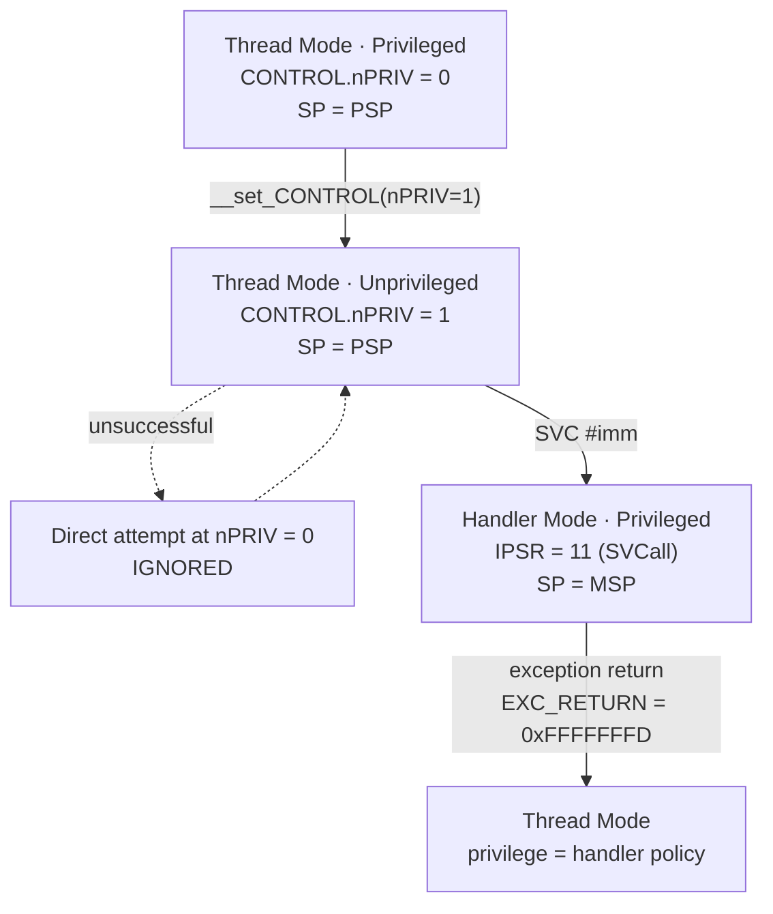

**Language:** English | [Türkçe](README.tr.md)

# Lesson 05 — Privilege & SVC

`[STANDARD]` · Day 3 · Estimated time: 60–75 min

---

## Why This Matters

In Lesson 04, we moved Thread Mode onto its own stack (PSP). That is half of an RTOS task. The other half is that task code runs **unprivileged**.

Why? Privileged code can access everything—the vector table, MPU configuration, `CONTROL`, and other tasks' state. If application code has a bug (and it will), that bug must not be able to corrupt the kernel.

But this raises a question: **what does unprivileged code do when it genuinely needs something?** The answer is `SVC`: a controlled entry point. This is precisely the Cortex-M counterpart of a system call.

This is neither the MPU lesson (that is Lesson 06) nor an RTOS lesson (14/15). The only mechanism established here is **privilege flow**.

---

## Core Idea

### Two independent dimensions, four states

| | Determined by | Values |
|---|---|---|
| **Mode** | `IPSR` | Thread (`IPSR = 0`) / Handler (`IPSR > 0`) |
| **Privilege** | `CONTROL.nPRIV` in Thread; **always privileged** in Handler | Privileged / Unprivileged |

Two fundamental rules:

1. **Handler Mode is always privileged.** `CONTROL.nPRIV` does not describe the handler's privilege; it describes the privilege of the **interrupted Thread context**. Reading `nPRIV = 1` inside a handler does not mean “the handler is unprivileged.”
2. **A privileged Thread can voluntarily drop its privilege** (by writing `nPRIV = 1`). But it **cannot regain it**: an unprivileged Thread's attempt to write `CONTROL` is ignored.

### A one-way gate

```text
Privileged Thread  --(nPRIV = 1)-->  Unprivileged Thread
Unprivileged Thread --(nPRIV = 0)-->  IGNORED
```

The return path must pass through a **privileged execution path**. `SVC` is the gate to that path: one instruction, one exception, and exception handlers run in Handler Mode—which is privileged.

Note: `SVC` is **a gate, not a policy**. Executing SVC does not automatically make the Thread privileged. The **handler decides** what happens. We will measure this in this lesson.

### `privilege != security state`

These two mechanisms are often confused. They are different:

| | Privilege | Security state |
|---|---|---|
| Controlled by | `CONTROL.nPRIV` + mode | TrustZone / SAU |
| Values | Privileged / Unprivileged | Secure / Non-secure |
| Available? | On every Cortex-M | Only with the Security Extension |
| In this lesson | In scope | Out of scope (Lesson 16) |

**“Unprivileged” does not mean “Non-secure.”** They are orthogonal: the Secure side can contain unprivileged code, and the Non-secure side can contain privileged code. This lesson runs in a single security state (Secure) and changes only the privilege dimension.

---

## Mental Model

Think of privilege as a **one-way turnstile**:

```text
Thread Mode
Privileged                 CONTROL.nPRIV = 0
      |
      |  nPRIV = 1  (privileged code chooses to transition)
      v
Thread Mode
Unprivileged               CONTROL.nPRIV = 1
      |
      |  attempt to write CONTROL directly  -->  IGNORED
      |
      |  SVC #imm
      v
================= exception boundary =================
Handler Mode
Privileged (always)     IPSR = 11 (SVCall)
      |
      |  privileged service runs
      |  handler determines POLICY
      |  exception return
      v
Thread Mode
(handler decision determines privilege)
```

You cannot go back through the turnstile by yourself. To return, the attendant (the handler) must open the gate—and the attendant is free to decide whether to do so.

---

## Visual



The stack side connects to Lesson 04:

```text
Thread was running on PSP
        |
        v  SVC
hardware writes the 8-word exception frame to PSP
        |
        v
Handler runs on MSP (SPSEL cleared on entry)
        |
        v  exception return
hardware restores the frame from PSP; Thread resumes
```

---

## Tiny Example

Sources: [`example/main.c`](example/main.c),
[`example/svc_handler.S`](example/svc_handler.S),
[`example/psp_start.S`](example/psp_start.S) (unchanged from Lesson 04).

### The handler boundary

```asm
SVC_Handler:
    tst     lr, #4              /* EXC_RETURN bit2: 0 = MSP, 1 = PSP */
    ite     eq
    mrseq   r0, msp
    mrsne   r0, psp             /* r0 = exception frame adresi        */
    mov     r1, lr              /* r1 = EXC_RETURN                    */
    b       svc_dispatch        /* lr KORUNUR -> donusu o yapar       */
```

Why assembly? Two reasons. First, `lr`: hardware writes `EXC_RETURN` there on handler entry, and this is the **only** source that tells us which stack holds the frame; an ordinary C prologue can push it onto the stack and overwrite it. Second, the frame address cannot be obtained reliably from C.

Using `b` rather than `bl` is deliberate: because we do not touch `lr`, it still carries `EXC_RETURN`. When `svc_dispatch` tries to return like an ordinary C function (`pop {..., pc}`), that value is written to `pc`, triggering exception return.

**Supported assumptions:** a standard 8-word frame (soft-float build, no FP context), one security state, and no additional state context (`DCRS = 1`). This is **not** a general exception framework; we do not claim to support every Armv8-M frame format.

### How is the SVC number found?

```c
const uint8_t *svc_instr = (const uint8_t *)(frame->pc - 2u);
uint32_t svc_number = (uint32_t)svc_instr[0];
```

The stacked PC points to the instruction **after** `SVC`. In Thumb, the T1 encoding of `SVC` is **16 bits**: `0b11011111:imm8`. Therefore, the instruction is at `pc - 2`, and the low byte is `imm8`.

Values measured in this build:

```text
10000194:  df01   svc  1
10000198:  df01   svc  1
100001a2:  df04   svc  4
```

`df01` → `0xDF` upper byte, `0x01` `imm8`. The technique is verified.

> **Do not generalize this.** `pc - 2` is valid only for the 16-bit `SVC` instruction. There is **no** rule saying “the faulty instruction is at `pc - 2` for every exception”—for faults, the meaning of the stacked PC depends on the exception type (precise / imprecise). Lesson 08 will explore this.

### Services

```c
#define SVC_INCREMENT      1u
#define SVC_GET_VERSION    2u    /* Exercise 01 */
#define SVC_RESTORE_PRIV   4u
```

The result is written to `frame->r0`. During exception return, hardware restores that word into the Thread's `R0`; the calling code reads it like a function return value (AAPCS: `r0` = return value).

---

## Build & Run

```bash
cmake --preset debug
cmake --build --preset debug --target 05-privilege-svc
./scripts/run-qemu.sh build/debug/lessons/05-privilege-svc/05-privilege-svc.elf
```

To exit QEMU: `Ctrl-A`, then `X`.

---

## Expected Output

Actual output (arm-none-eabi-gcc 13.2.1, QEMU 8.2.2, mps2-an505, `debug`):

```text
===== LESSON 05: PRIVILEGE & SVC =====
[MSP_AT_START] 0x30007FF0
[TASK_STACK_TOP] 0x30000328
[1] Thread Mode, ayricalikli, PSP uzerinde
[  MODE] Thread
[  PRIVILEGE] Privileged
[  CONTROL] 0x00000002
[  IPSR] 0
[  PSP] 0x30000310
[  LOCAL_ADDR] 0x30000314
--- CONTROL.nPRIV = 1 (ayricalikli kod yapiyor) ---
    (buradan sonraki konsol ciktisi SVC'ye kadar susacak)

[2] Ayricaliksiz bolumde kaydedilenler
[  CONTROL_BEFORE_DROP] 0x00000002
[  CONTROL_UNPRIV] 0x00000003
[  IPSR_UNPRIV] 0
[  PSP_UNPRIV] 0x00000000
[  CHECK_PRIV_DROPPED] PASS
[3] Dogrudan kendini yukseltme denemesi
[  CONTROL_AFTER_ATTEMPT] 0x00000003
[  CHECK_SELF_PROMOTION_BLOCKED] PASS
[4] Cevre birimi erisimi: ayni register, iki baglam
[  UART_BAUDDIV_PRIV] 173
[  UART_BAUDDIV_UNPRIV] 0
[  CHECK_PERIPHERAL_BLOCKED_UNPRIV] PASS
[5] SVC uzerinden ayricalikli servis
[  SVC1_RESULT] 1
[  SVC1_RESULT_AGAIN] 2
[  CHECK_SVC_SERVICE] PASS
[  CONTROL_IN_THREAD_AFTER_SVC] 0x00000003
[  CHECK_SVC_DID_NOT_PROMOTE] PASS
[7] Handler nPRIV'i temizledi - Thread yeniden ayricalikli
[  MODE] Thread
[  PRIVILEGE] Privileged
[  CONTROL] 0x00000002
[  IPSR] 0
[  PSP] 0x30000310
[  LOCAL_ADDR] 0x30000314
[  CHECK_PRIV_RESTORED_BY_HANDLER] PASS
===== END =====
```

> Addresses are build-specific.

### Why is the unprivileged section silent?

This design is explained by the UART access behavior examined below.

In the first version, unprivileged code called `console_line()` directly, and **nothing was printed**. The program kept running, but there was no output. The unprivileged section therefore now records observations in RAM and prints them after privilege has been restored.

The reason is measured in the `[4]` lines: the same UART register reads `173` when privileged and `0` when unprivileged.

This is **not the MPU**—the MPU was never enabled in this lesson. The cause is a SoC-level **Peripheral Protection Controller (PPC)**. In QEMU v8.2.2, `tz_ppc_check()` in `hw/misc/tz-ppc.c` **blocks** an access if it is “usermode” and that port's `cfg_ap` (access permission) bit is zero; with `cfg_sec_resp` zero, blocking returns `0` on reads rather than raising an error (RAZ/WI). No software has enabled this permission, so the default is “privileged only.”

Two lessons follow:

1. **The privilege boundary is enforced in the system as well as in the core.** MPU and PPC are separate blocks.
2. **Silent failure is a real danger.** No fault, no warning; just incorrect data (`0`). This is the same class of problem as the callee-saved violation in Lesson 03.

Another measurement is striking: `PSP_UNPRIV = 0x00000000`. An unprivileged Thread **cannot read** its own stack pointer with `MRS PSP`—the returned value is zero. Yet `MRS CONTROL` works (`0x3` was read). Which special registers can be read unprivileged therefore depends on the register; measure rather than assume.

---

## Observe in GDB

At each stop, we will inspect the mode, privilege, and stack state.

Terminal 1:

```bash
cmake --build --preset debug --target debug-05-privilege-svc
```

Terminal 2:

```bash
gdb-multiarch -q build/debug/lessons/05-privilege-svc/05-privilege-svc.elf
```

```gdb
set architecture armv8-m.main
target remote :3333
source scripts/gdb/cortex-m.gdb
```

### A — Before dropping privilege

```gdb
(gdb) break thread_entry
(gdb) continue
(gdb) cm-mode
(gdb) p/x $control
(gdb) p/x $sp
(gdb) p/x $msp
(gdb) p/x $psp
```

Actual output:

```text
Mode      : Thread Mode
Privilege : Privileged (CONTROL.nPRIV = 0)
Stack     : PSP (0x30000330)
$control = 0x2       $sp = 0x30000330
$msp     = 0x30007ff0  $psp = 0x30000330
```

**Observation:** The initial state is where Lesson 04 left us—Thread Mode, privileged, PSP active (`CONTROL` bit 1 = 1). `$sp == $psp`, while `$msp` is separate.

### B / C — After dropping privilege and attempting self-promotion

```gdb
(gdb) break uart_bauddiv_probe
(gdb) continue          # 1. duruş: hala ayrıcalıklı (referans ölçüm)
(gdb) continue          # 2. duruş: ayrıcalıksız
(gdb) cm-mode
(gdb) p/x $control
```

```text
Mode      : Thread Mode
Privilege : Unprivileged (CONTROL.nPRIV = 1)
Stack     : PSP (0x30000328)
$control = 0x3
```

**Observation:** The mode is still **Thread**—dropping privilege does not change modes. Before reaching this stop, the code tried to write `nPRIV = 0`; `$control` is still `0x3`. **The write was ignored.**

Reading `0x3` also shows both `CONTROL` fields together: bit 0 `nPRIV = 1` (unprivileged) and bit 1 `SPSEL = 1` (PSP).

### D — At SVC handler entry

```gdb
(gdb) delete
(gdb) break svc_dispatch
(gdb) continue
(gdb) cm-mode
(gdb) p/x $control
(gdb) p/x $lr
(gdb) p/x $sp
(gdb) p/x $msp
(gdb) p/x $psp
(gdb) p/x frame
```

```text
Mode      : Handler Mode (exception 11)
Privilege : Privileged (Handler Mode her zaman ayricaliklidir)
            CONTROL.nPRIV = 1 -> KESILEN Thread baglami ayricaliksizdi
Stack     : MSP (0x30007ff0)  (Handler Mode MSP kullanir)
            PSP = 0x30000308

$control = 0x1          $lr  = 0xfffffffd
$sp = 0x30007ff0        $msp = 0x30007ff0     $psp = 0x30000308
frame    = 0x30000308
```

**State observed with GDB:**

1. `IPSR = 11` → **SVCall**. Entry 11 in the vector table (verify with `cm-vectors`).
2. **The handler is privileged.** `CONTROL = 0x1`, so `nPRIV` is still 1—but this is the state of the *interrupted Thread*. The handler is privileged independently of it. `cm-mode` states this distinction explicitly.
3. **The stack changed.** `$sp == $msp`, although the Thread was using PSP. `CONTROL` bit 1 was also cleared (`0x3` → `0x1`): **hardware** cleared `SPSEL` on exception entry.
4. `frame == $psp` → the address the wrapper found using `EXC_RETURN` bit 2 is the interrupted Thread's stack.

### E / F — The interrupted frame

```gdb
(gdb) cm-exc-return $lr
(gdb) cm-frame $psp $lr
```

```text
EXC_RETURN 0xfffffffd -> frame PSP uzerinde, Thread Mode'a donus
R0         = 0x00000000
R1         = 0x3000031c
R2         = 0x100009ac
R3         = 0x50200000
R12        = 0x00000000
LR         = 0x10000193
stacked PC = 0x10000196
xPSR       = 0x61000000
```

The preconditions for `cm-frame` hold here: a standard frame, one security state, and no stacking error. (If they did not hold, the command would reject it—see `docs/DEBUGGING.md`.)

Let us inspect how the SVC number is read:

```gdb
(gdb) x/2i (*(unsigned int*)($psp+24))-2
```

```text
   0x10000194 <thread_entry+104>:  svc  1
   0x10000196 <thread_entry+106>:  str  r0, [r4, #28]
```

**Observation:** The stacked PC is `0x10000196`, the instruction **after** `SVC`. `pc - 2 = 0x10000194`, and that address contains `svc 1`. The dispatcher's `frame->pc - 2` calculation is correct.

### G — Returning to Thread

```gdb
(gdb) delete
(gdb) break *(*(unsigned int*)($psp+24))
(gdb) continue
(gdb) cm-mode
(gdb) p/x $control
(gdb) info registers r0
```

```text
Mode      : Thread Mode
Privilege : Unprivileged (CONTROL.nPRIV = 1)
Stack     : PSP (0x30000328)
$control = 0x3
r0 = 0x1
```

**State observed with GDB:**

1. **The Thread is still unprivileged.** Executing `SVC` did not automatically promote it. Passing through the gate does not grant privilege; the outcome depends on what the handler did.
2. **The service result arrived.** `r0 = 1`—the counter value that the dispatcher wrote to `frame->r0` was restored to `R0` by hardware during exception return.

---

## Experiment

**Experiment 1 — Same exception, different service.**

The example firmware uses two different immediates: `SVC #1` (increment) and `SVC #4` (restore privilege). Both trigger the **same** SVCall exception (`IPSR = 11`); the dispatcher distinguishes them.

Verify: `break svc_dispatch`, then at each stop:

```gdb
p/x $psp
p (*(unsigned char*)((*(unsigned int*)($psp+24))-2))
```

You should see `1` at the first two stops and `4` at the third.

**Experiment 2 — The handler restores privilege.**

The `SVC #4` service does this:

```c
case SVC_RESTORE_PRIV:
    __set_CONTROL(__get_CONTROL() & ~0x1u);
    __ISB();
```

**Who** executes this line? The handler—privileged code. The Thread is not promoting itself; the privileged side is making a policy decision for the context to which it will return.

The same line was ignored when executed from Thread (section `[3]`). Same code, different context, different result. **Privilege is determined by the context in which code runs, not by the code itself.**

In a real RTOS, this is usually not done—tasks remain unprivileged. We do it deliberately here to expose the mechanism.

**Experiment 3 — What does `MRS` read when unprivileged?**

We measured `PSP_UNPRIV = 0` but `CONTROL_UNPRIV = 0x3`. What do other special registers do? Read and record `MSP`, `PRIMASK`, and `IPSR` in an unprivileged context, then compare them with privileged reads. What rule do you find?

---

## Break It

What should happen when an undefined service number is requested? **It must never perform an arbitrary operation.** This is the first security property of a syscall dispatcher.

```bash
cmake --build --preset debug --target 05-privilege-svc-broken
./scripts/run-qemu.sh build/debug/lessons/05-privilege-svc/05-privilege-svc-broken.elf
```

The broken version calls `SVC #99`. Actual output:

```text
[  UNKNOWN_SVC] 99
...
[6] BREAK IT: SVC #99 (tanimsiz servis)
[  SVC99_RESULT] 0xFFFFFFFF
[  CHECK_UNKNOWN_SVC_REJECTED] PASS
[7] Handler nPRIV'i temizledi - Thread yeniden ayricalikli
...
===== END =====
```

This Break It deliberately **does not produce a fault**. Demonstrating a crash is easy; the more instructive behavior is for the dispatcher to reject an unknown request and leave the system intact. The Thread continues normally and receives a defined error value.

Notice where the `UNKNOWN_SVC` line is printed: **from the handler**. The Thread was unprivileged at that point and could not write to the UART.

---

## Debug It

I am giving you the measurements and questions, not the answers.

```bash
cmake --build --preset debug --target debug-05-privilege-svc-broken
```

```gdb
set architecture armv8-m.main
target remote :3333
source scripts/gdb/cortex-m.gdb
break svc_dispatch
continue
continue
continue        # SVC #99 çağrısına kadar ilerle
p svc_number
cm-mode
p/x $lr
```

Questions to answer:

1. Is there any difference in **exception number** between `SVC #99` and `SVC #1`? Read `IPSR` in both cases. What did you find, and why?
2. Where did the dispatcher read the number `99`? Why is this address different from the one in the `SVC #1` case?
3. What would the Thread read without the `frame->r0 = SVC_ERROR_UNKNOWN` line? (Hint: what was the value of `R0` before the exception?)
4. If the dispatcher silently did nothing in its `default` branch, could that be a **security vulnerability**? In what scenario?
5. The `UNKNOWN_SVC` line is printed from the handler. What would happen if you made the same `console_kv_u32()` call from an unprivileged Thread? Why?

---

## Exercise

### Exercise 01 — Add an SVC Service

Provided: a PSP Thread context, privilege drop, SVC dispatcher, and one working service (`SVC #1`).

You will add: **`SVC #2` → `get_service_version()`**

```text
exercises/01-add-svc-service/main.c
```

Requirements:

- the request must come from **unprivileged** Thread Mode (it is already called that way)
- the dispatcher must recognize `SVC #2`
- the service must run in **privileged** Handler Mode
- the result must return to the Thread as `0x00010002`
- the Thread must continue normally

```bash
cmake --build --preset debug --target 05-exercise-svc2
./scripts/run-qemu.sh build/debug/lessons/05-privilege-svc/05-exercise-svc2.elf
```

Initial output (actual):

```text
[  UNKNOWN_SVC] 2
...
[6] SVC #2 (get_service_version)
[  SVC2_VERSION] 0xFFFFFFFF
[  CHECK_SVC2_VERSION] FAIL
```

`SVC #2` currently matches no `case` and falls into `default`. This is the **expected starting state**, not a bug.

**Verification criterion:** `CHECK_SVC2_VERSION` must become `PASS`, and every other `CHECK_*` line must remain `PASS`.

The question you must answer: **how** will you deliver the result to the Thread? You cannot write `return`—the dispatcher's return value goes to exception return, not to the Thread. Look at the `SVC_INCREMENT` service and understand why it writes there.

---

## Reference Solution

| What | Where | Target |
|---|---|---|
| Exercise 01 solution | [`solutions/01-add-svc-service/`](solutions/01-add-svc-service/) | `05-solution-svc2` |

```bash
cmake --build --preset debug --target 05-solution-svc2
./scripts/run-qemu.sh build/debug/lessons/05-privilege-svc/05-solution-svc2.elf
```

Actual output (relevant lines):

```text
[6] SVC #2 (get_service_version)
[  SVC2_VERSION] 0x00010002
[  CHECK_SVC2_VERSION] PASS
```

The solution README explains how the `SVC` instruction is emitted, how its immediate is decoded, where the argument/result resides, and how exception return resumes the Thread.

---

## What I Learned

> This section is yours. Fill it in after completing the experiments.

**Privilege being one-way, in my own words:**

<!-- -->

**The relationship between Handler Mode privilege and `CONTROL.nPRIV`:**

<!-- -->

**`SVC` is a gate, not a policy—what this means:**

<!-- -->

**What surprised me:**

<!-- e.g. unprivileged code being unable to write to the UART, or MRS PSP returning 0 -->

**The question I am taking into Lesson 06:**

<!-- -->

---

## Quick Check

1. What exactly does `CONTROL.nPRIV` control? Does it also cover Handler Mode privilege?

2. Can unprivileged Thread Mode regain privilege by clearing `nPRIV`? What happens when it tries?

3. Why can `SVC_Handler` perform privileged operations? Is this enabled by the handler's code, or by something else?

4. Are “Unprivileged” and “Non-secure” the same thing? State the difference in one sentence.

5. If Thread Mode uses PSP when `SVC` occurs, **which** stack holds the Thread's exception frame?

6. Which stack does Handler Mode use? Is this selected by software or hardware?

7. Does executing `SVC` automatically make the returning Thread privileged? Justify your answer using this lesson's measurement.

8. **(Reasoning)** Why can this implementation read the `SVC` immediate from the stacked `PC - 2`? Is this calculation valid for every exception?

9. **(Reasoning)** What is missing for this to be a genuinely isolated syscall boundary? Can unprivileged code currently write directly to `g_service_counter`? How would you check?

> Answers: [`answers/quick-check.md`](answers/quick-check.md)
> — open them after writing your own answers.

---

## Takeaway

- **Mode and privilege are separate dimensions.** `IPSR` determines the mode; `CONTROL.nPRIV` determines Thread privilege. Handler Mode is **always** privileged.
- **Privilege can only be dropped in one direction.** A privileged Thread can write `nPRIV = 1`; an unprivileged Thread's attempt to write `nPRIV = 0` is **ignored**.
- **`SVC` is a gate, not a policy.** The handler runs privileged, but decides whether to give the Thread privilege.
- When an exception occurs while the Thread uses PSP, the frame is written to **PSP**, and the handler runs on **MSP**; hardware clears `SPSEL`.
- **`privilege != security state`** and **`unprivileged != Non-secure`**. Different mechanisms, orthogonal dimensions.
- At this stage, the service boundary is **architectural privilege flow, not memory isolation.** Lesson 06 adds actual protection with the MPU.

---

## Known Boundaries — What is not protected without an MPU

This lesson is deliberately incomplete. What is **not protected** yet:

| Item | State |
|---|---|
| `g_service_counter` | Ordinary RAM. Unprivileged code can write to it **directly**; the SVC route is a convention, not a hardware restriction |
| Thread stack ↔ kernel data | Same address space, no separation |
| Code region | Readable from unprivileged code |
| One task writing to another task's stack | Not prevented |

The only actual restriction measured is **peripheral access** (`UART_BAUDDIV_UNPRIV = 0`)—and it comes from the SoC's PPC, not the MPU.

This lesson establishes **privilege flow**; using SVC alone does not provide memory isolation. Lesson 06 will use the MPU to deny unprivileged access to `g_service_counter`; a direct write attempt will then produce a MemManage fault.

---

## Official References

- **Armv8-M Architecture Reference Manual (Arm DDI 0553)** — `CONTROL.nPRIV`, Thread/Handler Mode, exception entry and clearing `SPSEL`, exception frame layout, `EXC_RETURN`, `SVC` instruction encoding (T1, 16 bit).
  <https://developer.arm.com/documentation/ddi0553/latest/>
- **Armv8-M Exception Model User Guide (Arm 107706)** — exception numbers (SVCall = 11), `EXC_RETURN` bit fields.
  <https://developer.arm.com/documentation/107706/latest/>
- **Cortex-M33 Devices Generic User Guide (Arm 100235)** — `CONTROL`, MSP/PSP, SVCall.
  <https://developer.arm.com/documentation/100235/latest/>
- **AAPCS32** — `r0` argument and return value; why the service result is returned through `frame->r0`.
  <https://github.com/ARM-software/abi-aa/blob/main/aapcs32/aapcs32.rst>
- **CMSIS-Core (M)** — `__get_CONTROL`, `__set_CONTROL` (executes `ISB` internally), `__get_IPSR`, `__get_PSP`, `__ISB`.
  <https://arm-software.github.io/CMSIS_6/latest/Core/index.html>
- **QEMU v8.2.2, `hw/misc/tz-ppc.c`** — why unprivileged peripheral access returns `0` (`tz_ppc_check`, `cfg_ap`, `cfg_sec_resp`).
  <https://github.com/qemu/qemu/blob/v8.2.2/hw/misc/tz-ppc.c>
- Measurement environment: `arm-none-eabi-gcc 13.2.1`, `QEMU 8.2.2`, `mps2-an505 / cortex-m33`, `debug` preset.

---

**Previous:** [04 — Stack, MSP & PSP](../04-stack-msp-psp/)
**Next:** [06 — MPU](../06-mpu/)
