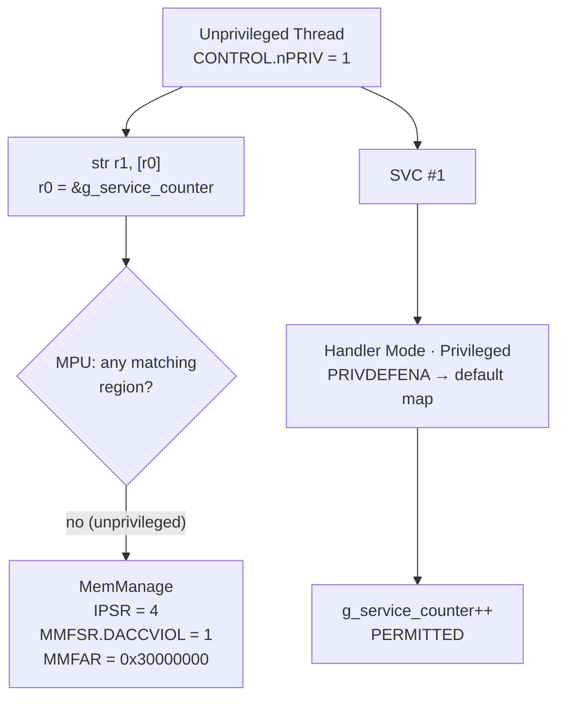

**Language:** English | [Türkçe](README.tr.md)

# Lesson 06 — MPU: Hardware-Enforced Isolation

`[STANDARD]` · Day 3 · Estimated time: 70–90 min

---

## Why This Matters

In Lesson 05, `g_service_counter` lived in ordinary RAM. “You must go through
SVC” was a **software contract** — unprivileged code could violate it directly
without anything happening.

This lesson turns that statement into a **hardware rule**. The same direct
write will now cause a `MemManage` fault, and `MMFAR` will identify the exact
address of the violation.

This underpins RTOS task isolation, bootloader self-protection, and a syscall boundary.

---

## Core Idea

### What does privilege do, and what does the MPU do?

> **Privilege establishes an execution level. The MPU enforces in hardware
> which memory that level may access.**

Neither suffices alone:

| | What it provides alone | What is missing |
|---|---|---|
| Privilege (Lesson 05) | “This code runs unprivileged” | Unprivileged code can still access all RAM |
| MPU | “This address range is accessible at this level” | Privilege defines that level |

Together, they provide isolation.

### PMSAv8: base + limit (not Armv7-M!)

The Armv8-M MPU (PMSAv8) defines regions with **two registers**:

```text
RBAR  bit0      XN        (execute never)
      bits[2:1] AP        (access permission)
      bits[4:3] SH        (shareability)
      bits[31:5] BASE     (region start, 32-byte granularity)

RLAR  bit0      EN        (region enabled)
      bits[3:1] AttrIndx  (attribute index in MAIR)
      bit4      PXN       (privileged execute never)
      bits[31:5] LIMIT    (region LAST byte - INCLUSIVE)
```

Two points are critical:

1. **`LIMIT` is inclusive.** It is the address of the region's last byte,
   not “end+1.” In the CMSIS header's own terms, `LIMIT` is one-extended:
   its low 5 bits are treated as 1.
2. **Granularity is 32 bytes.** `BASE` and `LIMIT` hold only bits [31:5].
   The region start is aligned to 32; its ending address ends in `...1F`.

**Difference from Armv7-M:** Armv7-M defines a region using `base` + an
**encoded size field** (a power of 2), and the region must align to its own
size. Armv8-M has **no** such `size` field. Most MPU examples found online
are for Armv7-M and cannot be applied directly here.

### What happens without a match? `PRIVDEFENA`

```text
MPU_CTRL.ENABLE     = 1   MPU enabled
MPU_CTRL.PRIVDEFENA = 1   privileged accesses without a matching region
                          use the DEFAULT memory map
```

Unprivileged accesses have **no** such fallback: without a matching region,
the access is denied.

This lesson's policy relies on precisely that asymmetry. **No region** is
deliberately defined for `g_service_counter`:

- Privileged handler → can access it through `PRIVDEFENA`.
- Unprivileged Thread → no match → denied.

Protection comes from **omitting** a region, not *adding* one.

### MAIR: “what kind of memory,” not “who”

`RLAR.AttrIndx` selects one of the 8 attribute entries in `MAIR0`/`MAIR1`.
The MPU defines not only access permissions, but **what kind of memory** the
processor treats it as (Normal / Device, cacheability, shareability).

We use one attribute here — Normal memory, Write-Back, non-transient,
read/write allocate:

```c
ARM_MPU_SetMemAttr(0u,
    ARM_MPU_ATTR(ARM_MPU_ATTR_MEMORY_(1,1,1,1),    /* Outer */
                 ARM_MPU_ATTR_MEMORY_(1,1,1,1)));  /* Inner */
```

The parameters of `ARM_MPU_ATTR_MEMORY_(NT, WB, RA, WA)` come directly from
the CMSIS header: non-transient, write-back, read-allocate, write-allocate.
The measured result was `MAIR0 = 0x000000FF`.

Cache behavior is outside this lesson. What matters here is that the
attribute is **mandatory** — a region cannot be defined without an index.

---

## Mental Model

Think of the MPU as **card readers attached to a building floor plan**.
Privilege determines the color of your card (Lesson 05); the MPU determines
which door opens for which color.

```text
FLASH  0x10000000 ... 0x1007FFFF
┌──────────────────────────────────────┐
│ Program code + constants             │
│ Unprivileged: READ + EXECUTE         │  Region 0
│ Write: NO                            │
└──────────────────────────────────────┘

RAM
┌──────────────────────────────────────┐
│ g_service_counter                    │
│ Unprivileged: NO REGION              │  (deliberate)
│ Privileged: access via PRIVDEFENA    │
├──────────────────────────────────────┤
│ Thread stack + Thread data           │
│ Unprivileged: READ + WRITE           │  Region 1
│ Execution: NEVER (XN)                │
└──────────────────────────────────────┘
```

Flow:

```text
Unprivileged Thread
        |
        |  direct counter write
        X  MPU denies
        |
        v
    MemManage
        |
        |  MMFAR = violated address

Unprivileged Thread
        |
        |  SVC
        v
Handler Mode (privileged)
        |
        |  g_service_counter++
        v
      PERMITTED
```

---

## Visual



---

## Tiny Example

Sources: [`example/main.c`](example/main.c),
[`example/mpu_probe.S`](example/mpu_probe.S), and
[`example/psp_start.S`](example/psp_start.S),
[`example/svc_handler.S`](example/svc_handler.S), unchanged from Lessons 04/05.

### Memory layout

Everything the unprivileged Thread may touch is in **one block**:

```c
typedef struct {
    uint32_t     stack[UNPRIV_STACK_WORDS];   /* asagi dogru buyur  */
    unpriv_obs_t obs;                          /* stack'in ustunde   */
} unpriv_block_t;

static unpriv_block_t g_unpriv __attribute__((aligned(32)));

static volatile uint32_t g_service_counter;    /* blogun DISINDA     */
```

`aligned(32)` is required: MPU region boundaries have 32-byte granularity.
Size must also be a multiple of 32 — that is the purpose of `pad` in `unpriv_obs_t`.

### Policy

```c
ARM_MPU_Disable();

ARM_MPU_SetMemAttr(ATTR_IDX_NORMAL, /* Normal, WB, NT, RA, WA */ ...);

/* Region 0: FLASH — ayricaliksiz oku+calistir, yazma yok */
ARM_MPU_SetRegion(0u,
    ARM_MPU_RBAR(FLASH_BASE_ADDR, ARM_MPU_SH_NON, 1 /*RO*/, 1 /*NP*/, 0 /*XN*/),
    ARM_MPU_RLAR(FLASH_LIMIT_ADDR, ATTR_IDX_NORMAL));

/* Region 1: Thread blogu — ayricaliksiz oku+yaz, calistirma YOK */
ARM_MPU_SetRegion(1u,
    ARM_MPU_RBAR(UNPRIV_BASE, ARM_MPU_SH_NON, 0 /*RW*/, 1 /*NP*/, 1 /*XN*/),
    ARM_MPU_RLAR(UNPRIV_LIMIT, ATTR_IDX_NORMAL));

/* g_service_counter icin BILEREK bolge yok */

SCB->SHCSR |= SCB_SHCSR_MEMFAULTENA_Msk;
ARM_MPU_Enable(MPU_CTRL_PRIVDEFENA_Msk);
```

Why the CMSIS API? The official vendored `armv8m_mpu.h` mirrors the register
fields directly — there is no reason to invent an abstraction. We will still
verify the raw register values it produces in both firmware and GDB.

### Why is `MEMFAULTENA` required?

This bit in `SCB->SHCSR` enables the MemManage exception. Without it, an MPU
violation **escalates to HardFault** and sets `HFSR.FORCED`; `MMFSR`/`MMFAR`
may still contain diagnostic information, but diagnosis takes an extra step.
Experiment 3 **proposes measuring this**; no result is claimed here.

### Why does unprivileged Thread not write to the console?

This design decision **does not come from the MPU**. Lesson 05 measured that
unprivileged code cannot access UART on this target because of the SoC's
**Peripheral Protection Controller**. The unprivileged section therefore
records observations in its own permitted data area, and they are printed
after privilege is restored.

See “PPC vs MPU” below for details.

---

## Build & Run

```bash
cmake --preset debug
cmake --build --preset debug --target 06-mpu
./scripts/run-qemu.sh build/debug/lessons/06-mpu/06-mpu.elf
```

---

## Expected Output

Actual output (arm-none-eabi-gcc 13.2.1, QEMU 8.2.2, mps2-an505, `debug`):

```text
===== LESSON 06: MPU =====
[1] MPU yapilandirilmadan once
[  MPU_CTRL] 0x00000000
[  CHECK_MPU_INITIALLY_DISABLED] PASS
[2] MPU etkin
--- MPU yapilandirmasi ---
[  MPU_TYPE] 0x00000800
[  MPU_REGIONS] 8
[  MPU_CTRL] 0x00000005
[  MPU_MAIR0] 0x000000FF
[  REGION] 0
[    RBAR] 0x10000006
[    RLAR] 0x1007FFE1
[    BASE] 0x10000000
[    LIMIT_INCL] 0x1007FFFF
[  REGION] 1
[    RBAR] 0x30000023
[    RLAR] 0x30000321
[    BASE] 0x30000020
[    LIMIT_INCL] 0x3000033F
[  COUNTER_ADDR] 0x30000000
[  UNPRIV_BASE] 0x30000020
[  UNPRIV_LIMIT] 0x3000033F
[  CHECK_MPU_ENABLED] PASS
[  CHECK_PRIVDEFENA] PASS
[  CHECK_MEMFAULT_ENABLED] PASS
[  CHECK_FLASH_REGION_RO_EXEC] PASS
[  CHECK_STACK_REGION_RW_XN] PASS

[3] Ayricaliksiz bolumde kaydedilenler
[  CONTROL_UNPRIV] 0x00000003
[  IPSR_UNPRIV] 0
[  CHECK_THREAD_UNPRIV] PASS
[  STACK_WRITE_MAGIC] 0xA5A5C0DE
[  CHECK_UNPRIV_REGION_WRITABLE] PASS
[4] Korunan sayaca SVC uzerinden erisim
[  SVC_INCREMENT_1] 1
[  SVC_INCREMENT_2] 2
[  CHECK_SVC_PROTECTED_ACCESS] PASS
===== END =====
```

> **Distinguish ARCHITECTURE / TARGET CONFIG / OBSERVATION.**
> `MPU_TYPE = 0x00000800` → 8 regions is **this target's measured configuration**,
> not a universal Cortex-M33 property. Region count is an implementation
> option. Addresses are also build-specific.

### Decode the register values by hand

Learn to read them instead of memorizing them:

```text
RBAR = 0x10000006
       bit0      = 0  -> XN = 0  (executable)
       bits[2:1] = 3  -> AP: RO=1, NP=1 (read-only, unprivileged access allowed)
       bits[4:3] = 0  -> SH = non-shareable
       bits[31:5]     -> BASE = 0x10000000

RLAR = 0x1007FFE1
       bit0      = 1  -> EN  (region enabled)
       bits[3:1] = 0  -> AttrIndx = 0  (MAIR0 low byte)
       bit4      = 0  -> PXN = 0
       bits[31:5]     -> LIMIT = 0x1007FFE0 -> INCLUSIVE last byte 0x1007FFFF
```

```text
RBAR = 0x30000023
       bit0      = 1  -> XN = 1  (NO CODE EXECUTION here)
       bits[2:1] = 1  -> AP: RO=0, NP=1 (read/write, unprivileged access allowed)
       bits[31:5]     -> BASE = 0x30000020

RLAR = 0x30000321
       bit0      = 1  -> EN
       bits[3:1] = 0  -> AttrIndx = 0
       bits[31:5]     -> LIMIT = 0x30000320 -> INCLUSIVE last byte 0x3000033F
```

Now read the table: `COUNTER_ADDR = 0x30000000`, while the unprivileged
region starts at `0x30000020`. The counter is **outside every region** —
that is where its protection comes from.

---

## Observe in GDB

Terminal 1:

```bash
cmake --build --preset debug --target debug-06-mpu
```

Terminal 2:

```bash
gdb-multiarch -q build/debug/lessons/06-mpu/06-mpu.elf
set architecture armv8-m.main
target remote :3333
source scripts/gdb/cortex-m.gdb
```

### A — Before configuration

```gdb
(gdb) break mpu_configure
(gdb) continue
(gdb) cm-mpu
```

```text
MPU_TYPE = 0x00000800  (region sayisi = 8)
MPU_CTRL = 0x00000000  (bit0 ENABLE, bit2 PRIVDEFENA)
```

**Observation:** hardware provides 8 regions, but the MPU is **disabled**.
This is the default after reset; software establishes protection.

### B — After configuration

```gdb
(gdb) break thread_entry
(gdb) continue
(gdb) cm-mpu
```

```text
MPU_TYPE = 0x00000800  (region sayisi = 8)
MPU_CTRL = 0x00000005  (bit0 ENABLE, bit2 PRIVDEFENA)
```

`0x5` = `ENABLE | PRIVDEFENA`. Is MemManage enabled?

```gdb
(gdb) printf "SHCSR = 0x%08X\n", *(unsigned int*)0xE000ED24
SHCSR = 0x00010000
```

Bit 16 = `MEMFAULTENA`. ✓

**A warning about reading regions individually.** Writing `MPU->RNR` from
GDB and reading `RBAR`/`RLAR` **does not work in this setup** — measured:
the write has no effect, and both reads show the same region. (We saw the
same behavior with NVIC priority registers in Lesson 01.) The per-region
view is therefore obtained from firmware:

```gdb
(gdb) break check_region_policy
(gdb) continue
(gdb) next 6
(gdb) printf "R0: RBAR=0x%08X RLAR=0x%08X\n", rbar0, rlar0
```

```text
R0: RBAR=0x10000006 RLAR=0x1007FFE1
R0 base=0x10000000 AP=3 XN=0 EN=1
```

For each region, answer: **“Which address range does it cover, and what may
unprivileged Thread do here?”** Use the bit decoding above.

### C — Unprivileged Thread

```gdb
(gdb) delete
(gdb) break svc_dispatch
(gdb) continue
(gdb) cm-mode
```

```text
Mode      : Handler Mode (exception 11)
Privilege : Privileged (Handler Mode her zaman ayricaliklidir)
            CONTROL.nPRIV = 1 -> KESILEN Thread baglami ayricaliksizdi
Stack     : MSP (0x30007ff0)
            PSP = 0x...
```

**Observation:** Thread was unprivileged (`nPRIV = 1`), yet reached this SVC
handler, which is privileged. Lesson 05's chain still works with the MPU enabled.

### D — Access to protected data succeeds

```gdb
(gdb) p/x g_service_counter
(gdb) next 5
(gdb) p/x g_service_counter
```

The counter increments inside the handler. **Thread could not access the
same variable at this point** — only the execution context differs.

---

## Experiment

**Experiment 1 — Change the policy, change the result.**

The same direct write under two policies. A separate target adds an
unprivileged RW region for the counter:

```bash
cmake --build --preset debug --target 06-mpu-permissive
./scripts/run-qemu.sh build/debug/lessons/06-mpu/06-mpu-permissive.elf
```

The only addition:

```c
ARM_MPU_SetRegion(2u,
    ARM_MPU_RBAR((uint32_t)&g_service_counter & ~0x1Fu, ARM_MPU_SH_NON,
                 0 /*RW*/, 1 /*NP*/, 1 /*XN*/),
    ARM_MPU_RLAR(((uint32_t)&g_service_counter & ~0x1Fu) + 0x1Fu, ATTR_IDX_NORMAL));
```

Actual output (final lines):

```text
[  DIRECT_WRITE_MARKER] 2
[  COUNTER_AFTER_DIRECT] 0x0BADC0DE
[  CHECK_DIRECT_WRITE_SUCCEEDED] PASS (MPU izin verdi)
===== END =====
```

The same `str r1, [r0]` instruction: `MemManage` under policy A, success under
policy B. **Same code; different MPU policy.** MPU permissions determine
the outcome of the access.

The `~0x1Fu` mask is another lesson: because of 32-byte granularity, the
region covers all of `0x30000000..0x3000001F`, not just those four bytes.
The MPU cannot protect “one variable”; it protects **an aligned region**.
Real projects therefore place protected data in its own aligned linker section.

**Experiment 2 — Locate the exact region boundary.**

`UNPRIV_LIMIT = 0x3000033F` is the last **permitted byte** address.
Because `mpu_store_word()` issues a four-byte `STR`, accessing
`0x3000033F` with it is unaligned and crosses the MPU boundary.
Instead, compare aligned word accesses at `0x3000033C` (the last word
entirely inside the region) and `0x30000340` (the first word outside).
This distinguishes an **inclusive** `LIMIT` byte boundary from the requirement that
all four bytes of a word store must be permitted.

**Experiment 3 — What happens without `MEMFAULTENA`? (Deep Dive)**

Comment out `SCB->SHCSR |= SCB_SHCSR_MEMFAULTENA_Msk;` in `mpu_configure()`,
rebuild `06-mpu-broken`, and inspect the fault in GDB. What happened to
`IPSR`? `HFSR.FORCED`? Are `MMFSR`/`MMFAR` still populated?

I **did not measure** this experiment, so no expected output is supplied
here — your measurement will be the result. (You saw escalation as
`HFSR = 0x40000000` in Lesson 02; compare.)

---

## Break It

A separate target: unprivileged Thread attempts to write **directly** to
the protected counter.

The trigger is deliberately a small assembly function
([`example/mpu_probe.S`](example/mpu_probe.S)), so the exact faulting
instruction is known:

```asm
mpu_store_word:
    str     r1, [r0]            /* hata BURADA olusacak */
    bx      lr
```

```bash
cmake --build --preset debug --target 06-mpu-broken
./scripts/run-qemu.sh build/debug/lessons/06-mpu/06-mpu-broken.elf
```

Output **stops** after block `[2]`: `[3]`, `[4]`, and `===== END =====` are
not printed. Thread executed `str` while unprivileged and entered the
MemManage handler.

---

## Debug It

```bash
cmake --build --preset debug --target debug-06-mpu-broken
```

```gdb
set architecture armv8-m.main
target remote :3333
source scripts/gdb/cortex-m.gdb
break Default_Handler
continue
cm-mode
cm-fault
cm-exc-return $lr
cm-frame $psp $lr
```

Actual measurement (**OBSERVATION** — this build, this QEMU run):

```text
Mode      : Handler Mode (exception 4)
Privilege : Privileged (Handler Mode her zaman ayricaliklidir)
            CONTROL.nPRIV = 1 -> KESILEN Thread baglami ayricaliksizdi
Stack     : MSP (0x30007ff0)
            PSP = 0x300002f8

CFSR  = 0x00000082  (MMFSR=0x82 BFSR=0x00 UFSR=0x0000)
HFSR  = 0x00000000  FORCED=0 -> escalation YOK
MMFAR = 0x30000000  (MMARVALID=1 -> adres GECERLI)
BFAR  = 0x00000000  (BFARVALID=0 -> icerik ANLAMSIZ, kullanma)

MMFSR bits: DACCVIOL=1 IACCVIOL=0 MSTKERR=0 MMARVALID=1

EXC_RETURN = 0xfffffffd  -> frame PSP uzerinde, Thread Mode'a donus

--- exception frame @ 0x300002f8 (standart 8 word) ---
R0         = 0x30000000
R1         = 0x0badc0de
R12        = 0x000000ff
LR         = 0x10000281
stacked PC = 0x10000078
xPSR       = 0x21000000
```

Interpreting the values together:

| Observation | Meaning |
|---|---|
| `IPSR = 4` | MemManage, not HardFault, because `MEMFAULTENA` was enabled |
| `HFSR = 0` | No escalation |
| `MMFSR.DACCVIOL = 1` | **Data** access violation, not instruction fetch |
| `MMARVALID = 1` | `MMFAR` contents are valid |
| `MMFAR = 0x30000000` | Exactly matches `&g_service_counter` |
| `R0 = 0x30000000`, `R1 = 0x0badc0de` | Arguments to `mpu_store_word()`, retained in the frame |

`cm-frame` was usable because its prerequisites hold: no stacking error
(`MSTKERR = 0`), standard frame, single security state. It would reject a
stacking error, as in Lessons 02 and 04.

### The faulting instruction

```gdb
(gdb) x/2i *(unsigned int*)($psp+24)
```

```text
   0x10000078 <mpu_store_word>:     str  r1, [r0, #0]
   0x1000007a <mpu_store_word+2>:   bx   lr
```

Stacked PC points to **the address of `str` itself**.

> **Do not generalize.** This is the measured result for *this* fault: for
a precise MPU data access violation, stacked PC identifies the faulting
instruction. “Stacked PC always identifies the faulting instruction” is
**false** — with imprecise faults, the context may already have advanced.
Lesson 08 expands this.

### Questions to answer

1. Which exception is `IPSR = 4`? Which vector table entry?
2. What would you have done if you saw `IACCVIOL` instead of `DACCVIOL`?
3. **Why** can we trust `MMFAR`? Which bit says so?
4. `stacked PC` and `stacked LR` (`0x10000281`) differ. What is the latter?
5. Could the fault handler “recover” from this error? What would it need
   to do, and what risk would that introduce?

---

## Exercise

### Exercise 01 — Build the Thread MPU Policy

Already provided in the starter: a PSP Thread context, privilege drop,
SVC service, `g_service_counter`, and `MAIR` configuration.

You write **the rest of `mpu_configure()`**.

```text
exercises/01-thread-mpu-policy/main.c
```

Four steps:

1. **Region 0 — FLASH:** unprivileged read + execute, no write.
2. **Region 1 — Thread block:** unprivileged read + write, no execution (XN).
3. Enable the **MemManage** exception.
4. **Enable** the MPU with privileged accesses using the default map.

**Do not define** a region for `g_service_counter` — protection comes from
omitting a region.

```bash
cmake --build --preset debug --target 06-exercise-mpu
./scripts/run-qemu.sh build/debug/lessons/06-mpu/06-exercise-mpu.elf
```

Initial output (actual):

```text
[  CHECK_MPU_ENABLED] FAIL
[  CHECK_PRIVDEFENA] FAIL
[  CHECK_MEMFAULT_ENABLED] FAIL
[  CHECK_FLASH_REGION_RO_EXEC] FAIL
[  CHECK_STACK_REGION_RW_XN] FAIL
[  CHECK_THREAD_UNPRIV] PASS
[  CHECK_UNPRIV_REGION_WRITABLE] PASS
[  CHECK_SVC_PROTECTED_ACCESS] PASS
===== END =====
```

With the MPU disabled, firmware runs normally and the SVC path works —
but **there is no protection**. This is the expected initial state.

**Verification criterion:** all five `FAIL` checks must become `PASS`,
with the others remaining `PASS`.

Once the policy is correct, verify the violation too: try the same direct
write as `06-mpu-broken` with your policy and observe `MemManage`.

---

## Reference Solution

| What | Where | Target |
|---|---|---|
| Exercise 01 solution | [`solutions/01-thread-mpu-policy/`](solutions/01-thread-mpu-policy/) | `06-solution-mpu` |

```bash
cmake --build --preset debug --target 06-solution-mpu
./scripts/run-qemu.sh build/debug/lessons/06-mpu/06-solution-mpu.elf
```

All eight `CHECK_*` lines are `PASS`. The solution README explains **why**
each region is required, the role of `PRIVDEFENA`, and why Armv7-M examples
cannot be used directly.

---

## What I Learned

> This section is yours.

**The division of responsibilities between privilege and the MPU:**

<!-- -->

**How protection comes from *omitting* a region:**

<!-- -->

**Where I struggled while decoding RBAR/RLAR by hand:**

<!-- -->

**What surprised me:**

<!-- e.g. 32-byte granularity, or MMFAR identifying the exact address -->

**The question I am taking into Lesson 07:**

<!-- -->

---

## Quick Check

1. What exactly does the MPU enforce? What does it not enforce?
2. How do privilege and the MPU relate? How useful is either without the other?
3. Why can unprivileged Thread access its own stack?
4. Why can the same Thread not access `g_service_counter`? What precisely protects it?
5. Why can `SVC_Handler` access the same variable?
6. What does `PRIVDEFENA` provide? What would break in this lesson if it were `0`?
7. What does `XN` prevent? Why is `XN = 1` selected for the Thread block?
8. How does Armv8-M's `RBAR`/`RLAR` model differ from the Armv7-M MPU?
   Why cannot online Armv7-M examples be used directly?
9. Why does the MemManage exception matter? Does a violation disappear
   when `MEMFAULTENA` is disabled?
10. **(Reasoning)** Why was Lesson 05's UART restriction **not** an MPU example?
11. **(Reasoning)** Can the MPU replace TrustZone? For which threat model
    is it sufficient, and for which is it not?
12. **(Reasoning)** Does enabling the MPU automatically make software “secure”?

> Answers: [`answers/quick-check.md`](answers/quick-check.md)

---

## Takeaway

- **Privilege supplies the level; the MPU restricts memory according to it.**
  Together they provide isolation; neither is sufficient alone.
- The Armv8-M MPU uses **base + limit** (`RBAR`/`RLAR`), with **no** Armv7-M
  `size` field. `LIMIT` is **inclusive**; granularity is **32 bytes**.
- `PRIVDEFENA = 1` opens the default map to privileged accesses; unprivileged
  accesses have no fallback. Protection here relies on this exact asymmetry —
  **omitting a region** is the protection method.
- `RLAR.AttrIndx` + `MAIR` are mandatory: the MPU defines both “who may access”
  and “what kind of memory this is.”
- An MPU violation causes `MemManage`; `MMFSR.DACCVIOL` gives the type and
  `MMFAR` the address — but trust `MMFAR` only when `MMARVALID = 1`.
- **MPU ≠ TrustZone, MPU ≠ PPC.** Three different mechanisms.

---

## PPC vs MPU — placing Lesson 05's finding in context

Lesson 05 measured that unprivileged Thread could not access UART
(`UART_BAUDDIV_PRIV = 173`, `UART_BAUDDIV_UNPRIV = 0`). The MPU had
**never been enabled** then.

| | Lesson 05 UART restriction | Lesson 06 RAM restriction |
|---|---|---|
| Mechanism | SoC Peripheral Protection Controller (PPC) | Cortex-M33 MPU |
| Location | **Outside** the processor, in the SoC interconnect | **Inside** the processor |
| Configured by | SSE-200 security controller (`cfg_ap`) | `MPU_RBAR` / `MPU_RLAR` / `MPU_CTRL` |
| Violation behavior | Silent: read returns `0` (`cfg_sec_resp = 0`) | `MemManage` exception |
| Observation in this repository | `UART_BAUDDIV_UNPRIV = 0` | `IPSR = 4`, `MMFAR = 0x30000000` |

**“Unprivileged code cannot write UART because the MPU blocks it” is false.**
The MPU was disabled in Lesson 05. Both act along the privilege axis, but
they are different hardware blocks with different behavior: one silently
returns zero; the other raises an exception.

Practical consequence: when access unexpectedly fails, ask **which block**
rejected it before concluding “my MPU policy is wrong.” An exception points
to the MPU; silent incorrect data may point to a system-level controller.

---

## Known Boundaries

- **QEMU ≠ physical board.** The 8 regions, PPC defaults, and fault behavior
  were measured in this emulator. Physical MPS2+ AN505 was not verified.
- **One security state.** This lesson operates in Secure state. TrustZone
  systems have separate MPU banks per security state (`MPU` / `MPU_NS`),
  while `SAU` is a different axis entirely. Lesson 16.
- **MPU ≠ TrustZone.** The MPU works along the privilege axis and trusts the
  privileged software that configures it. TrustZone establishes a different
  boundary, protecting against privileged Non-secure code too.
- **The MPU does not automatically make software secure.** Protection is
  only as correct as the policy. A wrong region, omitted `XN`, or oversized
  `LIMIT` silently leaves access open. This lesson also defines only two
  regions; a real system needs peripherals, shared buffers, and separate
  stack regions for each task.
- **32-byte granularity is a design constraint.** You cannot protect “one
  variable”; you protect an aligned region. Real projects put protected data
  in its own aligned linker section — this repository does not yet do so.
- Behavior with `MEMFAULTENA` disabled was **not measured** in this lesson
  (left to the reader as Experiment 3).

---

## Official References

- **Armv8-M Architecture Reference Manual (Arm DDI 0553)** — PMSAv8 MPU:
  `MPU_TYPE`, `MPU_CTRL` (`ENABLE`, `PRIVDEFENA`), `MPU_RNR`, `MPU_RBAR`
  (`XN`, `AP`, `SH`, `BASE`), `MPU_RLAR` (`EN`, `AttrIndx`, `PXN`, `LIMIT`),
  `MPU_MAIR0/1`, region matching rules; `MMFSR` (`IACCVIOL`, `DACCVIOL`,
  `MMARVALID`), `MMFAR`, `SHCSR.MEMFAULTENA`.
  <https://developer.arm.com/documentation/ddi0553/latest/>
- **Cortex-M33 Devices Generic User Guide (Arm 100235)** — MPU register
  definitions and their use on this core.
  <https://developer.arm.com/documentation/100235/latest/>
- **CMSIS-Core (M), Armv8-M MPU API** — vendored in this repository:
  `external/CMSIS/Core/Include/m-profile/armv8m_mpu.h`. `ARM_MPU_RBAR`,
  `ARM_MPU_RLAR` (LIMIT “one extended”), `ARM_MPU_ATTR`,
  `ARM_MPU_ATTR_MEMORY_(NT, WB, RA, WA)`, `ARM_MPU_SetMemAttr`,
  `ARM_MPU_SetRegion`, `ARM_MPU_Enable`.
  <https://arm-software.github.io/CMSIS_6/latest/Core/index.html>
- **QEMU v8.2.2, `hw/misc/tz-ppc.c`** — solely for the emulator-specific PPC
  observation (Lesson 05's finding).
  <https://github.com/qemu/qemu/blob/v8.2.2/hw/misc/tz-ppc.c>
- Measurement environment: `arm-none-eabi-gcc 13.2.1`, `QEMU 8.2.2`,
  `mps2-an505 / cortex-m33`, `debug` preset.

---

**Previous:** [05 — Privilege & SVC](../05-privilege-svc/)
**Next:** [07 — Exceptions](../07-exceptions/)
