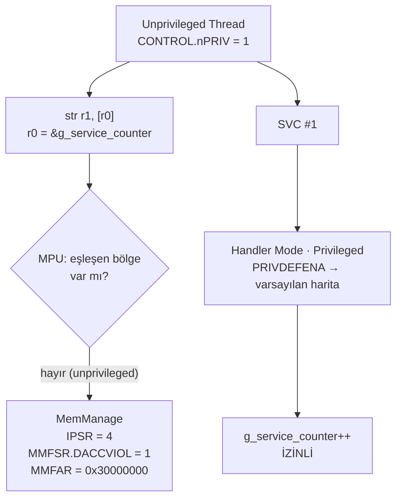

# Lesson 06 — MPU: Hardware-Enforced Isolation

`[STANDARD]` · Day 3 · Tahmini süre: 70–90 dk

---

## Why This Matters

Ders 05'te `g_service_counter` sıradan RAM'deydi. "SVC yolundan geçmelisin"
bir **yazılım sözleşmesiydi** — ayrıcalıksız kod onu doğrudan bozabilirdi
ve hiçbir şey olmazdı.

Bu ders o cümleyi **donanım kuralına** çeviriyor. Aynı doğrudan yazma artık
bir `MemManage` fault üretecek ve `MMFAR` tam olarak hangi adresin ihlal
edildiğini söyleyecek.

Bu, bir RTOS'un görev izolasyonunun, bir bootloader'ın kendini korumasının ve
bir syscall sınırının temelidir.

---

## Core Idea

### Ayrıcalık ne yapar, MPU ne yapar?

> **Ayrıcalık bir yürütme seviyesi sağlar. MPU ise o seviyeye göre hangi
> belleğe erişilebileceğini donanımda uygular.**

İkisi ayrı ayrı yetersiz:

| | Tek başına ne verir | Eksik kalan |
|---|---|---|
| Ayrıcalık (ders 05) | "Bu kod ayrıcalıksız çalışıyor" | Ayrıcalıksız kod yine de tüm RAM'e erişebilir |
| MPU | "Bu adres aralığına şu seviyede erişilebilir" | Seviyeyi tanımlayan şey ayrıcalıktır |

Birleştiklerinde izolasyon çıkar.

### PMSAv8: base + limit (Armv7-M değil!)

Armv8-M'in MPU'su (PMSAv8) bölgeleri **iki register** ile tanımlar:

```text
RBAR  bit0      XN        (execute never)
      bits[2:1] AP        (erisim izni)
      bits[4:3] SH        (shareability)
      bits[31:5] BASE     (bolge baslangici, 32 byte granularite)

RLAR  bit0      EN        (bolge etkin)
      bits[3:1] AttrIndx  (MAIR icindeki attribute indeksi)
      bit4      PXN       (privileged execute never)
      bits[31:5] LIMIT    (bolgenin SON byte'i - DAHIL)
```

İki nokta kritik:

1. **`LIMIT` dahildir.** Bölgenin son byte'ının adresidir, "bitiş+1" değil.
   CMSIS başlığının kendi ifadesiyle `LIMIT` değeri bir-genişletilir (one
   extended), yani alt 5 bit 1 kabul edilir.
2. **Granularite 32 byte.** `BASE` ve `LIMIT` yalnızca bit [31:5] tutar.
   Bölge başlangıcı 32'ye hizalı, bitiş adresi `...1F` ile biter.

**Armv7-M'den fark:** Armv7-M'de bölge `base` + **kodlanmış boyut alanı**
(2'nin kuvveti) ile tanımlanır ve bölge kendi boyutuna hizalı olmak
zorundadır. Armv8-M'de böyle bir `size` alanı **yoktur**. İnternette
bulacağın MPU örneklerinin çoğu Armv7-M içindir ve buraya doğrudan
uygulanamaz.

### Eşleşme yoksa ne olur? `PRIVDEFENA`

```text
MPU_CTRL.ENABLE     = 1   MPU acik
MPU_CTRL.PRIVDEFENA = 1   ayricalikli erisimler, hicbir bolge eslesmezse
                          VARSAYILAN bellek haritasini kullanir
```

Ayrıcalıksız erişimler için böyle bir kurtarma yolu **yoktur**: eşleşen bir
bölge yoksa erişim reddedilir.

Bu dersin politikası tam olarak bu asimetriye dayanıyor. `g_service_counter`
için bilerek **hiçbir bölge tanımlanmadı**:

- Ayrıcalıklı handler → `PRIVDEFENA` sayesinde erişebilir.
- Ayrıcalıksız Thread → eşleşme yok → reddedilir.

Koruma bir bölge *eklemekten* değil, **eklememekten** geliyor.

### MAIR: "kim" değil, "ne tür bellek"

`RLAR.AttrIndx`, `MAIR0`/`MAIR1` içindeki 8 attribute girdisinden birini
seçer. MPU yalnızca erişim iznini değil, işlemcinin o belleği **ne tür bellek
olarak ele alacağını** da tanımlar (Normal / Device, cacheability, shareability).

Bu derste tek bir attribute kullanıyoruz — Normal bellek, Write-Back,
non-transient, read/write allocate:

```c
ARM_MPU_SetMemAttr(0u,
    ARM_MPU_ATTR(ARM_MPU_ATTR_MEMORY_(1,1,1,1),    /* Outer */
                 ARM_MPU_ATTR_MEMORY_(1,1,1,1)));  /* Inner */
```

`ARM_MPU_ATTR_MEMORY_(NT, WB, RA, WA)` parametreleri CMSIS başlığının kendi
tanımıdır: non-transient, write-back, read-allocate, write-allocate. Sonuç
`MAIR0 = 0x000000FF` olarak ölçüldü.

Cache davranışı bu dersin konusu değil; burada bilinmesi gereken tek şey
attribute'un **zorunlu** olduğu — indekssiz bir bölge tanımlayamazsın.

---

## Mental Model

MPU'yu **bina kat planına iliştirilmiş kart okuyucular** gibi düşün. Ayrıcalık
kartının rengini belirler (ders 05); MPU ise hangi kapının hangi renge
açılacağını belirler.

```text
FLASH  0x10000000 ... 0x1007FFFF
┌──────────────────────────────────────┐
│ Program kodu + sabitler              │
│ Ayricaliksiz: OKU + CALISTIR         │  Region 0
│ Yazma: YOK                           │
└──────────────────────────────────────┘

RAM
┌──────────────────────────────────────┐
│ g_service_counter                    │
│ Ayricaliksiz: HICBIR BOLGE YOK       │  (bilerek)
│ Ayricalikli : PRIVDEFENA ile erisir  │
├──────────────────────────────────────┤
│ Thread stack + Thread verisi         │
│ Ayricaliksiz: OKU + YAZ              │  Region 1
│ Calistirma  : ASLA (XN)              │
└──────────────────────────────────────┘
```

Akış:

```text
Unprivileged Thread
        |
        |  dogrudan counter yazmasi
        X  MPU reddeder
        |
        v
    MemManage
        |
        |  MMFAR = ihlal edilen adres

Unprivileged Thread
        |
        |  SVC
        v
Handler Mode (ayricalikli)
        |
        |  g_service_counter++
        v
      IZINLI
```

---

## Visual



---

## Tiny Example

Kaynaklar: [`example/main.c`](example/main.c),
[`example/mpu_probe.S`](example/mpu_probe.S),
ve ders 04/05'ten değişmeden gelen
[`example/psp_start.S`](example/psp_start.S),
[`example/svc_handler.S`](example/svc_handler.S).

### Bellek yerleşimi

Ayrıcalıksız Thread'in dokunabileceği her şey **tek bir blokta**:

```c
typedef struct {
    uint32_t     stack[UNPRIV_STACK_WORDS];   /* asagi dogru buyur  */
    unpriv_obs_t obs;                          /* stack'in ustunde   */
} unpriv_block_t;

static unpriv_block_t g_unpriv __attribute__((aligned(32)));

static volatile uint32_t g_service_counter;    /* blogun DISINDA     */
```

`aligned(32)` zorunlu: MPU bölge sınırları 32 byte granularite ile ifade
edilir. Boyut da 32'nin katı olmalı — `unpriv_obs_t` içindeki `pad` alanı
bunun için var.

### Politika

```c
ARM_MPU_Disable();

ARM_MPU_SetMemAttr(ATTR_IDX_NORMAL, /* Normal, WB, NT, RA, WA */ ...);

/* Region 0: FLASH — ayricaliksiz oku+calistir, yazma yok */
ARM_MPU_SetRegion(0u,
    ARM_MPU_RBAR(FLASH_BASE_ADDR, ARM_MPU_SH_NON, 1 /*RO*/, 1 /*NP*/, 0 /*XN*/),
    ARM_MPU_RLAR(FLASH_LIMIT_ADDR, ATTR_IDX_NORMAL));

/* Region 1: Thread blogu — ayricaliksiz oku+yaz, calistirma YOK */
ARM_MPU_SetRegion(1u,
    ARM_MPU_RBAR(UNPRIV_BASE, ARM_MPU_SH_NON, 0 /*RW*/, 1 /*NP*/, 1 /*XN*/),
    ARM_MPU_RLAR(UNPRIV_LIMIT, ATTR_IDX_NORMAL));

/* g_service_counter icin BILEREK bolge yok */

SCB->SHCSR |= SCB_SHCSR_MEMFAULTENA_Msk;
ARM_MPU_Enable(MPU_CTRL_PRIVDEFENA_Msk);
```

Neden CMSIS API'si? Çünkü repo'da vendored olarak duran resmi
`armv8m_mpu.h`, register alanlarını birebir yansıtıyor — kendi soyutlamamızı
yazmak için sebep yok. Yine de ürettiği ham değerleri hem firmware'den hem
GDB'den register olarak doğrulayacağız.

### `MEMFAULTENA` neden gerekli?

`SCB->SHCSR` içindeki bu bit MemManage exception'ını etkinleştirir.
Etkinleştirilmezse MPU ihlali **HardFault'a yükseltilir** (escalation) ve
`HFSR.FORCED` set olur; `MMFSR`/`MMFAR` yine yazılır ama teşhis bir adım
dolaylı hale gelir. Deney 3 bunu ölçüyor.

### Neden ayrıcalıksız Thread konsola yazmıyor?

Bu tasarım kararı **MPU'dan gelmiyor**. Ders 05'te ölçülmüştü: bu hedefte
ayrıcalıksız kod UART'a erişemiyor ve sebebi SoC'nin **Peripheral Protection
Controller**'ı. Bu yüzden ayrıcalıksız bölüm gözlemleri kendi (izinli) veri
alanına yazıyor, ayrıcalık geri geldikten sonra basılıyor.

Ayrıntı için aşağıdaki "PPC vs MPU" bölümü.

---

## Build & Run

```bash
cmake --preset debug
cmake --build --preset debug --target 06-mpu
./scripts/run-qemu.sh build/debug/lessons/06-mpu/06-mpu.elf
```

---

## Expected Output

Gerçek çıktı (arm-none-eabi-gcc 13.2.1, QEMU 8.2.2, mps2-an505, `debug`):

```text
===== LESSON 06: MPU =====
[1] MPU yapilandirilmadan once
[  MPU_CTRL] 0x00000000
[  CHECK_MPU_INITIALLY_DISABLED] PASS
[2] MPU etkin
--- MPU yapilandirmasi ---
[  MPU_TYPE] 0x00000800
[  MPU_REGIONS] 8
[  MPU_CTRL] 0x00000005
[  MPU_MAIR0] 0x000000FF
[  REGION] 0
[    RBAR] 0x10000006
[    RLAR] 0x1007FFE1
[    BASE] 0x10000000
[    LIMIT_INCL] 0x1007FFFF
[  REGION] 1
[    RBAR] 0x30000023
[    RLAR] 0x30000321
[    BASE] 0x30000020
[    LIMIT_INCL] 0x3000033F
[  COUNTER_ADDR] 0x30000000
[  UNPRIV_BASE] 0x30000020
[  UNPRIV_LIMIT] 0x3000033F
[  CHECK_MPU_ENABLED] PASS
[  CHECK_PRIVDEFENA] PASS
[  CHECK_MEMFAULT_ENABLED] PASS
[  CHECK_FLASH_REGION_RO_EXEC] PASS
[  CHECK_STACK_REGION_RW_XN] PASS

[3] Ayricaliksiz bolumde kaydedilenler
[  CONTROL_UNPRIV] 0x00000003
[  IPSR_UNPRIV] 0
[  CHECK_THREAD_UNPRIV] PASS
[  STACK_WRITE_MAGIC] 0xA5A5C0DE
[  CHECK_UNPRIV_REGION_WRITABLE] PASS
[4] Korunan sayaca SVC uzerinden erisim
[  SVC_INCREMENT_1] 1
[  SVC_INCREMENT_2] 2
[  CHECK_SVC_PROTECTED_ACCESS] PASS
===== END =====
```

> **ARCHITECTURE / TARGET CONFIG / OBSERVATION ayrımı.**
> `MPU_TYPE = 0x00000800` → 8 bölge, **bu hedefin ölçülmüş
> konfigürasyonudur**; evrensel bir Cortex-M33 özelliği değildir. Bölge
> sayısı bir uygulama seçeneğidir. Adresler de build'e özeldir.

### Register değerlerini elle çöz

Ezberlemeden okumayı öğren:

```text
RBAR = 0x10000006
       bit0      = 0  -> XN = 0  (calistirilabilir)
       bits[2:1] = 3  -> AP: RO=1, NP=1 (salt-okunur, ayricaliksiz erisime acik)
       bits[4:3] = 0  -> SH = non-shareable
       bits[31:5]     -> BASE = 0x10000000

RLAR = 0x1007FFE1
       bit0      = 1  -> EN  (bolge etkin)
       bits[3:1] = 0  -> AttrIndx = 0  (MAIR0 alt byte)
       bit4      = 0  -> PXN = 0
       bits[31:5]     -> LIMIT = 0x1007FFE0 -> DAHIL son byte 0x1007FFFF
```

```text
RBAR = 0x30000023
       bit0      = 1  -> XN = 1  (buradan KOD CALISTIRILAMAZ)
       bits[2:1] = 1  -> AP: RO=0, NP=1 (oku/yaz, ayricaliksiz acik)
       bits[31:5]     -> BASE = 0x30000020

RLAR = 0x30000321
       bit0      = 1  -> EN
       bits[3:1] = 0  -> AttrIndx = 0
       bits[31:5]     -> LIMIT = 0x30000320 -> DAHIL son byte 0x3000033F
```

Şimdi tabloyu oku: `COUNTER_ADDR = 0x30000000`, ayrıcalıksız bölge ise
`0x30000020`'de başlıyor. Sayaç **hiçbir bölgenin içinde değil** — koruma
buradan geliyor.

---

## Observe in GDB

Terminal 1:

```bash
cmake --build --preset debug --target debug-06-mpu
```

Terminal 2:

```bash
gdb-multiarch -q build/debug/lessons/06-mpu/06-mpu.elf
set architecture armv8-m.main
target remote :3333
source scripts/gdb/cortex-m.gdb
```

### A — Yapılandırmadan önce

```gdb
(gdb) break mpu_configure
(gdb) continue
(gdb) cm-mpu
```

```text
MPU_TYPE = 0x00000800  (region sayisi = 8)
MPU_CTRL = 0x00000000  (bit0 ENABLE, bit2 PRIVDEFENA)
```

**Gözlem:** Donanımda 8 bölge var ama MPU **kapalı**. Reset sonrası
varsayılan durum budur; koruma yazılım tarafından kurulur.

### B — Yapılandırmadan sonra

```gdb
(gdb) break thread_entry
(gdb) continue
(gdb) cm-mpu
```

```text
MPU_TYPE = 0x00000800  (region sayisi = 8)
MPU_CTRL = 0x00000005  (bit0 ENABLE, bit2 PRIVDEFENA)
```

`0x5` = `ENABLE | PRIVDEFENA`. MemManage etkin mi?

```gdb
(gdb) printf "SHCSR = 0x%08X\n", *(unsigned int*)0xE000ED24
SHCSR = 0x00010000
```

Bit 16 = `MEMFAULTENA`. ✓

**Bölgeleri tek tek okumak için bir uyarı.** GDB'den `MPU->RNR`'a yazıp
`RBAR`/`RLAR` okumak **bu kurulumda işe yaramıyor** — ölçüldü: yazma etkisiz
kalıyor ve her iki okumada da aynı bölge görünüyor. (Aynı davranışı ders
01'de NVIC öncelik register'larında da gördük.) Bu yüzden bölge bazlı görünüm
firmware'den alınıyor:

```gdb
(gdb) break check_region_policy
(gdb) continue
(gdb) next 6
(gdb) printf "R0: RBAR=0x%08X RLAR=0x%08X\n", rbar0, rlar0
```

```text
R0: RBAR=0x10000006 RLAR=0x1007FFE1
R0 base=0x10000000 AP=3 XN=0 EN=1
```

Her bölge için cevaplaman gereken soru: **"bu bölge hangi adres aralığını
kapsıyor ve ayrıcalıksız Thread burada ne yapabilir?"** Yukarıdaki bit
çözümlemesini kullan.

### C — Ayrıcalıksız Thread

```gdb
(gdb) delete
(gdb) break svc_dispatch
(gdb) continue
(gdb) cm-mode
```

```text
Mode      : Handler Mode (exception 11)
Privilege : Privileged (Handler Mode her zaman ayricaliklidir)
            CONTROL.nPRIV = 1 -> KESILEN Thread baglami ayricaliksizdi
Stack     : MSP (0x30007ff0)
            PSP = 0x...
```

**Gözlem:** Thread ayrıcalıksızdı (`nPRIV = 1`), ama bu SVC
handler'ına ulaşabildi ve handler ayrıcalıklı. Ders 05'in zinciri MPU
açıkken de aynen çalışıyor.

### D — Korunan veriye erişim başarılı

```gdb
(gdb) p/x g_service_counter
(gdb) next 5
(gdb) p/x g_service_counter
```

Handler içinde sayaç artıyor. **Aynı değişkene aynı anda Thread erişemezdi**
— aradaki tek fark yürütme bağlamı.

---

## Experiment

**Deney 1 — Politikayı değiştir, sonucu değiştir.**

Aynı doğrudan yazma, iki farklı politika altında. Sayaç için ayrıcalıksız bir
RW bölgesi eklenmiş sürüm ayrı bir hedef:

```bash
cmake --build --preset debug --target 06-mpu-permissive
./scripts/run-qemu.sh build/debug/lessons/06-mpu/06-mpu-permissive.elf
```

Eklenen tek şey:

```c
ARM_MPU_SetRegion(2u,
    ARM_MPU_RBAR((uint32_t)&g_service_counter & ~0x1Fu, ARM_MPU_SH_NON,
                 0 /*RW*/, 1 /*NP*/, 1 /*XN*/),
    ARM_MPU_RLAR(((uint32_t)&g_service_counter & ~0x1Fu) + 0x1Fu, ATTR_IDX_NORMAL));
```

Gerçek çıktı (son satırlar):

```text
[  DIRECT_WRITE_MARKER] 2
[  COUNTER_AFTER_DIRECT] 0x0BADC0DE
[  CHECK_DIRECT_WRITE_SUCCEEDED] PASS (MPU izin verdi)
===== END =====
```

Aynı `str r1, [r0]` komutu: politika A'da `MemManage`, politika B'de başarılı.
**Kod aynı; değişen MPU politikası.** Erişim sonucunu MPU izinleri
belirliyor.

`~0x1Fu` maskelemesi de bir ders: 32 byte granularite yüzünden bölge
`0x30000000..0x3000001F` aralığının tamamını kapsıyor — yalnızca o dört
byte'ı değil. MPU ile "tek bir değişkeni" koruyamazsın; **hizalanmış bir
bölgeyi** korursun. Gerçek projelerde korunan veri bu yüzden linker
script'inde kendi hizalı bölümüne konur.

**Deney 2 — Bölge sınırının tam yerini bul.**

`UNPRIV_LIMIT = 0x3000033F`. Ayrıcalıksız Thread `0x3000033F`'ye yazabilir mi?
`0x30000340`'a? `mpu_store_word()` ile ikisini de dene ve `LIMIT`'in
**dahil** olduğunu kendin doğrula.

**Deney 3 — `MEMFAULTENA` olmadan ne olur? (Deep Dive)**

`mpu_configure()` içindeki `SCB->SHCSR |= SCB_SHCSR_MEMFAULTENA_Msk;`
satırını yorum satırı yap, `06-mpu-broken` hedefini yeniden derle ve
GDB'de fault'a bak. `IPSR` ne oldu? `HFSR.FORCED`? `MMFSR`/`MMFAR` hâlâ
dolu mu?

Bu deneyi ben **ölçmedim**, bu yüzden beklenen çıktıyı buraya yazmıyorum —
kendi ölçümün sonuç olacak. (Ders 02'de escalation'ı `HFSR = 0x40000000`
olarak görmüştün; karşılaştır.)

---

## Break It

Ayrı hedef: ayrıcalıksız Thread korunan sayaca **doğrudan** yazmayı deniyor.

Tetikleyici bilerek küçük bir assembly fonksiyonu
([`example/mpu_probe.S`](example/mpu_probe.S)) — hata üreten komutun tam
olarak hangisi olduğunu bilmek için:

```asm
mpu_store_word:
    str     r1, [r0]            /* hata BURADA olusacak */
    bx      lr
```

```bash
cmake --build --preset debug --target 06-mpu-broken
./scripts/run-qemu.sh build/debug/lessons/06-mpu/06-mpu-broken.elf
```

Çıktı `[2]` bloğundan sonra **duruyor**: `[3]`, `[4]` ve `===== END =====`
basılmıyor. Thread ayrıcalıksızken `str` komutunu çalıştırdı ve MemManage
handler'ına düştü.

---

## Debug It

```bash
cmake --build --preset debug --target debug-06-mpu-broken
```

```gdb
set architecture armv8-m.main
target remote :3333
source scripts/gdb/cortex-m.gdb
break Default_Handler
continue
cm-mode
cm-fault
cm-exc-return $lr
cm-frame $psp $lr
```

Gerçek ölçüm (**OBSERVATION** — bu build, bu QEMU çalışması):

```text
Mode      : Handler Mode (exception 4)
Privilege : Privileged (Handler Mode her zaman ayricaliklidir)
            CONTROL.nPRIV = 1 -> KESILEN Thread baglami ayricaliksizdi
Stack     : MSP (0x30007ff0)
            PSP = 0x300002f8

CFSR  = 0x00000082  (MMFSR=0x82 BFSR=0x00 UFSR=0x0000)
HFSR  = 0x00000000  FORCED=0 -> escalation YOK
MMFAR = 0x30000000  (MMARVALID=1 -> adres GECERLI)
BFAR  = 0x00000000  (BFARVALID=0 -> icerik ANLAMSIZ, kullanma)

MMFSR bits: DACCVIOL=1 IACCVIOL=0 MSTKERR=0 MMARVALID=1

EXC_RETURN = 0xfffffffd  -> frame PSP uzerinde, Thread Mode'a donus

--- exception frame @ 0x300002f8 (standart 8 word) ---
R0         = 0x30000000
R1         = 0x0badc0de
R12        = 0x000000ff
LR         = 0x10000281
stacked PC = 0x10000078
xPSR       = 0x21000000
```

Bu değerler birlikte yorumlandığında:

| Gözlem | Anlamı |
|---|---|
| `IPSR = 4` | MemManage — HardFault değil, çünkü `MEMFAULTENA` açıktı |
| `HFSR = 0` | Escalation olmadı |
| `MMFSR.DACCVIOL = 1` | **Veri** erişim ihlali (komut getirme değil) |
| `MMARVALID = 1` | `MMFAR` içeriği geçerli |
| `MMFAR = 0x30000000` | `&g_service_counter` ile birebir aynı |
| `R0 = 0x30000000`, `R1 = 0x0badc0de` | `mpu_store_word()` argümanları — frame'de duruyor |

`cm-frame` burada kullanılabildi çünkü ön koşulları sağlanıyor: stacking
hatası yok (`MSTKERR = 0`), standart frame, tek güvenlik durumu. Stacking
hatası olsaydı reddederdi — ders 02 ve 04'te öyle olmuştu.

### Hata veren komut

```gdb
(gdb) x/2i *(unsigned int*)($psp+24)
```

```text
   0x10000078 <mpu_store_word>:     str  r1, [r0, #0]
   0x1000007a <mpu_store_word+2>:   bx   lr
```

Yığılmış PC, `str` komutunun **kendi adresini** gösteriyor.

> **Genelleme yapma.** Bu, *bu* fault için ölçülen sonuçtur: precise bir MPU
> veri erişim ihlalinde yığılmış PC hata veren komutu gösterir. "Her fault'ta
> yığılmış PC hatalı komuttur" **doğru değildir** — imprecise fault'larda
> bağlam çoktan ilerlemiş olabilir. Ders 08 bunu açacak.

### Cevaplaman gereken sorular

1. `IPSR = 4` hangi exception? Vektör tablosunun kaçıncı girdisi?
2. `DACCVIOL` yerine `IACCVIOL` görseydin ne yapmış olurdun?
3. `MMFAR`'a **neden** güvenebiliyoruz? Hangi bit bunu söylüyor?
4. `stacked PC` ile `stacked LR` (`0x10000281`) farklı. İkincisi ne?
5. Fault handler'ı bu hatadan "kurtarabilir" mi? Ne yapması gerekirdi ve
   bunun riski ne olurdu?

---

## Exercise

### Exercise 01 — Build the Thread MPU Policy

Başlangıç firmware'inde hazır olanlar: PSP Thread bağlamı, ayrıcalık
düşürme, SVC servisi, `g_service_counter`, `MAIR` ayarı.

Senin yazacağın: **`mpu_configure()` fonksiyonunun geri kalanı.**

```text
exercises/01-thread-mpu-policy/main.c
```

Dört adım:

1. **Region 0 — FLASH:** ayrıcalıksız okuma + çalıştırma, yazma yok.
2. **Region 1 — Thread bloğu:** ayrıcalıksız okuma + yazma, çalıştırma yok (XN).
3. **MemManage** exception'ını etkinleştir.
4. MPU'yu, ayrıcalıklı erişimler varsayılan haritayı kullanacak şekilde
   **enable** et.

`g_service_counter` için bölge **tanımlama** — koruma bir bölge eklememekten
geliyor.

```bash
cmake --build --preset debug --target 06-exercise-mpu
./scripts/run-qemu.sh build/debug/lessons/06-mpu/06-exercise-mpu.elf
```

Başlangıç çıktısı (gerçek):

```text
[  CHECK_MPU_ENABLED] FAIL
[  CHECK_PRIVDEFENA] FAIL
[  CHECK_MEMFAULT_ENABLED] FAIL
[  CHECK_FLASH_REGION_RO_EXEC] FAIL
[  CHECK_STACK_REGION_RW_XN] FAIL
[  CHECK_THREAD_UNPRIV] PASS
[  CHECK_UNPRIV_REGION_WRITABLE] PASS
[  CHECK_SVC_PROTECTED_ACCESS] PASS
===== END =====
```

MPU kapalı olduğu için firmware sorunsuz çalışıyor ve SVC yolu işliyor —
ama **koruma yok**. Bu beklenen başlangıç durumudur.

**Doğrulama ölçütü:** beş `FAIL` de `PASS` olmalı, diğerleri `PASS` kalmalı.

Politikan doğruysa ihlali de doğrula: `06-mpu-broken` hedefiyle aynı doğrudan
yazmayı kendi politikanla dene ve `MemManage` aldığını gör.

---

## Reference Solution

| Ne | Nerede | Hedef |
|---|---|---|
| Exercise 01 çözümü | [`solutions/01-thread-mpu-policy/`](solutions/01-thread-mpu-policy/) | `06-solution-mpu` |

```bash
cmake --build --preset debug --target 06-solution-mpu
./scripts/run-qemu.sh build/debug/lessons/06-mpu/06-solution-mpu.elf
```

Sekiz `CHECK_*` satırının hepsi `PASS`. Çözüm README'si her bölgenin **neden**
gerektiğini, `PRIVDEFENA`'nın rolünü ve Armv7-M örneklerinin neden doğrudan
kullanılamayacağını açıklıyor.

---

## What I Learned

> Bu bölüm senin.

**Ayrıcalık ile MPU arasındaki iş bölümü:**

<!-- -->

**Korumanın bir bölge *eklememekten* gelmesi:**

<!-- -->

**RBAR/RLAR'ı elle çözerken zorlandığım yer:**

<!-- -->

**Beni şaşırtan şey:**

<!-- örn: 32 byte granularite, ya da MMFAR'ın tam adresi vermesi -->

**Ders 07'ye taşıdığım soru:**

<!-- -->

---

## Quick Check

1. MPU tam olarak neyi enforce eder? Neyi etmez?
2. Ayrıcalık ile MPU arasındaki ilişki nedir? Biri olmadan diğeri ne kadar iş
   görür?
3. Ayrıcalıksız Thread neden kendi stack'ine erişebiliyor?
4. Aynı Thread neden `g_service_counter`'a erişemiyor? Onu koruyan tam olarak
   ne?
5. `SVC_Handler` aynı değişkene neden erişebiliyor?
6. `PRIVDEFENA` ne sağlar? `0` olsaydı bu derste ne kırılırdı?
7. `XN` neyi engeller? Thread bloğunda neden `XN = 1` seçildi?
8. Armv8-M'in `RBAR`/`RLAR` modeli Armv7-M MPU'dan nasıl farklıdır?
   İnternetteki Armv7-M örneklerini neden doğrudan kullanamazsın?
9. MemManage exception'ı neden önemli? `MEMFAULTENA` kapalıyken ihlal
   kaybolur mu?
10. **(Reasoning)** Ders 05'teki UART engeli neden bir MPU örneği **değildi**?
11. **(Reasoning)** MPU, TrustZone'un yerine geçer mi? Hangi tehdit modelinde
    yeterli, hangisinde değil?
12. **(Reasoning)** MPU açıkken yazılım otomatik olarak "güvenli" mi olur?

> Cevaplar: [`answers/quick-check.md`](answers/quick-check.md)

---

## Takeaway

- **Ayrıcalık seviyeyi verir, MPU o seviyeye göre belleği kapatır.** İkisi
  birlikte izolasyon üretir; ayrı ayrı yetersizdirler.
- Armv8-M MPU **base + limit** modelidir (`RBAR`/`RLAR`), Armv7-M'in
  `size` alanı **yoktur**. `LIMIT` **dahildir**, granularite **32 byte**.
- `PRIVDEFENA = 1` ayrıcalıklı erişimlere varsayılan haritayı açar;
  ayrıcalıksız erişimlerin böyle bir kurtarma yolu yoktur. Bu dersin koruması
  tam olarak bu asimetriye dayanıyor — **bölge eklememek** koruma yöntemidir.
- `RLAR.AttrIndx` + `MAIR` zorunludur: MPU yalnızca "kim erişebilir"i değil,
  "bu ne tür bellek"i de tanımlar.
- MPU ihlali `MemManage` üretir; `MMFSR.DACCVIOL` türü, `MMFAR` adresi verir —
  ama `MMFAR`'a ancak `MMARVALID = 1` iken güvenilir.
- **MPU ≠ TrustZone, MPU ≠ PPC.** Üçü farklı mekanizmadır.

---

## PPC vs MPU — ders 05 bulgusunu doğru yerine koymak

Ders 05'te ayrıcalıksız Thread'in UART'a erişemediğini ölçmüştük
(`UART_BAUDDIV_PRIV = 173`, `UART_BAUDDIV_UNPRIV = 0`). O zaman MPU
**hiç etkinleştirilmemişti**.

| | Ders 05 UART engeli | Ders 06 RAM engeli |
|---|---|---|
| Mekanizma | SoC Peripheral Protection Controller (PPC) | Cortex-M33 MPU |
| Nerede | İşlemcinin **dışında**, SoC ara bağlantısında | İşlemcinin **içinde** |
| Yapılandıran | SSE-200 güvenlik denetleyicisi (`cfg_ap`) | `MPU_RBAR` / `MPU_RLAR` / `MPU_CTRL` |
| İhlal davranışı | Sessiz: okuma `0` döner (`cfg_sec_resp = 0`) | `MemManage` exception |
| Bu repodaki gözlem | `UART_BAUDDIV_UNPRIV = 0` | `IPSR = 4`, `MMFAR = 0x30000000` |

**"Ayrıcalıksız kod UART'a yazamıyor çünkü MPU engelliyor" cümlesi
yanlıştır.** Ders 05'te MPU kapalıydı. İkisi de ayrıcalık ekseninde çalışır
ama farklı donanım bloklarıdır ve farklı davranırlar — biri sessizce sıfır
döndürür, diğeri exception üretir.

Pratik sonuç: bir erişim beklenmedik şekilde başarısız olduğunda "MPU
politikam yanlış" demeden önce **hangi bloğun** reddettiğini sor. Exception
geldiyse MPU; sessizce yanlış veri geldiyse sistem seviyesinde bir denetleyici
olabilir.

---

## Known Boundaries

- **QEMU ≠ fiziksel kart.** 8 bölge, PPC varsayılanları ve fault davranışı bu
  emülatörde ölçüldü. Fiziksel MPS2+ AN505 doğrulanmadı.
- **Tek güvenlik durumu.** Bu ders Secure state içinde çalışıyor. TrustZone
  etkin sistemlerde güvenlik durumuna göre ayrı MPU bankaları vardır
  (`MPU` / `MPU_NS`) ve `SAU` bambaşka bir eksendir. Ders 16.
- **MPU ≠ TrustZone.** MPU ayrıcalık ekseninde çalışır ve ayrıcalıklı yazılıma
  güvenir — MPU'yu yapılandıran odur. TrustZone farklı bir sınır çizer ve
  Non-secure ayrıcalıklı koda karşı da korur.
- **MPU yazılımı otomatik güvenli yapmaz.** Koruma, yazdığın politikanın
  doğruluğu kadardır. Yanlış bir bölge, unutulmuş bir `XN`, fazla geniş bir
  `LIMIT` — hepsi sessizce açık bırakır. Ayrıca bu ders yalnızca iki bölge
  tanımlıyor; gerçek bir sistemde çevre birimleri, paylaşılan tamponlar ve
  her görev için ayrı stack bölgeleri gerekir.
- **32 byte granularite bir tasarım kısıtıdır.** "Tek bir değişkeni"
  koruyamazsın; hizalı bir bölge korursun. Gerçek projelerde korunan veri
  linker script'inde kendi hizalı bölümüne konur — bu repo henüz onu yapmıyor.
- `MEMFAULTENA` kapalıyken davranış bu derste **ölçülmedi** (Deney 3 olarak
  okuyucuya bırakıldı).

---

## Official References

- **Armv8-M Architecture Reference Manual (Arm DDI 0553)** — PMSAv8 MPU:
  `MPU_TYPE`, `MPU_CTRL` (`ENABLE`, `PRIVDEFENA`), `MPU_RNR`, `MPU_RBAR`
  (`XN`, `AP`, `SH`, `BASE`), `MPU_RLAR` (`EN`, `AttrIndx`, `PXN`, `LIMIT`),
  `MPU_MAIR0/1`, bölge eşleşme kuralları; `MMFSR` (`IACCVIOL`, `DACCVIOL`,
  `MMARVALID`), `MMFAR`, `SHCSR.MEMFAULTENA`.
  <https://developer.arm.com/documentation/ddi0553/latest/>
- **Cortex-M33 Devices Generic User Guide (Arm 100235)** — MPU register
  tanımları ve bu çekirdekteki kullanımı.
  <https://developer.arm.com/documentation/100235/latest/>
- **CMSIS-Core (M), Armv8-M MPU API** — bu repoda vendored:
  `external/CMSIS/Core/Include/m-profile/armv8m_mpu.h`. `ARM_MPU_RBAR`,
  `ARM_MPU_RLAR` (LIMIT "one extended"), `ARM_MPU_ATTR`,
  `ARM_MPU_ATTR_MEMORY_(NT, WB, RA, WA)`, `ARM_MPU_SetMemAttr`,
  `ARM_MPU_SetRegion`, `ARM_MPU_Enable`.
  <https://arm-software.github.io/CMSIS_6/latest/Core/index.html>
- **QEMU v8.2.2, `hw/misc/tz-ppc.c`** — yalnızca emülatöre özgü PPC gözlemi
  için (ders 05 bulgusu).
  <https://github.com/qemu/qemu/blob/v8.2.2/hw/misc/tz-ppc.c>
- Ölçüm ortamı: `arm-none-eabi-gcc 13.2.1`, `QEMU 8.2.2`,
  `mps2-an505 / cortex-m33`, `debug` preset.

---

**Previous:** [05 — Privilege & SVC](../05-privilege-svc/)
**Next:** [07 — Exceptions](../07-exceptions/)
