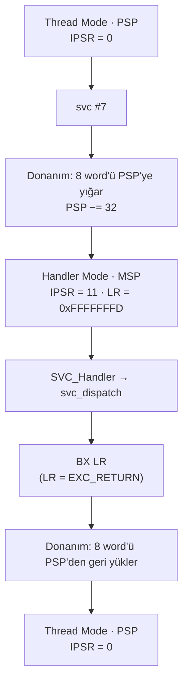

# Lesson 07 — Exceptions: Entry, Stacking, Vectors & Return

`[STANDARD]` · Day 4 · Tahmini süre: 75–90 dk

---

## Why This Matters

Exception mekanizmasını beş derstir **kullanıyoruz**: ders 02'de HardFault,
ders 04'te UsageFault/STKOF, ders 05'te SVCall, ders 06'da MemManage. Her
seferinde `EXC_RETURN`'ü okuduk, frame'i çözdük, `IPSR`'ye baktık — ama CPU'nun
exception'a **girerken tam olarak ne yaptığını** sistematik olarak hiç
anlatmadık.

Bu ders o boşluğu dolduruyor. Sonunda şunu söyleyebilmelisin:

> **Exception, çağrılan normal bir C fonksiyonu değildir. CPU, yürütme
> bağlamını donanım yardımıyla değiştirir.**

Bu, ders 08'deki fault teşhisinin, ders 14'teki SysTick/PendSV zamanlamasının
ve ders 15'teki context switch'in ortak temelidir.

---

## Core Idea

### Zincir

```text
olay / komut
     ↓
exception pending olur
     ↓
oncelik / uygunluk degerlendirilir
     ↓
vector lookup
     ↓
DONANIMSAL YIGMA (8 word)
     ↓
Handler Mode, aktif SP = MSP, LR = EXC_RETURN
     ↓
handler calisir
     ↓
EXC_RETURN pc'ye yazilir
     ↓
donanim yigilmis baglami GERI YUKLER
     ↓
kesilen baglam devam eder
```

Bu zincirin **hiçbir adımı** yazılım tarafından yapılmaz — `handler çalışır`
hariç. Yığma, mod değişimi, stack seçimi ve geri yükleme donanımın işidir.

Bu zincir **olağan** exception yoludur: SVCall, MemManage, HardFault, PendSV,
SysTick, external IRQ'lar. **Reset bu yolu izlemez** — aşağıda ayrı anlatılıyor.

### Özel durum: Reset

Reset mimari olarak bir exception'dır (numarası 1), ama **olağan giriş/çıkış
modeline uymaz**:

| | Olağan exception (SVC, MemManage, IRQ...) | Reset |
|---|---|---|
| Kesilen bir bağlam var mı? | Evet | **Hayır** — önceki bağlam yok |
| Donanım frame yığar mı? | Evet, 8 word | **Hayır** — incelenecek frame yok |
| Nerede başlar? | Handler Mode | **Ayrıcalıklı Thread Mode** |
| `IPSR` | Exception numarası | **0** |
| `LR` | `EXC_RETURN` | `EXC_RETURN` değil |
| `SP` nereden gelir? | Mevcut stack'ten | `vector[0]` → `MSP` |
| `PC` nereden gelir? | `vector[n]` | `vector[1]` → `Reset_Handler` |
| Dönüş var mı? | `EXC_RETURN` ile | **Yok** — dönülecek bir bağlam yok |

Bu build'de `Reset_Handler`'ın ilk komutunda ölçüldü (**OBSERVATION**):

```text
IPSR     = 0
LR       = 0xffffffff        <- EXC_RETURN degil
MSP      = 0x30008000        <- vector[0] ile ayni
PSP      = 0x00000000
CONTROL  = 0x0               <- ayricalikli Thread Mode, MSP
```

Yani `Reset_Handler` bir "handler" gibi adlandırılsa da, kesilmiş bir işin
arasına giren bir handler değildir. Sistemin **ilk Thread Mode kodudur**. Bu
yüzden bu dersteki yığma, `EXC_RETURN` ve geri yükleme anlatımının hiçbiri
Reset için geçerli değildir.

### Exception ≠ external interrupt

Günlük konuşmada "interrupt" geniş kullanılır. Mimari anlatımda ayrım net:

```text
Exception
├── system exceptions (mimari tarafindan tanimli)
│   ├── Reset          (1)   <- OZEL DURUM: olagan giris/cikis yolu yok
│   ├── NMI            (2)
│   ├── HardFault      (3)
│   ├── MemManage      (4)
│   ├── BusFault       (5)
│   ├── UsageFault     (6)
│   ├── SecureFault    (7)   <- Armv8-M Security Extension
│   ├── SVCall         (11)
│   ├── DebugMonitor   (12)
│   ├── PendSV         (14)
│   └── SysTick        (15)
│
└── external interrupts (cihaza ozel)
    └── IRQ0, IRQ1, ...      exception numarasi = 16 + IRQ numarasi
```

Ortak nokta: **Reset dışındakilerin hepsi** aynı giriş/çıkış mekanizmasını
kullanır. Fark, kimin tanımladığı ve nasıl tetiklendiği.

> **ARCHITECTURE:** Exception numarası vector table indeksidir. Olağan bir
> exception'ın handler'ı çalışırken numarası `IPSR`'de görünür. **Reset
> istisnadır:** `Reset_Handler` Thread Mode'da çalışır ve `IPSR = 0` okur. External IRQ *n*, exception numarası `16 + n`'dir ve vector
> table'daki `[16 + n]` girdisini kullanır.
>
> **Bu repoda:** AN505'in cihaza özel IRQ numaraları henüz tanımlı değil
> (`platform/mps2_an505.h` içindeki `TODO`). FAST TRACK için system
> exception'lar yeterli; cihaz IRQ'ları doğrulanmadan eklenmiyor
> (bkz. "Known Boundaries").

### Vector table

```text
vector[0]  = initial MSP degeri       <- HANDLER ADRESI DEGIL
vector[1]  = Reset_Handler adresi
vector[n]  = exception n'in handler adresi (veya ayrilmis)
```

Handler adresleri Thumb bit'i (bit 0 = 1) ile yazılır. Ama:

> **Eski ve yanlış kural: "vector table'daki bütün değerler tektir."**
> `vector[0]` bir **handler adresi değildir**; başlangıç `MSP` değerini
> taşır — bu build'de `0x30008000`. Çift olması stack hizalamasıyla
> ilgilidir (bir `SP` değeri Thumb biti taşımaz, word/8-byte hizalı olur),
> "bu bir adres değil" diye değil: sonuçta bir bellek adresidir, yalnızca
> dallanma hedefi değildir. Ayrılmış girdiler de `0` olabilir.

### Otomatik (basic) stack frame

Exception kabul edildiğinde donanım şu sekiz word'ü **o an aktif olan**
stack'e yazar:

```text
ofset  icerik
+0x00  R0
+0x04  R1
+0x08  R2
+0x0C  R3
+0x10  R12
+0x14  LR
+0x18  PC        <- kesilen baglamin DEVAM adresi
+0x1C  xPSR
```

Neden tam bu sekizi? İki ayrı grup var:

- **`R0-R3` ve `R12`** — normal fonksiyon çağrılarında çağrılan tarafın
  serbestçe bozabildiği (volatile / caller-clobbered) çalışma register'ları
  (ders 03). Donanım onları kaydettiği için handler sıradan bir C fonksiyonu
  gibi yazılabilir; `r4-r11`'i derleyici zaten kendi prologunda korur.
- **`LR`, `PC`, `xPSR`** — bunlar bir ABI kategorisi yüzünden değil, işlemcinin
  **kesilen kontrol akışını ve mimari durumu** geri yükleyebilmesi için
  yığılır: nereye dönülecek, hangi bayraklar, hangi yürütme durumu.

Yani frame, "AAPCS'in caller-saved kümesi" değildir. Doğru özet: **sıradan
kodu sürdürmek için en acil gereken volatile çalışma register'ları, artı
kesilen yürütmeyi devam ettirmek için gereken kontrol akışı/durum bilgisi.**

> **Bu her zaman 8 word değildir.** FP bağlamı aktifse genişletilmiş frame
> kullanılır (FP register'ları + `FPSCR`), hizalama için bir dolgu word'ü
> eklenebilir, ve güvenlik durumu geçişlerinde ek varyantlar vardır. Bu repo
> soft-float derlendiği için basic frame ana modeldir — ama "8 word" evrensel
> bir kural değildir.

### `EXC_RETURN`

Handler'a girerken `LR`'ye **normal bir dönüş adresi değil**, özel bir değer
yazılır. Bu derste ölçülen ikisi:

| Değer | Anlamı |
|---|---|
| `0xFFFFFFFD` | Thread Mode'a dönüş, frame **PSP**'de |
| `0xFFFFFFF9` | Thread Mode'a dönüş, frame **MSP**'de |

İlgili alanlar (tamamı için `docs/DEBUGGING.md`):

```text
bit3 Mode   1 = Thread'e donus, 0 = Handler'a donus
bit2 SPSEL  1 = frame PSP'de,   0 = frame MSP'de
bit4 FType  1 = standart frame, 0 = genisletilmis (FP)
```

**Kritik:** bit 2 frame'in **nerede olduğunu** söyler; handler'ın **hangi
stack'i kullandığını** değil. Handler her zaman MSP kullanır.

### `BX LR` neden sıradan bir dönüş değil?

`LR` bir `EXC_RETURN` değeri taşıyorken `PC`'ye yazılırsa, işlemci bunu bir
adres olarak yorumlamaz — **exception return** olarak tanır ve yığılmış
bağlamı geri yükler. Bu derste tek bir `si` adımıyla ölçeceğiz.

---

## Mental Model

```text
Thread Mode, PSP aktif
R0 R1 R2 R3 R12 LR PC xPSR  <- calisan baglam
        |
        |  exception kabul edildi
        v
PSP (asagi dogru buyur)
                 yuksek adres
              +--------------+
  frame+0x1C  | xPSR         |
  frame+0x18  | PC           |
  frame+0x14  | LR           |
  frame+0x10  | R12          |
  frame+0x0C  | R3           |
  frame+0x08  | R2           |
  frame+0x04  | R1           |
  frame+0x00  | R0           |  <- yeni PSP buraya isaret eder
              +--------------+
                 dusuk adres

        +
CPU Handler Mode'a gecer
aktif SP  -> MSP        (donanim SPSEL'i temizler)
LR        -> EXC_RETURN
PC        -> vector[11] (SVCall)
IPSR      -> 11

handler calisir
        |
        |  BX LR   (LR = EXC_RETURN)
        v
donanim yigilmis 8 word'u GERI YUKLER
        ↓
Thread PSP uzerinde kaldigi yerden devam eder
```

Yön kontrolü (ders 04'ten): stack **full-descending**. `PSP` yığmadan önce
`0x300002F0` idi, sonra `0x300002D0` — **32 byte aşağı**. Frame'in en düşük
adresinde `R0`, en yükseğinde `xPSR` var.

---

## Visual



---

## Tiny Example

Kaynaklar: [`example/main.c`](example/main.c),
[`example/svc_handler.S`](example/svc_handler.S),
[`example/psp_start.S`](example/psp_start.S) (ders 04'ten değişmeden).

### Neden SVC?

Exception kaynağı olarak `SVC` seçildi: **senkron** (tam olarak ne zaman
olacağını biliyoruz), komutu bilinen, yığmanın başarılı olması beklenen, ve
ders 05'ten tanıdık. Fault'lar bunların hiçbirini garanti etmez — onlar
ders 08'in konusu.

### Bu derste Thread ayrıcalıklı kalıyor

Ders 05/06 ayrıcalık ve izolasyonu işledi. Burada odak exception mekanizması,
bu yüzden Thread Mode ayrıcalıklı bırakıldı ve doğrudan konsola yazabiliyor.
(Ders 05'te ölçülen PPC engeli **ayrıcalıksız** koda aitti; burada geçerli
değil.)

### Tanınabilir işaretler

Frame'in gerçekten o sekiz register'ı taşıdığını kanıtlamak için `SVC`'den
önce bilinen değerler yükleniyor:

```c
register uint32_t r0  __asm__("r0")  = 0x11111111u;
register uint32_t r1  __asm__("r1")  = 0x22222222u;
register uint32_t r2  __asm__("r2")  = 0x33333333u;
register uint32_t r3  __asm__("r3")  = 0x44444444u;
register uint32_t r12 __asm__("r12") = 0xCCCCCCCCu;

__asm__ volatile ("svc %[imm]" : "+r"(r0) : [imm]"I"(7), "r"(r1), ...);
```

### Handler sarmalayıcısı — neden giriş durumunu kaydediyor?

```asm
SVC_Handler:
    ldr     r2, =g_entry_lr
    str     lr, [r2]            /* EXC_RETURN - ILK is bu */
    mrs     r3, msp
    ...
```

Çünkü bu iki değer handler içinde C kodu çalıştıktan sonra **artık güvenilir
değildir**:

- `lr` → herhangi bir `bl` onu ezer.
- `msp` → handler'ın kendi prologu onu aşağı iter.

Bu, ders 04'te `cm-frame`'in onarılmasına yol açan hatanın ta kendisiydi.

---

## Build & Run

```bash
cmake --preset debug
cmake --build --preset debug --target 07-exceptions
./scripts/run-qemu.sh build/debug/lessons/07-exceptions/07-exceptions.elf
```

---

## Expected Output

Gerçek çıktı (arm-none-eabi-gcc 13.2.1, QEMU 8.2.2, mps2-an505, `debug`):

```text
===== LESSON 07: EXCEPTIONS =====
[MSP_AT_START] 0x30007FF0
--- vector table ---
[  VTOR] 0x10000000
[  [0] initial MSP] 0x30008000
[  [1] Reset] 0x10000535
[  [3] HardFault] 0x10000531
[  [4] MemManage] 0x10000531
[  [11] SVCall] 0x10000041
[  [14] PendSV] 0x10000531
[  CHECK_VEC0_IS_NOT_ADDRESS] PASS
[  CHECK_SVCALL_THUMB_BIT] PASS
[1] Exception'dan ONCE (Thread Mode)
[  IPSR] 0
[  CONTROL] 0x00000002
[  MSP] 0x30007FF0
[  PSP] 0x300002F0
[  ACTIVE_SP_APPROX] 0x300002F4
[  ACTIVE_STACK] PSP
--- svc #7 calistiriliyor ---
[2] Exception'dan SONRA (Thread Mode)
[  IPSR] 0
[  PSP] 0x300002F0
[  SVC_RESULT] 286331154
[  CHECK_THREAD_RESUMED] PASS
[  CHECK_SVC_RESULT] PASS
[3] Handler giriste ne gordu?
[  HANDLER_IPSR] 11
[  ENTRY_EXC_RETURN] 0xFFFFFFFD
[  ENTRY_MSP] 0x30007FF0
[  ENTRY_PSP] 0x300002D0
[  DISPATCHER_SP] 0x30007FE0
[  CHECK_IPSR_IS_SVCALL] PASS
[  CHECK_HANDLER_USED_MSP] PASS
[  CHECK_ACTIVE_SP_NOT_FRAME] PASS
--- yakalanan exception frame ---
[  FRAME_ADDR] 0x300002D0
[  +0x00 R0] 0x11111111
[  +0x04 R1] 0x22222222
[  +0x08 R2] 0x33333333
[  +0x0C R3] 0x44444444
[  +0x10 R12] 0xCCCCCCCC
[  +0x14 LR] 0x100001E7
[  +0x18 PC] 0x100000BA
[  +0x1C xPSR] 0x61000000
[  xPSR_IPSR_FIELD] 0
[  xPSR_T_BIT] 1
[  xPSR_ALIGN_BIT9] 0
[  CHECK_FRAME_MATCHES_MARKERS] PASS
[  CHECK_FRAME_ON_PSP] PASS
[  CHECK_EXC_RETURN_PSP] PASS
===== END =====
```

> **OBSERVATION.** Adresler build'e özeldir. Önemli olan ilişkiler.

Altı gözlem, sırayla:

1. **`vector[0] = 0x30008000`, çift sayı.** Bir handler adresi değil, `MSP`
   başlangıç değeri. `vector[11] = 0x10000041`, tek — Thumb biti.
2. **Frame `0x300002D0`'da, yığmadan önceki PSP `0x300002F0` idi.** Fark tam
   32 byte = 8 word. Donanım aşağı doğru yazdı.
3. **Beş işaret değeri frame'de birebir duruyor.** `0x11111111` en düşük
   adreste (`+0x00`), `0xCCCCCCCC` `+0x10`'da. Layout tahmin değil, ölçüm.
4. **Yığılmış `xPSR = 0x61000000`.** `IPSR` alanı `0` — kesilen bağlam Thread
   Mode'daydı. T biti (bit 24) `1`. Hizalama biti (bit 9) `0` — bu çalıştırmada
   donanım dolgu eklemedi.
5. **`DISPATCHER_SP (0x30007FE0) ≠ FRAME_ADDR (0x300002D0)`.** Handler MSP'de
   çalışıyor, frame PSP'de duruyor. Bu ikisini karıştırmak ders 04'teki
   debugger hatasıydı.
6. **`SVC_RESULT = 286331154 = 0x11111112`.** Handler frame'in `R0` yuvasını
   değiştirdi; exception return onu Thread'in `R0`'ına geri yükledi.

---

## Observe in GDB

Her durakta tek soru: **hangi mimari geçişi kanıtlıyoruz?**

```bash
cmake --build --preset debug --target debug-07-exceptions
```

```gdb
gdb-multiarch -q build/debug/lessons/07-exceptions/07-exceptions.elf
set architecture armv8-m.main
target remote :3333
source scripts/gdb/cortex-m.gdb
```

### A — `svc` komutundan hemen önce

```gdb
(gdb) disassemble do_marked_svc
```

`svc 7` komutunun adresini bul (bu build'de `0x100000b8`), oraya breakpoint koy:

```gdb
(gdb) break *0x100000b8
(gdb) continue
(gdb) cm-mode
(gdb) info registers r0 r1 r12
```

```text
Mode      : Thread Mode
Privilege : Privileged (CONTROL.nPRIV = 0)
Stack     : PSP (0x300002f0)
r0  = 0x11111111
r1  = 0x22222222
r12 = 0xcccccccc
```

**Ne kanıtlıyoruz:** Başlangıç durumu — Thread Mode, `IPSR = 0`, PSP aktif,
ve işaret değerleri register'larda duruyor. Henüz hiçbir şey yığılmadı.

### B — `SVC_Handler`'ın ilk komutu

```gdb
(gdb) break SVC_Handler
(gdb) continue
(gdb) cm-mode
(gdb) p/x $lr
(gdb) p/x $sp
(gdb) p/x $msp
(gdb) p/x $psp
```

```text
Mode      : Handler Mode (exception 11)
Privilege : Privileged (Handler Mode her zaman ayricaliklidir)
Stack     : MSP (0x30007ff0)
            PSP = 0x300002d0

$lr  = 0xfffffffd
$sp  = 0x30007ff0
$msp = 0x30007ff0
$psp = 0x300002d0
```

**Ne kanıtlıyoruz — tek komutluk bir geçişte dört şey birden:**

| Gözlem | Mimari geçiş |
|---|---|
| `IPSR` 0 → 11 | Handler Mode'a girildi, exception numarası SVCall |
| `$sp == $msp` | Donanım `SPSEL`'i temizledi, aktif stack MSP oldu |
| `$psp` 0x300002f0 → 0x300002d0 | 32 byte yığıldı |
| `$lr = 0xfffffffd` | `LR` bir dönüş adresi değil, `EXC_RETURN` |

Hiçbir yazılım satırı çalışmadan bunların hepsi oldu.

### C — Dispatcher kendi stack'ini kullandıktan sonra

```gdb
(gdb) break svc_dispatch
(gdb) continue
(gdb) next 3
(gdb) p/x $sp
(gdb) p/x g_frame_addr
```

```text
$sp           = 0x30007fe0
g_frame_addr  = 0x300002d0
```

**Ne kanıtlıyoruz:** Aktif `$sp` artık ne giriş MSP'si (`0x30007ff0`) ne de
frame adresi. Handler'ın kendi prologu MSP'yi aşağı itti.

Bu yüzden `cm-frame` aktif `$sp`'den **tahmin etmez** ve frame adresini
argüman olarak ister. Eski sürüm tahmin ediyordu ve uydurma değerler
basıyordu — bağımsız denetimin bulduğu hata buydu.

### D — Kaydedilen frame'i çöz

```gdb
(gdb) cm-exc-return g_entry_lr
(gdb) cm-frame g_frame_addr g_entry_lr
```

```text
EXC_RETURN 0xfffffffd
  bit3 Mode     = 1 -> Thread Mode'a donus
  bit2 SPSEL    = 1 -> frame PSP uzerinde
  bit4 FType    = 1 -> standart (8 word) frame

--- exception frame @ 0x300002d0 (standart 8 word) ---
R0         = 0x11111111
R1         = 0x22222222
R2         = 0x33333333
R3         = 0x44444444
R12        = 0xcccccccc
LR         = 0x100001e7
stacked PC = 0x100000ba
xPSR       = 0x61000000
```

**Ne kanıtlıyoruz:** Ön koşullar sağlanıyor (standart frame, tek güvenlik
durumu, yığma hatası yok), bu yüzden komut çözüyor. Değerler firmware'in
bastığıyla birebir aynı.

### E — Yığılmış PC neyi gösteriyor?

```gdb
(gdb) x/2i *(unsigned int*)(g_frame_addr+24)-2
```

```text
   0x100000b8 <do_marked_svc+20>:  svc  7
   0x100000ba <do_marked_svc+22>:  bx   lr
```

**Ne kanıtlıyoruz:** Yığılmış PC (`0x100000ba`), `svc` komutundan **sonraki**
komutu gösteriyor. Yani kesilen bağlamın **devam edeceği** adres. `SVC` senkron
bir exception olduğu için kesin biliniyor.

> Bunu genelleme: fault'larda yığılmış PC'nin anlamı exception türüne bağlıdır
> (precise / imprecise). Ders 08.

### F — Exception return komutu

```gdb
(gdb) disassemble svc_dispatch
```

Son komutu bul (bu build'de `0x100004e2`):

```gdb
(gdb) break *0x100004e2
(gdb) continue
(gdb) p/x $lr
(gdb) x/1i $pc
```

```text
$lr = 0xfffffffd
=> 0x100004e2 <svc_dispatch+98>:  bx  lr
```

**Ne kanıtlıyoruz:** Bu, derleyicinin ürettiği **sıradan bir fonksiyon
dönüşü**. Ama `LR` bir `EXC_RETURN` değeri taşıyor.

### G — Tek adımda bağlam geri yükleniyor

```gdb
(gdb) si
(gdb) cm-mode
(gdb) info registers r0 r1 r12
```

```text
do_marked_svc () at .../example/main.c:217
Mode      : Thread Mode
Privilege : Privileged (CONTROL.nPRIV = 0)
Stack     : PSP (0x300002f0)
r0  = 0x11111112
r1  = 0x22222222
r12 = 0xcccccccc
```

**Ne kanıtlıyoruz — dersin en önemli tek satırı:** `bx lr` **tek bir adımda**
şunların hepsini yaptı:

- Handler Mode → Thread Mode (`IPSR` 11 → 0)
- Aktif stack MSP → PSP
- Sekiz word geri yüklendi: `R1`/`R12` **değişmeden** döndü
  (`0x22222222`, `0xcccccccc`)
- `PC` yığılmış değere (`0x100000ba`) atladı
- `R0` handler'ın yazdığı yeni değeri taşıyor (`0x11111112`)

İşlemci `LR`'deki `EXC_RETURN` kodlamasını tanıdı ve bunu bir adres olarak
yorumlamak yerine **exception return** yaptı.

---

## Experiment

**Deney 1 — MSP kaynaklı exception.**

Aynı ölçüm, Thread Mode MSP üzerindeyken. Ayrı hedef; stack değiştirmiyoruz —
`psp_start()` hiç çağrılmıyor, `main` zaten MSP üzerinde çalışıyor.

```bash
cmake --build --preset debug --target 07-exceptions-msp
./scripts/run-qemu.sh build/debug/lessons/07-exceptions/07-exceptions-msp.elf
```

Gerçek çıktı (ilgili satırlar):

```text
[  CONTROL] 0x00000000
[  ACTIVE_STACK] MSP
[  MSP] 0x30007FE0
[  PSP] 0x00000000
...
[  HANDLER_IPSR] 11
[  ENTRY_EXC_RETURN] 0xFFFFFFF9
[  ENTRY_MSP] 0x30007FC0
[  ENTRY_PSP] 0x00000000
[  CHECK_FRAME_ON_MSP] PASS
[  CHECK_EXC_RETURN_MSP] PASS
```

Karşılaştırma tablosu:

| | PSP kaynaklı | MSP kaynaklı |
|---|---|---|
| `CONTROL` | `0x2` (SPSEL=1) | `0x0` |
| Frame nerede | PSP: `0x300002D0` | MSP: `0x30007FC0` |
| `EXC_RETURN` | `0xFFFFFFFD` | `0xFFFFFFF9` |
| Handler'ın stack'i | **MSP** | **MSP** |
| `IPSR` | 11 | 11 |

**Tek fark bit 2.** Handler her iki durumda da MSP kullanıyor; değişen yalnızca
frame'in nereye yığıldığı.

MSP kaynaklı durumda frame ve handler **aynı** stack'tedir. Stack
full-descending olduğu için (ders 04): donanımın yığdığı frame MSP üzerinde
bir adres aralığını zaten kaplar; handler'ın prologu ve yerel verisi MSP'yi
**daha da aşağı** iter. Yani handler'ın stack kullanımı, kaydedilmiş frame'in
**altında, daha düşük adreslerde** büyür — doğru çalışan durumda frame'in
kendisi ezilmez. Ölçüm: frame `0x30007FC0`'da, dispatcher'ın yerel verisi
`0x30007FB0`'da.

Bu yüzden giriş MSP'sini kaydetmek daha da kritik: `$sp` ile frame arasında
handler'ın ne kadar yığdığına bağlı değişken bir mesafe var.

**Deney 2 — Pending ve Active durumları.**

Bir exception dört durumdan geçer:

```text
Inactive
   | olay / yazilim istegi
   v
Pending          <- kabul edilmeyi bekliyor
   | kabul edildi
   v
Active           <- handler calisiyor
   | handler dondu
   v
Inactive
```

`Pending` her zaman "hemen çalışacak" demek değildir. Beklemesinin sebepleri
maskeleme, eşit/daha yüksek öncelikli bir exception'ın aktif olması veya
mimari uygunluk koşulları olabilir.

**Active** durumunu bu derste gerçekten ölçtük. `SHCSR` register'ı system
handler'ların active bitlerini taşır — fault hedeflerinde ölçülen değerler:

```text
MemManage etkinken fault aninda:  SHCSR = 0x00010001
    bit16 MEMFAULTENA = 1   bit0 MEMFAULTACT = 1  (MemManage AKTIF)

MemManage devre disiyken:         SHCSR = 0x00000004
    bit16 MEMFAULTENA = 0   bit2 HARDFAULTACT = 1 (HardFault AKTIF)
```

İki farklı handler aktif — aynı ihlalden. Devamı Break It bölümünde.

> Pending bitlerini yazarak (`ICSR.PENDSVSET` gibi) bir exception'ı elle
> tetiklemek mümkündür ve bu, ders 14'teki PendSV tabanlı zamanlamanın
> temelidir. Burada bilerek açmıyoruz — bu ders giriş/çıkış mekanizması
> üzerine.

**Deney 3 — Öncelik.**

> **ARCHITECTURE:** Daha **düşük** sayısal öncelik değeri = daha **yüksek**
> aciliyet. `Reset (-3)`, `NMI (-2)`, `HardFault (-1)` sabit ve
> programlanamaz; geri kalanı yapılandırılabilir.
>
> **TARGET CONFIG:** Bu QEMU hedefinde **8 öncelik biti** ölçüldü
> (`capability-probe`: `NVIC_PRIO_BITS_MEASURED = 8`). Bu **evrensel bir
> Cortex-M33 gerçeği değildir** — uygulanan bit sayısı bir uygulama
> seçeneğidir ve cihazdan cihaza değişir.

Kendin ölç:

```bash
cmake --build --preset debug --target capability-probe
./scripts/run-qemu.sh build/debug/tools/capability-probe/capability-probe.elf
```

Öncelik gruplaması (`PRIGROUP`, subpriority) bu derste bilerek ertelendi.

---

## Break It

Aynı ihlal, iki farklı sonuç. Değişen tek şey bir bit.

Her iki hedef de ayrıcalıklı **salt-okunur** bir MPU bölgesi kurup oraya
yazmayı deniyor:

```c
/* Region 0: RO = 1, NP = 0 (yalnizca ayricalikli), XN = 1 */
ARM_MPU_SetRegion(0u,
    ARM_MPU_RBAR((uint32_t)&g_ro_block[0], ARM_MPU_SH_NON, 1u, 0u, 1u),
    ARM_MPU_RLAR((uint32_t)&g_ro_block[0] + sizeof(g_ro_block) - 1u, 0u));
```

Ayrıcalıklı kod bile bu bölgeye **yazamaz** — koruma ayrıcalık ekseninden
bağımsız.

### Ölçülmüş bir tuzak: sıra önemli

```c
ARM_MPU_Enable(MPU_CTRL_PRIVDEFENA_Msk);

/* SIRA ONEMLI: CMSIS'in ARM_MPU_Enable() fonksiyonu KENDI ICINDE
 *     SCB->SHCSR |= SCB_SHCSR_MEMFAULTENA_Msk;
 * yapar. Ondan ONCE temizlemek etkisiz kalir. */
SCB->SHCSR &= ~SCB_SHCSR_MEMFAULTENA_Msk;
```

Bu ilk denemede gerçekten başımıza geldi: `MEMFAULTENA`'yı `ARM_MPU_Enable()`
öncesinde temizledik ve escalation hedefi de `IPSR = 4` verdi. Kaynağa bakınca
sebep görüldü — vendored `armv8m_mpu.h` içinde `ARM_MPU_Enable` bu biti
kendisi set ediyor. Ders: **kütüphane fonksiyonunun ne yaptığını varsayma,
kaynağa bak.**

```bash
cmake --build --preset debug --target 07-exceptions-memmanage
cmake --build --preset debug --target 07-exceptions-escalation
```

### Ölçülen sonuç

| | MemManage **ETKİN** | MemManage **DEVRE DIŞI** |
|---|---|---|
| `IPSR` | **4** (MemManage) | **3** (HardFault) |
| `CFSR` | `0x00000082` | `0x00000082` — **aynı** |
| `MMFSR` | `0x82` (DACCVIOL + MMARVALID) | `0x82` — **aynı** |
| `HFSR` | `0x00000000` | `0x40000000` |
| `HFSR.FORCED` | 0 | **1** |
| `MMFAR` | `0x30000000` | `0x30000000` — **aynı** |
| `SHCSR` | `0x00010001` | `0x00000004` |
| `EXC_RETURN` | `0xFFFFFFFD` | `0xFFFFFFFD` |
| Yığılmış PC | `0x10000110` | `0x10000110` — **aynı** |

**İhlalin kendisi tamamen aynı.** `MMFSR` ve `MMFAR` her iki durumda da doğru
yazıldı. Değişen tek şey **hangi handler'ın çağrıldığı**.

`HFSR.FORCED = 1` bunu açıkça söylüyor: "bu HardFault kendi başına oluşmadı,
başka bir fault yükseltildi (escalated)". Ders 02'de aynı biti başka bir
sebeple görmüştük.

> **OBSERVATION**, universal kural değil: bu değerler bu build ve bu QEMU
> çalıştırması için ölçüldü. Escalation kuralları mimaridir ama tam
> `CFSR`/`HFSR` içerikleri senaryoya bağlıdır.

---

## Debug It

```bash
cmake --build --preset debug --target debug-07-exceptions-escalation
```

```gdb
set architecture armv8-m.main
target remote :3333
source scripts/gdb/cortex-m.gdb
break fault_report
continue
cm-mode
cm-fault
cm-exc-return g_entry_lr
```

Yığma başarılı (`MSTKERR = 0`) olduğu için frame çözülebilir:

```gdb
cm-frame g_frame_addr g_entry_lr
```

Cevaplaman gereken sorular:

1. `IPSR = 3` iken `MMFSR` neden hâlâ dolu? Hangi donanım bu biti yazdı?
2. `HFSR.FORCED = 1` tam olarak ne anlatıyor? "HardFault oluştu"dan farkı ne?
3. `MMFAR` geçerli mi? Hangi bit bunu söylüyor ve neden her zaman kontrol
   etmen gerekir?
4. Yığılmış PC (`0x10000110`) hangi komutu gösteriyor? `x/1i` ile bak.
   Bu, `svc` durumundaki yığılmış PC'den **anlamca** nasıl farklı?
5. Escalation olmasaydı bu fault'tan "kurtulmak" mümkün olur muydu? Handler
   ne yapmak zorunda kalırdı?
6. `SHCSR = 0x00000004` — hangi bit set ve ne anlama geliyor?

---

## Exercise

### Exercise 01 — Decode an Exception Entry

Başlangıç firmware'i temiz bir `SVC` üretiyor ve frame'i yakalıyor. Senin
yazacağın: `decode_exception_entry()`.

```text
exercises/01-decode-exception-entry/main.c
```

Fonksiyon üç şey alıyor — frame pointer, `EXC_RETURN`, `IPSR` — ve altı alanı
dolduruyor:

| Alan | Kaynak |
|---|---|
| `interrupted_mode` | `"Thread"` / `"Handler"` |
| `frame_stack` | `"PSP"` / `"MSP"` |
| `exception_number` | |
| `stacked_r0` | |
| `stacked_pc` | |
| `stacked_xpsr` | |

**Kapsam:** yalnızca bu repo'nun desteklediği alt küme — standart 8 word
frame, tek güvenlik durumu. Her `EXC_RETURN` kuralını yeniden uygulaman
istenmiyor.

```bash
cmake --build --preset debug --target 07-exercise-decode
./scripts/run-qemu.sh build/debug/lessons/07-exceptions/07-exercise-decode.elf
```

Başlangıç çıktısı (gerçek):

```text
[4] Exception girisi cozumu
[  INTERRUPTED_MODE] ?
[  FRAME_STACK] ?
[  EXCEPTION_NUMBER] 0
[  CHECK_DECODE_MODE] FAIL
[  CHECK_DECODE_STACK] FAIL
[  CHECK_DECODE_EXCNUM] FAIL
[  CHECK_DECODE_R0] FAIL
[  CHECK_DECODE_PC] FAIL
[  CHECK_DECODE_XPSR] FAIL
```

Firmware sorunsuz çalışıyor; yalnızca çözümleme boş. Bu **beklenen başlangıç
durumudur**.

**Doğrulama ölçütü:** altı `CHECK_DECODE_*` da `PASS` olmalı ve diğer bütün
`CHECK_*` satırları `PASS` kalmalı.

**Dikkat edilecek tuzak:** `frame_stack` ile "handler hangi stack'i kullanıyor"
**aynı soru değil**. Biri `EXC_RETURN` bit 2'den gelir, diğerinin cevabı her
zaman MSP'dir.

### Exercise 02 (opsiyonel, DEEP) — `EXC_RETURN` sınıflandırma

Aşağıdaki değerleri sınıflandır: Thread mi Handler mı, MSP mi PSP mi, basic mi
extended mi, ve bu laboratuvarın `cm-frame` yardımcısı tarafından
desteklenip desteklenmediği.

```text
0xFFFFFFF9    0xFFFFFFFD    0xFFFFFFED    0xFFFFFFF1    0xFFFFFFF5
```

Cevapları `answers/quick-check.md` sonundaki tabloda.
(İpucu: `cm-exc-return <değer>` ile kontrol edebilirsin.)

---

## Reference Solution

| Ne | Nerede | Hedef |
|---|---|---|
| Exercise 01 çözümü | [`solutions/01-decode-exception-entry/`](solutions/01-decode-exception-entry/) | `07-solution-decode` |

```bash
cmake --build --preset debug --target 07-solution-decode
./scripts/run-qemu.sh build/debug/lessons/07-exceptions/07-solution-decode.elf
```

Gerçek çıktı:

```text
[4] Exception girisi cozumu
[  INTERRUPTED_MODE] Thread
[  FRAME_STACK] PSP
[  EXCEPTION_NUMBER] 11
[  STACKED_R0] 0x11111111
[  STACKED_PC] 0x100000BA
[  STACKED_XPSR] 0x61000000
[  CHECK_DECODE_MODE] PASS
[  CHECK_DECODE_STACK] PASS
[  CHECK_DECODE_EXCNUM] PASS
[  CHECK_DECODE_R0] PASS
[  CHECK_DECODE_PC] PASS
[  CHECK_DECODE_XPSR] PASS
```

---

## What I Learned

> Bu bölüm senin.

**Exception'ın normal fonksiyon çağrısından farkı:**

<!-- -->

**`bx lr`'nin tek adımda yaptıkları:**

<!-- -->

**`EXC_RETURN` bit 2 ile "handler hangi stack'i kullanır" arasındaki fark:**

<!-- -->

**Beni şaşırtan şey:**

<!-- örn: aynı ihlalin MMFSR'ı aynı bırakıp farklı handler'a gitmesi -->

**Ders 08'e taşıdığım soru:**

<!-- -->

---

## Quick Check

1. Exception ile external interrupt aynı şey midir? Ortak yanları ne?
2. Vector table'ın 0. girdisi neden bir handler adresi değildir? Bu build'de
   değeri kaç ve neden çift sayı?
3. Exception girişinde hangi register'lar basic frame'e otomatik yazılır?
   Neden tam olarak onlar?
4. Thread PSP kullanırken `SVC` oluşursa frame hangi stack'e gider?
5. Handler hangi stack'i kullanır? Bunu yazılım mı seçer, donanım mı?
6. Handler girişinde `LR` neden normal bir dönüş adresi değildir?
7. `BX LR` bir exception handler'ında nasıl exception return başlatabilir?
8. `Pending` ile `Active` arasındaki fark nedir? Pending her zaman "hemen
   çalışacak" demek midir?
9. Daha düşük bir öncelik sayısı ne anlama gelir?
10. Bu hedefte 8 öncelik biti ölçüldü. Bu neden evrensel bir Cortex-M33
    gerçeği değildir?
11. **(Reasoning)** `cm-frame $sp ...` bir handler içinde neden otomatik
    olarak doğru değildir?
12. **(Reasoning)** MemManage devre dışıyken bir MPU ihlali neden başka bir
    exception'a dönüşür? `MMFSR`'a ne olur?
13. **(Reasoning)** Handler'ın `r4-r11`'i kaydetmesi gerekir mi? Donanım neden
    onları yığmıyor?

> Cevaplar: [`answers/quick-check.md`](answers/quick-check.md)

---

## Takeaway

- **Exception bir fonksiyon çağrısı değildir.** Yığma, mod değişimi, stack
  seçimi ve geri yükleme **donanım** tarafından yapılır.
- Basic frame **8 word**: `R0 R1 R2 R3 R12 LR PC xPSR`, en düşük adreste `R0`.
  Volatile çalışma register'ları (`R0-R3`, `R12`) + kontrol akışı/durum
  (`LR`, `PC`, `xPSR`). Tamamı "caller-saved küme" değildir. (FP ve güvenlik
  varyantları vardır.)
- Frame **o an aktif olan** stack'e yazılır; handler **her zaman MSP**
  kullanır. `EXC_RETURN` bit 2 birincisini söyler, ikincisini değil.
- `EXC_RETURN` `LR`'de taşınır; `PC`'ye yazıldığında işlemci onu bir adres
  değil, **exception return komutu** olarak yorumlar.
- `vector[0]` bir handler adresi değildir; başlangıç `MSP` değerini taşır.
  "Bütün vector girdileri tektir" **yanlıştır**.
- **Reset özel durumdur:** yığma yok, `EXC_RETURN` yok, dönüş yok;
  `Reset_Handler` ayrıcalıklı Thread Mode'da `IPSR = 0` ile başlar.
- Bir handler devre dışıysa fault kaybolmaz; **yükseltilir** (escalation) ve
  `HFSR.FORCED` bunu söyler. Durum register'ları yine doğru yazılır.

---

## Official References

- **Armv8-M Architecture Reference Manual (Arm DDI 0553)** — exception
  numaralandırma, `IPSR`, vector table, exception entry/return, stack frame
  yerleşimi, `EXC_RETURN`, `SPSEL`'in exception girişinde temizlenmesi,
  öncelik modeli ve escalation.
  <https://developer.arm.com/documentation/ddi0553/latest/>
- **Armv8-M Exception Model User Guide (Arm 107706)** — exception numaraları
  (SVCall = 11, MemManage = 4, HardFault = 3), `EXC_RETURN` bit alanları.
  <https://developer.arm.com/documentation/107706/latest/>
- **Cortex-M33 Devices Generic User Guide (Arm 100235)** — `SHCSR`, system
  handler active/enable bitleri, `VTOR`, öncelik register'ları.
  <https://developer.arm.com/documentation/100235/latest/>
- **AAPCS32** — volatile / callee-saved register ayrımı; frame'in `R0-R3`/`R12`
  kısmının neden yığıldığı (`LR`/`PC`/`xPSR` ise kontrol akışı için).
  <https://github.com/ARM-software/abi-aa/blob/main/aapcs32/aapcs32.rst>
- **CMSIS-Core (M)** — `__get_IPSR`, `__get_CONTROL`, `SCB`/`MPU` tanımları;
  `ARM_MPU_Enable()`'ın `MEMFAULTENA`'yı set etmesi (bu repoda vendored:
  `external/CMSIS/Core/Include/m-profile/armv8m_mpu.h`).
  <https://arm-software.github.io/CMSIS_6/latest/Core/index.html>
- Ölçüm ortamı: `arm-none-eabi-gcc 13.2.1`, `QEMU 8.2.2`,
  `mps2-an505 / cortex-m33`, `debug` preset.

---

## Known Boundaries

- **Basic frame odaklı.** Bu repo `-mfloat-abi=soft` ile derleniyor, FP
  bağlamı hiç aktif olmuyor, bu yüzden tüm ölçümler 8 word frame üzerinde.
  Genişletilmiş (FP) frame ve ek durum bağlamı (`DCRS = 0`) varyantları
  **ölçülmedi**; `cm-frame` onları zaten reddediyor. FPU ders 13'te.
- **Hizalama dolgusu bu çalıştırmalarda görülmedi** (`xPSR` bit 9 = 0). Donanım
  gerektiğinde bir dolgu word'ü ekleyebilir; uydurma bir örnek vermek yerine
  ölçülen sonucu yazdık.
- **Tek güvenlik durumu.** Secure state içinde çalışıyoruz. TrustZone'da
  exception giriş/çıkışının güvenlik durumu boyutu vardır (`EXC_RETURN` bit 0
  ve bit 6, ek frame varyantları) — ders 16.
- **QEMU hedef konfigürasyonu.** 8 öncelik biti ve PPC davranışı bu
  emülatörde ölçüldü; fiziksel MPS2+ AN505 doğrulanmadı.
- **External IRQ örneği ertelendi.** AN505'in cihaza özel IRQ numaraları
  doğrulanmadan `IRQn_Type`'a eklenmiyor (uydurma değer yazmamak için). Bu
  derste external interrupt numaralandırması **kavramsal** olarak anlatıldı
  (`exception numarası = 16 + IRQ numarası`); çalışan bir cihaz IRQ örneği
  ileriye bırakıldı.
- **Öncelik gruplaması ertelendi.** `PRIGROUP`, subpriority ve iç içe
  (nested) kesme senaryoları bu derste açılmadı — deterministik ve küçük bir
  demo kurulamadığı için. Nested preemption fikri kavramsal olarak verildi.
- **Pending bitlerini elle tetikleme** (örneğin `ICSR.PENDSVSET`) bilerek
  ders 14'e bırakıldı.

---

**Previous:** [06 — MPU](../06-mpu/)
**Next:** [08 — Faults](../08-faults/)
