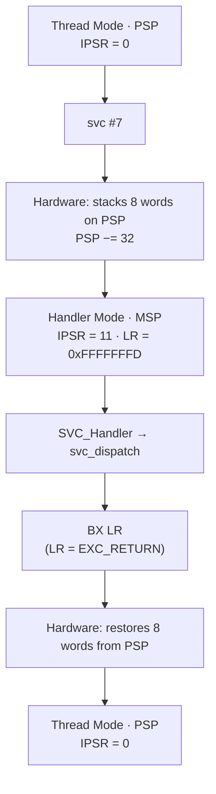

**Language:** English | [Türkçe](README.tr.md)

# Lesson 07 — Exceptions: Entry, Stacking, Vectors & Return

`[STANDARD]` · Day 4 · Estimated time: 75–90 min

---

## Why This Matters

We have been **using** exceptions for five lessons: HardFault in Lesson 02,
UsageFault/STKOF in Lesson 04, SVCall in Lesson 05, and MemManage in Lesson 06.
Each time we read `EXC_RETURN`, decoded the frame, and inspected `IPSR` — but
never systematically explained **exactly what the CPU does when entering** an exception.

This lesson fills that gap. By the end, you should be able to say:

> **An exception is not an ordinary C function call. The CPU changes the execution
> context with hardware assistance.**

This is the common foundation of fault diagnosis in Lesson 08, SysTick/PendSV
scheduling in Lesson 14, and context switching in Lesson 15.

---

## Core Idea

### The sequence

```text
event / instruction
     ↓
exception becomes pending
     ↓
priority / eligibility evaluated
     ↓
vector lookup
     ↓
HARDWARE STACKING (8 word)
     ↓
Handler Mode, active SP = MSP, LR = EXC_RETURN
     ↓
handler runs
     ↓
EXC_RETURN written to pc
     ↓
hardware RESTORES stacked context
     ↓
interrupted context resumes
```

**None of these steps** is performed by software — except `handler çalışır`.
Stacking, mode changes, stack selection, and restoration are hardware responsibilities.

This is the **ordinary** exception path: SVCall, MemManage, HardFault, PendSV,
SysTick, and external IRQs. **Reset does not follow this path** — it is covered separately below.

### Special case: Reset

Reset is architecturally an exception (number 1), but **does not follow the ordinary
entry/exit model**:

| | Ordinary exception (SVC, MemManage, IRQ...) | Reset |
|---|---|---|
| Is there an interrupted context? | Yes | **No** — no previous context |
| Does hardware stack a frame? | Yes, 8 words | **No** — no frame to inspect |
| Where does it start? | Handler Mode | **Privileged Thread Mode** |
| `IPSR` | Exception number | **0** |
| `LR` | `EXC_RETURN` | Not `EXC_RETURN` |
| Where does `SP` come from? | Existing stack | `vector[0]` → `MSP` |
| Where does `PC` come from? | `vector[n]` | `vector[1]` → `Reset_Handler` |
| Is there a return? | Through `EXC_RETURN` | **No** — no context to return to |

Measured at the first instruction of `Reset_Handler` in this build (**OBSERVATION**):

```text
IPSR     = 0
LR       = 0xffffffff        <- not EXC_RETURN
MSP      = 0x30008000        <- same as vector[0]
PSP      = 0x00000000
CONTROL  = 0x0               <- privileged Thread Mode, MSP
```

Although named a "handler," `Reset_Handler` does not interrupt an ongoing task.
It is the system's **first Thread Mode code**. Consequently, none of the stacking,
`EXC_RETURN`, and restoration discussion in this lesson applies to Reset.

### Exception ≠ external interrupt

Everyday speech uses "interrupt" broadly. The architectural distinction is precise:

```text
Exception
├── system exceptions (architecturally defined)
│   ├── Reset          (1)   <- SPECIAL CASE: no ordinary entry/exit path
│   ├── NMI            (2)
│   ├── HardFault      (3)
│   ├── MemManage      (4)
│   ├── BusFault       (5)
│   ├── UsageFault     (6)
│   ├── SecureFault    (7)   <- Armv8-M Security Extension
│   ├── SVCall         (11)
│   ├── DebugMonitor   (12)
│   ├── PendSV         (14)
│   └── SysTick        (15)
│
└── external interrupts (device-specific)
    └── IRQ0, IRQ1, ...      exception number = 16 + IRQ number
```

The common point: **all except Reset** use the same entry/exit mechanism.
They differ in who defines them and how they are triggered.

> **ARCHITECTURE:** The exception number is the vector-table index. While an
> ordinary exception handler runs, its number appears in `IPSR`. **Reset is the
> exception:** `Reset_Handler` runs in Thread Mode and reads `IPSR = 0`.
> External IRQ *n* has exception number `16 + n` and uses vector-table entry `[16 + n]`.
>
> **In this repository:** AN505 device-specific IRQ numbers are not yet defined
> (the `TODO` in `platform/mps2_an505.h`). System exceptions suffice for the FAST
> TRACK; device IRQs are not added without verification (see "Known Boundaries").

### Vector table

```text
vector[0]  = initial MSP value       <- NOT A HANDLER ADDRESS
vector[1]  = Reset_Handler address
vector[n]  = handler address for exception n (or reserved)
```

Handler addresses are stored with the Thumb bit (bit 0 = 1). But:

> **Old, incorrect rule: "all values in the vector table are odd."**
> `vector[0]` is **not a handler address**; it holds the initial `MSP` value —
> `0x30008000` in this build. Its even value concerns stack alignment (an `SP`
> value has no Thumb bit and is word/8-byte aligned), not "this is not an address":
> it is a memory address, just not a branch target. Reserved entries can also be `0`.

### Automatic (basic) stack frame

When an exception is accepted, hardware writes these eight words to the
**currently active** stack:

```text
offset contents
+0x00  R0
+0x04  R1
+0x08  R2
+0x0C  R3
+0x10  R12
+0x14  LR
+0x18  PC        <- RESUME address of interrupted context
+0x1C  xPSR
```

Why exactly these eight? There are two distinct groups:

- **`R0-R3` and `R12`** — working registers that the called function may freely
  overwrite during ordinary calls (volatile / caller-clobbered; Lesson 03).
  Hardware saving them allows a handler to be written as an ordinary C function;
  the compiler already preserves `r4-r11` in its own prologue.
- **`LR`, `PC`, `xPSR`** — stacked not because of an ABI category, but so the
  processor can restore **interrupted control flow and architectural state**:
  where to return, which flags, and which execution state.

The frame is therefore not "the AAPCS caller-saved set." A correct summary is:
**the volatile working registers immediately needed to resume ordinary code,
plus the control-flow/state information required to continue interrupted execution.**

> **This is not always 8 words.** Active FP context uses an extended frame
> (FP registers + `FPSCR`); an alignment padding word may be added, and security
> state transitions introduce further variants. Because this repository is built
> with soft-float, the basic frame is the main model — but "8 words" is not universal.

### `EXC_RETURN`

On handler entry, `LR` receives **a special value, not a normal return address**.
The two measured in this lesson:

| Value | Meaning |
|---|---|
| `0xFFFFFFFD` | Return to Thread Mode, frame on **PSP** |
| `0xFFFFFFF9` | Return to Thread Mode, frame on **MSP** |

Relevant fields (see `docs/DEBUGGING.md` for the complete set):

```text
bit3 Mode   1 = return to Thread, 0 = return to Handler
bit2 SPSEL  1 = frame on PSP,   0 = frame on MSP
bit4 FType  1 = standard frame, 0 = extended (FP)
```

**Critical:** bit 2 identifies **where the frame is**, not **which stack the handler
uses**. A handler always uses MSP.

### Why is `BX LR` not an ordinary return?

When `LR` holds an `EXC_RETURN` value and is written to `PC`, the processor does
not interpret it as an address — it recognizes **exception return** and restores
the stacked context. We will measure this with a single `si` step.

---

## Mental Model

```text
Thread Mode, PSP active
R0 R1 R2 R3 R12 LR PC xPSR  <- running context
        |
        |  exception accepted
        v
PSP (grows downward)
                 high address
              +--------------+
  frame+0x1C  | xPSR         |
  frame+0x18  | PC           |
  frame+0x14  | LR           |
  frame+0x10  | R12          |
  frame+0x0C  | R3           |
  frame+0x08  | R2           |
  frame+0x04  | R1           |
  frame+0x00  | R0           |  <- new PSP points here
              +--------------+
                 low address

        +
CPU enters Handler Mode
active SP  -> MSP        (hardware clears SPSEL)
LR        -> EXC_RETURN
PC        -> vector[11] (SVCall)
IPSR      -> 11

handler runs
        |
        |  BX LR   (LR = EXC_RETURN)
        v
hardware RESTORES the 8 stacked words
        ↓
Thread resumes where it stopped, using PSP
```

Direction check (from Lesson 04): the stack is **full-descending**. `PSP` was
`0x300002F0` before stacking and `0x300002D0` afterwards — **32 bytes lower**.
`R0` is at the frame's lowest address and `xPSR` at its highest.

---

## Visual



---

## Tiny Example

Sources: [`example/main.c`](example/main.c),
[`example/svc_handler.S`](example/svc_handler.S),
[`example/psp_start.S`](example/psp_start.S) (unchanged from Lesson 04).

### Why SVC?

`SVC` was chosen as the exception source: it is **synchronous** (we know exactly
when it occurs), its instruction is known, stacking is expected to succeed,
and it is familiar from Lesson 05. Faults guarantee none of these — they belong
to Lesson 08.

### Thread remains privileged in this lesson

Lessons 05/06 covered privilege and isolation. Here the focus is the exception
mechanism, so Thread Mode remains privileged and can write directly to the console.
(The PPC restriction measured in Lesson 05 concerned **unprivileged** code;
it does not apply here.)

### Recognizable markers

Known values are loaded before `SVC` to check that the frame carries these eight registers:

```c
register uint32_t r0  __asm__("r0")  = 0x11111111u;
register uint32_t r1  __asm__("r1")  = 0x22222222u;
register uint32_t r2  __asm__("r2")  = 0x33333333u;
register uint32_t r3  __asm__("r3")  = 0x44444444u;
register uint32_t r12 __asm__("r12") = 0xCCCCCCCCu;

__asm__ volatile ("svc %[imm]" : "+r"(r0) : [imm]"I"(7), "r"(r1), ...);
```

### Handler wrapper — why save entry state?

```asm
SVC_Handler:
    ldr     r2, =g_entry_lr
    str     lr, [r2]            /* EXC_RETURN - ILK is bu */
    mrs     r3, msp
    ...
```

Because these two values are **no longer reliable** after C code has run inside the handler:

- `lr` → any `bl` overwrites it.
- `msp` → the handler's own prologue moves it downward.

This was precisely the bug that led to the `cm-frame` repair in Lesson 04.

---

## Build & Run

```bash
cmake --preset debug
cmake --build --preset debug --target 07-exceptions
./scripts/run-qemu.sh build/debug/lessons/07-exceptions/07-exceptions.elf
```

---

## Expected Output

Actual output (arm-none-eabi-gcc 13.2.1, QEMU 8.2.2, mps2-an505, `debug`):

```text
===== LESSON 07: EXCEPTIONS =====
[MSP_AT_START] 0x30007FF0
--- vector table ---
[  VTOR] 0x10000000
[  [0] initial MSP] 0x30008000
[  [1] Reset] 0x10000535
[  [3] HardFault] 0x10000531
[  [4] MemManage] 0x10000531
[  [11] SVCall] 0x10000041
[  [14] PendSV] 0x10000531
[  CHECK_VEC0_IS_NOT_ADDRESS] PASS
[  CHECK_SVCALL_THUMB_BIT] PASS
[1] Exception'dan ONCE (Thread Mode)
[  IPSR] 0
[  CONTROL] 0x00000002
[  MSP] 0x30007FF0
[  PSP] 0x300002F0
[  ACTIVE_SP_APPROX] 0x300002F4
[  ACTIVE_STACK] PSP
--- svc #7 calistiriliyor ---
[2] Exception'dan SONRA (Thread Mode)
[  IPSR] 0
[  PSP] 0x300002F0
[  SVC_RESULT] 286331154
[  CHECK_THREAD_RESUMED] PASS
[  CHECK_SVC_RESULT] PASS
[3] Handler giriste ne gordu?
[  HANDLER_IPSR] 11
[  ENTRY_EXC_RETURN] 0xFFFFFFFD
[  ENTRY_MSP] 0x30007FF0
[  ENTRY_PSP] 0x300002D0
[  DISPATCHER_SP] 0x30007FE0
[  CHECK_IPSR_IS_SVCALL] PASS
[  CHECK_HANDLER_USED_MSP] PASS
[  CHECK_ACTIVE_SP_NOT_FRAME] PASS
--- yakalanan exception frame ---
[  FRAME_ADDR] 0x300002D0
[  +0x00 R0] 0x11111111
[  +0x04 R1] 0x22222222
[  +0x08 R2] 0x33333333
[  +0x0C R3] 0x44444444
[  +0x10 R12] 0xCCCCCCCC
[  +0x14 LR] 0x100001E7
[  +0x18 PC] 0x100000BA
[  +0x1C xPSR] 0x61000000
[  xPSR_IPSR_FIELD] 0
[  xPSR_T_BIT] 1
[  xPSR_ALIGN_BIT9] 0
[  CHECK_FRAME_MATCHES_MARKERS] PASS
[  CHECK_FRAME_ON_PSP] PASS
[  CHECK_EXC_RETURN_PSP] PASS
===== END =====
```

> **OBSERVATION.** Addresses are build-specific. The relationships matter.

Six observations, in order:

1. **`vector[0] = 0x30008000`, even.** Not a handler address, but the initial
   `MSP` value. `vector[11] = 0x10000041`, odd — the Thumb bit.
2. **The frame is at `0x300002D0`; PSP before stacking was `0x300002F0`.**
   Exactly 32 bytes = 8 words. Hardware wrote downward.
3. **All five marker values remain exactly in the frame.** `0x11111111` is at
   the lowest address (`+0x00`), `0xCCCCCCCC` at `+0x10`. The layout is measured, not guessed.
4. **Stacked `xPSR = 0x61000000`.** Its `IPSR` field is `0` — the interrupted
   context was Thread Mode. T (bit 24) is `1`. Alignment bit 9 is `0` — hardware
   added no padding in this run.
5. **`DISPATCHER_SP (0x30007FE0) ≠ FRAME_ADDR (0x300002D0)`.** The handler runs
   on MSP while the frame remains on PSP. Confusing the two was the Lesson 04 debugger bug.
6. **`SVC_RESULT = 286331154 = 0x11111112`.** The handler changed the frame's `R0`
   slot; exception return restored it into Thread's `R0`.

---

## Observe in GDB

At each stop we will inspect the corresponding architectural transition in GDB.

```bash
cmake --build --preset debug --target debug-07-exceptions
```

```gdb
gdb-multiarch -q build/debug/lessons/07-exceptions/07-exceptions.elf
set architecture armv8-m.main
target remote :3333
source scripts/gdb/cortex-m.gdb
```

### A — Immediately before `svc`

```gdb
(gdb) disassemble do_marked_svc
```

Find the address of `svc 7` (`0x100000b8` in this build) and set a breakpoint there:

```gdb
(gdb) break *0x100000b8
(gdb) continue
(gdb) cm-mode
(gdb) info registers r0 r1 r12
```

```text
Mode      : Thread Mode
Privilege : Privileged (CONTROL.nPRIV = 0)
Stack     : PSP (0x300002f0)
r0  = 0x11111111
r1  = 0x22222222
r12 = 0xcccccccc
```

**Observation:** Initial state — Thread Mode, `IPSR = 0`, PSP active, marker values
in the registers. Nothing has been stacked yet.

### B — First instruction of `SVC_Handler`

```gdb
(gdb) break SVC_Handler
(gdb) continue
(gdb) cm-mode
(gdb) p/x $lr
(gdb) p/x $sp
(gdb) p/x $msp
(gdb) p/x $psp
```

```text
Mode      : Handler Mode (exception 11)
Privilege : Privileged (Handler Mode her zaman ayricaliklidir)
Stack     : MSP (0x30007ff0)
            PSP = 0x300002d0

$lr  = 0xfffffffd
$sp  = 0x30007ff0
$msp = 0x30007ff0
$psp = 0x300002d0
```

**Changes observed after the instruction:**

| Observation | Architectural transition |
|---|---|
| `IPSR` 0 → 11 | Entered Handler Mode, exception number SVCall |
| `$sp == $msp` | Hardware cleared `SPSEL`; MSP became the active stack |
| `$psp` 0x300002f0 → 0x300002d0 | 32 bytes stacked |
| `$lr = 0xfffffffd` | `LR` holds `EXC_RETURN`, not a return address |

All of this happened without a line of software executing.

### C — After the dispatcher uses its own stack

```gdb
(gdb) break svc_dispatch
(gdb) continue
(gdb) next 3
(gdb) p/x $sp
(gdb) p/x g_frame_addr
```

```text
$sp           = 0x30007fe0
g_frame_addr  = 0x300002d0
```

**Observation:** Active `$sp` is now neither the entry MSP (`0x30007ff0`) nor
the frame address. The handler's own prologue pushed MSP downward.

This is why `cm-frame` does **not guess** from active `$sp` and requires the
frame address as an argument. The old version guessed and printed fabricated
values — the independent audit found this bug.

### D — Decode the saved frame

```gdb
(gdb) cm-exc-return g_entry_lr
(gdb) cm-frame g_frame_addr g_entry_lr
```

```text
EXC_RETURN 0xfffffffd
  bit3 Mode     = 1 -> Thread Mode'a donus
  bit2 SPSEL    = 1 -> frame PSP uzerinde
  bit4 FType    = 1 -> standart (8 word) frame

--- exception frame @ 0x300002d0 (standart 8 word) ---
R0         = 0x11111111
R1         = 0x22222222
R2         = 0x33333333
R3         = 0x44444444
R12        = 0xcccccccc
LR         = 0x100001e7
stacked PC = 0x100000ba
xPSR       = 0x61000000
```

**Observation:** Preconditions hold (standard frame, one security state, no
stacking error), so the command decodes it. Values exactly match the firmware output.

### E — What does the stacked PC point to?

```gdb
(gdb) x/2i *(unsigned int*)(g_frame_addr+24)-2
```

```text
   0x100000b8 <do_marked_svc+20>:  svc  7
   0x100000ba <do_marked_svc+22>:  bx   lr
```

**Observation:** The stacked PC (`0x100000ba`) points to the instruction **after**
`svc`: the address where the interrupted context will **resume**. This is known
precisely because `SVC` is synchronous.

> Do not generalize this: for faults, the meaning of stacked PC depends on the
> exception type (precise / imprecise). Lesson 08.

### F — Exception-return instruction

```gdb
(gdb) disassemble svc_dispatch
```

Find the final instruction (`0x100004e2` in this build):

```gdb
(gdb) break *0x100004e2
(gdb) continue
(gdb) p/x $lr
(gdb) x/1i $pc
```

```text
$lr = 0xfffffffd
=> 0x100004e2 <svc_dispatch+98>:  bx  lr
```

**Observation:** This is an **ordinary function return** emitted by the compiler.
But `LR` carries an `EXC_RETURN` value.

### G — Context restored in one step

```gdb
(gdb) si
(gdb) cm-mode
(gdb) info registers r0 r1 r12
```

```text
do_marked_svc () at .../example/main.c:217
Mode      : Thread Mode
Privilege : Privileged (CONTROL.nPRIV = 0)
Stack     : PSP (0x300002f0)
r0  = 0x11111112
r1  = 0x22222222
r12 = 0xcccccccc
```

**Observation:** In **one step**, `bx lr` did all of the following:

- Handler Mode → Thread Mode (`IPSR` 11 → 0)
- Active stack MSP → PSP
- Eight words restored: `R1`/`R12` returned **unchanged** (`0x22222222`, `0xcccccccc`)
- `PC` jumped to the stacked value (`0x100000ba`)
- `R0` carries the handler's new value (`0x11111112`)

The processor recognized the `EXC_RETURN` encoding in `LR` and performed
**exception return**, rather than interpreting it as an address.

---

## Experiment

**Experiment 1 — MSP-origin exception.**

The same measurement with Thread Mode on MSP. A separate target; we do not switch
stacks — `psp_start()` is never called, and `main` already runs on MSP.

```bash
cmake --build --preset debug --target 07-exceptions-msp
./scripts/run-qemu.sh build/debug/lessons/07-exceptions/07-exceptions-msp.elf
```

Actual output (relevant lines):

```text
[  CONTROL] 0x00000000
[  ACTIVE_STACK] MSP
[  MSP] 0x30007FE0
[  PSP] 0x00000000
...
[  HANDLER_IPSR] 11
[  ENTRY_EXC_RETURN] 0xFFFFFFF9
[  ENTRY_MSP] 0x30007FC0
[  ENTRY_PSP] 0x00000000
[  CHECK_FRAME_ON_MSP] PASS
[  CHECK_EXC_RETURN_MSP] PASS
```

Comparison:

| | PSP-origin | MSP-origin |
|---|---|---|
| `CONTROL` | `0x2` (SPSEL=1) | `0x0` |
| Frame location | PSP: `0x300002D0` | MSP: `0x30007FC0` |
| `EXC_RETURN` | `0xFFFFFFFD` | `0xFFFFFFF9` |
| Handler stack | **MSP** | **MSP** |
| `IPSR` | 11 | 11 |

**Only bit 2 differs.** The handler uses MSP in both cases; only the location
where the frame was stacked changes.

In the MSP-origin case, the frame and handler share the **same** stack. Because
it is full-descending (Lesson 04), the hardware frame already occupies an address
range on MSP; the handler's prologue and local data move MSP **further downward**.
The handler's stack use therefore grows **below the saved frame, at lower
addresses** — correct operation does not overwrite the frame itself. Measurement:
frame at `0x30007FC0`, dispatcher local data at `0x30007FB0`.

Saving entry MSP is therefore even more critical: the distance between `$sp`
and the frame varies with how much the handler has stacked.

**Experiment 2 — Pending and Active states.**

An exception passes through four states:

```text
Inactive
   | event / software request
   v
Pending          <- waiting to be accepted
   | accepted
   v
Active           <- handler running
   | handler returned
   v
Inactive
```

`Pending` does not always mean "will run immediately." Masking, an active
exception of equal/higher priority, or architectural eligibility conditions
can make it wait.

**Active** state was also measured here. `SHCSR` contains active bits for system
handlers — values measured in the fault targets:

```text
At fault with MemManage enabled:  SHCSR = 0x00010001
    bit16 MEMFAULTENA = 1   bit0 MEMFAULTACT = 1  (MemManage ACTIVE)

With MemManage disabled:         SHCSR = 0x00000004
    bit16 MEMFAULTENA = 0   bit2 HARDFAULTACT = 1 (HardFault ACTIVE)
```

Two different handlers active — from the same violation. Continued in Break It.

> An exception can be triggered manually by writing pending bits such as
> `ICSR.PENDSVSET`; this underpins PendSV-based scheduling in Lesson 14. We
> deliberately defer it here — this lesson concerns entry/exit mechanisms.

**Experiment 3 — Priority.**

> **ARCHITECTURE:** A **lower** numeric priority means **higher** urgency.
> `Reset (-3)`, `NMI (-2)`, `HardFault (-1)` are fixed and not programmable;
> the rest are configurable.
>
> **TARGET CONFIG:** **8 priority bits** were measured on this QEMU target
> (`capability-probe`: `NVIC_PRIO_BITS_MEASURED = 8`). This is **not a universal
> Cortex-M33 fact** — the implemented bit count is an implementation option
> and differs between devices.

Measure it yourself:

```bash
cmake --build --preset debug --target capability-probe
./scripts/run-qemu.sh build/debug/tools/capability-probe/capability-probe.elf
```

Priority grouping (`PRIGROUP`, subpriority) is deliberately deferred in this lesson.

---

## Break It

The same violation, two different outcomes. Only one bit changes.

Both targets configure a privileged **read-only** MPU region and attempt a write:

```c
/* Region 0: RO = 1, NP = 0 (yalnizca ayricalikli), XN = 1 */
ARM_MPU_SetRegion(0u,
    ARM_MPU_RBAR((uint32_t)&g_ro_block[0], ARM_MPU_SH_NON, 1u, 0u, 1u),
    ARM_MPU_RLAR((uint32_t)&g_ro_block[0] + sizeof(g_ro_block) - 1u, 0u));
```

Even privileged code **cannot write** this region — protection is independent
of the privilege axis.

### A measured pitfall: order matters

```c
ARM_MPU_Enable(MPU_CTRL_PRIVDEFENA_Msk);

/* SIRA ONEMLI: CMSIS'in ARM_MPU_Enable() fonksiyonu KENDI ICINDE
 *     SCB->SHCSR |= SCB_SHCSR_MEMFAULTENA_Msk;
 * yapar. Ondan ONCE temizlemek etkisiz kalir. */
SCB->SHCSR &= ~SCB_SHCSR_MEMFAULTENA_Msk;
```

In the first attempt, clearing `MEMFAULTENA` before `ARM_MPU_Enable()` made the
escalation target report `IPSR = 4`. `ARM_MPU_Enable` in vendored `armv8m_mpu.h`
sets the bit again.

```bash
cmake --build --preset debug --target 07-exceptions-memmanage
cmake --build --preset debug --target 07-exceptions-escalation
```

### Measured result

| | MemManage **ENABLED** | MemManage **DISABLED** |
|---|---|---|
| `IPSR` | **4** (MemManage) | **3** (HardFault) |
| `CFSR` | `0x00000082` | `0x00000082` — **same** |
| `MMFSR` | `0x82` (DACCVIOL + MMARVALID) | `0x82` — **same** |
| `HFSR` | `0x00000000` | `0x40000000` |
| `HFSR.FORCED` | 0 | **1** |
| `MMFAR` | `0x30000000` | `0x30000000` — **same** |
| `SHCSR` | `0x00010001` | `0x00000004` |
| `EXC_RETURN` | `0xFFFFFFFD` | `0xFFFFFFFD` |
| Stacked PC | `0x10000110` | `0x10000110` — **same** |

**The violation itself is identical.** `MMFSR` and `MMFAR` were written correctly
in both cases. Only **which handler was invoked** changed.

`HFSR.FORCED = 1` states this explicitly: "this HardFault did not arise on its
own; another fault was escalated." We saw the same bit for another reason in Lesson 02.

> **OBSERVATION**, not a universal rule: these values were measured for this build
> and QEMU run. Escalation rules are architectural, but exact `CFSR`/`HFSR`
> contents depend on the scenario.

---

## Debug It

```bash
cmake --build --preset debug --target debug-07-exceptions-escalation
```

```gdb
set architecture armv8-m.main
target remote :3333
source scripts/gdb/cortex-m.gdb
break fault_report
continue
cm-mode
cm-fault
cm-exc-return g_entry_lr
```

Stacking succeeded (`MSTKERR = 0`), so the frame can be decoded:

```gdb
cm-frame g_frame_addr g_entry_lr
```

Questions to answer:

1. Why is `MMFSR` still populated when `IPSR = 3`? Which hardware wrote the bit?
2. What exactly does `HFSR.FORCED = 1` mean? How is it different from "a HardFault occurred"?
3. Is `MMFAR` valid? Which bit says so, and why must you always check it?
4. Which instruction does stacked PC (`0x10000110`) point to? Inspect with `x/1i`.
   How does its **meaning** differ from stacked PC in the `svc` case?
5. Without escalation, could this fault be "recovered from"? What would the handler have to do?
6. `SHCSR = 0x00000004` — which bit is set, and what does it mean?

---

## Exercise

### Exercise 01 — Decode an Exception Entry

The starter firmware generates a clean `SVC` and captures its frame.
You will write `decode_exception_entry()`.

```text
exercises/01-decode-exception-entry/main.c
```

The function takes three inputs — frame pointer, `EXC_RETURN`, `IPSR` — and
fills six fields:

| Field | Source |
|---|---|
| `interrupted_mode` | `"Thread"` / `"Handler"` |
| `frame_stack` | `"PSP"` / `"MSP"` |
| `exception_number` | |
| `stacked_r0` | |
| `stacked_pc` | |
| `stacked_xpsr` | |

**Scope:** only the subset supported by this repository — standard 8-word frame,
one security state. You are not asked to reimplement every `EXC_RETURN` rule.

```bash
cmake --build --preset debug --target 07-exercise-decode
./scripts/run-qemu.sh build/debug/lessons/07-exceptions/07-exercise-decode.elf
```

Actual starter output:

```text
[4] Exception girisi cozumu
[  INTERRUPTED_MODE] ?
[  FRAME_STACK] ?
[  EXCEPTION_NUMBER] 0
[  CHECK_DECODE_MODE] FAIL
[  CHECK_DECODE_STACK] FAIL
[  CHECK_DECODE_EXCNUM] FAIL
[  CHECK_DECODE_R0] FAIL
[  CHECK_DECODE_PC] FAIL
[  CHECK_DECODE_XPSR] FAIL
```

The firmware runs correctly; only decoding is empty. This is the **expected
starting state**.

**Verification criterion:** all six `CHECK_DECODE_*` checks must become `PASS`,
while all other `CHECK_*` lines remain `PASS`.

**Pitfall:** `frame_stack` and "which stack does the handler use?" are **not the
same question**. One comes from `EXC_RETURN` bit 2; the other is always MSP.

### Exercise 02 (optional, DEEP) — `EXC_RETURN` classification

Classify these values: Thread or Handler, MSP or PSP, basic or extended, and
whether this lab's `cm-frame` helper supports them.

```text
0xFFFFFFF9    0xFFFFFFFD    0xFFFFFFED    0xFFFFFFF1    0xFFFFFFF5
```

Answers are in the table at the end of `answers/quick-check.md`.
(Hint: check with `cm-exc-return <değer>`.)

---

## Reference Solution

| What | Where | Target |
|---|---|---|
| Exercise 01 solution | [`solutions/01-decode-exception-entry/`](solutions/01-decode-exception-entry/) | `07-solution-decode` |

```bash
cmake --build --preset debug --target 07-solution-decode
./scripts/run-qemu.sh build/debug/lessons/07-exceptions/07-solution-decode.elf
```

Actual output:

```text
[4] Exception girisi cozumu
[  INTERRUPTED_MODE] Thread
[  FRAME_STACK] PSP
[  EXCEPTION_NUMBER] 11
[  STACKED_R0] 0x11111111
[  STACKED_PC] 0x100000BA
[  STACKED_XPSR] 0x61000000
[  CHECK_DECODE_MODE] PASS
[  CHECK_DECODE_STACK] PASS
[  CHECK_DECODE_EXCNUM] PASS
[  CHECK_DECODE_R0] PASS
[  CHECK_DECODE_PC] PASS
[  CHECK_DECODE_XPSR] PASS
```

---

## What I Learned

> This section is yours.

**How an exception differs from an ordinary function call:**

<!-- -->

**What `bx lr` did in one step:**

<!-- -->

**The difference between `EXC_RETURN` bit 2 and "which stack the handler uses":**

<!-- -->

**What surprised me:**

<!-- e.g. the same violation leaves MMFSR unchanged but reaches a different handler -->

**My question for Lesson 08:**

<!-- -->

---

## Quick Check

1. Are exceptions and external interrupts the same? What do they share?
2. Why is vector-table entry 0 not a handler address? What is its value in this
   build, and why is it even?
3. Which registers are automatically written to the basic frame on exception
   entry? Why exactly those?
4. If `SVC` occurs while Thread uses PSP, which stack receives the frame?
5. Which stack does a handler use? Does software or hardware choose it?
6. Why is `LR` not a normal return address on handler entry?
7. How can `BX LR` initiate exception return in an exception handler?
8. What is the difference between `Pending` and `Active`? Does pending always
   mean "will run immediately"?
9. What does a lower priority number mean?
10. This target measured 8 priority bits. Why is that not a universal Cortex-M33 fact?
11. **(Reasoning)** Why is `cm-frame $sp ...` not automatically correct inside a handler?
12. **(Reasoning)** Why does an MPU violation become another exception when
    MemManage is disabled? What happens to `MMFSR`?
13. **(Reasoning)** Must the handler save `r4-r11`? Why does hardware not stack them?

> Answers: [`answers/quick-check.md`](answers/quick-check.md)

---

## Takeaway

- **An exception is not a function call.** Stacking, mode changes, stack selection,
  and restoration are performed by **hardware**.
- Basic frame: **8 words**, `R0 R1 R2 R3 R12 LR PC xPSR`, with `R0` at the lowest
  address. Volatile working registers (`R0-R3`, `R12`) + control flow/state
  (`LR`, `PC`, `xPSR`). Not all are a "caller-saved set." (FP and security variants exist.)
- The frame is written to the **currently active** stack; the handler **always
  uses MSP**. `EXC_RETURN` bit 2 describes the former, not the latter.
- `EXC_RETURN` is carried in `LR`; when written to `PC`, the processor interprets
  it as **exception return**, not an address.
- `vector[0]` is not a handler address; it holds the initial `MSP` value.
  "All vector entries are odd" is **incorrect**.
- **Reset is special:** no stacking, no `EXC_RETURN`, no return;
  `Reset_Handler` starts in privileged Thread Mode with `IPSR = 0`.
- Disabling a handler does not remove a fault; it **escalates**, and `HFSR.FORCED`
  indicates this. Status registers are still written correctly.

---

## Official References

- **Armv8-M Architecture Reference Manual (Arm DDI 0553)** — exception numbering,
  `IPSR`, vector table, exception entry/return, stack-frame layout, `EXC_RETURN`,
  clearing `SPSEL` on exception entry, priority model, and escalation.
  <https://developer.arm.com/documentation/ddi0553/latest/>
- **Armv8-M Exception Model User Guide (Arm 107706)** — exception numbers
  (SVCall = 11, MemManage = 4, HardFault = 3), `EXC_RETURN` bit fields.
  <https://developer.arm.com/documentation/107706/latest/>
- **Cortex-M33 Devices Generic User Guide (Arm 100235)** — `SHCSR`, system-handler
  active/enable bits, `VTOR`, priority registers.
  <https://developer.arm.com/documentation/100235/latest/>
- **AAPCS32** — volatile / callee-saved registers; why the `R0-R3`/`R12` portion
  is stacked (`LR`/`PC`/`xPSR` serve control flow).
  <https://github.com/ARM-software/abi-aa/blob/main/aapcs32/aapcs32.rst>
- **CMSIS-Core (M)** — `__get_IPSR`, `__get_CONTROL`, `SCB`/`MPU` definitions;
  `ARM_MPU_Enable()` setting `MEMFAULTENA` (vendored here in
  `external/CMSIS/Core/Include/m-profile/armv8m_mpu.h`).
  <https://arm-software.github.io/CMSIS_6/latest/Core/index.html>
- Measurement environment: `arm-none-eabi-gcc 13.2.1`, `QEMU 8.2.2`,
  `mps2-an505 / cortex-m33`, `debug` preset.

---

## Known Boundaries

- **Basic-frame focus.** This repository is built with `-mfloat-abi=soft`; FP
  context never becomes active, so all measurements use 8-word frames. Extended
  (FP) frames and additional-state-context (`DCRS = 0`) variants were **not
  measured**; `cm-frame` already rejects them. FPU is covered in Lesson 13.
- **Alignment padding was not observed in these runs** (`xPSR` bit 9 = 0).
  Hardware can add a padding word when needed; only measured results are shown here.
- **One security state.** We run in Secure state. TrustZone adds a security-state
  dimension to exception entry/exit (`EXC_RETURN` bits 0 and 6, extra frame
  variants) — Lesson 16.
- **QEMU target configuration.** The 8 priority bits and PPC behavior were
  measured in this emulator; physical MPS2+ AN505 was not verified.
- **External IRQ example deferred.** AN505 device-specific IRQ numbers are not
  added to `IRQn_Type` without verification. External interrupt numbering is
  explained **conceptually** here (`exception numarası = 16 + IRQ numarası`);
  a working device IRQ example is left for later.
- **Priority grouping deferred.** `PRIGROUP`, subpriority, and nested interrupt
  scenarios were not implemented here because a small deterministic demonstration
  could not be established. Nested preemption was introduced conceptually.
- **Manually triggering pending bits**, such as `ICSR.PENDSVSET`, is deliberately
  left to Lesson 14.

---

**Previous:** [06 — MPU](../06-mpu/)
**Next:** [08 — Faults](../08-faults/)
