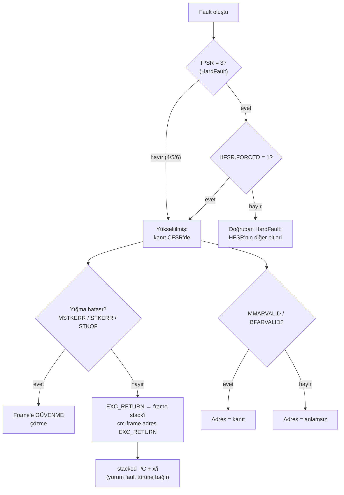

**Language:** English | [Türkçe](README.tr.md)

# Lesson 08 — Faults: MemManage, BusFault, UsageFault & HardFault

`[STANDARD]` · Day 4 · Estimated time: 75–90 min

---

## Why This Matters

We have seen faults for five lessons — but one isolated case at a time:

| Lesson | Observed | Taught |
|---|---|---|
| 02 | `STKERR` + HardFault | Invalid stack |
| 04 | `STKOF` | Stack limit |
| 06 | `DACCVIOL` → MemManage | MPU policy |
| 07 | Same `DACCVIOL`, handler disabled → HardFault + `FORCED` | Escalation |

This lesson turns those scattered observations into **a repeatable diagnostic method**.

The lesson in one sentence:

> **Do not diagnose a Cortex-M fault from a single register.**

When a field device stops in HardFault, "a HardFault happened" says almost nothing.
What matters is reading registers **together**, and knowing when each can be trusted.

---

## Core Idea

### Four fault classes — mechanisms, not dramatic labels

| Class | `IPSR` | When | Subregister |
|---|---|---|---|
| **MemManage** | 4 | Memory-protection violation (MPU and related checks) | `MMFSR` + `MMFAR` |
| **BusFault** | 5 | Memory/bus system rejected an access | `BFSR` + `BFAR` |
| **UsageFault** | 6 | Incorrect instruction or execution-state usage | `UFSR` (no address) |
| **HardFault** | 3 | High-priority fault mechanism; destination for faults **escalated** because their own handler is unavailable | `HFSR` |

The first three are **configurable**: enabled by `MEMFAULTENA`, `BUSFAULTENA`,
and `USGFAULTENA` in `SHCSR`, with configurable priorities.

**HardFault is not "the worst fault,"** nor "every unknown error." It is a
**mechanism**: the destination of a fault whose own handler is not enabled or cannot run.

### Fault ≠ root cause

The central idea. Measured in Lesson 07:

| | MemManage ENABLED | MemManage DISABLED |
|---|---|---|
| Active handler | MemManage (`IPSR = 4`) | **HardFault** (`IPSR = 3`) |
| `CFSR` | `DACCVIOL` | `DACCVIOL` — **same** |
| `HFSR.FORCED` | 0 | **1** |

Same violation; only **which handler saw it** changed.

> **"HardFault is active" ≠ "the underlying problem was inherently a HardFault."**

Diagnosing HardFault often requires looking **beneath HardFault**:
first `HFSR.FORCED`, then `CFSR`.

### CFSR structure

```text
CFSR (0xE000ED28)
├── MMFSR   bits [7:0]     MemManage durumu
├── BFSR    bits [15:8]    BusFault durumu
└── UFSR    bits [31:16]   UsageFault durumu
```

Bits used in this lesson (positions verified against vendored CMSIS `core_cm33.h` — Armv8-M):

```text
MMFSR  bit0 IACCVIOL   komut getirme ihlali
       bit1 DACCVIOL   veri erisim ihlali
       bit3 MUNSTKERR  exception DONUSUNDE geri yukleme hatasi
       bit4 MSTKERR    exception GIRISINDE yigma hatasi
       bit5 MLSPERR    lazy FP koruma hatasi (FP'ye ozel)
       bit7 MMARVALID  MMFAR gecerli

BFSR   bit0 IBUSERR    komut getirme veri yolu hatasi
       bit1 PRECISERR  precise veri yolu hatasi
       bit2 (genel Armv8-M/CMSIS: IMPRECISERR)  -> asagidaki nota bak
       bit3 UNSTKERR   donuste geri yukleme hatasi
       bit4 STKERR     giriste yigma hatasi
       bit5 LSPERR     lazy FP koruma hatasi
       bit7 BFARVALID  BFAR gecerli

UFSR   bit0 UNDEFINSTR tanimsiz komut
       bit1 INVSTATE   gecersiz yurutme durumu (orn. Thumb biti 0)
       bit2 INVPC      gecersiz EXC_RETURN / PC yuklemesi
       bit3 NOCP       coprocessor erisimi (FP kapaliyken FP komutu)
       bit4 STKOF      stack limiti asildi   <- Armv8-M'e OZEL
       bit8 UNALIGNED  hizasiz erisim (UNALIGN_TRP acikken)
       bit9 DIVBYZERO  sifira bolme (DIV_0_TRP acikken)
```

`STKOF` is **absent** from Armv7-M tables — a CFSR table copied from Armv7-M
cannot explain this lesson's Lesson 04 case.

> **BFSR bit 2 — generic definition ≠ Cortex-M33 implementation.** Generic
> Armv8-M material and vendored CMSIS (`SCB_CFSR_IMPRECISERR_Msk`) define bit 2
> as `IMPRECISERR`. The independent audit reported that the Cortex-M33-specific
> BFSR register table marks it **Reserved / RES0**. This repository could not
> independently reread that table; in the accessible Cortex-M33 Generic User Guide
> r0p4 text, the summary "fault types" table (Table 2-25) still lists `IMPRECISERR`.
> Because the sources are inconsistent, this lab **does not present bit 2 as an
> implemented Cortex-M33 status field**: firmware and `cm-fault` label it only
> "`bit2 (generic IMPRECISERR)`", and the solution does not select it as a cause
> bit. It was not set in any case in this lesson.

### Address register + validity bit = evidence

```text
MMFAR icerigi  +  MMARVALID = 1   ->  kullanilabilir kanit
MMFAR icerigi  +  MMARVALID = 0   ->  ANLAMSIZ, kullanma

BFAR  icerigi  +  BFARVALID = 1   ->  kullanilabilir kanit
BFAR  icerigi  +  BFARVALID = 0   ->  ANLAMSIZ, kullanma
```

> **ARCHITECTURE:** `MMFAR`/`BFAR` are diagnostically meaningful only when their
> corresponding `VALID` bit is set. Otherwise they may contain stale values or garbage.

UsageFault has **no** address register.

### Status bits are sticky and cleared with W1C

`CFSR` and `HFSR` bits remain set until explicitly cleared (or reset).
They use **write-one-to-clear**: write **1** to clear a bit.
**Writing 0 clears nothing.**

Although based on the same principle, they are **handled differently** on Cortex-M33:

```c
/* CFSR: tanimli bitlerin hepsi W1C, ayrilmis bitler 0 okunur.
 * Okunani geri yazmak: set olan bitlere 1, ayrilmis bitlere 0. */
uint32_t cfsr = SCB->CFSR;
SCB->CFSR = cfsr;

/* HFSR: acik maske. */
uint32_t hfsr = SCB->HFSR;
SCB->HFSR = SCB_HFSR_DEBUGEVT_Msk |                            /* bit31 = 1 */
            (hfsr & (SCB_HFSR_FORCED_Msk | SCB_HFSR_VECTTBL_Msk)); /* bit30, bit1 */
```

| HFSR bit | Written value | Reason |
|---|---|---|
| 31 `DEBUGEVT` | **always 1** | Cortex-M33-specific write rule (below). W1C means this write also clears it. |
| 30 `FORCED` | value read | If set, write 1 → clear |
| 1 `VECTTBL` | value read | If set, write 1 → clear |
| others | 0 | Reserved fields |

**Why is `HFSR = HFSR` insufficient?** The independent audit reported that the
Cortex-M33 HFSR bit table requires writing **1** to `DEBUGEVT` when writing HFSR;
otherwise behavior is **UNPREDICTABLE**. Writing back the read value writes **0**
to bit 31 when `DEBUGEVT` is clear, violating the rule. `CFSR` has no such rule;
writing back is safe there.

> **Source status (candidly):** What this repository could verify from the
> Cortex-M33 Generic User Guide's HFSR section is that HFSR is *"read, write to
> clear"*, its bits are sticky, and only writing 1 or reset clears them. The bit-table
> text containing the `DEBUGEVT`-specific "write 1" rule could not be reread here;
> the rule came from the audit. The chosen mask also agrees with verified W1C
> semantics: writing 1 to bit 31 only clears `DEBUGEVT`.
>
> **An opposite-direction pitfall:** Cortex-M3/M4 guides say the opposite for
> `DEBUGEVT` (*"write 0"*). That rule does not apply to this core; do not copy
> internet M3/M4 examples here.
>
> **ARCHITECTURE vs OBSERVATION:** QEMU v8.2.2 implements HFSR writes as plain W1C
> (`hw/intc/armv7m_nvic.c`: `hfsr &= ~value`), so **it does not validate this rule**;
> the old write also "worked" there. This repository was **not tested** on physical
> Cortex-M33 hardware. The mask was chosen for the architectural requirement,
> not because the emulator accepted it.

Each target starts from reset and produces one fault, so cleanup at the start
of `main()` has no bits left from a previous run. The same cleanup function is
called again at the end of the report — **after capturing the snapshot**
(the `POST-CLEAR` section). Measured in the escalation case:

```text
[  HFSR] 0x40000000             <- snapshot: FORCED temizlikten ONCE yakalandi
--- POST-CLEAR ---
[  SNAPSHOT_HFSR] 0x40000000
[  HFSR_AFTER_CLEAR] 0x00000000
[  CFSR_AFTER_CLEAR] 0x00000000
```

GDB measured the HFSR write value in this case: `0xC0000000` (`DEBUGEVT = 1`,
`FORCED = 1`, reserved fields 0).

### Precise vs imprecise

- **Precise:** the processor can associate the fault with a specific instruction/context.
  Stacked PC can point to that instruction.
- **Imprecise:** reporting may be delayed (for example, a buffered write fails later).
  Stacked PC **may not identify** the access that caused the error.

Not every BusFault is imprecise; not every data fault is precise.

> **OBSERVATION:** All four cases measured here are **precise**. Precise/imprecise
> is explained as a general Arm fault-model concept; this repository has no
> measured imprecise example. The generic Armv8-M/CMSIS `IMPRECISERR` status bit
> is **not presented** as a verified Cortex-M33 field (see BFSR bit 2 above).

---

## Mental Model

```text
FAULT OLUSTU
    ↓
Hangi exception onu isliyor?           IPSR / SHCSR
    ↓
Yukseltilmis mi?                       HFSR.FORCED
    ↓
CFSR ne diyor?                         MMFSR / BFSR / UFSR
    ↓
Adres register'i gecerli mi?           MMARVALID / BFARVALID
    ↓
Yigma / geri yukleme basarili mi?      MSTKERR / STKERR / STKOF
    ↓
Exception frame'ine guvenilir mi?      EXC_RETURN + yigma bitleri
    ↓
Yigilmis durum + disassembly ne diyor? stacked PC, x/i
    ↓
KOK SEBEP
```

Raw registers are **facts**; their inferred meaning is **interpretation**.
That is why this lesson's report separates `RAW` and `DECODE`.

---

## Visual



---

## Tiny Example

One source, four compile-time-selected scenarios:
[`example/main.c`](example/main.c).

### Controlled triggers

Each is **one instruction**, written in assembly to identify exactly which
instruction faulted ([`example/fault_triggers.S`](example/fault_triggers.S)).
"Generating" a fault through undefined C behavior would depend on the compiler.

```asm
trigger_udf:      udf  #0x42        /* mimari olarak TANIMSIZ komut */
trigger_load:     ldr  r0, [r0]     /* eslenmemis adres -> BusFault  */
mpu_store_word:   str  r1, [r0]     /* MPU izin vermezse -> MemManage */
```

### Where did the BusFault target come from?

It was not guessed. QEMU's memory map was read with `info mtree -f`: Secure SRAM
is `0x30000000..0x30007FFF`, the next region is `0x38000000`. In between,
`0x30100000` is **unmapped**. This is a **TARGET CONFIG** fact — the same address
can behave differently on a physical board.

### Capture first, interpret second

The wrappers ([`example/fault_handlers.S`](example/fault_handlers.S)) do the same
work for four handlers: save `EXC_RETURN` and entry `MSP`/`PSP`, select the frame
address using `EXC_RETURN` bit 2, and branch to the C recorder.

The C recorder's **first task** is to capture status registers — before console work:

```c
g_snap.ipsr   = __get_IPSR();
g_snap.cfsr   = SCB->CFSR;
g_snap.hfsr   = SCB->HFSR;
g_snap.shcsr  = SCB->SHCSR;
g_snap.mmfar_raw = SCB->MMFAR;
g_snap.bfar_raw  = SCB->BFAR;
...
/* Frame yalnizca yigma basariliysa ve bicim destekleniyorsa gecerli */
g_snap.frame_valid = !stacking_failed && basic_frame;
```

Why this order? The handler itself changes `SP`, `LR`, and registers. Inferring
the interrupted frame from live handler `$sp` was the Lesson 04 debugger bug.

---

## Build & Run

```bash
cmake --preset debug
cmake --build --preset debug
./scripts/run-qemu.sh build/debug/lessons/08-faults/08-faults-memmanage.elf
./scripts/run-qemu.sh build/debug/lessons/08-faults/08-faults-usage.elf
./scripts/run-qemu.sh build/debug/lessons/08-faults/08-faults-bus.elf
./scripts/run-qemu.sh build/debug/lessons/08-faults/08-faults-escalation.elf
```

---

## Expected Output

Actual outputs (arm-none-eabi-gcc 13.2.1, QEMU 8.2.2, mps2-an505, `debug`).
Only decisive lines for each case; full output is available from each firmware.

### Case 1 — MemManage (clean reference case)

Unprivileged Thread writes directly to protected `g_service_counter`.

```text
--- RAW ---
[  IPSR] 4
[  EXC_RETURN] 0xFFFFFFFD
[  CONTROL] 0x00000001
[  CFSR] 0x00000082
[  HFSR] 0x00000000
[  SHCSR] 0x00010001
[  MMFAR_RAW] 0x30000000
[  BFAR_RAW] 0x00000000
[  FRAME_ADDR] 0x300002F8
--- DECODE ---
[  ACTIVE_EXCEPTION] MemManage
[  ESCALATED] NO
[  MMFSR.DACCVIOL] 1
[  MMFSR.MMARVALID] 1
[  FAULT_ADDRESS(MMFAR)] 0x30000000
[  BFAR] GECERSIZ - kanit degil
[  FRAME_STACK] PSP
[  FRAME_VALID] YES
[  STACKED_R0] 0x30000000
[  STACKED_R1] 0x0BADC0DE
[  STACKED_PC] 0x100000FC
```

`MMFAR = 0x30000000` = `PROTECTED_ADDR`. `STACKED_R0`/`R1` are `mpu_store_word` arguments.

### Case 2 — UsageFault

```text
--- RAW ---
[  IPSR] 6
[  CFSR] 0x00010000
[  HFSR] 0x00000000
[  SHCSR] 0x00040008
--- DECODE ---
[  ACTIVE_EXCEPTION] UsageFault
[  ESCALATED] NO
[  UFSR.UNDEFINSTR] 1
[  MMFAR] GECERSIZ - kanit degil
[  BFAR] GECERSIZ - kanit degil
[  FRAME_VALID] YES
[  STACKED_PC] 0x100000F4
```

No address register — UsageFault concerns an instruction, not a memory address.

### Case 3 — BusFault

```text
--- RAW ---
[  IPSR] 5
[  CFSR] 0x00008200
[  HFSR] 0x00000000
[  SHCSR] 0x00020002
[  BFAR_RAW] 0x30100000
--- DECODE ---
[  ACTIVE_EXCEPTION] BusFault
[  ESCALATED] NO
[  BFSR.PRECISERR] 1
[  BFSR.BFARVALID] 1
[  MMFAR] GECERSIZ - kanit degil
[  FAULT_ADDRESS(BFAR)] 0x30100000
[  FRAME_VALID] YES
[  STACKED_R0] 0x30100000
[  STACKED_PC] 0x100000F8
```

`BFAR = 0x30100000` = `TARGET_ADDR`. A deterministic, precise BusFault.

### Case 4 — Escalation (see Break It)

```text
[  IPSR] 3
[  CFSR] 0x00010000
[  HFSR] 0x40000000
[  SHCSR] 0x00000004
[  ACTIVE_EXCEPTION] HardFault
[  ESCALATED] YES
[  UFSR.UNDEFINSTR] 1
[  FRAME_VALID] YES
[  STACKED_PC] 0x100000F4
```

### Stacked PC ↔ disassembly

```text
100000f4 <trigger_udf>:     udf  #66        <- Vaka 2 ve 4: STACKED_PC 0x100000F4
100000f8 <trigger_load>:    ldr  r0, [r0]   <- Vaka 3:      STACKED_PC 0x100000F8
100000fc <mpu_store_word>:  str  r1, [r0]   <- Vaka 1:      STACKED_PC 0x100000FC
```

In all four cases, stacked PC points to **the faulting instruction itself**.

Compare Lesson 07: `svc 7` was at `0x100000b8`, and stacked PC was `0x100000ba` —
the **next** instruction.

| Exception | Stacked PC identifies | Reason |
|---|---|---|
| SVCall (Lesson 07) | Instruction **after** `svc` | `SVC` completed; return to continuation |
| Precise fault (this lesson) | The faulting instruction **itself** | Instruction could not complete |
| Imprecise fault | **May not identify** the causal access | Delayed reporting |

> **"Stacked PC always identifies the faulty instruction" is WRONG.** Meaning
> depends on exception type. The first two rows were measured in this repository;
> the third is an architectural caution.

---

## Cortex-M Fault Triage

The main deliverable of this lesson. `projects/fault-analyzer/` will use this list later.

| # | Question | Inspect | Caution |
|---|---|---|---|
| 1 | Which exception is active? | `IPSR`, `SHCSR` active bits | |
| 2 | If HardFault, was it escalated? | `HFSR.FORCED` | `FORCED = 1` → evidence in `CFSR` |
| 3 | Which `CFSR` subfield is populated? | `MMFSR` / `BFSR` / `UFSR` | **Independent** of active handler |
| 4 | Exactly which bits? | `cm-fault` `SET` line | `VALID` bits are not causes |
| 5 | Is the address register valid? | `MMARVALID` / `BFARVALID` | Otherwise address is **not evidence** |
| 6 | Did stacking succeed? | `MSTKERR` / `STKERR` / `STKOF` | If not, **do not trust the frame** |
| 7 | Which stack holds the frame? | Entry-saved `EXC_RETURN` bit 2 | Not live `$lr`/`$sp` |
| 8 | If frame is valid: PC / LR / xPSR / arguments | `cm-frame <adres> <EXC_RETURN>` | |
| 9 | Does disassembly confirm the suspicion? | `x/i <stacked PC>` | Interpret according to precise/imprecise |
| 10 | Which architectural condition caused the fault? | Combine 1–9 | Root cause |

---

## Observe in GDB

Example session: **BusFault**, the new case in this lesson. Inspect the other
three using the same steps.

```bash
cmake --build --preset debug --target debug-08-faults-bus
```

```gdb
gdb-multiarch -q build/debug/lessons/08-faults/08-faults-bus.elf
set architecture armv8-m.main
target remote :3333
source scripts/gdb/cortex-m.gdb
```

### A — Immediately before the faulting instruction

```gdb
(gdb) break trigger_load
(gdb) continue
(gdb) x/1i $pc
(gdb) p/x $r0
(gdb) cm-mode
```

```text
=> 0x100000f8 <trigger_load>:  ldr  r0, [r0, #0]
$1 = 0x30100000
Mode      : Thread Mode
Privilege : Privileged (CONTROL.nPRIV = 0)
Stack     : PSP (0x300002f8)
```

**Observation:** Thread Mode, PSP. The next instruction is a single `ldr`; the
address is in `r0` and lies in an unmapped region.

### B / C — First handler instruction, EXC_RETURN

```gdb
(gdb) break BusFault_Handler
(gdb) continue
(gdb) cm-mode
(gdb) p/x $lr
```

```text
Mode      : Handler Mode (exception 5)
Privilege : Privileged (Handler Mode her zaman ayricaliklidir)
Stack     : MSP (0x30007ff0)
            PSP = 0x300002d8
$lr = 0xfffffffd
```

**Observation:** `IPSR = 5` → BusFault, **not HardFault** (because `BUSFAULTENA = 1`).
`PSP` moved down 32 bytes → frame stacked. `LR` holds `EXC_RETURN`.

### D — Fault status registers: raw + helper

Do not trust the helper blindly; read raw registers at least once:

```gdb
(gdb) x/1wx 0xE000ED28      # CFSR
(gdb) x/1wx 0xE000ED2C      # HFSR
(gdb) x/1wx 0xE000ED38      # BFAR
(gdb) cm-fault
```

```text
0xe000ed28:  0x00008200
0xe000ed2c:  0x00000000
0xe000ed38:  0x30100000

--- fault status registers ---
CFSR  = 0x00008200  (MMFSR=0x00 BFSR=0x82 UFSR=0x0000)
HFSR  = 0x00000000  FORCED=0 -> escalation YOK
MMFAR = 0x00000000  (MMARVALID=0 -> icerik ANLAMSIZ, kullanma)
BFAR  = 0x30100000  (BFARVALID=1 -> adres GECERLI)
SET   : BFSR.PRECISERR BFSR.BFARVALID
```

**Observation:** Raw values exactly match helper output. `BFSR = 0x82` = bit 1
`PRECISERR` + bit 7 `BFARVALID`. `MMFAR = 0`, but `MMARVALID = 0` — meaningless;
do not use it.

### E / F — Frame-validity decision and decoding

Stacking-error bits (`MSTKERR` / `STKERR` / `STKOF`) are **clear** → the frame
can be decoded:

```gdb
(gdb) cm-frame $psp $lr
```

```text
--- exception frame @ 0x300002d8 (standart 8 word) ---
EXC_RETURN 0xfffffffd -> frame PSP uzerinde, Thread Mode'a donus
R0         = 0x30100000
LR         = 0x10000199
stacked PC = 0x100000f8
xPSR       = 0x61000000
```

Here `$psp` and `$lr` could be used directly because we are **at the first handler
instruction** — nothing has changed them yet. This is no longer true after C runs
inside the handler.

### G — Stacked PC ↔ disassembly

```gdb
(gdb) x/1i *(unsigned int*)($psp+24)
```

```text
   0x100000f8 <trigger_load>:  ldr  r0, [r0, #0]
```

**Observation:** In a precise bus fault, two addresses answer different questions:

| Register | Value | What |
|---|---|---|
| `BFAR` | `0x30100000` | The attempted **data** address |
| stacked PC | `0x100000F8` | The faulting **instruction's** address (`ldr r0, [r0]`) |

`BFAR` is **not** the address of `ldr` itself; it is the address `ldr` tried to
read. Together they complete the story: *this instruction attempted this data
address, and the memory system rejected it.*

### `cm-fault` update

This lesson made **one** addition to `cm-fault`: the `SET` line listing set
`CFSR` bits by name, and an unstacking note (triage step 4). Bit positions came
from vendored CMSIS. The change was retested against Lesson 02 (`STKERR`),
Lesson 04 (`STKOF`), Lesson 06 (`DACCVIOL`), and Lesson 07 (escalation);
all were labeled correctly.

The audit repair changed **one** `cm-fault` label: BFSR bit 2 is now printed as
`BFSR.bit2(generic-IMPRECISERR,M33:dogrulanmadi)` instead of `BFSR.IMPRECISERR`
(see the BFSR bit 2 note). Raw registers, `MMARVALID`/`BFARVALID`, stacking/
unstacking warnings, `HFSR.FORCED`, and all other labels remain unchanged;
eight known cases were retested.

---

## Experiment

**Experiment 1 — Compare the four cases side by side.**

| | MemManage | UsageFault | BusFault | Escalation |
|---|---|---|---|---|
| `IPSR` | 4 | 6 | 5 | **3** |
| `CFSR` | `0x00000082` | `0x00010000` | `0x00008200` | `0x00010000` |
| Primary bit | `DACCVIOL` | `UNDEFINSTR` | `PRECISERR` | `UNDEFINSTR` |
| Address | `MMFAR` ✓ | none | `BFAR` ✓ | none |
| `HFSR` | 0 | 0 | 0 | `0x40000000` |
| `SHCSR` | `0x00010001` | `0x00040008` | `0x00020002` | `0x00000004` |
| Frame | valid | valid | valid | valid |

Read `SHCSR`: each case sets **both** the relevant `ENA` and `ACT` bits.
For example, BusFault `0x00020002` = bit 17 `BUSFAULTENA` + bit 1 `BUSFAULTACT`.
Escalation has no `ENA`, only bit 2 `HARDFAULTACT`.

**Experiment 2 — Which evidence is trustworthy in each case?** (DEEP, documentation)

For each snapshot below, ask: *which evidence can I trust?*

1. Clean `DACCVIOL` (Case 1)
2. Escalated `UNDEFINSTR` (Case 4)
3. `UsageFault` (Case 2)
4. Stacking error (Lesson 02: `CFSR = 0x00009200`, `STKERR`)

Answers are at the end of `answers/quick-check.md`.

**Experiment 3 — `DIV_0_TRP` / `UNALIGN_TRP` (optional).**

These two `SCB->CCR` bits turn divide-by-zero and unaligned access into UsageFault.
They were **not measured** here — write an `sdiv` or unaligned `ldr` trigger and
try it. Ensure the compiler does not optimize away the division (use an assembly trigger).

---

## Break It

This lesson already concerns faults, so Break It changes the **diagnostic state**,
rather than generating a new crash.

Same `UDF`, only `USGFAULTENA` differs:

```bash
cmake --build --preset debug --target 08-faults-escalation
./scripts/run-qemu.sh build/debug/lessons/08-faults/08-faults-escalation.elf
```

| | UsageFault ENABLED (Case 2) | UsageFault DISABLED (Case 4) |
|---|---|---|
| Active handler | UsageFault (`IPSR = 6`) | **HardFault** (`IPSR = 3`) |
| `HFSR.FORCED` | 0 | **1** |
| `CFSR` | `0x00010000` | `0x00010000` — **same** |
| `UFSR.UNDEFINSTR` | 1 | 1 — **same** |
| Frame | valid | valid — **same** |
| Stacked PC | `0x100000F4` | `0x100000F4` — **same** |

Lesson 07 demonstrated this with MemManage; here the same principle is repeated
with **a different fault class**. The rule is class-independent.

Stopping the investigation at HardFault would **completely miss the diagnosis**.
The underlying cause is one layer below, in `UFSR`.

> **ARCHITECTURE:** A configurable fault occurring while disabled can escalate.
> **OBSERVATION:** This measurement had `HFSR = 0x40000000` with `CFSR` preserved.
> No claim is made that every disabled fault produces **identical** register values.

`HFSR.FORCED` means a configurable-priority exception was escalated to HardFault,
not "the processor forced a random crash."

---

## Debug It

A second kind of Break It: break a **diagnostic assumption**. Try to decode a
known stacking-error context as though it contained a valid frame.

```bash
cmake --build --preset debug --target debug-02-programmer-model-broken
```

```gdb
set architecture armv8-m.main
target remote :3333
source scripts/gdb/cortex-m.gdb
break Default_Handler
continue
cm-fault
cm-frame $psp 0xFFFFFFFD
```

Measured (Lesson 02 target rerun unchanged):

```text
CFSR  = 0x00009200  (MMFSR=0x00 BFSR=0x92 UFSR=0x0000)
HFSR  = 0x40000000  FORCED=1 -> baska bir fault HardFault'a yukseltildi (escalation)
BFAR  = 0xfffffffc  (BFARVALID=1 -> adres GECERLI)
SET   : BFSR.PRECISERR BFSR.STKERR BFSR.BFARVALID
UYARI: STACKING hatasi bildirilmis (STKOF/STKERR/MSTKERR).

REDDEDILDI [STACKING HATASI]: CFSR = 0x00009200
```

The tool rejects frame decoding. `STKERR` means hardware encountered an error
while stacking the exception frame. No trustworthy frame exists in memory;
values read there cannot be used as the interrupted context's register values.

The Lesson 04 `STKOF` case is rejected the same way (`SET : UFSR.STKOF`).

Questions to answer:

1. This case has `BFARVALID = 1` but an untrustworthy frame. Is that contradictory?
   What does `BFAR` refer to?
2. What would the old `cm-frame` (reading 8 words from active `$sp`) print here?
   Why is that dangerous?
3. How do `STKERR` and `UNSTKERR` differ? Which says the frame could not be written **on entry**?
4. Between clean `DACCVIOL` (Case 1) and this case, **which evidence** is reliable in both?

---

## Exercise

### Exercise 01 — Complete the Fault Report

The starter produces **one** deterministic fault: an unprivileged Thread directly
writes protected data (Case 1). The raw snapshot is ready.

You will write `decode_fault_snapshot()` — **decisions** from raw values.

```text
exercises/01-fault-report/decode.c
```

| Field | Decision |
|---|---|
| `active_exception` | Which handler is running? |
| `escalated` | Was it escalated? |
| `fault_class` | Which `CFSR` subfield is populated? |
| `primary_bit` | Primary cause bit (`VALID` bits are not causes) |
| `address_valid` | Is `MMFAR`/`BFAR` evidence? |
| `fault_address` | Only if valid |
| `frame_safe` | Can the frame be decoded? |
| `stacked_pc` | Only if the frame is safe |

**Scope:** you are not asked to decode every `CFSR` bit; the three fault types
in this lesson suffice.

```bash
cmake --build --preset debug --target 08-exercise-fault-report
./scripts/run-qemu.sh build/debug/lessons/08-faults/08-exercise-fault-report.elf
```

Actual starter output:

```text
--- DECISION (decode_fault_snapshot) ---
[  D_ACTIVE_EXCEPTION] ?
[  D_ESCALATED] YES
[  D_FAULT_CLASS] ?
[  D_PRIMARY_BIT] ?
[  D_ADDRESS_VALID] NO
[  CHECK_D_ACTIVE] FAIL
[  CHECK_D_NOT_ESCALATED] FAIL
[  CHECK_D_CLASS] FAIL
[  CHECK_D_BIT] FAIL
[  CHECK_D_ADDRESS] FAIL
[  CHECK_D_FRAME] FAIL
```

This is the **expected starting state**. Verification criterion: six `CHECK_D_*`
checks PASS. Text fields are compared **in full**, not just the first character:
a wrong answer beginning with the same letter — for example, `DIVBYZERO` instead
of `DACCVIOL` — does not pass.

**Pitfall:** `fault_class` is derived from `CFSR`, not the active handler.
They differ in an escalation case.

---

## Reference Solution

| What | Where | Target |
|---|---|---|
| Exercise 01 solution | [`solutions/01-fault-report/`](solutions/01-fault-report/) | `08-solution-fault-report` |

Actual output:

```text
[  D_ACTIVE_EXCEPTION] MemManage
[  D_ESCALATED] NO
[  D_FAULT_CLASS] MemManage
[  D_PRIMARY_BIT] DACCVIOL
[  D_ADDRESS_VALID] YES
[  D_FAULT_ADDRESS] 0x30000000
[  D_FRAME_SAFE] YES
[  D_STACKED_PC] 0x100000FC
[  CHECK_D_*] PASS  (6/6)
```

---

## What I Learned

> This section is yours.

**"Fault ≠ root cause" in my own words:**

<!-- -->

**When I trust an address register:**

<!-- -->

**How stacked PC meaning depends on exception type:**

<!-- -->

**What surprised me:**

<!-- -->

**My question for the Fault Analyzer project:**

<!-- -->

---

## Quick Check

1. Why is "a HardFault occurred" not always the root cause?
2. What are the three `CFSR` subregisters, and which bit ranges do they occupy?
3. When can `MMFAR` be trusted?
4. When can `BFAR` be trusted?
5. Why must stacking-error bits be checked before decoding a frame?
6. Is stacked PC always the faulting instruction?
7. What does `HFSR.FORCED` tell you?
8. Conceptually, what happens when a configurable fault occurs while disabled?
9. **(Reasoning)** How do precise and imprecise BusFaults differ diagnostically?
10. **(Reasoning)** Why capture status registers **before** substantial handler work?
11. **(Reasoning)** Why is live handler `$sp` not automatically the interrupted frame?
12. **(Reasoning)** What do you inspect first after entering HardFault, and why?
13. **(Reasoning)** Why does writing `0` not clear `CFSR`?

> Answers: [`answers/quick-check.md`](answers/quick-check.md)

---

## Takeaway

- **Do not diagnose from a single register.** Read `IPSR`, `HFSR`, `CFSR`,
  validity bits, stacking bits, `EXC_RETURN`, frame, and disassembly together.
- **Fault ≠ root cause.** With HardFault active and `HFSR.FORCED = 1`, the
  underlying evidence is in `CFSR`. Status registers are written correctly
  independently of escalation.
- **Address + validity bit = evidence.** Without `MMARVALID`/`BFARVALID`,
  `MMFAR`/`BFAR` contents are meaningless.
- **Do not trust the frame if stacking failed.** Check `MSTKERR`/`STKERR`/`STKOF` first.
- **Stacked PC meaning depends on exception type.** Faulting instruction for a
  precise fault, next instruction for SVC, possibly unrelated for an imprecise fault.
- **Capture first, interpret second.** Status registers are sticky and W1C;
  handler work changes the context.

---

## Official References

- **Armv8-M Architecture Reference Manual (Arm DDI 0553)** — `CFSR`
  (`MMFSR`/`BFSR`/`UFSR`), `HFSR` (`FORCED`, `VECTTBL`), `MMFAR`, `BFAR`,
  `SHCSR` enable/active bits, W1C behavior, escalation rules, precise/imprecise,
  `UFSR.STKOF`.
  <https://developer.arm.com/documentation/ddi0553/latest/>
- **Armv8-M Exception Model User Guide (Arm 107706)** — exception numbers, fault escalation.
  <https://developer.arm.com/documentation/107706/latest/>
- **Cortex-M33 Devices Generic User Guide (Arm 100235)** — System Control Block
  fault registers: 4.2.11 CFSR, 4.2.12 HFSR (W1C / sticky; `DEBUGEVT` write rule),
  2.5.1 fault-types table. For the HFSR bit table and BFSR bit 2 source status,
  see the "Source status" notes above.
  <https://developer.arm.com/documentation/100235/latest/>
- **CMSIS-Core (M)** — `SCB_CFSR_*_Pos/_Msk`, `SCB_HFSR_*`, `SCB_SHCSR_*`
  definitions; bit positions verified against vendored `core_cm33.h` here.
  <https://arm-software.github.io/CMSIS_6/latest/Core/index.html>
- **QEMU v8.2.2** — only for emulator-specific observations: memory map
  (`info mtree -f`) and BusFault from an unmapped address.
- Measurement environment: `arm-none-eabi-gcc 13.2.1`, `QEMU 8.2.2`,
  `mps2-an505 / cortex-m33`, `debug` preset.

---

## Known Boundaries

- **QEMU ≠ physical hardware.** The BusFault target (`0x30100000`) is unmapped
  in QEMU's memory map; it may behave differently on a board. All `CFSR`/`HFSR`
  values are **OBSERVATION**.
- **Only precise faults were measured.** Imprecise was explained generally;
  no measured example exists. The generic `IMPRECISERR` bit is not presented as
  a verified Cortex-M33 field (inconsistent sources; see BFSR bit 2 note).
- **HFSR write rule not tested on hardware.** The `DEBUGEVT = 1` mask was applied
  as an architectural requirement; QEMU does not validate that rule.
- **Soft-float / basic frame.** FP-related bits such as `MLSPERR`/`LSPERR`/`NOCP`
  are outside scope; FPU is in Lesson 13.
- **One security state.** `SecureFault` (exception 7) and TrustZone fault variants
  belong to Lesson 16.
- **`DIV_0_TRP` / `UNALIGN_TRP` were not measured** (left as Experiment 3).
- **This is educational fault triage, not production crash recovery.** Handlers
  report and stop; they do not attempt fault recovery, task termination, or
  persistent logging. Those belong to `projects/fault-analyzer/`.

---

**Previous:** [07 — Exceptions](../07-exceptions/)
**Next:** [09 — Compiler & AAPCS](../09-compiler-aapcs/)
