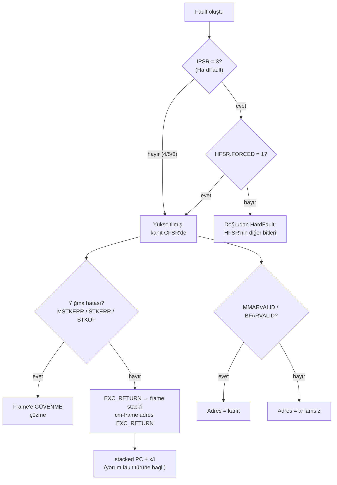

# Lesson 08 — Faults: MemManage, BusFault, UsageFault & HardFault

`[STANDARD]` · Day 4 · Tahmini süre: 75–90 dk

---

## Why This Matters

Beş derstir fault görüyoruz — ama her seferinde tek bir vakayı, tek başına:

| Ders | Görülen | Öğretilen |
|---|---|---|
| 02 | `STKERR` + HardFault | Geçersiz stack |
| 04 | `STKOF` | Stack limiti |
| 06 | `DACCVIOL` → MemManage | MPU politikası |
| 07 | Aynı `DACCVIOL`, handler kapalı → HardFault + `FORCED` | Escalation |

Bu ders o dağınık gözlemleri **tekrarlanabilir bir teşhis yöntemine** çeviriyor.

Tek cümlelik ders:

> **Bir Cortex-M fault'unu tek bir register'dan teşhis etme.**

Sahada bir cihaz HardFault'ta durduğunda, "HardFault oldu" bilgisi neredeyse
hiçbir şey söylemez. Söyleyen şey register'ların **birlikte** okunmasıdır —
ve hangisine ne zaman güvenilebileceğini bilmek.

---

## Core Idea

### Dört fault sınıfı — mekanizmalar, dramatik etiketler değil

| Sınıf | `IPSR` | Ne zaman | Alt register |
|---|---|---|---|
| **MemManage** | 4 | Bellek koruma ihlali (MPU ve ilgili denetimler) | `MMFSR` + `MMFAR` |
| **BusFault** | 5 | Bellek/veri yolu sistemi erişimi reddetti | `BFSR` + `BFAR` |
| **UsageFault** | 6 | Komut veya yürütme durumu kullanım hatası | `UFSR` (adres yok) |
| **HardFault** | 3 | Yüksek öncelikli fault mekanizması; kendi handler'ı kullanılamayan fault'ların **yükseltildiği** hedef | `HFSR` |

İlk üçü **yapılandırılabilir** (configurable): `SHCSR` içindeki
`MEMFAULTENA`, `BUSFAULTENA`, `USGFAULTENA` bitleriyle etkinleştirilir ve
öncelikleri ayarlanabilir.

**HardFault "en kötü fault" değildir.** Ne de "bilinmeyen her hata"dır. Bir
**mekanizmadır**: kendi handler'ı etkin olmayan veya çalıştırılamayan bir
fault'un gittiği yer.

### Fault ≠ kök sebep

Bu dersin ana fikri. Ders 07'de ölçülen:

| | MemManage ETKİN | MemManage DEVRE DIŞI |
|---|---|---|
| Aktif handler | MemManage (`IPSR = 4`) | **HardFault** (`IPSR = 3`) |
| `CFSR` | `DACCVIOL` | `DACCVIOL` — **aynı** |
| `HFSR.FORCED` | 0 | **1** |

İhlal aynı; değişen yalnızca **onu hangi handler'ın gördüğü**.

> **"HardFault aktif" ≠ "asıl sorun doğası gereği bir HardFault'tu."**

HardFault teşhisi çoğu zaman **HardFault'un altına** bakmayı gerektirir:
önce `HFSR.FORCED`, sonra `CFSR`.

### CFSR'nin yapısı

```text
CFSR (0xE000ED28)
├── MMFSR   bits [7:0]     MemManage durumu
├── BFSR    bits [15:8]    BusFault durumu
└── UFSR    bits [31:16]   UsageFault durumu
```

Bu dersin kullandığı bitler (konumlar vendored CMSIS `core_cm33.h` ile
doğrulandı — Armv8-M):

```text
MMFSR  bit0 IACCVIOL   komut getirme ihlali
       bit1 DACCVIOL   veri erisim ihlali
       bit3 MUNSTKERR  exception DONUSUNDE geri yukleme hatasi
       bit4 MSTKERR    exception GIRISINDE yigma hatasi
       bit5 MLSPERR    lazy FP koruma hatasi (FP'ye ozel)
       bit7 MMARVALID  MMFAR gecerli

BFSR   bit0 IBUSERR    komut getirme veri yolu hatasi
       bit1 PRECISERR  precise veri yolu hatasi
       bit2 IMPRECISERR imprecise veri yolu hatasi
       bit3 UNSTKERR   donuste geri yukleme hatasi
       bit4 STKERR     giriste yigma hatasi
       bit5 LSPERR     lazy FP koruma hatasi
       bit7 BFARVALID  BFAR gecerli

UFSR   bit0 UNDEFINSTR tanimsiz komut
       bit1 INVSTATE   gecersiz yurutme durumu (orn. Thumb biti 0)
       bit2 INVPC      gecersiz EXC_RETURN / PC yuklemesi
       bit3 NOCP       coprocessor erisimi (FP kapaliyken FP komutu)
       bit4 STKOF      stack limiti asildi   <- Armv8-M'e OZEL
       bit8 UNALIGNED  hizasiz erisim (UNALIGN_TRP acikken)
       bit9 DIVBYZERO  sifira bolme (DIV_0_TRP acikken)
```

`STKOF` Armv7-M tablolarında **yoktur** — Armv7-M'den kopyalanmış bir CFSR
tablosu bu dersin ders 04 vakasını açıklayamaz.

### Adres register'ı + geçerlilik biti = kanıt

```text
MMFAR icerigi  +  MMARVALID = 1   ->  kullanilabilir kanit
MMFAR icerigi  +  MMARVALID = 0   ->  ANLAMSIZ, kullanma

BFAR  icerigi  +  BFARVALID = 1   ->  kullanilabilir kanit
BFAR  icerigi  +  BFARVALID = 0   ->  ANLAMSIZ, kullanma
```

> **ARCHITECTURE:** `MMFAR`/`BFAR` yalnızca ilgili `VALID` biti set iken
> teşhis değeri taşır. Aksi halde eski bir değer veya çöp olabilir.

UsageFault'un adres register'ı **yoktur**.

### Durum bitleri yapışkandır (sticky), W1C ile temizlenir

`CFSR` ve `HFSR` bitleri, açıkça temizlenene kadar (veya reset'e kadar) set
kalır. Temizleme **write-one-to-clear**'dır: bir biti temizlemek için ona
**1** yazılır.

```c
SCB->CFSR = SCB->CFSR;   /* set olan bitlere 1 yaz -> temizle */
SCB->HFSR = SCB->HFSR;
```

**0 yazmak hiçbir şeyi temizlemez.** Bu dersteki her hedef reset'ten başlar
ve tek bir fault üretir; yani önceki bir çalışmadan kalan bit yoktur. Temizlik
kodu yine de ilkeyi göstermek için `main()` başında duruyor.

### Precise vs imprecise

- **Precise:** işlemci fault'u belirli bir komut/bağlamla
  ilişkilendirebilir. Yığılmış PC o komutu gösterebilir.
- **Imprecise:** raporlama gecikebilir (örneğin yazma tamponlu bir yazma
  sonradan hata verir). Yığılmış PC, hataya sebep olan erişimi
  **göstermeyebilir**.

Her BusFault imprecise değildir; her veri fault'u da precise değildir.

> **OBSERVATION:** Bu ortamda ölçülen dört vakanın dördü de **precise**.
> QEMU'da deterministik bir imprecise BusFault kurulamadı; `IMPRECISERR`
> kavramsal olarak anlatılıyor, uydurma bir örnek verilmiyor.

---

## Mental Model

```text
FAULT OLUSTU
    ↓
Hangi exception onu isliyor?           IPSR / SHCSR
    ↓
Yukseltilmis mi?                       HFSR.FORCED
    ↓
CFSR ne diyor?                         MMFSR / BFSR / UFSR
    ↓
Adres register'i gecerli mi?           MMARVALID / BFARVALID
    ↓
Yigma / geri yukleme basarili mi?      MSTKERR / STKERR / STKOF
    ↓
Exception frame'ine guvenilir mi?      EXC_RETURN + yigma bitleri
    ↓
Yigilmis durum + disassembly ne diyor? stacked PC, x/i
    ↓
KOK SEBEP
```

Ham register'lar **gerçektir**; onlardan çıkarılan anlam **yorumdur**. Bu
dersin fault raporu bu yüzden ikiye bölünmüş: `RAW` ve `DECODE`.

---

## Visual



---

## Tiny Example

Tek kaynak, derleme zamanı seçilen dört senaryo:
[`example/main.c`](example/main.c).

### Kontrollü tetikleyiciler

Her biri **tek komut** — hangi komutun hata verdiğini tam bilmek için
assembly'de ([`example/fault_triggers.S`](example/fault_triggers.S)). C'de
tanımsız davranışla fault "üretmek" derleyiciye bağlı olurdu.

```asm
trigger_udf:      udf  #0x42        /* mimari olarak TANIMSIZ komut */
trigger_load:     ldr  r0, [r0]     /* eslenmemis adres -> BusFault  */
mpu_store_word:   str  r1, [r0]     /* MPU izin vermezse -> MemManage */
```

### BusFault hedefi nereden geldi?

Tahmin edilmedi. QEMU'nun bellek haritası `info mtree -f` ile okundu: Secure
SRAM `0x30000000..0x30007FFF`, sonraki bölge `0x38000000`. Aradaki
`0x30100000` **hiçbir bölgeye eşlenmemiş**. Bu bir **TARGET CONFIG**
gerçeğidir — fiziksel bir kartta aynı adres farklı davranabilir.

### Önce yakala, sonra yorumla

Handler sarmalayıcıları ([`example/fault_handlers.S`](example/fault_handlers.S))
dört handler için aynı işi yapar: `EXC_RETURN`, giriş `MSP`/`PSP` değerlerini
kaydeder, frame adresini `EXC_RETURN` bit 2'den seçer ve C kaydediciye dallanır.

C kaydedicinin **ilk işi** durum register'larını sabitlemek — konsol işinden
önce:

```c
g_snap.ipsr   = __get_IPSR();
g_snap.cfsr   = SCB->CFSR;
g_snap.hfsr   = SCB->HFSR;
g_snap.shcsr  = SCB->SHCSR;
g_snap.mmfar_raw = SCB->MMFAR;
g_snap.bfar_raw  = SCB->BFAR;
...
/* Frame yalnizca yigma basariliysa ve bicim destekleniyorsa gecerli */
g_snap.frame_valid = !stacking_failed && basic_frame;
```

Neden bu sıra? Handler'ın kendisi `SP`'yi, `LR`'yi ve register'ları
değiştirir. Canlı handler `$sp`'sinden kesilen frame'i çıkarmak ders 04'teki
debugger hatasıydı.

---

## Build & Run

```bash
cmake --preset debug
cmake --build --preset debug
./scripts/run-qemu.sh build/debug/lessons/08-faults/08-faults-memmanage.elf
./scripts/run-qemu.sh build/debug/lessons/08-faults/08-faults-usage.elf
./scripts/run-qemu.sh build/debug/lessons/08-faults/08-faults-bus.elf
./scripts/run-qemu.sh build/debug/lessons/08-faults/08-faults-escalation.elf
```

---

## Expected Output

Gerçek çıktılar (arm-none-eabi-gcc 13.2.1, QEMU 8.2.2, mps2-an505, `debug`).
Her vaka için yalnızca karar veren satırlar; tam çıktı her firmware'de.

### Vaka 1 — MemManage (temiz referans vaka)

Ayrıcalıksız Thread, korunan `g_service_counter`'a doğrudan yazıyor.

```text
--- RAW ---
[  IPSR] 4
[  EXC_RETURN] 0xFFFFFFFD
[  CONTROL] 0x00000001
[  CFSR] 0x00000082
[  HFSR] 0x00000000
[  SHCSR] 0x00010001
[  MMFAR_RAW] 0x30000000
[  BFAR_RAW] 0x00000000
[  FRAME_ADDR] 0x300002F8
--- DECODE ---
[  ACTIVE_EXCEPTION] MemManage
[  ESCALATED] NO
[  MMFSR.DACCVIOL] 1
[  MMFSR.MMARVALID] 1
[  FAULT_ADDRESS(MMFAR)] 0x30000000
[  BFAR] GECERSIZ - kanit degil
[  FRAME_STACK] PSP
[  FRAME_VALID] YES
[  STACKED_R0] 0x30000000
[  STACKED_R1] 0x0BADC0DE
[  STACKED_PC] 0x100000FC
```

`MMFAR = 0x30000000` = `PROTECTED_ADDR`. `STACKED_R0`/`R1` = `mpu_store_word`
argümanları.

### Vaka 2 — UsageFault

```text
--- RAW ---
[  IPSR] 6
[  CFSR] 0x00010000
[  HFSR] 0x00000000
[  SHCSR] 0x00040008
--- DECODE ---
[  ACTIVE_EXCEPTION] UsageFault
[  ESCALATED] NO
[  UFSR.UNDEFINSTR] 1
[  MMFAR] GECERSIZ - kanit degil
[  BFAR] GECERSIZ - kanit degil
[  FRAME_VALID] YES
[  STACKED_PC] 0x100000F4
```

Adres register'ı yok — UsageFault komutla ilgilidir, bir bellek adresiyle
değil.

### Vaka 3 — BusFault

```text
--- RAW ---
[  IPSR] 5
[  CFSR] 0x00008200
[  HFSR] 0x00000000
[  SHCSR] 0x00020002
[  BFAR_RAW] 0x30100000
--- DECODE ---
[  ACTIVE_EXCEPTION] BusFault
[  ESCALATED] NO
[  BFSR.PRECISERR] 1
[  BFSR.BFARVALID] 1
[  MMFAR] GECERSIZ - kanit degil
[  FAULT_ADDRESS(BFAR)] 0x30100000
[  FRAME_VALID] YES
[  STACKED_R0] 0x30100000
[  STACKED_PC] 0x100000F8
```

`BFAR = 0x30100000` = `TARGET_ADDR`. Deterministik, precise bir BusFault.

### Vaka 4 — Escalation (Break It'e bak)

```text
[  IPSR] 3
[  CFSR] 0x00010000
[  HFSR] 0x40000000
[  SHCSR] 0x00000004
[  ACTIVE_EXCEPTION] HardFault
[  ESCALATED] YES
[  UFSR.UNDEFINSTR] 1
[  FRAME_VALID] YES
[  STACKED_PC] 0x100000F4
```

### Yığılmış PC ↔ disassembly

```text
100000f4 <trigger_udf>:     udf  #66        <- Vaka 2 ve 4: STACKED_PC 0x100000F4
100000f8 <trigger_load>:    ldr  r0, [r0]   <- Vaka 3:      STACKED_PC 0x100000F8
100000fc <mpu_store_word>:  str  r1, [r0]   <- Vaka 1:      STACKED_PC 0x100000FC
```

Dört vakada da yığılmış PC **hata veren komutun kendisini** gösteriyor.

Şimdi ders 07 ile karşılaştır: orada `svc 7` `0x100000b8`'deydi ve yığılmış PC
`0x100000ba` — **sonraki** komut.

| Exception | Yığılmış PC neyi gösteriyor | Sebep |
|---|---|---|
| SVCall (ders 07) | `svc`'den **sonraki** komut | `SVC` tamamlandı; dönüş devam adresine |
| Precise fault (bu ders) | Hata veren komutun **kendisi** | Komut tamamlanamadı |
| Imprecise fault | Hataya sebep olan erişimi **göstermeyebilir** | Raporlama gecikti |

> **"Yığılmış PC her zaman hatalı komuttur" YANLIŞTIR.** Anlamı exception
> türüne bağlıdır. Bu tablonun ilk iki satırı bu repoda ölçüldü; üçüncüsü
> mimari bir uyarıdır.

---

## Cortex-M Fault Triage

Bu dersin asıl çıktısı. İleride `projects/fault-analyzer/` bu listeyi
kullanacak.

| # | Soru | Nereye bak | Dikkat |
|---|---|---|---|
| 1 | Hangi exception aktif? | `IPSR`, `SHCSR` active bitleri | |
| 2 | HardFault ise, yükseltilmiş mi? | `HFSR.FORCED` | `FORCED = 1` → kanıt `CFSR`'de |
| 3 | `CFSR`'nin hangi alt alanı dolu? | `MMFSR` / `BFSR` / `UFSR` | Aktif handler'dan **bağımsız** |
| 4 | Tam olarak hangi bitler? | `cm-fault` `SET` satırı | `VALID` bitleri sebep değildir |
| 5 | Adres register'ı geçerli mi? | `MMARVALID` / `BFARVALID` | Değilse adres **kanıt değil** |
| 6 | Yığma başarılı mı? | `MSTKERR` / `STKERR` / `STKOF` | Başarısızsa **frame'e güvenme** |
| 7 | Frame hangi stack'te? | Giriş anında kaydedilen `EXC_RETURN` bit 2 | Canlı `$lr`/`$sp` değil |
| 8 | Frame geçerliyse: PC / LR / xPSR / argümanlar | `cm-frame <adres> <EXC_RETURN>` | |
| 9 | Disassembly şüpheyi doğruluyor mu? | `x/i <stacked PC>` | Precise/imprecise'e göre yorumla |
| 10 | Hangi mimari koşul fault'u doğurdu? | 1–9'un birleşimi | Kök sebep |

---

## Observe in GDB

Örnek oturum: **BusFault** vakası (bu dersin yeni vakası). Diğer üç vaka
aynı adımlarla incelenir.

```bash
cmake --build --preset debug --target debug-08-faults-bus
```

```gdb
gdb-multiarch -q build/debug/lessons/08-faults/08-faults-bus.elf
set architecture armv8-m.main
target remote :3333
source scripts/gdb/cortex-m.gdb
```

### A — Hata veren komuttan hemen önce

```gdb
(gdb) break trigger_load
(gdb) continue
(gdb) x/1i $pc
(gdb) p/x $r0
(gdb) cm-mode
```

```text
=> 0x100000f8 <trigger_load>:  ldr  r0, [r0, #0]
$1 = 0x30100000
Mode      : Thread Mode
Privilege : Privileged (CONTROL.nPRIV = 0)
Stack     : PSP (0x300002f8)
```

**Ne kanıtlıyoruz:** Thread Mode, PSP. Bir sonraki komut tek bir `ldr`, adres
`r0`'da ve eşlenmemiş bölgede.

### B / C — Handler'ın ilk komutu, EXC_RETURN

```gdb
(gdb) break BusFault_Handler
(gdb) continue
(gdb) cm-mode
(gdb) p/x $lr
```

```text
Mode      : Handler Mode (exception 5)
Privilege : Privileged (Handler Mode her zaman ayricaliklidir)
Stack     : MSP (0x30007ff0)
            PSP = 0x300002d8
$lr = 0xfffffffd
```

**Ne kanıtlıyoruz:** `IPSR = 5` → BusFault, **HardFault değil** (çünkü
`BUSFAULTENA = 1`). `PSP` 32 byte indi → frame yığıldı. `LR` bir
`EXC_RETURN`.

### D — Fault durum register'ları: ham + yardımcı

Yardımcıya körü körüne güvenme; en az bir kez ham register'ları oku:

```gdb
(gdb) x/1wx 0xE000ED28      # CFSR
(gdb) x/1wx 0xE000ED2C      # HFSR
(gdb) x/1wx 0xE000ED38      # BFAR
(gdb) cm-fault
```

```text
0xe000ed28:  0x00008200
0xe000ed2c:  0x00000000
0xe000ed38:  0x30100000

--- fault status registers ---
CFSR  = 0x00008200  (MMFSR=0x00 BFSR=0x82 UFSR=0x0000)
HFSR  = 0x00000000  FORCED=0 -> escalation YOK
MMFAR = 0x00000000  (MMARVALID=0 -> icerik ANLAMSIZ, kullanma)
BFAR  = 0x30100000  (BFARVALID=1 -> adres GECERLI)
SET   : BFSR.PRECISERR BFSR.BFARVALID
```

**Ne kanıtlıyoruz:** Ham değerler ile yardımcının çıktısı birebir aynı.
`BFSR = 0x82` = bit 1 `PRECISERR` + bit 7 `BFARVALID`. `MMFAR = 0` ama
`MMARVALID = 0` — anlamlı değil, kullanma.

### E / F — Frame geçerliliği kararı ve çözüm

Yığma hatası bitleri (`MSTKERR` / `STKERR` / `STKOF`) **temiz** → frame
çözülebilir:

```gdb
(gdb) cm-frame $psp $lr
```

```text
--- exception frame @ 0x300002d8 (standart 8 word) ---
EXC_RETURN 0xfffffffd -> frame PSP uzerinde, Thread Mode'a donus
R0         = 0x30100000
LR         = 0x10000199
stacked PC = 0x100000f8
xPSR       = 0x61000000
```

Burada `$psp` ve `$lr` doğrudan kullanılabildi çünkü **handler'ın ilk
komutundayız** — henüz hiçbir şey onları değiştirmedi. Handler içinde C
çalıştıktan sonra bu artık doğru olmaz.

### G — Yığılmış PC ↔ disassembly

```gdb
(gdb) x/1i *(unsigned int*)($psp+24)
```

```text
   0x100000f8 <trigger_load>:  ldr  r0, [r0, #0]
```

**Ne kanıtlıyoruz:** Precise bir veri yolu hatasında yığılmış PC, hata veren
`ldr`'nin kendisi. Ve `BFAR` o `ldr`'nin adresi. İki bağımsız kanıt aynı
şeyi söylüyor — teşhis böyle kurulur.

### `cm-fault` güncellemesi

Bu derste `cm-fault`'a **tek bir** ek yapıldı: set olan `CFSR` bitlerinin
isimleriyle listelendiği `SET` satırı, ve bir unstacking notu (triage adımı 4).
Bit konumları vendored CMSIS'ten alındı. Değişiklik, ders 02 (`STKERR`),
ders 04 (`STKOF`), ders 06 (`DACCVIOL`) ve ders 07 (escalation) vakalarına
karşı yeniden test edildi; hepsi doğru etiketlendi.

---

## Experiment

**Deney 1 — Dört vakayı yan yana koy.**

| | MemManage | UsageFault | BusFault | Escalation |
|---|---|---|---|---|
| `IPSR` | 4 | 6 | 5 | **3** |
| `CFSR` | `0x00000082` | `0x00010000` | `0x00008200` | `0x00010000` |
| Asıl bit | `DACCVIOL` | `UNDEFINSTR` | `PRECISERR` | `UNDEFINSTR` |
| Adres | `MMFAR` ✓ | yok | `BFAR` ✓ | yok |
| `HFSR` | 0 | 0 | 0 | `0x40000000` |
| `SHCSR` | `0x00010001` | `0x00040008` | `0x00020002` | `0x00000004` |
| Frame | geçerli | geçerli | geçerli | geçerli |

`SHCSR`'yi oku: her vakada **hem** ilgili `ENA` biti **hem** `ACT` biti set.
Örneğin BusFault `0x00020002` = bit 17 `BUSFAULTENA` + bit 1 `BUSFAULTACT`.
Escalation'da `ENA` yok, yalnızca bit 2 `HARDFAULTACT`.

**Deney 2 — Hangi vakada hangi kanıt güvenilir?** (DEEP, dokümantasyon)

Aşağıdaki dört anlık görüntünün her biri için sor: *hangi kanıta
güvenebilirim?*

1. Temiz `DACCVIOL` (Vaka 1)
2. Yükseltilmiş `UNDEFINSTR` (Vaka 4)
3. `UsageFault` (Vaka 2)
4. Yığma hatası (ders 02: `CFSR = 0x00009200`, `STKERR`)

Cevaplar `answers/quick-check.md` sonunda.

**Deney 3 — `DIV_0_TRP` / `UNALIGN_TRP` (opsiyonel).**

`SCB->CCR` içindeki bu iki bit, sıfıra bölme ve hizasız erişimi UsageFault'a
çevirir. Bu derste **ölçülmedi** — bir `sdiv` veya hizasız `ldr` tetikleyicisi
yazıp kendin dene. Derleyicinin bölmeyi optimize etmediğinden emin ol
(assembly tetikleyici kullan).

---

## Break It

Bu ders zaten fault'larla ilgili; bu yüzden Break It yeni bir çöküş
üretmiyor, **teşhis durumunu** değiştiriyor.

Aynı `UDF`, tek fark `USGFAULTENA`:

```bash
cmake --build --preset debug --target 08-faults-escalation
./scripts/run-qemu.sh build/debug/lessons/08-faults/08-faults-escalation.elf
```

| | UsageFault ETKİN (Vaka 2) | UsageFault DEVRE DIŞI (Vaka 4) |
|---|---|---|
| Aktif handler | UsageFault (`IPSR = 6`) | **HardFault** (`IPSR = 3`) |
| `HFSR.FORCED` | 0 | **1** |
| `CFSR` | `0x00010000` | `0x00010000` — **aynı** |
| `UFSR.UNDEFINSTR` | 1 | 1 — **aynı** |
| Frame | geçerli | geçerli — **aynı** |
| Yığılmış PC | `0x100000F4` | `0x100000F4` — **aynı** |

Ders 07 bunu MemManage ile göstermişti; burada **farklı bir fault sınıfıyla**
aynı ilke tekrarlanıyor. Kural sınıftan bağımsız.

HardFault'a bakıp orada durmak, bu vakada teşhisi **tamamen kaçırmak** olurdu.
Asıl sebep bir kat aşağıda, `UFSR`'de.

> **ARCHITECTURE:** Yapılandırılabilir bir fault devre dışıyken oluşursa
> escalation meydana gelebilir. **OBSERVATION:** Bu ölçümde `HFSR = 0x40000000`
> ve `CFSR` korundu. Her devre dışı fault'un **aynı** register değerlerini
> üreteceği iddia edilmiyor.

`HFSR.FORCED`'ın anlamı: yapılandırılabilir öncelikli bir exception
HardFault'a yükseltildi. "İşlemci rastgele bir çöküşü zorladı" değil.

---

## Debug It

İkinci bir Break It türü: **teşhis varsayımını** bozmak. Bilinen bir yığma
hatası bağlamını geçerli bir frame'miş gibi çözmeye çalış.

```bash
cmake --build --preset debug --target debug-02-programmer-model-broken
```

```gdb
set architecture armv8-m.main
target remote :3333
source scripts/gdb/cortex-m.gdb
break Default_Handler
continue
cm-fault
cm-frame $psp 0xFFFFFFFD
```

Ölçülen (ders 02 hedefi, değiştirilmeden yeniden çalıştırıldı):

```text
CFSR  = 0x00009200  (MMFSR=0x00 BFSR=0x92 UFSR=0x0000)
HFSR  = 0x40000000  FORCED=1 -> baska bir fault HardFault'a yukseltildi (escalation)
BFAR  = 0xfffffffc  (BFARVALID=1 -> adres GECERLI)
SET   : BFSR.PRECISERR BFSR.STKERR BFSR.BFARVALID
UYARI: STACKING hatasi bildirilmis (STKOF/STKERR/MSTKERR).

REDDEDILDI [STACKING HATASI]: CFSR = 0x00009200
```

Araç reddediyor ve bu **doğru**. `STKERR` = donanım exception frame'ini
yığarken hata aldı. Bellekte güvenilir bir frame yok; oradan okunan her değer
uydurma olur.

Ders 04'teki `STKOF` vakası da aynı şekilde reddedilir (`SET : UFSR.STKOF`).

Cevaplaman gereken sorular:

1. Bu vakada `BFARVALID = 1` ama frame güvenilmez. İkisi çelişiyor mu?
   `BFAR` neye ait?
2. Eski `cm-frame` (aktif `$sp`'den 8 word okuyan) burada ne basardı?
   Neden tehlikeli?
3. `STKERR` ile `UNSTKERR` arasındaki fark ne? Hangisi frame'in **girişte**
   yazılamadığını söyler?
4. Temiz `DACCVIOL` (Vaka 1) ile bu vaka arasında, **hangi kanıtlar** her
   ikisinde de güvenilir?

---

## Exercise

### Exercise 01 — Complete the Fault Report

Başlangıç firmware'i **tek** bir deterministik fault üretiyor: ayrıcalıksız
Thread'in korunan veriye doğrudan yazması (Vaka 1). Ham snapshot hazır.

Senin yazacağın: `decode_fault_snapshot()` — ham değerlerden **kararlar**.

```text
exercises/01-fault-report/decode.c
```

| Alan | Karar |
|---|---|
| `active_exception` | Hangi handler çalışıyor? |
| `escalated` | Yükseltilmiş mi? |
| `fault_class` | `CFSR`'nin hangi alt alanı dolu? |
| `primary_bit` | Asıl sebep biti (`VALID` bitleri sebep değildir) |
| `address_valid` | `MMFAR`/`BFAR` kanıt mı? |
| `fault_address` | Yalnızca geçerliyse |
| `frame_safe` | Frame çözülebilir mi? |
| `stacked_pc` | Yalnızca frame güvenliyse |

**Kapsam:** her `CFSR` bitini çözmen istenmiyor; bu dersin üç fault türü yeter.

```bash
cmake --build --preset debug --target 08-exercise-fault-report
./scripts/run-qemu.sh build/debug/lessons/08-faults/08-exercise-fault-report.elf
```

Başlangıç çıktısı (gerçek):

```text
--- DECISION (decode_fault_snapshot) ---
[  D_ACTIVE_EXCEPTION] ?
[  D_ESCALATED] YES
[  D_FAULT_CLASS] ?
[  D_PRIMARY_BIT] ?
[  D_ADDRESS_VALID] NO
[  CHECK_D_ACTIVE] FAIL
[  CHECK_D_NOT_ESCALATED] FAIL
[  CHECK_D_CLASS] FAIL
[  CHECK_D_BIT] FAIL
[  CHECK_D_ADDRESS] FAIL
[  CHECK_D_FRAME] FAIL
```

Bu **beklenen başlangıç durumudur**. Doğrulama ölçütü: altı `CHECK_D_*` PASS.

**Tuzak:** `fault_class` aktif handler'dan türetilmez — `CFSR`'den türetilir.
Escalation vakasında ikisi farklıdır.

---

## Reference Solution

| Ne | Nerede | Hedef |
|---|---|---|
| Exercise 01 çözümü | [`solutions/01-fault-report/`](solutions/01-fault-report/) | `08-solution-fault-report` |

Gerçek çıktı:

```text
[  D_ACTIVE_EXCEPTION] MemManage
[  D_ESCALATED] NO
[  D_FAULT_CLASS] MemManage
[  D_PRIMARY_BIT] DACCVIOL
[  D_ADDRESS_VALID] YES
[  D_FAULT_ADDRESS] 0x30000000
[  D_FRAME_SAFE] YES
[  D_STACKED_PC] 0x100000FC
[  CHECK_D_*] PASS  (6/6)
```

---

## What I Learned

> Bu bölüm senin.

**"Fault ≠ kök sebep" kendi cümlemle:**

<!-- -->

**Adres register'ına ne zaman güvenirim:**

<!-- -->

**Yığılmış PC'nin anlamının exception türüne bağlı olması:**

<!-- -->

**Beni şaşırtan şey:**

<!-- -->

**Fault Analyzer projesine taşıdığım soru:**

<!-- -->

---

## Quick Check

1. "HardFault oluştu" neden her zaman kök sebep değildir?
2. `CFSR`'nin üç alt register'ı nelerdir ve hangi bit aralıklarındadır?
3. `MMFAR`'a ne zaman güvenilebilir?
4. `BFAR`'a ne zaman güvenilebilir?
5. Bir frame'i çözmeden önce yığma hatası bitleri neden kontrol edilmelidir?
6. Yığılmış PC her zaman hata veren komut mudur?
7. `HFSR.FORCED` sana ne söyler?
8. Yapılandırılabilir bir fault devre dışıyken oluşursa kavramsal olarak ne
   olur?
9. **(Reasoning)** Precise ve imprecise BusFault'lar teşhis açısından nasıl
   farklıdır?
10. **(Reasoning)** Durum register'ları neden handler'da kapsamlı iş
    yapılmadan **önce** yakalanmalıdır?
11. **(Reasoning)** Canlı handler `$sp`'si neden otomatik olarak kesilen
    frame değildir?
12. **(Reasoning)** HardFault'a girdikten sonra ilk bakacağın şey ne ve neden?
13. **(Reasoning)** `CFSR`'yi temizlemek için ona `0` yazmak neden işe yaramaz?

> Cevaplar: [`answers/quick-check.md`](answers/quick-check.md)

---

## Takeaway

- **Bir fault'u tek register'dan teşhis etme.** `IPSR`, `HFSR`, `CFSR`,
  geçerlilik bitleri, yığma bitleri, `EXC_RETURN`, frame ve disassembly
  birlikte okunur.
- **Fault ≠ kök sebep.** HardFault aktifken `HFSR.FORCED = 1` ise asıl kanıt
  `CFSR`'dedir. Durum register'ları escalation'dan bağımsız doğru yazılır.
- **Adres + geçerlilik biti = kanıt.** `MMARVALID`/`BFARVALID` olmadan
  `MMFAR`/`BFAR` içeriği anlamsızdır.
- **Yığma başarısızsa frame'e güvenme.** `MSTKERR`/`STKERR`/`STKOF` önce
  kontrol edilir.
- **Yığılmış PC'nin anlamı exception türüne bağlıdır.** Precise fault'ta hata
  veren komut, SVC'de sonraki komut, imprecise'de ilgisiz olabilir.
- **Önce yakala, sonra yorumla.** Durum register'ları sticky ve W1C'dir;
  handler işi bağlamı değiştirir.

---

## Official References

- **Armv8-M Architecture Reference Manual (Arm DDI 0553)** — `CFSR`
  (`MMFSR`/`BFSR`/`UFSR`), `HFSR` (`FORCED`, `VECTTBL`), `MMFAR`, `BFAR`,
  `SHCSR` enable/active bitleri, W1C davranışı, escalation kuralları,
  precise/imprecise, `UFSR.STKOF`.
  <https://developer.arm.com/documentation/ddi0553/latest/>
- **Armv8-M Exception Model User Guide (Arm 107706)** — exception numaraları,
  fault escalation.
  <https://developer.arm.com/documentation/107706/latest/>
- **Cortex-M33 Devices Generic User Guide (Arm 100235)** — System Control
  Block fault register'ları.
  <https://developer.arm.com/documentation/100235/latest/>
- **CMSIS-Core (M)** — `SCB_CFSR_*_Pos/_Msk`, `SCB_HFSR_*`, `SCB_SHCSR_*`
  tanımları; bit konumları bu repoda vendored `core_cm33.h`'ten doğrulandı.
  <https://arm-software.github.io/CMSIS_6/latest/Core/index.html>
- **QEMU v8.2.2** — yalnızca emülatöre özgü gözlem için: bellek haritası
  (`info mtree -f`) ve eşlenmemiş adresin BusFault üretmesi.
- Ölçüm ortamı: `arm-none-eabi-gcc 13.2.1`, `QEMU 8.2.2`,
  `mps2-an505 / cortex-m33`, `debug` preset.

---

## Known Boundaries

- **QEMU ≠ fiziksel donanım.** BusFault hedefi (`0x30100000`) QEMU'nun
  bellek haritasında eşlenmemiş bir adrestir; fiziksel bir kartta farklı
  davranabilir. Bütün `CFSR`/`HFSR` değerleri **OBSERVATION**'dır.
- **Yalnızca precise fault'lar ölçüldü.** Deterministik bir imprecise
  BusFault kurulamadı; `IMPRECISERR` kavramsal olarak anlatıldı. Uydurma
  örnek verilmedi.
- **Soft-float / basic frame.** `MLSPERR`/`LSPERR`/`NOCP` gibi FP'ye ilişkin
  bitler kapsamda yok; FPU ders 13.
- **Tek güvenlik durumu.** `SecureFault` (exception 7) ve TrustZone fault
  varyantları ders 16.
- **`DIV_0_TRP` / `UNALIGN_TRP` ölçülmedi** (Deney 3 olarak bırakıldı).
- **Bu eğitim amaçlı bir fault triyajıdır, üretim çöküş kurtarması değildir.**
  Handler'lar raporlayıp durur; fault'tan kurtulmaya, hatalı görevi
  sonlandırmaya veya kalıcı log'a yazmaya çalışmaz. Onlar
  `projects/fault-analyzer/`'ın konusu.

---

**Previous:** [07 — Exceptions](../07-exceptions/)
**Next:** [09 — Compiler & AAPCS](../09-compiler-aapcs/)
