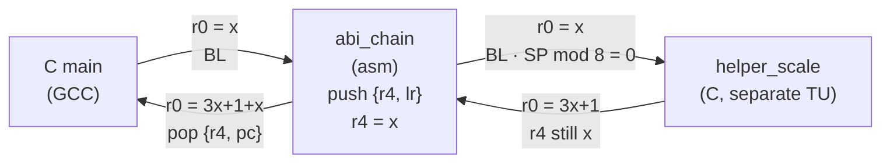

**Language:** English | [Türkçe](README.tr.md)

# Lesson 09 — Compiler, AAPCS & Calling Conventions

`[STANDARD]` · Day 5 · Estimated time: 75–90 min

> **Teaching cycle:** TEACH → SHOW → RUN → OBSERVE → MODIFY → BREAK → DEBUG → VERIFY

---

## Why This Matters

*(TEACH)*

In Lesson 03, a C function called an assembly function and **it worked**.
Lesson 04 touched on 8-byte alignment, and Lesson 07 on the exception frame's
volatile registers — each time, we said “details in Lesson 09.”

This lesson answers one question:

> **What contract allows separately compiled C and assembly functions to work together?**

The answer is **AAPCS32** (Procedure Call Standard for the Arm Architecture).
Lesson 03 said “it works”; this lesson **measures** the contract — and shows a
function that produces the right result even while violating it.

---

## Core Idea

*(TEACH)*

### Four labels

Every claim in this lesson belongs to one of four categories. Keeping them
separate is half the lesson:

| Label | Meaning | Example |
|---|---|---|
| **ABI** | An AAPCS32 rule; binding for interoperability | r4 must be preserved |
| **ARCHITECTURE** | Armv8-M processor behavior | exception entry aligns the frame |
| **COMPILER** | A GCC option / behavior | `-O2` can produce a tail call |
| **OBSERVATION** | What *this* GCC 13.2.1 produced with *this* preset | `sq()` was not inlined at `-Og` |

**Measured compiler output is not an ABI rule.**

### Register roles (ABI)

Source: AAPCS32, *Core registers*.

| Register | AAPCS name | Role | Across a call |
|---|---|---|---|
| r0–r1 | a1–a2 | Argument / **result** / scratch | caller-clobbered |
| r2–r3 | a3–a4 | Argument / scratch | caller-clobbered |
| r4–r8 | v1–v5 | Variable registers | **callee-saved** |
| r9 | v6 / SB / TR | **Platform register** | platform-dependent (below) |
| r10–r11 | v7–v8 | Variable registers | **callee-saved** |
| r12 | IP | Intra-call scratch; linker veneers may use it | caller-clobbered |
| r13 | SP | Stack pointer | must be restored |
| r14 | LR | Return address | every `BL` overwrites it |
| r15 | PC | Program counter | — |

In AAPCS32's terms, a subroutine must preserve **r4–r8, r10, r11, and SP** —
*and r9 only in PCS variants that designate r9 as v6*.

**Be careful with r9.** Under AAPCS32, r9's role is **platform-specific**: a
platform may designate it as a static base (SB) or thread register (TR); a
platform without such a need may make it an additional callee-saved register
(v6). Thus, **“r9 is callee-saved” is not a universal rule.** Experiment 2 shows
the behavior observed in this repository/toolchain configuration.

### Argument allocation (ABI)

Source: AAPCS32, *Parameter Passing* — rules A.1–A.4, C.3–C.8.

“The first four arguments go into r0–r3” is **shorthand, not the rule**:

- **C.3:** An argument requiring 8-byte alignment (for example, `uint64_t`)
  rounds NCRN up to the next **even-numbered** register.
- **C.4:** If it fits in the remaining registers, it goes into registers.
- **C.6 / C.7 / C.8:** Otherwise, NCRN is set to r4, NSAA is rounded up to 8
  bytes if necessary, and the argument goes onto the **stack**.

Result: some prototypes **skip** a register, which carries no argument.

### Return value (ABI)

Source: AAPCS32, *Result Return*. A 32-bit result → `r0`. A double-word
fundamental type (`long long`, soft-float `double`) → **`r0` and `r1`**.

### Caller and callee — who is responsible for what?

```text
          CALLER                              |          CALLEE
                                              |
  puts arguments in r0-r3 (+ stack)  -------> |  may freely clobber r0-r3, r12, flags
  SP aligned to 8 at BL                     |  r4-r8, r10, r11 (and r9 if v6), SP:
  BL writes return address to LR     -------> |    SAVE and RESTORE if used
                                              |  save LR FIRST if making another call
  on return:                           <------- |  result in r0 (or r0:r1)
  - r4-r11 and SP are unchanged               |
  - treat r0-r3, r12, LR, flags as clobbered     |
```

| | Caller's responsibility | Callee's responsibility |
|---|---|---|
| **caller-clobbered** (r0–r3, r12) | Keep the value elsewhere if needed after the call | Use freely |
| **callee-saved** (r4–r8, r10, r11, r9 if v6) | Nothing — the values will be restored | Save and restore if used |

Lesson 03's deliberate violation (`[ACCUMULATE(7,5)] 5`, no crash) broke
exactly the right-hand column of this table.

### Three separate alignment rules

This was the source of confusion in Lesson 04. These are **different layers**:

| Rule | Layer | Source |
|---|---|---|
| **SP mod 8 = 0 at a public interface** | ABI | AAPCS32, *Stack constraints at a public interface* |
| Alignment of `LDRD`/`STRD` and other accesses | ARCHITECTURE | Armv8-M ARM |
| Frame alignment on exception entry (xPSR bit 9) | ARCHITECTURE | Armv8-M ARM; Lesson 07 |

AAPCS's 8-byte rule applies **at the call boundary**. SP need not be aligned
to 8 **inside** a leaf function that calls nothing — measured in Experiment 1
(`asm_clobber_good`).

---

## Mental Model

*(TEACH)*

**A call boundary is a contract between two parties that never see each other's
code.** Neither can check the other at compile time.

When the contract is broken, the program often **still works** — until another
compiler version or optimization level allocates registers differently. The
damage appears not in the offending function, but **later, in someone else's
variable**.

That is why this lesson checks the contract with a measurement instrument
that **does not depend on** the compiler's register allocation.

---

## Visual

*(SHOW)*



---

## Tiny Example

*(SHOW)*

Sources: [`example/`](example/).

| File | Purpose |
|---|---|
| [`abi.h`](example/abi.h) | All prototypes — the caller needs a **complete prototype** to allocate arguments correctly |
| [`abi_probes.S`](example/abi_probes.S) | Argument / return probes + `abi_chain` |
| [`abi_harness.S`](example/abi_harness.S) | Callee-saved measurement instrument |
| [`good_callee.S`](example/good_callee.S) | Positive control |
| [`bad_callee.S`](example/bad_callee.S) | Break It |
| [`helpers.c`](example/helpers.c) | C helpers — **separate translation unit** |
| [`main.c`](example/main.c) | Driver |
| [`optimization.c`](example/optimization.c) | Optimization fixture |

### Probes: capture entry state before touching anything

**GCC** allocates the arguments; the probes only record them. Only `r12` is
used as a pointer — it is scratch under AAPCS and carries no argument:

```asm
.macro CAPTURE_ENTRY
    ldr     r12, =g_probe
    str     r0, [r12, #0]
    str     r1, [r12, #4]
    str     r2, [r12, #8]
    str     r3, [r12, #12]
    mov     r0, sp              /* r0 artik kaydedildi, scratch olabilir */
    str     r0, [r12, #16]
    ldr     r0, [sp, #0]        /* [SP+0]: ilk stack argumani */
    str     r0, [r12, #20]
    ldr     r0, [sp, #4]
    str     r0, [r12, #24]
.endm
```

The probes are leaf functions and do not write to the stack; `[SP]` therefore
still points to the first stack argument placed there by the caller.

### C → asm → C chain

```asm
abi_chain:                      @ uint32_t abi_chain(uint32_t x)
    push    {r4, lr}            /* r4: kullanacagimiz callee-saved      */
                                /* lr: yaprak degiliz, BL onu ezecek    */
    mov     r4, r0              /* x cagri boyunca r4'te                */
    ldr     r1, =g_chain_sp_at_call
    mov     r2, sp
    str     r2, [r1]            /* BL aninda SP                          */
    mov     r0, r4
    bl      helper_scale        /* C: r0-r3, r12, LR'yi bozabilir        */
    add     r0, r0, r4          /* r4 hala x: helper AAPCS'e uydu        */
    pop     {r4, pc}            /* r4'u geri ver, LR'den don             */
```

`helper_scale` deliberately lives in a **separate translation unit**
(`helpers.c`). In the same file, GCC would know which registers it clobbers
at `-O2`/`-Os` (`-fipa-ra`, **COMPILER**) and could generate more optimistic
caller code than AAPCS alone permits. In a separate TU, the compiler can
rely only on the contract.

### Measurement instrument: the callee-saved harness

Writing “keep a value in r4 and inspect it after the call” in C would depend
on GCC's register allocation. The harness does this deterministically in assembly:

```text
abi_check_callee(fn, a, b, *out_result):
    push   {r3-r11, lr}          10 registers = 40 bytes
                                 r3 = alignment PADDING and out_result slot
    r4..r11 <- distinct sentinel values (0xA4A4A404 ... 0xABABAB0B)
    save SP
    write out_result and SP at BLX into GLOBAL slots
    blx    fn                    fn(a, b)
    --- return: SP untrusted; NO [sp] access until SP is validated ---
    *out_result = r0             (pointer from global slot)
    SP differs from expected? -> bit 8; restore SP to known-good value
    for each: r4..r11 equals sentinel? if not, set bit in mask
    pop    {r3-r11, pc}          CALLER'S r4-r11 restored; return
```

The harness is **a measurement instrument**, so it must itself obey AAPCS:

| Check | How it is provided |
|---|---|
| Caller's r4–r11 preserved | `push {r3-r11, lr}` … `pop {r3-r11, pc}` |
| LR | Saved on entry, popped into `pc` |
| SP mod 8 = 0 at `BLX` | 40 bytes stacked; measured (`CHECK_HARNESS_SP_ALIGNED`) |
| Result | Mask in `r0`, callee result in `*out_result` |
| Surviving a broken callee | Restores its own r4–r11 without trusting the callee |
| Surviving a callee that corrupts SP | No `[sp]` access after return until SP is checked and restored; everything needed is written to global slots before `BLX` |

And **the positive control comes first**: if the harness does not produce
mask = 0 for a correct callee (`good_callee`), its measurement of the broken
callee cannot be trusted.

> **The measurement instrument's own regression.** An independent audit found
> that the first harness version read from `[sp]` after a callee corrupted SP,
> mistaking its own caller's r4 for a pointer and writing through it (BusFault,
> `BFAR = 0xDEAD0000`). A separate, non-student-facing target tests the repaired
> harness against this case: `09-harness-sp-regression` ([`regression/`](regression/)).
> Callees that shift SP by +4 and −8 produce mask `0x100`; a callee corrupting
> r4 + SP produces `0x101`. In every case, the result, the caller's r4–r11,
> and SP are recovered.

---

## Build & Run

*(RUN)*

```bash
cmake --preset debug
cmake --build --preset debug --target 09-compiler-aapcs
./scripts/run-qemu.sh build/debug/lessons/09-compiler-aapcs/09-compiler-aapcs.elf
```

| Target | Purpose |
|---|---|
| `09-compiler-aapcs` | **Measure** the contract |
| `09-compiler-aapcs-broken` | Correct result, **broken** contract |
| `09-compiler-optimization` | Same C, three presets, different machine code |
| `09-exercise-callee-save` | Function to repair |
| `09-solution-callee-save` | Reference solution |

---

## Expected Output

*(RUN)*

Actual output (arm-none-eabi-gcc 13.2.1, QEMU 8.2.2, mps2-an505, `debug`):

```text
===== LESSON 09: AAPCS =====
[1] Arguman yerlesimi (cagiran: GCC, olcen: asm probe)
[  F1 r0] 0xA1A1A1A1
[  F1 r1] 0xB2B2B2B2
[  F1 r2] 0xC3C3C3C3
[  F1 r3] 0xD4D4D4D4
[  CHECK_ARGS_4U32] PASS
[  F2 r3] 0xD4D4D4D4
[  F2 [SP+0]] 0xE5E5E5E5
[  CHECK_ARG5_ON_STACK] PASS
[  F3 r0 (a)] 0xA1A1A1A1
[  F3 r1 (unspecified)] 0x100008C8
[  F3 r2 (b.lo)] 0x55667788
[  F3 r3 (b.hi)] 0x11223344
[  CHECK_U64_IN_R2_R3] PASS
[  F4 r0] 0xA1A1A1A1
[  F4 r1] 0xB2B2B2B2
[  F4 r2] 0xC3C3C3C3
[  F4 r3 (unspecified)] 0x99AABBCC
[  F4 SP] 0x30007FD8
[  F4 [SP+0] (d.lo)] 0xDDEEFF00
[  F4 [SP+4] (d.hi)] 0x99AABBCC
[  CHECK_U64_ON_STACK] PASS
[  CHECK_U64_STACK_SP_ALIGNED] PASS
[  F5 r0 after BL] 0x89ABCDEF
[  F5 r1 after BL] 0x01234567
[  CHECK_U64_RETURN_R0_R1] PASS
[2] C -> asm -> C zinciri
[  CHAIN_RESULT] 41
[  CHAIN_SP_AT_BL] 0x30007FD8
[  CHECK_CHAIN_RESULT] PASS
[  CHECK_SP_ALIGNED_AT_CALL] PASS
[3] Callee-saved harness
[  CONTROL_MASK] 0x00000000
[  CONTROL_RESULT] 12
[  HARNESS_SP_AT_BLX] 0x30007FB8
[  CHECK_HARNESS_POSITIVE_CONTROL] PASS
[  CHECK_HARNESS_SP_ALIGNED] PASS
--- test edilen: good_callee ---
[  TESTED_RESULT] 12
[  TESTED_MASK] 0x00000000
[  CORRUPTED] (yok)
[  CHECK_RESULT] PASS
[  CHECK_CALLEE_SAVED] PASS
===== END =====
```

All twelve `CHECK_*` lines also report `PASS` with the `release` and `minsize`
presets. Addresses are build-specific.

### Argument mapping — measured (OBSERVATION, identical across three presets)

| Fixture | Prototype | r0 | r1 | r2 | r3 | Stack |
|---|---|---|---|---|---|---|
| F1 | `f(u32 a, b, c, d)` | a | b | c | d | — |
| F2 | `f(u32 a, b, c, d, e)` | a | b | c | d | `[SP+0]` = e |
| F3 | `f(u32 a, u64 b)` | a | *skipped* | b.lo | b.hi | — |
| F4 | `f(u32 a, b, c, u64 d)` | a | b | c | *skipped* | `[SP+0]` = d.lo, `[SP+4]` = d.hi |

- **F3:** `b` went into the even-numbered register pair **r2:r3** (rule C.3);
  the low word is in the lower-numbered register. r1 carries no argument.
- **F4:** `d` **did not fit** in r3 alone; r3 was skipped and `d` went onto
  the stack (C.6–C.8). The low word is at the lower address. At probe entry,
  `SP = 0x30007FD8` → mod 8 = 0.
- **F5:** `make_u64()` returned `0x0123456789ABCDEF`; immediately after `BL`,
  `r0 = 0x89ABCDEF` (low), `r1 = 0x01234567` (high).

### Why is the “skipped register” not checked?

In F3, r1 **does not carry** the argument; in F4, neither does r3. Their contents
are not part of the contract. They are therefore printed as `(unspecified)`
and **never affect a PASS/FAIL decision**. Checks are strictly **positive**:
is `b` in r2:r3, is `d` at the right stack addresses, is word order correct,
is SP aligned?

Measurements showed why this matters:

| Preset | F3 r1 | F4 r3 |
|---|---|---|
| `debug` | `0x100008C8` | **`0x99AABBCC`** |
| `release` | `0x100009D8` | `0x00000000` |
| `minsize` | `0x1000081C` | **`0x99AABBCC`** |

In `debug` and `minsize`, r3 **happens** to contain the high word of `d` — GCC
used r3 as a temporary while writing it to the stack. A negative check such
as “r3 must contain neither half of `d`” would report FAIL **despite ABI
compliance**. The only correct statement about a skipped register is:
**its contents are unspecified**.

---

## Observe in GDB

*(OBSERVE)*

Target: `09-compiler-aapcs`, `debug`. Five stops, all around `abi_chain`.

```bash
cmake --build --preset debug --target debug-09-compiler-aapcs
```

```gdb
gdb-multiarch -q build/debug/lessons/09-compiler-aapcs/09-compiler-aapcs.elf
set architecture armv8-m.main
target remote :3333
```

Obtain addresses from your own build: `disassemble fixture_chain` and
`disassemble abi_chain`. The addresses below belong to this build.

### A — In `main`, at `bl abi_chain`

```gdb
(gdb) break *0x100004e6
(gdb) continue
(gdb) x/1i $pc
(gdb) info registers r0 r4 sp
```

```text
=> 0x100004e6 <fixture_chain+10>:  bl  0x100000f4 <abi_chain>
r0  0xa
r4  0x0
sp  0x30007fe0
```

**Observation:** argument in `r0`. The caller's r4 and SP were recorded.

### B — First instruction of `abi_chain`

```gdb
(gdb) break *0x100000f4
(gdb) continue
(gdb) p/x $lr
(gdb) p/x $sp
```

```text
$lr = 0x100004eb
$sp = 0x30007fe0
```

**Observation:** `BL` changed only `LR`: `0x100004e6 + 4 = 0x100004ea`,
bit 0 = 1 → `0x100004eb` (Thumb). SP did not change.

### C — At `bl helper_scale`

```gdb
(gdb) break *0x10000100
(gdb) continue
(gdb) p/x $sp
(gdb) p/x (unsigned)$sp & 7
(gdb) x/2wx $sp
(gdb) p/x $r4
```

```text
$sp = 0x30007fd8
(unsigned)$sp & 7 = 0x0
0x30007fd8:  0x00000000  0x100004eb
$r4 = 0xa
```

**Observation:** `push {r4, lr}` stacked 8 bytes → SP remains aligned to 8.
On the stack, **r4** (the caller's value, `0`) is at the lowest address, with
**LR** above it. `r4` now carries `x`.

### D — Immediately after `helper_scale` returns

At stop C, also run `info registers r1 r2 r3` just before `bl`, then:

```gdb
(gdb) break *0x10000104
(gdb) continue
(gdb) info registers r0 r1 r2 r3 r4
```

```text
            before BL    after BL
r0          0xa            0x1f         <- helper result: 3*10+1
r1          0x30000008     0x30000008
r2          0x30007fd8     0x30007fd8
r3          0x1234567      0x1234567
r4          0xa            0xa          <- unchanged
```

**Observation:** `r4` survived — `helper_scale` obeyed the contract. In this
call, `helper_scale` changed **only `r0`**; `r1`–`r3` remained unchanged
across all three presets.

Distinguish these two things:

- **ABI:** `r1`–`r3` are caller-clobbered. The caller **cannot rely on** them
  surviving a call; the callee is **allowed** to change them.
- **OBSERVATION:** this `helper_scale` did not change them.

“May be changed” and “was changed” are different. A register staying unchanged
in one measurement does not justify relying on it — the next compiler version
or another callee may clobber it.

### E — Return to `main`

```gdb
(gdb) break *0x100004ea
(gdb) continue
(gdb) info registers r0 r4 sp
```

```text
r0  0x29        <- 41
r4  0x0         <- same as stop A
sp  0x30007fe0  <- same as stop A
```

**Observation:** the contract is fulfilled from the caller's perspective:
result in `r0`, with `r4` and SP as though untouched.

> GDB's source-line indicator sometimes points to a neighboring function's
> line in assembly files. The reliable evidence is `x/1i $pc`.

---

## Experiment

*(OBSERVE / MODIFY)*

### Experiment 1 — Same C, three presets

```bash
for p in debug release minsize; do
  cmake --preset $p && cmake --build --preset $p --target 09-compiler-optimization
done
# build/<preset>/lessons/09-compiler-aapcs/09-compiler-optimization.lst
```

Runtime behavior is **identical** across three presets: `OPT_CHECKSUM = 0x79DC404C`,
`CHECK_OPT_CHECKSUM PASS`. Machine code changes; meaning does not.

Everything in the following table is an **OBSERVATION** — GCC 13.2.1 with this
repository's flags. Another compiler or version may produce different code.

| Function | `-Og` (debug) | `-O2` (release) | `-Os` (minsize) | Demonstrates |
|---|---|---|---|---|
| `leaf_regs` | `eors`, `add.w`, `bx lr` | same | same | Register-only leaf: no push |
| `leaf_with_stack` | `sub sp, #16` … `add sp, #16`, `bx lr` | `push {r4}`, `sub sp, #20` … `pop {r4}`, `bx lr` | `sub sp, #16` … `bx lr` | **Leaf using the stack** |
| `tail_call` | `push {r3, lr}`, `bl helper_ext`, `pop {r3, pc}` | `adds`, **`b.w helper_ext`** | `adds`, **`b.w helper_ext`** | Tail call |
| `use_sq_twice` | two `bl sq` calls | `mul.w` + `mla` | `muls` + `mla` | Inlining |
| `dead_store` | **two** `str` (1, then 2) | **one** `str` (2) | **one** `str` (2) | Dead-store elimination |
| `vol_store_twice` | two `str` | two `str` | two `str` | `volatile` preserves accesses |
| `poll_plain` | `ldr` **inside** loop | `ldr` **once**, then `b.n` to itself | same as `-O2` | Load hoisting |
| `poll_vol` | `ldr` inside loop | `ldr` inside loop | `ldr` inside loop | `volatile` preserves each read |
| `signed_gt` | **`movs r0, #1`** | **`movs r0, #1`** | **`movs r0, #1`** | Signed overflow UB → folded to constant |
| `unsigned_gt` | `adds`, `it ne`, `movne` | same | same | Unsigned wraparound defined → actual computation |
| `asm_clobber_bad` | `mov r4, r0`, `bx lr` | same | same | No clobber → r4 **not saved** |
| `asm_clobber_good` | `push {r4}` … `pop {r4}` | same | `push {r4, lr}` … `pop {r4, pc}` | Clobber → r4 saved |
| `clobber_r9` | `str.w r9, [sp, #-4]!` … | same | `stmdb sp!, {r9, lr}` … | r9 saved in this configuration |

Functions used **only for disassembly**, **never executed**:
`poll_plain`/`poll_vol` (may loop forever), `signed_gt` (UB on overflow),
`asm_clobber_bad` (deliberate AAPCS violation). Their addresses are taken to
keep them alive through `--gc-sections`, but they are not called.

Lessons from the table:

- **Leaf ≠ stackless.** `leaf_with_stack` calls no function (no `bl` in any
  of the three presets), yet allocates stack space with `sub sp`. What forces
  the array into memory is not a call, but an empty inline asm taking its
  address (`"r"(buf)` + `"memory"` clobber). *A leaf function calls no other
  function*; whether it uses the stack is a separate question.
- **SP need not be aligned to 8 inside a leaf.** `asm_clobber_good` uses only
  `push {r4}` at `-Og`/`-O2`: 4 bytes, so SP mod 8 = 4 inside the function.
  This is **legal**, because the function calls nothing — AAPCS's 8-byte
  rule applies at the call boundary.
- **Seeing `b` does not mean the contract is broken.** At `-O2`, `tail_call`
  reaches `helper_ext` via `b.w` instead of `bl`, without saving LR:
  `helper_ext` returns directly to **the caller** of `tail_call`. This is a
  **compiler optimization** (`-foptimize-sibling-calls`), not a guarantee.
  The same function uses `bl` at `-Og`.
- **`push {r3, lr}` at `-Og`:** `tail_call` stacks r3 although it only needs
  to save LR. The reason is alignment: `{lr}` alone would be 4 bytes,
  leaving SP mod 8 = 4 at `bl`. r3 is **padding**. The same idea appears in
  the harness's `push {r3-r11, lr}`.
- **`signed_gt` was folded even at `-Og`.** `(x + 1) > x` is assumed always
  true for signed `int`, because overflow is undefined behavior in C
  (ISO C11 §6.5 ¶5). We repeat the correction from Lesson 03: assembly's
  wrapping `ADDS` result is **not equivalent** to overflowing signed C.
- **Inline asm has two contracts.** The instruction `mov r4, %0` is identical
  in both functions and executes correctly. The difference is in **the
  contract given to the compiler**: without a clobber list, GCC does not
  know r4 changes and does not save it — an AAPCS violation against the
  caller. The compiler **does not read** the asm text.

### Experiment 2 — What does r9 do in this configuration?

The `clobber_r9` row: seeing the `"r9"` clobber, the compiler **saved** r9
in all three presets. It would not do so for a caller-clobbered register.

> **ABI:** r9's role is platform-specific; it is callee-saved only if the
> platform assigns it the v6 role.
> **OBSERVATION:** This repository's `arm-none-eabi-gcc` configuration treats
> r9 as callee-saved (v6). That is why the harness checks r9 too.

### Experiment 3 — Change a prototype

*(MODIFY)* In `abi.h` and `main.c`, change F4 to
`probe_3u32_u64(uint32_t a, uint32_t b, uint64_t d)` (two u32 + u64).
**Predict first:** where does `d` go? Then measure. (Hint: which register
does rule C.3 round NCRN to?) Revert the change when finished.

---

## Break It

*(BREAK)*

```bash
cmake --build --preset debug --target 09-compiler-aapcs-broken
./scripts/run-qemu.sh build/debug/lessons/09-compiler-aapcs/09-compiler-aapcs-broken.elf
```

[`bad_callee.S`](example/bad_callee.S):

```asm
bad_callee:          @ uint32_t bad_callee(uint32_t a, uint32_t b)
    movs  r4, #0     @ IHLAL: callee-saved r4 saklanmadan ezildi
    adds  r0, r0, r1 @ sonuc yine de DOGRU
    bx    lr
```

Actual output (harness section):

```text
[  CONTROL_MASK] 0x00000000
[  CHECK_HARNESS_POSITIVE_CONTROL] PASS
--- test edilen: bad_callee (BREAK IT) ---
[  TESTED_RESULT] 12
[  TESTED_MASK] 0x00000001
[  CORRUPTED] r4
[  CHECK_RESULT] PASS
[  CHECK_CALLEE_SAVED] FAIL
===== END =====
```

Identical across three presets. **Correct result** (`7 + 5 = 12`), **broken
contract** (mask bit 0 = r4). No crash or timeout; firmware reaches `END`
normally.

Why was `main` unaffected? The harness restores its own caller's r4–r11
without trusting the broken callee. Verified in GDB: `main`'s r4–r11 were
marked `0x44444444 … 0xBBBBBBBB` before the call; after the broken callee,
all returned unchanged, as did SP (`0x30007fe0`).

A real program has **no such protection**: a function calling `bad_callee`
directly from C would lose a value kept in r4 — whether this becomes visible
depends on whether that function uses r4 at the time, hence on **register
allocation**. This is exactly why the harness exists.

---

## Debug It

*(DEBUG)*

1. `bad_callee` returns the right result. Why is “a function is correct if it
   returns the right result” false?
2. Why is the harness mask deterministic? Why can GCC register allocation
   not affect it?
3. Replace `bad_callee`'s `movs r4, #0` with `movs r12, #0`. What mask results?
   Why?
4. Why run the positive control (`good_callee`) **first**? What would we see
   if the harness itself had a bug?
5. If the harness used `push {r4-r11, lr}` (9 registers, 36 bytes), what
   would SP be at `BLX`? Which check would catch this?

To see in GDB that the harness protects its own caller:

```gdb
(gdb) disassemble fixture_harness      # ikinci "bl abi_check_callee"yi bul
(gdb) break *<o adres>
(gdb) continue
(gdb) set $r4 = 0x44444444
(gdb) set $r11 = 0xBBBBBBBB
(gdb) break *<o adres + 4>
(gdb) continue
(gdb) info registers r0 r4 r11 sp
```

---

## Exercise

*(VERIFY)*

### Exercise 01 — Repair an ABI-Broken Assembly Function

[`exercises/01-callee-save/scale_and_sum.S`](exercises/01-callee-save/scale_and_sum.S):
computes `helper_scale(a) + b` and returns **the right result**, but violates
the contract in two places.

```bash
cmake --build --preset debug --target 09-exercise-callee-save
./scripts/run-qemu.sh build/debug/lessons/09-compiler-aapcs/09-exercise-callee-save.elf
```

Starting output (actual, same verdict across three presets):

```text
[  CHECK_HARNESS_POSITIVE_CONTROL] PASS
[  RESULT] 36
[  MASK] 0x00000002
[  CORRUPTED] r5
[  SP_AT_BL] 0x30007FAC
[  CHECK_RESULT] PASS
[  CHECK_CALLEE_SAVED] FAIL
[  CHECK_SP_ALIGNED_AT_CALL] FAIL
===== END =====
```

Edit only the `.S` file. **Verification criterion:** all three checks must
be `PASS`, and the result must remain `36`. See the
[exercise README](exercises/01-callee-save/README.md) for details.

---

## Reference Solution

| What | Where | Target |
|---|---|---|
| Exercise 01 solution | [`solutions/01-callee-save/`](solutions/01-callee-save/) | `09-solution-callee-save` |

Actual output (`debug`):

```text
[  CHECK_HARNESS_POSITIVE_CONTROL] PASS
[  RESULT] 36
[  MASK] 0x00000000
[  CORRUPTED] (yok)
[  SP_AT_BL] 0x30007FA8
[  CHECK_RESULT] PASS
[  CHECK_CALLEE_SAVED] PASS
[  CHECK_SP_ALIGNED_AT_CALL] PASS
===== END =====
```

---

## What I Learned

> This section is yours.

**Caller and callee responsibilities in my own words:**

<!-- -->

**What it means for a register to be “skipped,” and why its contents are unspecified:**

<!-- -->

**Correct result ≠ correct contract:**

<!-- -->

**How I avoid mistaking what I see in a `.lst` file for an ABI rule:**

<!-- -->

**The question I am taking into Lesson 10:**

<!-- -->

---

## Quick Check

1. What are `r0`–`r3` used for, and why might their values not survive a call?
2. Caller-saved and callee-saved: who is responsible for what, and why?
3. **(Reasoning)** Why must a callee restore r4 even if its own result is correct?
4. What can `r12` (IP) be used for, and by whom — including the linker?
5. What happens to LR in a function that calls another function, and what
   must the function do?
6. **(Reasoning)** What does “SP mod 8 = 0 at a public interface” mean?
   How does it differ from `LDRD` alignment and exception frame alignment?
7. **(Reasoning)** For `f(u32 a, u32 b, u32 c, u64 d)`, where does `d` go,
   and why is r3 skipped? What can be said about the skipped r3's contents?
8. What does `volatile` guarantee? Name three things it **does not** guarantee.
9. Define a leaf function. Can it use the stack? Show this in the `.lst`.
10. **(Reasoning)** A function ends with `b helper` instead of `bl helper`
    followed by a return. Is the ABI violated?
11. **(Reasoning)** `-O2` output kept a value in r3 across a call. Is that an
    ABI rule? What made it possible?
12. Why can `(x + 1) > x` fold to `return 1` for `int`, but not for `unsigned`?
13. **(Reasoning)** Why must inline asm that writes r4 declare a clobber,
    even though the instruction itself works correctly?

> Answers: [`answers/quick-check.md`](answers/quick-check.md)

---

## Takeaway

- **AAPCS is a contract** enabling separately compiled code to interoperate;
  neither side checks the other at compile time.
- **r0–r3, r12** are caller-clobbered; **r4–r8, r10, r11** are callee-saved;
  **r9** is platform-dependent (observed as callee-saved in this configuration).
- “First four arguments in r0–r3” is **shorthand**: 64-bit arguments align
  to even-numbered registers, and a register **may be skipped**. Its contents
  are unspecified — do not base a verdict on them.
- **SP mod 8 = 0 at the call boundary**, not inside a leaf function.
- **A correct result is not a correct contract.** A callee-save violation
  causes damage later, in someone else's code.
- **What you see in `.lst` is a compiler observation, not an ABI rule.**
  Tail calls, inlining, dead-store elimination — all depend on the preset
  and compiler version.
- **`volatile` preserves accesses; it provides neither atomicity, ordering,
  nor mutual exclusion.**

---

## `volatile` — brief and precise

| `volatile` **does** | `volatile` **does not provide** |
|---|---|
| Preserve each program access to the object (`vol_store_twice`: two `str`) | Atomicity (read-modify-write still consists of separate load + store) |
| Access the object as a whole | Mutual exclusion |
| Prevent caching a value in a register (`poll_vol`) | Ordering of **non-volatile** accesses; it is not equivalent to `DMB`/`DSB` |
| | Thread safety, cache coherency |
| | Any privilege or memory protection (Lessons 05/06) |

AAPCS32 (*Volatile Data Types*) grants an interesting **permission**: a compiler
may **ignore** the `volatile` qualification of an automatic (local) variable
**whose address is never taken**, provided the function does not call `setjmp()`.
This is permission from the ABI, not a claim that GCC does so. This lesson's
fixtures therefore demonstrate `volatile` with **global** objects, and
`leaf_with_stack` keeps its array in memory through inline asm taking its
address, rather than through `volatile`.

Synchronization is the subject of Lesson 13.

---

## FAST TRACK / Deep Dive

**FAST TRACK (this lesson):** integer arguments, 32/64-bit returns, caller/callee
contract, alignment at call boundaries, compiler prologues/epilogues, three
presets, `volatile`, tail calls, inline asm clobbers.

**Deep Dive (deliberately excluded):** struct arguments and returns (hidden
pointer, rule A.4), arguments split between registers and stack (C.5), variadic
functions, hard-float ABI and VFP registers (repository uses soft-float), unwind
tables, platforms using r9 as SB/TR, and the full GCC extended-asm constraint
language.

---

## Official References

- **AAPCS32** — *Procedure Call Standard for the Arm Architecture*, release
  2025Q4 (23 January 2026). Sections: *Core registers* (register roles, r9),
  *Universal stack constraints*, *Stack constraints at a public interface*,
  *Subroutine Calls*, *Use of IP by the linker*, *Result Return*,
  *Parameter Passing* (rules A.1–A.4, C.3–C.8), *Volatile Data Types*.
  <https://github.com/ARM-software/abi-aa/blob/main/aapcs32/aapcs32.rst>
- **ISO C11** — §6.5 ¶5 (signed overflow: undefined behavior), §6.7.3
  (`volatile`), §5.1.2.3 (program execution).
- **GCC manual** — *Options That Control Optimization* (`-Og`, `-O2`, `-Os`,
  `-foptimize-sibling-calls`, `-fipa-ra`), *When is a Volatile Object
  Accessed?*, *Extended Asm* → *Clobbers and Scratch Registers*, *Local
  Register Variables*.
  <https://gcc.gnu.org/onlinedocs/>
- **Armv8-M Architecture Reference Manual (Arm DDI 0553)** — access alignment,
  frame alignment on exception entry.
- Measurement environment: `arm-none-eabi-gcc 13.2.1`, `QEMU 8.2.2`,
  `mps2-an505 / cortex-m33`, `debug` / `release` / `minsize`.

---

## Known Boundaries

- All compiler observations belong to GCC 13.2.1 and this repository's flags.
- Probes measure only integer arguments (soft-float).
- r9's behavior was **observed in this configuration**; AAPCS leaves it to the platform.
- The harness can test only functions taking two `uint32_t` arguments.
- AAPCS's permission for automatic `volatile` variables was not measured;
  the fixtures are designed not to depend on it.

---

**Previous:** [08 — Faults](../08-faults/)
**Next:** [10 — Linker, ELF & Memory](../10-linker-elf-memory/)
