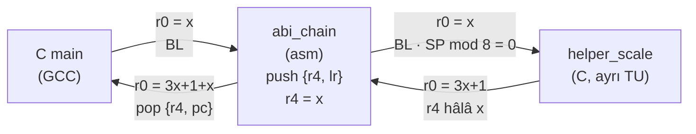

# Lesson 09 — Compiler, AAPCS & Calling Conventions

`[STANDARD]` · Day 5 · Tahmini süre: 75–90 dk

> **Öğretim döngüsü:** TEACH → SHOW → RUN → OBSERVE → MODIFY → BREAK → DEBUG → VERIFY

---

## Why This Matters

*(TEACH)*

Ders 03'te bir C fonksiyonu bir assembly fonksiyonunu çağırdı ve **çalıştı**.
Ders 04'te 8 byte hizalamaya, ders 07'de exception frame'in volatile
register'larına değindik — hepsinde "ayrıntısı ders 09'da" dedik.

Bu ders tek bir soruyu cevaplıyor:

> **Ayrı ayrı derlenmiş C ve assembly fonksiyonlarının birlikte çalışmasını
> sağlayan sözleşme nedir?**

Cevap **AAPCS32** (Procedure Call Standard for the Arm Architecture). Ders
03 "çalışıyor" dedi; bu ders sözleşmeyi **ölçüyor** — ve sözleşme bozukken
bile doğru sonuç üreten bir fonksiyon gösteriyor.

---

## Core Idea

*(TEACH)*

### Dört etiket

Bu derste her iddia dört türden birine ait. Karıştırmamak dersin yarısı:

| Etiket | Anlamı | Örnek |
|---|---|---|
| **ABI** | AAPCS32 kuralı; birlikte çalışabilirlik için bağlayıcı | r4 korunmak zorunda |
| **ARCHITECTURE** | Armv8-M işlemci davranışı | exception girişi frame'i hizalar |
| **COMPILER** | GCC'nin bir seçeneği / davranışı | `-O2` tail call üretebilir |
| **OBSERVATION** | *bu* GCC 13.2.1'in *bu* preset'te ürettiği | `-Og`'da `sq()` inline edilmedi |

**Ölçülmüş derleyici çıktısı bir ABI kuralı değildir.**

### Register rolleri (ABI)

Kaynak: AAPCS32, *Core registers*.

| Register | AAPCS adı | Rol | Çağrı boyunca |
|---|---|---|---|
| r0–r1 | a1–a2 | Argüman / **sonuç** / scratch | caller-clobbered |
| r2–r3 | a3–a4 | Argüman / scratch | caller-clobbered |
| r4–r8 | v1–v5 | Değişken register'ları | **callee-saved** |
| r9 | v6 / SB / TR | **Platform register'ı** | platforma bağlı (aşağıda) |
| r10–r11 | v7–v8 | Değişken register'ları | **callee-saved** |
| r12 | IP | Çağrı içi scratch; linker veneer'ları kullanabilir | caller-clobbered |
| r13 | SP | Stack pointer | geri getirilmek zorunda |
| r14 | LR | Dönüş adresi | her `BL` onu ezer |
| r15 | PC | Program counter | — |

AAPCS32'nin ifadesiyle: bir alt program **r4–r8, r10, r11 ve SP**'yi korumak
zorundadır — *ve r9'u, yalnızca r9'u v6 olarak atayan PCS varyantlarında*.

**r9 hakkında dikkat.** AAPCS32'ye göre r9'un rolü **platforma özgüdür**: bir
platform onu static base (SB) veya thread register (TR) olarak atayabilir;
böyle bir ihtiyacı olmayan bir platform onu ek bir callee-saved register (v6)
yapabilir. Yani **"r9 callee-saved'dir" evrensel bir kural değildir.** Bu
repo/toolchain yapılandırmasında gözlenen davranış Deney 2'de.

### Argüman yerleştirme (ABI)

Kaynak: AAPCS32, *Parameter Passing* — kurallar A.1–A.4, C.3–C.8.

"İlk dört argüman r0–r3'e gider" **kısayoldur, kural değil**:

- **C.3:** 8 byte hizalama isteyen bir argüman (örneğin `uint64_t`) NCRN'yi
  bir sonraki **çift** register'a yuvarlar.
- **C.4:** Kalan register'lara sığıyorsa register'lara gider.
- **C.6 / C.7 / C.8:** Sığmıyorsa NCRN r4'e ayarlanır, NSAA gerekiyorsa 8
  byte'a yuvarlanır ve argüman **stack'e** gider.

Sonuç: bazı prototiplerde bir register **atlanır** ve argüman taşımaz.

### Dönüş değeri (ABI)

Kaynak: AAPCS32, *Result Return*. 32 bit sonuç → `r0`. Double-word bir temel
tür (`long long`, soft-float `double`) → **`r0` ve `r1`**.

### Caller ve callee — kim neyden sorumlu?

```text
          CALLER                              |          CALLEE
                                              |
  argumanlari r0-r3 (+ stack) koyar  -------> |  r0-r3, r12, flag'leri serbestce bozabilir
  BL aninda SP 8'e hizali                     |  r4-r8, r10, r11 (ve v6 ise r9), SP'yi
  BL, donus adresini LR'ye yazar     -------> |    kullanirsa SAKLAR ve GERI YUKLER
                                              |  kendisi bir sey cagiracaksa ONCE LR'yi saklar
  donuste:                           <------- |  sonuc r0 (veya r0:r1)
  - r4-r11 ve SP ayni kalmistir               |
  - r0-r3, r12, LR, flag'ler: "gitti" say     |
```

| | Caller'ın görevi | Callee'nin görevi |
|---|---|---|
| **caller-clobbered** (r0–r3, r12) | Çağrıdan sonra lazımsa kendisi başka yerde tutar | Serbestçe kullanır |
| **callee-saved** (r4–r8, r10, r11, v6 ise r9) | Hiçbir şey — değerleri geri gelecek | Kullanırsa saklar ve geri yükler |

Ders 03'teki bilinçli ihlal (`[ACCUMULATE(7,5)] 5`, çökme yok) tam olarak bu
tablonun sağ sütununu bozuyordu.

### Üç ayrı hizalama kuralı

Ders 04'te karışan şey buydu. Üçü **farklı katmanlardır**:

| Kural | Katman | Kaynak |
|---|---|---|
| **Public interface'te SP mod 8 = 0** | ABI | AAPCS32, *Stack constraints at a public interface* |
| `LDRD`/`STRD` ve diğer erişimlerin hizalaması | ARCHITECTURE | Armv8-M ARM |
| Exception girişinde frame hizalaması (xPSR bit 9) | ARCHITECTURE | Armv8-M ARM; ders 07 |

AAPCS'in 8 byte kuralı **çağrı sınırında** geçerlidir. Hiçbir şey çağırmayan
bir yaprak fonksiyonun **içinde** SP 8'e hizalı olmak zorunda değildir —
Deney 1'de ölçülüyor (`asm_clobber_good`).

---

## Mental Model

*(TEACH)*

**Çağrı sınırı, birbirinin kodunu hiç görmeyen iki taraf arasında bir
sözleşmedir.** Derleme zamanında kimse karşı tarafı denetleyemez.

Sözleşme bozulduğunda program çoğu zaman **yine çalışır** — ta ki başka bir
derleyici sürümü veya optimizasyon seviyesi register'ları farklı dağıtana
kadar. Zarar, ihlali yapan fonksiyonda değil, **başkasının değişkeninde,
daha sonra** ortaya çıkar.

Bu yüzden bu derste sözleşmeyi, derleyicinin register tahsisine **bağlı
olmayan** bir ölçüm aletiyle denetliyoruz.

---

## Visual

*(SHOW)*



---

## Tiny Example

*(SHOW)*

Kaynaklar: [`example/`](example/).

| Dosya | Ne |
|---|---|
| [`abi.h`](example/abi.h) | Tüm prototipler — çağıranın argümanları doğru yerleştirmesi için **tam prototip** gerekir |
| [`abi_probes.S`](example/abi_probes.S) | Argüman / dönüş probe'ları + `abi_chain` |
| [`abi_harness.S`](example/abi_harness.S) | Callee-saved ölçüm aleti |
| [`good_callee.S`](example/good_callee.S) | Pozitif kontrol |
| [`bad_callee.S`](example/bad_callee.S) | Break It |
| [`helpers.c`](example/helpers.c) | C yardımcıları — **ayrı derleme birimi** |
| [`main.c`](example/main.c) | Sürücü |
| [`optimization.c`](example/optimization.c) | Optimizasyon fikstürü |

### Probe'lar: girişteki durumu, hiçbir şeye dokunmadan önce yakala

Argümanları **GCC** yerleştiriyor; probe'lar yalnızca kaydediyor. İşaretçi
olarak yalnızca `r12` kullanılıyor — AAPCS'e göre scratch ve argüman
taşımıyor:

```asm
.macro CAPTURE_ENTRY
    ldr     r12, =g_probe
    str     r0, [r12, #0]
    str     r1, [r12, #4]
    str     r2, [r12, #8]
    str     r3, [r12, #12]
    mov     r0, sp              /* r0 artik kaydedildi, scratch olabilir */
    str     r0, [r12, #16]
    ldr     r0, [sp, #0]        /* [SP+0]: ilk stack argumani */
    str     r0, [r12, #20]
    ldr     r0, [sp, #4]
    str     r0, [r12, #24]
.endm
```

Probe'lar yaprak fonksiyonlardır ve stack'e yazmaz; `[SP]` bu yüzden hâlâ
çağıranın yığdığı ilk stack argümanını gösterir.

### C → asm → C zinciri

```asm
abi_chain:                      @ uint32_t abi_chain(uint32_t x)
    push    {r4, lr}            /* r4: kullanacagimiz callee-saved      */
                                /* lr: yaprak degiliz, BL onu ezecek    */
    mov     r4, r0              /* x cagri boyunca r4'te                */
    ldr     r1, =g_chain_sp_at_call
    mov     r2, sp
    str     r2, [r1]            /* BL aninda SP                          */
    mov     r0, r4
    bl      helper_scale        /* C: r0-r3, r12, LR'yi bozabilir        */
    add     r0, r0, r4          /* r4 hala x: helper AAPCS'e uydu        */
    pop     {r4, pc}            /* r4'u geri ver, LR'den don             */
```

`helper_scale` bilerek **ayrı bir derleme biriminde** (`helpers.c`). Aynı
dosyada olsaydı, `-O2`/`-Os`'ta GCC hangi register'ları bozduğunu bildiği
için (`-fipa-ra`, **COMPILER**) çağıranda AAPCS'in izin verdiğinden daha
iyimser kod üretebilirdi. Ayrı TU'da derleyici yalnızca sözleşmeye
güvenebilir.

### Ölçüm aleti: callee-saved harness

C'de "r4'te bir değer tutup çağrıdan sonra bak" yazmak, GCC'nin register
tahsisine bağlı kalırdı. Harness bunu assembly'de, kesin olarak yapıyor:

```text
abi_check_callee(fn, a, b, *out_result):
    push   {r3-r11, lr}          10 register = 40 byte
                                 r3 = hizalama DOLGUSU ve out_result yuvasi
    r4..r11 <- farkli nobetci degerler (0xA4A4A404 ... 0xABABAB0B)
    SP'yi kaydet
    out_result'i ve BLX anindaki SP'yi GLOBAL yuvalara yaz
    blx    fn                    fn(a, b)
    --- donus: SP guvenilmez; SP dogrulanana kadar [sp] erisimi YOK ---
    *out_result = r0             (isaretci global yuvadan)
    SP beklenenden farkli mi? -> bit 8; SP'yi bilinen iyi degere geri yukle
    her biri icin: r4..r11 nobetciye esit mi? degilse maskeye bit
    pop    {r3-r11, pc}          CAGIRANIN r4-r11'i geri; donus
```

Harness **bir ölçüm aletidir**, yani kendisi de AAPCS'e uymak zorunda:

| Kontrol | Nasıl sağlanıyor |
|---|---|
| Çağıranın r4–r11'i korunuyor | `push {r3-r11, lr}` … `pop {r3-r11, pc}` |
| LR | Girişte saklanıyor, `pc`'ye pop'lanıyor |
| `BLX` anında SP mod 8 = 0 | 40 byte yığılıyor; ölçülüyor (`CHECK_HARNESS_SP_ALIGNED`) |
| Sonuç | Maske `r0`'da, callee sonucu `*out_result`'ta |
| Bozuk callee'den sağ çıkması | Kendi r4–r11'ini callee'ye güvenmeden geri yüklüyor |
| SP'yi bozan callee'den sağ çıkması | Dönüşte, SP doğrulanıp geri yüklenene kadar hiçbir `[sp]` erişimi yok; gereken her şey `BLX`'ten önce global yuvalara yazılıyor |

Ve **önce pozitif kontrol**: harness doğru bir callee'de (`good_callee`)
maske = 0 vermiyorsa, bozuk callee üzerindeki ölçümüne güvenilmez.

> **Ölçüm aletinin kendi regresyonu.** Bağımsız denetim, harness'in ilk
> sürümünün SP'yi bozan bir callee'den sonra `[sp]`'den okuduğu için
> kendi çağıranının r4'ünü işaretçi sanıp yazdığını buldu (BusFault,
> `BFAR = 0xDEAD0000`). Onarılmış harness'i bu duruma karşı sınayan ayrı,
> öğrenciye yönelik olmayan bir hedef var: `09-harness-sp-regression`
> ([`regression/`](regression/)). SP'yi +4 ve −8 kaydıran callee'lerde maske
> `0x100`, r4 + SP bozan callee'de `0x101`; her durumda sonuç, çağıranın
> r4–r11'i ve SP'si geri geliyor.

---

## Build & Run

*(RUN)*

```bash
cmake --preset debug
cmake --build --preset debug --target 09-compiler-aapcs
./scripts/run-qemu.sh build/debug/lessons/09-compiler-aapcs/09-compiler-aapcs.elf
```

| Hedef | Amaç |
|---|---|
| `09-compiler-aapcs` | Sözleşmeyi **ölç** |
| `09-compiler-aapcs-broken` | Doğru sonuç, **bozuk** sözleşme |
| `09-compiler-optimization` | Aynı C, üç preset, farklı makine kodu |
| `09-exercise-callee-save` | Onarılacak fonksiyon |
| `09-solution-callee-save` | Referans çözüm |

---

## Expected Output

*(RUN)*

Gerçek çıktı (arm-none-eabi-gcc 13.2.1, QEMU 8.2.2, mps2-an505, `debug`):

```text
===== LESSON 09: AAPCS =====
[1] Arguman yerlesimi (cagiran: GCC, olcen: asm probe)
[  F1 r0] 0xA1A1A1A1
[  F1 r1] 0xB2B2B2B2
[  F1 r2] 0xC3C3C3C3
[  F1 r3] 0xD4D4D4D4
[  CHECK_ARGS_4U32] PASS
[  F2 r3] 0xD4D4D4D4
[  F2 [SP+0]] 0xE5E5E5E5
[  CHECK_ARG5_ON_STACK] PASS
[  F3 r0 (a)] 0xA1A1A1A1
[  F3 r1 (unspecified)] 0x100008C8
[  F3 r2 (b.lo)] 0x55667788
[  F3 r3 (b.hi)] 0x11223344
[  CHECK_U64_IN_R2_R3] PASS
[  F4 r0] 0xA1A1A1A1
[  F4 r1] 0xB2B2B2B2
[  F4 r2] 0xC3C3C3C3
[  F4 r3 (unspecified)] 0x99AABBCC
[  F4 SP] 0x30007FD8
[  F4 [SP+0] (d.lo)] 0xDDEEFF00
[  F4 [SP+4] (d.hi)] 0x99AABBCC
[  CHECK_U64_ON_STACK] PASS
[  CHECK_U64_STACK_SP_ALIGNED] PASS
[  F5 r0 after BL] 0x89ABCDEF
[  F5 r1 after BL] 0x01234567
[  CHECK_U64_RETURN_R0_R1] PASS
[2] C -> asm -> C zinciri
[  CHAIN_RESULT] 41
[  CHAIN_SP_AT_BL] 0x30007FD8
[  CHECK_CHAIN_RESULT] PASS
[  CHECK_SP_ALIGNED_AT_CALL] PASS
[3] Callee-saved harness
[  CONTROL_MASK] 0x00000000
[  CONTROL_RESULT] 12
[  HARNESS_SP_AT_BLX] 0x30007FB8
[  CHECK_HARNESS_POSITIVE_CONTROL] PASS
[  CHECK_HARNESS_SP_ALIGNED] PASS
--- test edilen: good_callee ---
[  TESTED_RESULT] 12
[  TESTED_MASK] 0x00000000
[  CORRUPTED] (yok)
[  CHECK_RESULT] PASS
[  CHECK_CALLEE_SAVED] PASS
===== END =====
```

On iki `CHECK_*` satırının hepsi `release` ve `minsize` preset'lerinde de
`PASS`. Adresler build'e özeldir.

### Argüman eşlemesi — ölçülen (OBSERVATION, üç preset'te aynı)

| Fikstür | Prototip | r0 | r1 | r2 | r3 | Stack |
|---|---|---|---|---|---|---|
| F1 | `f(u32 a, b, c, d)` | a | b | c | d | — |
| F2 | `f(u32 a, b, c, d, e)` | a | b | c | d | `[SP+0]` = e |
| F3 | `f(u32 a, u64 b)` | a | *atlandı* | b.lo | b.hi | — |
| F4 | `f(u32 a, b, c, u64 d)` | a | b | c | *atlandı* | `[SP+0]` = d.lo, `[SP+4]` = d.hi |

- **F3:** `b`, çift numaralı register çifti **r2:r3**'e gitti (kural C.3);
  düşük word düşük numaralı register'da. r1 argüman taşımıyor.
- **F4:** `d` tek başına r3'e **sığmadı**; r3 atlandı ve `d` stack'e gitti
  (C.6–C.8). Düşük word düşük adreste. Probe girişinde `SP = 0x30007FD8` →
  mod 8 = 0.
- **F5:** `make_u64()` `0x0123456789ABCDEF` döndürdü; `BL`'den hemen sonra
  `r0 = 0x89ABCDEF` (düşük), `r1 = 0x01234567` (yüksek).

### "Atlanan register" neden kontrol edilmiyor?

F3'te r1, F4'te r3 argümanı **taşımıyor**; içerikleri sözleşmenin parçası
değil. Bu yüzden `(unspecified)` olarak basılıyor ve **hiçbir PASS/FAIL
kararına girmiyor**. Kontroller yalnızca **pozitif**: `b` r2:r3'te mi, `d`
doğru stack adreslerinde mi, word sırası doğru mu, SP hizalı mı.

Bunun neden önemli olduğunu ölçüm gösterdi:

| Preset | F3 r1 | F4 r3 |
|---|---|---|
| `debug` | `0x100008C8` | **`0x99AABBCC`** |
| `release` | `0x100009D8` | `0x00000000` |
| `minsize` | `0x1000081C` | **`0x99AABBCC`** |

`debug` ve `minsize`'da r3, **tesadüfen** `d`'nin yüksek word'ünü içeriyor —
GCC onu stack'e yazarken r3'ü geçici register olarak kullanmış. "r3, `d`'nin
hiçbir yarısını içermemeli" gibi bir negatif kontrol, ABI'ye **uyulmuşken**
FAIL verirdi. Atlanan bir register hakkında söylenebilecek tek doğru şey:
**içeriği tanımsız**.

---

## Observe in GDB

*(OBSERVE)*

Hedef: `09-compiler-aapcs`, `debug`. Beş durak, hepsi `abi_chain` etrafında.

```bash
cmake --build --preset debug --target debug-09-compiler-aapcs
```

```gdb
gdb-multiarch -q build/debug/lessons/09-compiler-aapcs/09-compiler-aapcs.elf
set architecture armv8-m.main
target remote :3333
```

Adresleri kendi build'inden al: `disassemble fixture_chain` ve
`disassemble abi_chain`. Aşağıdakiler bu build'in adresleri.

### A — `main` tarafında, `bl abi_chain` üzerinde

```gdb
(gdb) break *0x100004e6
(gdb) continue
(gdb) x/1i $pc
(gdb) info registers r0 r4 sp
```

```text
=> 0x100004e6 <fixture_chain+10>:  bl  0x100000f4 <abi_chain>
r0  0xa
r4  0x0
sp  0x30007fe0
```

**Gözlem:** argüman `r0`'da. Çağıranın r4'ü ve SP'si not edildi.

### B — `abi_chain`'in ilk komutu

```gdb
(gdb) break *0x100000f4
(gdb) continue
(gdb) p/x $lr
(gdb) p/x $sp
```

```text
$lr = 0x100004eb
$sp = 0x30007fe0
```

**Gözlem:** `BL` yalnızca `LR`'yi değiştirdi: `0x100004e6 + 4 = 0x100004ea`,
bit 0 = 1 → `0x100004eb` (Thumb). SP değişmedi.

### C — `bl helper_scale` üzerinde

```gdb
(gdb) break *0x10000100
(gdb) continue
(gdb) p/x $sp
(gdb) p/x (unsigned)$sp & 7
(gdb) x/2wx $sp
(gdb) p/x $r4
```

```text
$sp = 0x30007fd8
(unsigned)$sp & 7 = 0x0
0x30007fd8:  0x00000000  0x100004eb
$r4 = 0xa
```

**Gözlem:** `push {r4, lr}` 8 byte yığdı → SP hâlâ 8'e hizalı. Stack'te en
düşük adreste **r4** (çağıranın değeri `0`), üstünde **LR**. `r4` artık `x`'i
taşıyor.

### D — `helper_scale` döndükten hemen sonra

Durak C'de `bl`'den hemen önce `info registers r1 r2 r3` de al, sonra:

```gdb
(gdb) break *0x10000104
(gdb) continue
(gdb) info registers r0 r1 r2 r3 r4
```

```text
            BL'den once    BL'den sonra
r0          0xa            0x1f         <- helper sonucu: 3*10+1
r1          0x30000008     0x30000008
r2          0x30007fd8     0x30007fd8
r3          0x1234567      0x1234567
r4          0xa            0xa          <- degismedi
```

**Gözlem:** `r4` sağlam — `helper_scale` sözleşmeye uydu. Bu çağrıda
`helper_scale` **yalnızca `r0`'ı** değiştirdi; `r1`–`r3` üç preset'te de
aynı kaldı.

Bu iki şeyi ayır:

- **ABI:** `r1`–`r3` caller-clobbered. Çağıran onların çağrıdan sağ çıkmasına
  **güvenemez**; callee onları değiştirmeye **yetkilidir**.
- **OBSERVATION:** bu `helper_scale` onları değiştirmedi.

"Değiştirilebilir" ile "değiştirildi" aynı şey değildir. Bir register'ın bir
ölçümde aynı kalması, ona güvenmeyi doğru yapmaz — bir sonraki derleyici
sürümü veya başka bir callee onu bozabilir.

### E — `main`'e dönüş

```gdb
(gdb) break *0x100004ea
(gdb) continue
(gdb) info registers r0 r4 sp
```

```text
r0  0x29        <- 41
r4  0x0         <- durak A ile ayni
sp  0x30007fe0  <- durak A ile ayni
```

**Gözlem:** sözleşme çağıranın tarafından tamamlandı: sonuç `r0`'da, `r4` ve
SP dokunulmamış gibi.

> GDB'nin kaynak satırı göstergesi assembly dosyalarında bazen komşu bir
> fonksiyonun satırını gösterebiliyor. Güvenilir olan `x/1i $pc` çıktısıdır.

---

## Experiment

*(OBSERVE / MODIFY)*

### Deney 1 — Aynı C, üç preset

```bash
for p in debug release minsize; do
  cmake --preset $p && cmake --build --preset $p --target 09-compiler-optimization
done
# build/<preset>/lessons/09-compiler-aapcs/09-compiler-optimization.lst
```

Çalışma zamanı üç preset'te de **aynı**: `OPT_CHECKSUM = 0x79DC404C`,
`CHECK_OPT_CHECKSUM PASS`. Makine kodu değişiyor; anlam değişmiyor.

Aşağıdaki tablonun tamamı **OBSERVATION**'dır — GCC 13.2.1, bu repo'nun
bayraklarıyla. Başka bir derleyici veya sürüm farklı kod üretebilir.

| Fonksiyon | `-Og` (debug) | `-O2` (release) | `-Os` (minsize) | Gösterdiği |
|---|---|---|---|---|
| `leaf_regs` | `eors`, `add.w`, `bx lr` | aynı | aynı | Register'la yetinen yaprak: push yok |
| `leaf_with_stack` | `sub sp, #16` … `add sp, #16`, `bx lr` | `push {r4}`, `sub sp, #20` … `pop {r4}`, `bx lr` | `sub sp, #16` … `bx lr` | **Stack kullanan yaprak** |
| `tail_call` | `push {r3, lr}`, `bl helper_ext`, `pop {r3, pc}` | `adds`, **`b.w helper_ext`** | `adds`, **`b.w helper_ext`** | Tail call |
| `use_sq_twice` | iki kez `bl sq` | `mul.w` + `mla` | `muls` + `mla` | Inlining |
| `dead_store` | **iki** `str` (1, sonra 2) | **tek** `str` (2) | **tek** `str` (2) | Ölü yazma eleme |
| `vol_store_twice` | iki `str` | iki `str` | iki `str` | `volatile` erişimleri korur |
| `poll_plain` | `ldr` döngü **içinde** | `ldr` **bir kez**, sonra kendine `b.n` | `-O2` ile aynı | Yükün döngü dışına alınması |
| `poll_vol` | `ldr` döngü içinde | `ldr` döngü içinde | `ldr` döngü içinde | `volatile` her okumayı korur |
| `signed_gt` | **`movs r0, #1`** | **`movs r0, #1`** | **`movs r0, #1`** | İşaretli taşma UB → sabite katlandı |
| `unsigned_gt` | `adds`, `it ne`, `movne` | aynı | aynı | İşaretsiz sarma tanımlı → gerçek hesap |
| `asm_clobber_bad` | `mov r4, r0`, `bx lr` | aynı | aynı | Clobber yok → r4 **saklanmadı** |
| `asm_clobber_good` | `push {r4}` … `pop {r4}` | aynı | `push {r4, lr}` … `pop {r4, pc}` | Clobber var → r4 saklandı |
| `clobber_r9` | `str.w r9, [sp, #-4]!` … | aynı | `stmdb sp!, {r9, lr}` … | r9 bu yapılandırmada saklanıyor |

**Yalnızca disassembly için** olan ve **asla çalıştırılmayan** fonksiyonlar:
`poll_plain`/`poll_vol` (sonsuz döngü olabilir), `signed_gt` (taşmada UB),
`asm_clobber_bad` (bilerek AAPCS ihlali). `--gc-sections`'tan kurtulmaları
için adresleri alınıyor ama çağrılmıyorlar.

Tablodan çıkan dersler:

- **Yaprak ≠ stack'siz.** `leaf_with_stack` hiçbir fonksiyon çağırmıyor (üç
  preset'te de `bl` yok), yine de `sub sp` ile stack ayırıyor. Diziyi
  bellekte tutmaya zorlayan şey bir çağrı değil, dizinin adresini alan boş
  bir inline asm (`"r"(buf)` + `"memory"` clobber'ı). *Yaprak fonksiyon =
  hiçbir çağrı yapmayan fonksiyon*; stack kullanıp kullanmaması ayrı bir soru.
- **Yaprak içinde SP 8'e hizalı olmak zorunda değil.** `asm_clobber_good`
  `-Og`/`-O2`'de yalnızca `push {r4}` yapıyor: 4 byte, yani fonksiyonun içinde
  SP mod 8 = 4. Bu **yasal**, çünkü fonksiyon hiçbir şey çağırmıyor —
  AAPCS'in 8 byte kuralı çağrı sınırı içindir.
- **`b` görmek bozuk sözleşme demek değildir.** `-O2`'de `tail_call`
  `helper_ext`'e `bl` yerine `b.w` ile gidiyor ve LR'yi hiç saklamıyor:
  `helper_ext` doğrudan `tail_call`'ın **çağıranına** dönecek. Bu bir
  **derleyici optimizasyonu** (`-foptimize-sibling-calls`); garanti değil.
  `-Og`'da aynı fonksiyon `bl` kullanıyor.
- **`-Og`'daki `push {r3, lr}`:** `tail_call` yalnızca LR'yi saklaması
  gerekirken r3'ü de yığıyor. Sebep hizalama: `{lr}` tek başına 4 byte olurdu
  ve `bl` anında SP mod 8 = 4 olurdu. r3 bir **dolgu**. Harness'teki
  `push {r3-r11, lr}` ile aynı fikir.
- **`signed_gt` `-Og`'da bile katlandı.** `(x + 1) > x` işaretli `int` için
  her zaman doğru kabul ediliyor, çünkü taşma C'de tanımsız davranış (ISO C11
  §6.5 ¶5). Ders 03'teki düzeltmeyi tekrar ediyoruz: assembly'nin sarmalayan
  `ADDS` sonucu, taşan işaretli C'nin davranışına **eşdeğer değildir**.
- **İnline asm'in iki sözleşmesi.** `mov r4, %0` komutu her iki fonksiyonda
  da aynı ve doğru çalışır. Fark, **derleyiciye verilen sözleşmede**:
  clobber listesi olmadan GCC r4'ün değiştiğini bilmiyor ve onu saklamıyor —
  sonuç, çağıranına karşı bir AAPCS ihlali. Derleyici asm metnini **okumaz**.

### Deney 2 — r9 bu yapılandırmada ne yapıyor?

`clobber_r9` satırı: derleyici `"r9"` clobber'ını gördüğünde r9'u üç
preset'te de **sakladı**. Caller-clobbered bir register için bunu yapmazdı.

> **ABI:** r9'un rolü platforma özgüdür; callee-saved olması ancak platform
> onu v6 olarak atarsa geçerlidir.
> **OBSERVATION:** Bu repo'nun `arm-none-eabi-gcc` yapılandırmasında r9,
> callee-saved (v6) gibi ele alınıyor. Harness bu yüzden r9'u da denetliyor.

### Deney 3 — Bir prototipi değiştir

*(MODIFY)* `abi.h` ve `main.c`'de F4'ü
`probe_3u32_u64(uint32_t a, uint32_t b, uint64_t d)`'ye çevir (iki u32 +
u64). Önce **tahmin et**: `d` nereye gider? Sonra ölç. (İpucu: kural C.3
NCRN'yi hangi register'a yuvarlar?) Bitince değişikliği geri al.

---

## Break It

*(BREAK)*

```bash
cmake --build --preset debug --target 09-compiler-aapcs-broken
./scripts/run-qemu.sh build/debug/lessons/09-compiler-aapcs/09-compiler-aapcs-broken.elf
```

[`bad_callee.S`](example/bad_callee.S):

```asm
bad_callee:          @ uint32_t bad_callee(uint32_t a, uint32_t b)
    movs  r4, #0     @ IHLAL: callee-saved r4 saklanmadan ezildi
    adds  r0, r0, r1 @ sonuc yine de DOGRU
    bx    lr
```

Gerçek çıktı (harness bölümü):

```text
[  CONTROL_MASK] 0x00000000
[  CHECK_HARNESS_POSITIVE_CONTROL] PASS
--- test edilen: bad_callee (BREAK IT) ---
[  TESTED_RESULT] 12
[  TESTED_MASK] 0x00000001
[  CORRUPTED] r4
[  CHECK_RESULT] PASS
[  CHECK_CALLEE_SAVED] FAIL
===== END =====
```

Üç preset'te de aynı. **Sonuç doğru** (`7 + 5 = 12`), **sözleşme bozuk**
(maske bit 0 = r4). Çökme yok, zaman aşımı yok; firmware normal şekilde
`END`'e ulaşıyor.

Neden `main` etkilenmedi? Çünkü harness, bozuk callee'ye güvenmeden kendi
çağıranının r4–r11'ini geri yüklüyor. GDB'de doğrulandı: `main`'in r4–r11'i
çağrıdan önce `0x44444444 … 0xBBBBBBBB` olarak işaretlendi; bozuk callee'den
sonra hepsi aynen geri geldi, SP de (`0x30007fe0`).

Gerçek bir programda bu koruma **yoktur**: `bad_callee`'yi doğrudan C'den
çağıran bir fonksiyon, r4'te tuttuğu bir değeri kaybederdi — ve bunun görünür
olup olmaması, o fonksiyonun r4'ü o anda kullanıp kullanmadığına, yani
**register tahsisine** bağlı olurdu. Harness'in varlık sebebi tam olarak bu.

---

## Debug It

*(DEBUG)*

1. `bad_callee` doğru sonuç veriyor. "Bir fonksiyon doğru sonuç veriyorsa
   doğrudur" cümlesi neden yanlış?
2. Harness'in maskesi neden deterministik? GCC register tahsisi onu neden
   etkileyemiyor?
3. `bad_callee`'nin `movs r4, #0` satırını `movs r12, #0` yap. Maske ne olur?
   Neden?
4. Pozitif kontrolü (`good_callee`) neden **önce** çalıştırıyoruz? Harness'in
   kendisinde bir hata olsaydı ne görürdük?
5. Harness `push {r4-r11, lr}` kullansaydı (9 register, 36 byte) `BLX`
   anında SP ne olurdu? Hangi kontrol bunu yakalardı?

GDB ile harness'in kendi çağıranını koruduğunu görmek için:

```gdb
(gdb) disassemble fixture_harness      # ikinci "bl abi_check_callee"yi bul
(gdb) break *<o adres>
(gdb) continue
(gdb) set $r4 = 0x44444444
(gdb) set $r11 = 0xBBBBBBBB
(gdb) break *<o adres + 4>
(gdb) continue
(gdb) info registers r0 r4 r11 sp
```

---

## Exercise

*(VERIFY)*

### Exercise 01 — Repair an ABI-Broken Assembly Function

[`exercises/01-callee-save/scale_and_sum.S`](exercises/01-callee-save/scale_and_sum.S):
`helper_scale(a) + b` hesaplıyor ve **doğru sonucu** döndürüyor. Ama
sözleşmeyi iki yerden bozuyor.

```bash
cmake --build --preset debug --target 09-exercise-callee-save
./scripts/run-qemu.sh build/debug/lessons/09-compiler-aapcs/09-exercise-callee-save.elf
```

Başlangıç çıktısı (gerçek, üç preset'te aynı karar):

```text
[  CHECK_HARNESS_POSITIVE_CONTROL] PASS
[  RESULT] 36
[  MASK] 0x00000002
[  CORRUPTED] r5
[  SP_AT_BL] 0x30007FAC
[  CHECK_RESULT] PASS
[  CHECK_CALLEE_SAVED] FAIL
[  CHECK_SP_ALIGNED_AT_CALL] FAIL
===== END =====
```

Yalnızca `.S` dosyasını düzenle. **Doğrulama ölçütü:** üç kontrolün üçü de
`PASS`, sonuç `36` kalmalı. Ayrıntılar
[exercise README](exercises/01-callee-save/README.md)'sinde.

---

## Reference Solution

| Ne | Nerede | Hedef |
|---|---|---|
| Exercise 01 çözümü | [`solutions/01-callee-save/`](solutions/01-callee-save/) | `09-solution-callee-save` |

Gerçek çıktı (`debug`):

```text
[  CHECK_HARNESS_POSITIVE_CONTROL] PASS
[  RESULT] 36
[  MASK] 0x00000000
[  CORRUPTED] (yok)
[  SP_AT_BL] 0x30007FA8
[  CHECK_RESULT] PASS
[  CHECK_CALLEE_SAVED] PASS
[  CHECK_SP_ALIGNED_AT_CALL] PASS
===== END =====
```

---

## What I Learned

> Bu bölüm senin.

**Caller ve callee'nin sorumluluklarını kendi cümlemle:**

<!-- -->

**Bir register'ın "atlanması" ve içeriğinin neden tanımsız olduğu:**

<!-- -->

**Doğru sonuç ≠ doğru sözleşme:**

<!-- -->

**Bir `.lst` dosyasında gördüğümü ABI kuralı sanmamak için dikkat ettiğim:**

<!-- -->

**Ders 10'a taşıdığım soru:**

<!-- -->

---

## Quick Check

1. `r0`–`r3` ne için kullanılır ve değerleri neden bir çağrıdan sonra
   korunmayabilir?
2. Caller-saved ve callee-saved: kim neyden sorumlu, neden?
3. **(Reasoning)** Bir callee kendi sonucu doğru olsa bile neden r4'ü geri
   yüklemek zorunda?
4. `r12` (IP) ne için kullanılabilir, kim tarafından — linker dahil?
5. Başka bir fonksiyonu çağıran bir fonksiyonda LR'ye ne olur, fonksiyon ne
   yapmalı?
6. **(Reasoning)** "Public interface'te SP mod 8 = 0" ne demek? `LDRD`
   hizalamasından ve exception frame hizalamasından farkı ne?
7. **(Reasoning)** `f(u32 a, u32 b, u32 c, u64 d)` için `d` nereye gider, r3
   neden atlanır? Atlanan r3'ün içeriği hakkında ne söylenebilir?
8. `volatile` neyi garanti eder? Garanti **etmediği** üç şey say.
9. Yaprak fonksiyonu tanımla. Bir yaprak fonksiyon stack kullanabilir mi?
   `.lst`'ten göster.
10. **(Reasoning)** Bir fonksiyon `bl helper` + dönüş yerine `b helper` ile
    bitiyor. ABI bozuk mu?
11. **(Reasoning)** `-O2` çıktısı bir değeri bir çağrı boyunca r3'te tuttu. Bu
    bir ABI kuralı mı? Ne mümkün kıldı?
12. `(x + 1) > x` neden `int` için `return 1`'e katlanabiliyor ama `unsigned`
    için katlanamıyor?
13. **(Reasoning)** r4'e yazan inline asm, komutun kendisi sorunsuz çalıştığı
    halde neden bir clobber bildirmek zorunda?

> Cevaplar: [`answers/quick-check.md`](answers/quick-check.md)

---

## Takeaway

- **AAPCS bir sözleşmedir**; ayrı derlenmiş kodun birlikte çalışmasını o
  sağlar ve derleme zamanında kimse karşı tarafı denetlemez.
- **r0–r3, r12** caller-clobbered; **r4–r8, r10, r11** callee-saved; **r9**
  platforma bağlı (bu yapılandırmada callee-saved gözlendi).
- "İlk dört argüman r0–r3'e" bir **kısayoldur**: 64 bit argümanlar çift
  register'a hizalanır ve bir register **atlanabilir**. Atlanan register'ın
  içeriği tanımsızdır — ona bakarak karar verme.
- **SP mod 8 = 0 çağrı sınırında**; yaprak bir fonksiyonun içinde değil.
- **Doğru sonuç, doğru sözleşme değildir.** Callee-save ihlali zararını
  başkasının kodunda, sonra gösterir.
- **`.lst`'te gördüğün bir derleyici gözlemidir, ABI kuralı değil.** Tail call,
  inlining, ölü yazma eleme — hepsi preset'e ve derleyici sürümüne bağlı.
- **`volatile` erişimleri korur; atomiklik, sıralama, karşılıklı dışlama
  vermez.**

---

## `volatile` — kısa ve kesin

| `volatile` **yapar** | `volatile` **yapmaz** |
|---|---|
| Programın nesneye yaptığı her erişimi korur (`vol_store_twice`: iki `str`) | Atomiklik (read-modify-write hâlâ ayrı load + store) |
| Nesneye bütün olarak erişir | Karşılıklı dışlama |
| Değerin bir register'da önbelleklenmesini engeller (`poll_vol`) | Volatile **olmayan** erişimlerin sıralanması; `DMB`/`DSB` eşdeğeri değildir |
| | Thread güvenliği, cache tutarlılığı |
| | Herhangi bir ayrıcalık veya bellek koruması (ders 05/06) |

AAPCS32 (*Volatile Data Types*) ilginç bir **izin** veriyor: derleyici,
**adresi hiç alınmayan** otomatik (yerel) bir değişkenin `volatile`
niteliğini — fonksiyon `setjmp()` çağırmıyorsa — **yok sayabilir**. Bu, ABI'nin
verdiği bir izindir; GCC'nin böyle yaptığı iddiası değildir. Bu yüzden bu
dersteki fikstürler `volatile` davranışını **global** nesnelerle gösteriyor
ve `leaf_with_stack` diziyi `volatile` ile değil, adresini alan bir inline
asm ile bellekte tutuyor.

Senkronizasyon ders 13'ün konusu.

---

## FAST TRACK / Deep Dive

**FAST TRACK (bu ders):** tamsayı argümanları, 32/64 bit dönüş, caller/callee
sözleşmesi, çağrı sınırında hizalama, derleyici prolog/epilog'u, üç preset,
`volatile`, tail call, inline asm clobber'ı.

**Deep Dive (bilerek dışarıda):** struct argümanları ve struct dönüşü (gizli
işaretçi, kural A.4), register/stack arası bölünen argümanlar (C.5), variadic
fonksiyonlar, hard-float ABI ve VFP register'ları (repo soft-float), unwind
tabloları, r9'un SB/TR olarak kullanıldığı platformlar, GCC extended asm'in
tüm kısıt dili.

---

## Official References

- **AAPCS32** — *Procedure Call Standard for the Arm Architecture*, release
  2025Q4 (23 Ocak 2026). Bölümler: *Core registers* (register rolleri, r9),
  *Universal stack constraints*, *Stack constraints at a public interface*,
  *Subroutine Calls*, *Use of IP by the linker*, *Result Return*,
  *Parameter Passing* (kurallar A.1–A.4, C.3–C.8), *Volatile Data Types*.
  <https://github.com/ARM-software/abi-aa/blob/main/aapcs32/aapcs32.rst>
- **ISO C11** — §6.5 ¶5 (işaretli taşma: tanımsız davranış), §6.7.3
  (`volatile`), §5.1.2.3 (program yürütme).
- **GCC manual** — *Options That Control Optimization* (`-Og`, `-O2`, `-Os`,
  `-foptimize-sibling-calls`, `-fipa-ra`), *When is a Volatile Object
  Accessed?*, *Extended Asm* → *Clobbers and Scratch Registers*, *Local
  Register Variables*.
  <https://gcc.gnu.org/onlinedocs/>
- **Armv8-M Architecture Reference Manual (Arm DDI 0553)** — erişim
  hizalaması, exception girişinde frame hizalaması.
- Ölçüm ortamı: `arm-none-eabi-gcc 13.2.1`, `QEMU 8.2.2`,
  `mps2-an505 / cortex-m33`, `debug` / `release` / `minsize`.

---

## Known Boundaries

- Bütün derleyici gözlemleri GCC 13.2.1 ve bu repo'nun bayraklarına aittir.
- Probe'lar yalnızca tamsayı argümanlarını ölçüyor (soft-float).
- r9 davranışı **bu yapılandırmada gözlendi**; AAPCS onu platforma bırakır.
- Harness yalnızca iki `uint32_t` argüman alan fonksiyonları test edebilir.
- `volatile` için AAPCS'in otomatik değişken izni ölçülmedi; fikstürler bu
  izne dayanmayacak şekilde kuruldu.

---

**Previous:** [08 — Faults](../08-faults/)
**Next:** [10 — Linker, ELF & Memory](../10-linker-elf-memory/)
