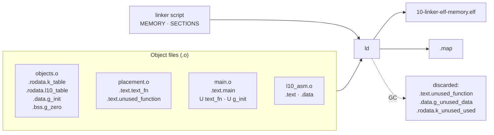

**Language:** English | [Türkçe](README.tr.md)

# Lesson 10 — Linker, ELF & Memory

`[STANDARD]` · Day 5 · Estimated time: 75–90 min

> **Teaching cycle:** TEACH → SHOW → RUN → OBSERVE → MODIFY → BREAK → DEBUG → VERIFY

---

## Why This Matters

*(TEACH)*

Lesson 09 ended with a question: who wrote the destination address of
`bl helper_scale`? Not the compiler — it did not know where `helper_scale`
would be during compilation. Not the assembler either.

This lesson answers that question and what follows:

> **How do separately compiled pieces become one executable image, and how
> are code and data placed in Cortex-M memory?**

“The firmware does not fit in FLASH,” “why is this variable at this address,”
“where is `.data` copied from,” “undefined reference” — the answers are in
the same two files: **the linker script** and **the map file**.

---

## Core Idea

*(TEACH)*

### Five labels

| Label | Meaning | Example |
|---|---|---|
| **ELF / ABI** | ELF file format and Arm ELF ABI (AAELF32) | `R_ARM_THM_CALL` describes a BL |
| **LINKER** | GNU ld behavior | `*(.rodata*)` gathers matching input sections |
| **REPOSITORY DESIGN** | Choices in this repository's linker script | `.data > RAM AT > FLASH` |
| **ARCHITECTURE** | Armv8-M processor behavior | at reset, `vector[0]` → MSP |
| **OBSERVATION** | What this toolchain produced in this build | `.data` LMA = `0x100009A8` |

GNU ld behavior **is not** an Arm architectural rule.

### Three layers: section, symbol, relocation

```text
SECTION      "which bytes, of which type?"      .text  .rodata  .data  .bss
SYMBOL       "what is this address named?"                 text_fn  g_init  __data_start
RELOCATION   "which bytes will be patched LATER,          R_ARM_THM_CALL -> text_fn
              and how?"
```

### Pipeline

```text
objects.c  ──gcc──► objects.o   sections: .rodata.k_table  .data.g_init  .bss.g_zero ...
placement.c ──gcc──► placement.o symbols:  text_fn (GLOBAL, defined)
main.c     ──gcc──► main.o      symbols:  text_fn (UNDEFINED)
                                relocation: "patch this BL to text_fn"
l10_asm.S  ──as───► l10_asm.o   symbols:  asm_fn (GLOBAL), local_helper (LOCAL)
                         │
                 linker script + all .o + libgcc
                         ▼
                   ld: 1. collect input sections into output sections
                       2. discard unreachable input sections (--gc-sections)
                       3. assign addresses (VMA and LMA) within MEMORY regions
                       4. resolve symbols
                       5. apply relocations
                         ▼
                   .elf  +  .map
                         ▼
          loader (QEMU -kernel) writes loadable bytes into memory
                         ▼
          Reset_Handler copies .data LMA -> VMA, zeros .bss (Lesson 11)
```

### One object, two addresses: VMA and LMA

```text
FLASH 0x10000000 ┌──────────────┐
                 │ .vectors     │  VMA = LMA
                 │ .text        │  VMA = LMA
                 │ .rodata      │  VMA = LMA
                 │ .data copy│  <- .data LMA (initial values here)
                 └──────────────┘
RAM   0x30000000 ┌──────────────┐
                 │ .data        │  <- .data VMA (code accesses it HERE)
                 │ .bss         │  VMA only; NO bytes in the image
                 │     ...      │
                 │ stack ↓      │  not a section; top = __stack_top
                 └──────────────┘
```

- **VMA** (virtual memory address): where the object resides **at runtime**,
  the address used by code to access it.
- **LMA** (load memory address): where the object's initial contents reside
  **in the image**.

They are identical for `.text` and `.rodata`. They differ for `.data`: its
initial value lives in FLASH, which survives power loss, but the writable
variable lives in RAM. Startup code bridges the two.

### Two inequalities

- **ELF file size ≠ FLASH usage.** ELF also contains a symbol table, section
  headers, and non-loaded `.debug_*` sections.
- **FLASH usage ≠ `.text`.** FLASH holds vectors, code, read-only data,
  **and initial values for `.data`**.

Both are measured below using this build's actual numbers.

---

## Mental Model

*(TEACH)*

**The linker is a publication editor.** Each author (translation unit)
submits separate pages without knowing page numbers. “See Figure 3” leaves
a number to fill in — these are **relocations**. The editor:

1. Arranges pages into sections by type (input section → output section).
2. Removes pages nobody references (**garbage collection**).
3. Assigns page numbers (**address assignment**).
4. Fills in the missing reference numbers (**applying relocations**).
5. Prints the table of contents (**map file**).

The printed book (**LMA**) and the copy on the reader's desk (**VMA**) may
be in different places — exactly the case for `.data`.

---

## Visual

*(SHOW)*



---

## Tiny Example

*(SHOW)*

Sources: [`example/`](example/). Objects deliberately live in **separate
translation units**, forcing `main.o` to link to them by name.

| File | Contents | Expected placement |
|---|---|---|
| [`objects.c`](example/objects.c) | `const uint32_t k_table[4]` | `.rodata` |
| | `k_custom[2]` — `__attribute__((section(".rodata.l10_table")))` | `.rodata` (custom input section) |
| | `uint32_t g_init = 0xC0DEFACE` | `.data` |
| | `uint32_t g_zero` | `.bss` |
| | `static uint32_t s_calls` (inside a function) | `.bss`, LOCAL symbol |
| | `g_unused_data`, `k_unused_used` (`used`) | GC observation |
| [`placement.c`](example/placement.c) | `text_fn()`, `unused_function()` | `.text` / GC |
| [`l10_asm.S`](example/l10_asm.S) | `asm_fn` (`.global`), `local_helper` (local), `asm_word` | `.text`, `.data` |
| [`main.c`](example/main.c) | Prints addresses, linker symbols, and checks | |

### How are linker symbols read from C?

`__data_start = .;` in the linker script **allocates no storage**; it simply
names **an address**. C therefore declares it like a variable but uses
its **address**, not its value:

```c
extern uint32_t __data_start;             /* depolama YOK          */
uint32_t start = (uint32_t)&__data_start; /* anlamli olan: ADRES   */
```

Startup code (`platform/.../startup_mps2_an505.c`) uses the same pattern.

---

## Build & Run

*(RUN)*

```bash
cmake --preset debug
cmake --build --preset debug --target 10-linker-elf-memory
./scripts/run-qemu.sh build/debug/lessons/10-linker-elf-memory/10-linker-elf-memory.elf
```

Each target produces four build-directory artifacts: `.elf`, `.bin`, `.map`,
`.lst`. The most important here is `.map`.

| Target | Purpose |
|---|---|
| `10-linker-elf-memory` | Observe placement, symbols, VMA/LMA |
| `10-linker-broken` | **Cannot link** — excluded from `ALL`; build manually |
| `10-exercise-linker` | “Locate Your Data” |
| `10-solution-linker` | Reference solution |

---

## Expected Output

*(RUN)*

Actual output (arm-none-eabi-gcc 13.2.1, binutils 2.42, QEMU 8.2.2,
mps2-an505, `debug`):

```text
===== LESSON 10: LINKER, ELF & MEMORY =====
[1] Nesneler nereye yerlesti? (calisma zamani adresleri)
[  text_fn (fonksiyon isaretcisi)] 0x10000495
[  k_table] 0x10000984
[  k_custom (.rodata.l10_table)] 0x1000097C
[  g_init] 0x30000004
[  asm_word] 0x30000000
[  g_zero] 0x3000000C
[  s_calls (static yerel)] 0x30000008
[2] Linker sembolleri
[  __vectors_start] 0x10000000
[  __vectors_end] 0x10000040
[  __etext (=LOADADDR(.data))] 0x100009A8
[  __data_start] 0x30000000
[  __data_end] 0x30000008
[  __bss_start] 0x30000008
[  __bss_end] 0x30000010
[  __flash_load_end] 0x100009B0
[  __stack_top] 0x30008000
[3] .data: VMA (RAM) ve LMA (FLASH)
[  g_init VMA] 0x30000004
[  g_init LMA] 0x100009AC
[  deger @ LMA (FLASH)] 0xC0DEFACE
[  deger @ VMA (RAM)] 0xC0DEFACE
[4] Kontroller
[  CHECK_TEXT_IN_FLASH] PASS
[  CHECK_FN_PTR_THUMB_BIT] PASS
[  CHECK_RODATA_IN_FLASH_RO] PASS
[  CHECK_DATA_IN_DATA] PASS
[  CHECK_BSS_IN_BSS] PASS
[  CHECK_DATA_LMA_HOLDS_INIT] PASS
[  CHECK_DATA_COPIED] PASS
[  CHECK_BSS_ZERO] PASS
[  CHECK_STATIC_LOCAL] PASS
[  CHECK_FLASH_LOAD_END] PASS
[  CHECK_VECTOR0_IS_STACK_TOP] PASS
[  CHECK_CROSS_TU_CALL] PASS
[  CHECK_ASM_LINKED] PASS
===== END =====
```

All thirteen checks also PASS in `release` and `minsize`. Addresses are
build-specific; the relationships are not.

Reading notes:

- **`g_init` at two addresses:** `0x30000004` in RAM (VMA), `0x100009AC`
  in FLASH (LMA). Both contain `0xC0DEFACE`. LMA was calculated as
  `__etext + (&g_init − &__data_start) = 0x100009A8 + 4`.
- **`.data` is 8 bytes:** `asm_word` (asm) + `g_init`. No `g_unused_data` —
  GC discarded it.
- **`.bss` is 8 bytes:** `s_calls` + `g_zero`. `.bss` starts immediately after
  `.data` (`__data_end = __bss_start`).
- **`__flash_load_end = 0x100009B0`** = `__etext` + 8: the FLASH load image
  ends with the copy of `.data`.
- **The `text_fn` pointer is odd** (`0x10000495`). See “Thumb bit” below.
- **`k_custom` was placed before `k_table`**, although defined later in source.
  The order comes from input-section order in the object file (**OBSERVATION**);
  source definition order is not a guarantee.

---

## Linker Script Walkthrough

*(OBSERVE)*

Shared script: [`platform/mps2-an505/linker/mps2-an505-secure.ld`](../../platform/mps2-an505/linker/mps2-an505-secure.ld).
This lesson **examines, not modifies**, it. Only constructs actually present
in the script are discussed.

| Construct | In the script | What it does | Evidence (this build) |
|---|---|---|---|
| `MEMORY` | `FLASH (rx) 0x10000000, 512K` · `RAM (rwx) 0x30000000, 32K` | Defines regions; overflow becomes a link error | Map: *Memory Configuration* |
| `ENTRY(Reset_Handler)` | present | Entry point in the ELF header | `readelf -h`: `Entry point 0x100004a1`. The processor **does not read this**; at reset it reads the vector table (Lesson 11) |
| `SECTIONS` | present | Maps input sections to output sections | — |
| `.` (location counter) | `__data_start = .;`, etc. | Current address | Map lines `. = ALIGN (0x4)` |
| `ALIGN` | `.vectors : ALIGN(512)`, `. = ALIGN(4)` | Rounds the address up | `.vectors` aligned to 512 |
| Wildcard | `*(.text*)`, `*(.rodata*)`, `*(.data*)`, `*(.bss*)` | Collects matching **input** sections | `.rodata.l10_table` → `.rodata` |
| `KEEP` | `KEEP(*(.vectors))` | Makes an input section a GC root | Measured below |
| `> REGION` | `.text ... > FLASH` | Places VMA (and LMA) in that region | `.text` `0x10000040` |
| `AT > REGION` | `.data ... > RAM AT > FLASH` | VMA in RAM; LMA **allocated within FLASH** | `.data` VMA `0x30000000`, LMA `0x100009A8` |
| `LOADADDR` | `__etext = LOADADDR(.data)` | A section's LMA | `__etext = 0x100009A8` |
| `SIZEOF` | `__flash_load_end = LOADADDR(.data) + SIZEOF(.data)` | Section size | `0x100009B0` |
| `NOLOAD` | `.bss (NOLOAD)`, `.heap (NOLOAD)` | Not loaded | `.bss` has type `NOBITS` |
| `ASSERT` | two | Link-time safety net | Two `ASSERT` lines in the map |
| `/DISCARD/` | `*(.note.GNU-stack) *(.gnu_debuglink) *(.comment)` | Discards matches | No `.comment` in ELF |

**`AT(adres)` is not used in this script** — a comment only explains why.
`AT(__etext)` *specifies* the LMA but does not *charge* those bytes to the
FLASH region; this caused silent overflow in the earlier version.
`AT > FLASH` really allocates within FLASH. This distinction is permanently
tested by probe **I5** in `tests/build-probes.sh`.

**The name `__etext` is misleading:** it sounds like “end of `.text`,” but
its definition is `LOADADDR(.data)`. Because `.rodata` and alignment follow
`.text`, these are different addresses. Read the definition, not the name.

---

## Observe in GDB

*(OBSERVE)*

```bash
cmake --build --preset debug --target debug-10-linker-elf-memory
```

```gdb
gdb-multiarch -q build/debug/lessons/10-linker-elf-memory/10-linker-elf-memory.elf
set architecture armv8-m.main
target remote :3333
```

### A — First instruction of Reset_Handler: `.data` has not been copied yet

When GDB connects to QEMU started with `-S`, the processor is stopped at
the first instruction of `Reset_Handler`.

```gdb
(gdb) x/1i $pc
(gdb) x/1wx &g_init
(gdb) x/2wx 0x100009a8
```

```text
=> 0x100004a0 <Reset_Handler>:  push {r3, lr}
0x30000004 <g_init>:   0x00000000       <- RAM: HENUZ bos
0x100009a8:            0x5a5a5a5a  0xc0deface   <- FLASH (LMA): ilk degerler burada
```

**Observation:** QEMU `-kernel` wrote `.data`'s initial contents **only to
LMA** (FLASH); its RAM copy is empty. The order is `asm_word`, `g_init`,
matching RAM order.

### B — After the copy loop

```gdb
(gdb) break *0x100004c6        # Reset_Handler icindeki "bl SystemInit"
(gdb) continue
(gdb) x/2wx &__data_start
(gdb) x/2wx &__bss_start
```

```text
0x30000000 <asm_word>:  0x5a5a5a5a  0xc0deface   <- LMA -> VMA kopyalandi
0x30000008 <s_calls.0>: 0x00000000  0x00000000   <- .bss sifir
```

**Observation:** **Startup code**, not the loader, produced the final RAM
state. Copying and zeroing details belong to Lesson 11.

> **QEMU note (OBSERVATION):** QEMU initially fills RAM with zeros.
> Therefore, zero `.bss` here **does not prove** startup code zeroed it.
> Physical hardware has undefined initial RAM contents — Lesson 11 addresses
> this separately.

### C — Symbols inside `main`

```gdb
(gdb) break main
(gdb) continue
(gdb) info symbol 0x10000494
(gdb) info symbol 0x30000004
(gdb) info address g_zero
(gdb) x/1i text_fn
```

```text
text_fn in section .text
g_init in section .data
Symbol "g_zero" is static storage at address 0x3000000c.
   0x10000494 <text_fn>:  add.w  r0, r0, r0, lsl #1
```

---

## Experiment

*(OBSERVE / MODIFY)*

All following output is from the `debug` build, an **OBSERVATION**.
Object files: `build/debug/lessons/10-linker-elf-memory/CMakeFiles/10-linker-elf-memory.dir/example/`.

### Experiment 1 — BEFORE linking: unresolved references in `.o`

```bash
arm-none-eabi-nm main.c.obj | grep -E " U | T "
```

```text
         U asm_fn
         U g_init
         U k_table
         U text_fn
         U __data_start
         U __etext
         ...
00000000 T main
```

`U` means **undefined**: `main.o` uses but does not define these symbols.
Linker-script symbols (`__data_start`, `__etext`) are also `U` here —
the linker will supply those too.

```bash
arm-none-eabi-nm objects.c.obj
arm-none-eabi-nm l10_asm.S.obj
```

```text
00000000 D g_init          00000000 T asm_fn
00000000 D g_unused_data   00000000 D asm_word
00000000 B g_zero          0000000e t local_helper
00000000 R k_custom                 U text_fn
00000000 R k_table
00000000 R k_unused_used
00000000 b s_calls.0
```

Letters: `T`/`t` code, `R` read-only data, `D` initialized data, `B`/`b`
`.bss`, `U` undefined. **Uppercase means GLOBAL; lowercase means LOCAL.**
Lowercase `b` for `s_calls.0`: the function-local `static` becomes a
compiler-generated local symbol. Lowercase `t` for `local_helper`: local
because it lacks `.global`.

**Values in `.o` are often section-relative offsets, not “addresses.”**
Distinguish three cases (**ELF**, relocatable object):

| Case | Symbol value | Example (`readelf -s l10_asm.S.obj`) |
|---|---|---|
| **Undefined** (`U`) | No definition yet; section index `UND`, value `0` | `text_fn: 00000000 NOTYPE GLOBAL UND` |
| **Defined in a relocatable object** | **Offset from the beginning** of its section | `local_helper: 0000000f FUNC LOCAL Ndx 1 (.text)` |
| **In final ELF** | Section's placed address + that offset | `local_helper: 1000004f` |

`local_helper` is a **counterexample**: its `.o` value is not `0`. `nm`
shows `0e`, while `readelf -s` shows `0f` (bit 0 is the Thumb bit —
Experiment 4). The `.text` input section of `l10_asm.o` was placed at
`0x10000040` in ELF; `0x10000040 + 0x0e =
0x1000004e`.

Most values above being `0` is a side effect, not a rule:
`-ffunction-sections -fdata-sections` puts each function/object in **its
own** input section, so each starts at offset 0 within its section.
`l10_asm.S` is not C; its two functions share **one** `.text` section,
so the second has a nonzero offset.

Because compilation uses `-g3`, `nm` also shows `n` symbols named `wm4.*`;
these are macro debugging information and can be ignored.

### Experiment 2 — Relocations

```bash
arm-none-eabi-readelf -r main.c.obj     # yalnizca .rel.text* bolumlerine bak
arm-none-eabi-readelf -r l10_asm.S.obj
```

Measured relocation types in code sections (`.rel.text*`):

| Object | Type | Count | Example |
|---|---|---|---|
| `main.o` | `R_ARM_THM_CALL` | 84 | `bl text_fn`, `bl asm_fn`, `bl console_*` |
| `main.o` | `R_ARM_ABS32` | 58 | `&g_init`, `&text_fn`, `&__etext` in literal pools |
| `l10_asm.o` | `R_ARM_THM_JUMP24` | **1** | `b.w text_fn` |

The code section of `l10_asm.o` has **only one** relocation. There is **no**
relocation for `bl local_helper`: the target is in the same file and section,
so the assembler knows the distance itself.

> **Caution:** complete `readelf -r` output also contains `.rel.debug_*`
> sections using `R_ARM_ABS32`. Separate these when counting code relocations.

In AAELF32 (Arm ELF ABI), these three are:

| Code | Name | Instruction | Formula |
|---|---|---|---|
| 2 | `R_ARM_ABS32` | 32-bit data word | `(S + A) \| T` |
| 10 | `R_ARM_THM_CALL` | Thumb `BL` | `((S + A) \| T) – P` |
| 30 | `R_ARM_THM_JUMP24` | Thumb `B.W` | `((S + A) \| T) – P` |

`S` is the symbol address, `A` the addend, `P` the address being patched,
and `T` is 1 if the target is a Thumb function.

### Experiment 3 — How is a `BL` resolved?

**Before** linking (`objdump -dr main.c.obj`):

```text
 2a4:  f7ff fffe   bl   0 <text_fn>
        2a4: R_ARM_THM_CALL  text_fn
```

**After** linking (`objdump -d 10-linker-elf-memory.elf`):

```text
10000334:  f000 f8ae   bl   10000494 <text_fn>
```

What happened?

- In `.o`, the offset field is `f7ff fffe`, or `-4`: the **addend**
  (`A = −4`) stored inside the instruction in REL format. Reading PC in
  Thumb gives the address 4 bytes beyond the instruction.
- Linker: `P = 0x10000334`, target `0x10000494`. The AAELF32 formula
  `((S + A) | T) – P` yields `0x15D`; bit 0 is Thumb state (`T`), and `BL`
  does not write it into the offset field.
- Written offset: `f000 f8ae` = `0x15C`. Check: `0x10000334 + 4 + 0x15C =
  0x10000494`. ✓

`b.w text_fn` (`l10_asm.o`) was similarly resolved through `R_ARM_THM_JUMP24`:
`1000004a: b.w 10000494 <text_fn>`.

### Experiment 4 — Thumb bit: four representations

`text_fn` is one function, but tools represent it differently — all correctly:

| Where | Value | Why |
|---|---|---|
| Actual instruction address (`objdump`, `nm`, GDB `x/i`) | `0x10000494` | Instructions align to 2 bytes; the address is even |
| ELF symbol value (`readelf -s`) | `0x10000495` | AAELF32: a Thumb function symbol's value carries bit 0 = 1 |
| C function pointer / literal pool (`R_ARM_ABS32`) | `0x10000495` | `(S + A) \| T`: carries Thumb state as a branch target |
| Vector table `vector[1]` (`Reset_Handler`) | `0x100004a1` | Same rule; the processor requires bit 0 to indicate Thumb |

Thus, “functions reside at odd addresses” is **wrong**. The instruction is
at an even address; the **value identifying the function** is odd — bit 0
carries state. (`nm` and `readelf -s` differ here: `nm` shows `10000494`,
`readelf -s` shows `10000495`.)

### Experiment 5 — Sections and segments

```bash
arm-none-eabi-readelf -S -W 10-linker-elf-memory.elf
arm-none-eabi-readelf -l -W 10-linker-elf-memory.elf
```

Sections (loadable ones):

```text
[Nr] Name      Type      Addr     Off    Size   Flg Al
[ 1] .vectors  PROGBITS  10000000 001000 000040  A  512
[ 2] .text     PROGBITS  10000040 001040 0005a4  AX   4
[ 3] .rodata   PROGBITS  100005e4 0015e4 0003c4  A    4
[ 4] .data     PROGBITS  30000000 002000 000008  WA   4
[ 5] .bss      NOBITS    30000008 002008 000008  WA   4
```

Program headers (segments):

```text
Type  Offset   VirtAddr   PhysAddr   FileSiz MemSiz  Flg
LOAD  0x001000 0x10000000 0x10000000 0x009a8 0x009a8 R E   <- .vectors .text .rodata
LOAD  0x002000 0x30000000 0x100009a8 0x00008 0x00010 RW    <- .data .bss
```

A **section** is the linker's view (linking view); a **segment** is the
loader's view (loading view). Examine the second segment:

- `VirtAddr 0x30000000` = VMA (runtime view),
  `PhysAddr 0x100009a8` = LMA (loading view).
- `FileSiz 8` — only the 8 bytes of `.data` exist in the file.
- `MemSiz 16` — `.data` + `.bss` occupies 16 bytes in memory.

### Experiment 6 — How does `.bss` appear in ELF?

“`.bss` is absent from ELF” is **wrong**. Measured:

- `.bss` has a **section header**: type `NOBITS`, address `0x30000008`,
  size `8`, flags `WA` (writable, occupies memory).
- **No content bytes in the file**: `NOBITS` means no contents.
- The segment shows `MemSiz − FileSiz = 8`: “this much memory has no
  corresponding file content.”
- It occupies 8 bytes of RAM at runtime.

So `.bss` is **described** in ELF, but its **contents are not stored**.
It occupies no FLASH either.

### Experiment 7 — File size, FLASH, RAM: three separate questions

```bash
arm-none-eabi-size 10-linker-elf-memory.elf
```

```text
   text    data     bss     dec     hex filename
   2472       8       8    2488     9b8 10-linker-elf-memory.elf
```

Berkeley `size` columns **are not section names**:

| Column | What it actually totals (this build) |
|---|---|
| `text` = 2472 | `.vectors` 64 + `.text` 1444 + `.rodata` 964 — **everything** read-only |
| `data` = 8 | `.data` |
| `bss` = 8 | `.bss` |

At link time, `--print-memory-usage` (already enabled in this repository):

```text
Memory region    Used Size  Region Size  %age Used
       FLASH:       2480 B       512 KB      0.47%
         RAM:         16 B        32 KB      0.05%
```

Three questions, three answers:

| Question | Answer | Source |
|---|---|---|
| How many bytes in the ELF file? | **94 316** | `ls -l`, including debug information and symbol table |
| How many bytes in FLASH? | **2480** | `text` 2472 + `.data` copy 8 = `__flash_load_end − 0x10000000` |
| How many static bytes in RAM? | **16** | `.data` 8 + `.bss` 8 — **excluding stack** |

`.data` counts **twice**: initial value in FLASH, variable in RAM. The stack
is not a section here, but linker-script accounting (`__stack_size = 4K`);
`--print-memory-usage` does not count it.

Same source, different presets (**OBSERVATION**):

| Preset | ELF file | `text` | `data` | `bss` |
|---|---|---|---|---|
| `debug` (`-Og -g3`) | 94 316 | 2472 | 8 | 8 |
| `release` (`-O2 -g`) | 31 764 | 2508 | 8 | 8 |
| `minsize` (`-Os -g`) | 27 964 | 2152 | 8 | 8 |

Debug information dominates the file-size difference (`-g3` includes macro
information); the portion entering FLASH changes far less.

### Experiment 8 — Garbage collection and a custom section

The repository builds with `-ffunction-sections -fdata-sections`: each
function and object goes into **its own input section**. `--gc-sections`
discards input sections unreachable from any root.

The *Discarded input sections* list at the map's beginning (lesson objects):

```text
 .rodata.k_unused_used
 .data.g_unused_data
 .text.unused_function
```

Custom-section placement (map, `.rodata`):

```text
.rodata         0x100005e4      0x3c4
 .rodata.l10_table
                0x1000097c                k_custom
 .rodata.k_table
                0x10000984                k_table
```

`.rodata.l10_table` does not appear in the linker script; existing
`*(.rodata*)` matched it. **Input section name** (`.rodata.l10_table`) and
**output section** (`.rodata`) are different things.

### Experiment 9 — `used` ≠ `KEEP`

`k_unused_used` is marked `__attribute__((used))`, yet was discarded
(the list above).

| | Addresses | Says |
|---|---|---|
| `__attribute__((used))` | **Compiler** | “Emit this definition in the object file even if it appears unused” |
| `KEEP(...)` | **Linker** | “Treat this input section as a GC root; do not discard it” |

With this toolchain (GCC 13.2.1 + binutils 2.42), `used` **did not prevent**
linker GC.

The same distinction was measured on the repository's most critical table.
The vector table is declared in C with `__attribute__((section(".vectors"), used))`,
and the script uses `KEEP(*(.vectors))`. In a temporary copy, not added to
the repository, `KEEP` was removed and the same example linked:

| Linker script | `.vectors` | Firmware |
|---|---|---|
| `KEEP(*(.vectors))` | 64 bytes | Runs |
| `*(.vectors)` | **Discarded** (map: *Discarded*) | **Never started** (no serial output) |

No code **references** the vector table — the processor reads it at reset.
The linker cannot know this; `KEEP` tells it. `used` alone was insufficient.

> GCC also has a `retain` attribute (section flag `SHF_GNU_RETAIN`);
> it was not tested in this lesson.

### Experiment 10 — Veneer

If a branch cannot reach its target, the linker may insert a small code
fragment, a **veneer**. AAELF32 permits linker-generated veneers to clobber
`r12` (IP) and flags — one reason AAPCS makes r12 caller-clobbered in Lesson 09.

**No veneer was observed in this build.** The map has a `.vfp11_veneer`
line, but its size is **0** (`linker stubs`): a placeholder, not an actual
veneer. The whole image is 2.5 KB, far below Thumb-2 `BL` range.
Do not infer a veneer merely from `grep veneer`; inspect its size.

### Experiment 11 — Modify and observe

*(MODIFY)* Read `g_unused_data` from `objects.c` once in `main.c`, then
rebuild. **Predict first:** what changes in the map? How many bytes in
`.data`? How far does `__flash_load_end` move? Then measure. Revert afterward.

---

## Break It

*(BREAK)*

`10-linker-broken` is identical to the main example with **one difference**:
`l10_asm_broken.S` omits `.global asm_fn`.

```bash
cmake --build --preset debug --target 10-linker-broken
```

Actual output:

```text
.../example/main.c:95:(.text.main+0x2be): undefined reference to `asm_fn'
collect2: error: ld returned 1 exit status
```

This target is excluded from `ALL` (`EXCLUDE_FROM_ALL`), otherwise every
build would fail. The failure itself is permanently verified in
`tests/build-probes.sh` (**L10a**).

---

## Debug It

*(DEBUG)*

The symbol **exists**, but the linker cannot see it. Why?

```bash
arm-none-eabi-gcc -mcpu=cortex-m33 -mthumb -c \
    lessons/10-linker-elf-memory/example/l10_asm_broken.S -o /tmp/b.o
arm-none-eabi-nm /tmp/b.o
```

```text
00000000 t asm_fn          <- KUCUK 't': LOCAL
00000000 D asm_word
0000000e t local_helper
         U text_fn
```

`asm_fn` is defined in the object file, but **LOCAL**. In GAS, a label is
local unless marked `.global` (or `.globl`); local symbols are visible only
inside their own object file. The `U asm_fn` reference in `main.o` seeks
a **GLOBAL** definition in another file and finds none.

Questions:

1. Why was `asm_word` unaffected?
2. Why does the error cite `main.c:95`, not `l10_asm_broken.S`?
3. What does `.text.main+0x2be` in the error identify? (Hint: Experiment 2's
   relocation list.)
4. What error would two **GLOBAL** definitions with the same name produce?

---

## Exercise

*(VERIFY)*

### Exercise 01 — Locate Your Data

Implement four functions using **only linker symbols and object addresses**:

```text
exercises/01-locate-your-data/locate.c
```

| Function | What it must calculate |
|---|---|
| `flash_used_bytes()` | The entire FLASH load image |
| `ram_static_bytes()` | Static bytes used in RAM, excluding stack |
| `data_lma_of(p)` | FLASH address of the initial value of an object in `.data` |
| `in_region(p, origin, length)` | Whether an address lies in a region |

```bash
cmake --build --preset debug --target 10-exercise-linker
./scripts/run-qemu.sh build/debug/lessons/10-linker-elf-memory/10-exercise-linker.elf
```

Initial output (actual):

```text
[  FLASH_USED_BYTES] 0
[  RAM_STATIC_BYTES] 0
[  G_INIT_LMA] 0x00000000
[  CHECK_FLASH_USED] FAIL
[  CHECK_RAM_STATIC] FAIL
[  CHECK_LMA_HOLDS_INIT] FAIL
[  CHECK_REGIONS] FAIL
===== END =====
```

This is the **expected initial state**. Checks do not rely on fixed addresses;
a wrong LMA produces FAIL, not a fault. Details are in the
[exercise README](exercises/01-locate-your-data/README.md).

---

## Reference Solution

| What | Where | Target |
|---|---|---|
| Exercise 01 solution | [`solutions/01-locate-your-data/`](solutions/01-locate-your-data/) | `10-solution-linker` |

Actual output (`debug`):

```text
[  FLASH_USED_BYTES] 1424
[  RAM_STATIC_BYTES] 8
[  G_INIT_LMA] 0x1000058C
[  CHECK_FLASH_USED] PASS
[  CHECK_RAM_STATIC] PASS
[  CHECK_LMA_HOLDS_INIT] PASS
[  CHECK_REGIONS] PASS
===== END =====
```

Numbers differ from the main example because this is a different program
(less code, no `asm_word`) — exactly why the solution uses symbols, not constants.

---

## What I Learned

> This section is yours.

**Sections, symbols, and relocations in my own words:**

<!-- -->

**Why VMA and LMA differ for `.data`:**

<!-- -->

**The difference between `used` and `KEEP`:**

<!-- -->

**Where I will look first in a map file:**

<!-- -->

**The question I am taking into Lesson 11:**

<!-- -->

---

## Quick Check

1. What fundamentally distinguishes `.o` from `.elf`? What does a symbol
   value in `.o` mean? Why do many show `0`, while `local_helper` is `0x0e`?
2. How do symbols and relocations differ? What do `U text_fn` and
   `R_ARM_THM_CALL text_fn` in `main.o` tell you?
3. How do sections and segments differ? Who uses each?
4. **(Reasoning)** Why do `.data`'s VMA and LMA differ? What if they were identical?
5. How do `.data > RAM AT > FLASH` and `.data : AT(__etext) > RAM` differ?
   Which catches FLASH overflow?
6. **(Reasoning)** Why is “`.bss` is absent from ELF” misleading? What do
   measured `FileSiz` and `MemSiz` tell you?
7. How do you find a symbol's originating object file and output section in the map?
8. Why does `KEEP` exist? Why is it necessary for the vector table?
9. **(Reasoning)** Does `__attribute__((used))` protect a section from
   `--gc-sections`? What was measured here?
10. Without `-ffunction-sections`, how effective would `--gc-sections` be?
11. What do `MEMORY` and `SECTIONS` do in a linker script?
12. **(Reasoning)** The ELF file is 94 KB, FLASH usage 2.5 KB. Where is the
    difference? Why is FLASH usage larger than `.text`?
13. **(Reasoning)** “undefined reference to `asm_fn`” appeared, but `asm_fn`
    is defined in the object file. How?

> Answers: [`answers/quick-check.md`](answers/quick-check.md)

---

## Takeaway

- An `.o` file contains **sections, symbols, and relocations**, not final
  addresses. The linker places them, resolves symbols, and applies relocations.
- **Input section** (`.rodata.l10_table`) and **output section** (`.rodata`)
  differ; linker-script wildcards map between them.
- **Sections** describe linking; **segments** describe loading.
- `.data` has **two addresses**: VMA (RAM, runtime) and LMA (FLASH, initial
  value). This repository uses `> RAM AT > FLASH`; startup code bridges them.
- `.bss` is **described** in ELF (`NOBITS`, `MemSiz > FileSiz`) without stored
  contents; it occupies no FLASH.
- **ELF file size, FLASH usage, and RAM usage are three separate questions.**
- `--gc-sections` discards unreachable input sections; **`used` addresses
  the compiler, `KEEP` the linker** — `used` did not prevent GC here.
- A Thumb function's **identifying value** is odd; its **instruction address** is even.
- “Undefined reference” often means **a symbol exists but is invisible** —
  inspect its binding with `nm` first.

---

## Official References

- **AAELF32** — *ELF for the Arm Architecture*, Arm ABI repository:
  relocation table (`R_ARM_ABS32` = 2, `R_ARM_THM_CALL` = 10,
  `R_ARM_THM_JUMP24` = 30), formula notation (`S`, `A`, `P`, `T`), bit 0
  of Thumb function symbols, linker-generated veneers, and `r12`.
  <https://github.com/ARM-software/abi-aa/blob/main/aaelf32/aaelf32.rst>
- **AAPCS32** — *Use of IP by the linker* (connection to Lesson 09).
  <https://github.com/ARM-software/abi-aa/blob/main/aapcs32/aapcs32.rst>
- **GNU ld manual** — *Linker Scripts*: MEMORY, SECTIONS, location counter,
  input section patterns, `KEEP`, output section region and LMA (`> region`,
  `AT > region`, `AT(addr)`), `NOLOAD`, `LOADADDR`/`SIZEOF`/`ORIGIN`/`LENGTH`,
  `ASSERT`, `/DISCARD/`, `ENTRY`; command line: `--gc-sections`, `-Map`,
  `--print-memory-usage`.
  <https://sourceware.org/binutils/docs/ld/>
- **GNU binutils manual** — `readelf`, `nm` (symbol letters), `objdump -h/-d/-r`,
  `size`.
  <https://sourceware.org/binutils/docs/binutils/>
- **GCC manual** — `-ffunction-sections`, `-fdata-sections`; attributes
  `section`, `used`, `retain`.
- **System V ABI (gABI)** — ELF sections (`SHT_NOBITS`, `SHF_ALLOC`),
  program headers (`p_vaddr`, `p_paddr`, `p_filesz`, `p_memsz`).
- Repository: [`platform/mps2-an505/linker/mps2-an505-secure.ld`](../../platform/mps2-an505/linker/mps2-an505-secure.ld),
  [`platform/mps2-an505/src/startup_mps2_an505.c`](../../platform/mps2-an505/src/startup_mps2_an505.c).
- Measurement environment: `arm-none-eabi-gcc 13.2.1`, `binutils 2.42`, `QEMU 8.2.2`,
  `mps2-an505 / cortex-m33`.

---

## Known Boundaries

- All addresses, sizes, relocation counts, and GC outcomes are **observations
  from this build and toolchain**.
- Loading `.data` at LMA and initially zeroing RAM were measured in QEMU;
  physical loaders (debug probes, bootloaders) may behave differently.
- No veneer was observed here; it was explained conceptually.
- The `retain` attribute was not tested.
- The experiment removing `KEEP` used a temporary copy; the shared linker
  script was untouched.
- Details of startup `.data` copying and `.bss` zeroing are left to Lesson 11.

---

**Previous:** [09 — Compiler, AAPCS & Calling Conventions](../09-compiler-aapcs/)
**Next:** [11 — Startup](../11-startup/)
