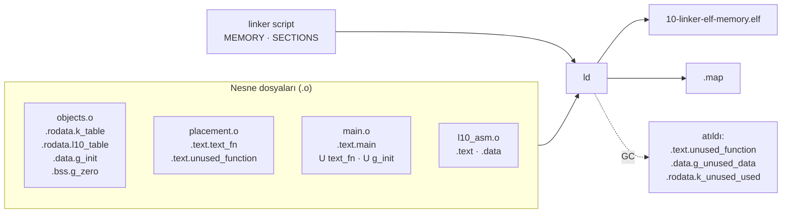

**Dil:** [English](README.md) | Türkçe

# Lesson 10 — Linker, ELF & Memory

`[STANDARD]` · Day 5 · Tahmini süre: 75–90 dk

> **Öğretim döngüsü:** TEACH → SHOW → RUN → OBSERVE → MODIFY → BREAK → DEBUG → VERIFY

---

## Why This Matters

*(TEACH)*

Ders 09 bir soruyla bitti: `bl helper_scale` komutunun hedef adresini kim
yazdı? Derleyici yazmadı — derlerken `helper_scale`'in nerede olacağını
bilmiyordu. Assembler da yazmadı.

Bu ders o soruyu ve devamını cevaplıyor:

> **Ayrı ayrı derlenmiş parçalar nasıl tek bir çalıştırılabilir imaja
> dönüşüyor, ve kod ile veri Cortex-M belleğine nasıl yerleşiyor?**

"Firmware FLASH'a sığmıyor", "bu değişken neden bu adreste", "`.data` nereden
kopyalanıyor", "undefined reference" — hepsinin cevabı aynı iki dosyada:
**linker script** ve **map dosyası**.

---

## Core Idea

*(TEACH)*

### Beş etiket

| Etiket | Anlamı | Örnek |
|---|---|---|
| **ELF / ABI** | ELF dosya biçimi ve Arm ELF ABI'si (AAELF32) | `R_ARM_THM_CALL` bir BL'yi tarif eder |
| **LINKER** | GNU ld davranışı | `*(.rodata*)` deseni eşleşen input section'ları toplar |
| **REPOSITORY DESIGN** | Bu repo'nun linker script'indeki seçimler | `.data > RAM AT > FLASH` |
| **ARCHITECTURE** | Armv8-M işlemci davranışı | reset'te `vector[0]` → MSP |
| **OBSERVATION** | bu toolchain'in bu build'de ürettiği | `.data` LMA = `0x100009A8` |

GNU ld'nin davranışı bir Arm mimari kuralı **değildir**.

### Üç katman: section, sembol, relocation

```text
SECTION      "hangi byte'lar, hangi turden?"      .text  .rodata  .data  .bss
SEMBOL       "bu adresin adi ne?"                 text_fn  g_init  __data_start
RELOCATION   "hangi byte'lar SONRA, nasil          R_ARM_THM_CALL -> text_fn
              yamanacak?"
```

### Boru hattı

```text
objects.c  ──gcc──► objects.o   section'lar: .rodata.k_table  .data.g_init  .bss.g_zero ...
placement.c ──gcc──► placement.o semboller:  text_fn (GLOBAL, tanimli)
main.c     ──gcc──► main.o      semboller:  text_fn (UNDEFINED)
                                relocation: "bu BL'yi text_fn'e yama"
l10_asm.S  ──as───► l10_asm.o   semboller:  asm_fn (GLOBAL), local_helper (LOCAL)
                         │
                 linker script + tum .o + libgcc
                         ▼
                   ld: 1. input section'lari cikis section'larina topla
                       2. erisilemeyen input section'lari at (--gc-sections)
                       3. adres ata (VMA ve LMA) - MEMORY bolgelerinin icinde
                       4. sembolleri coz
                       5. relocation'lari uygula
                         ▼
                   .elf  +  .map
                         ▼
          yukleyici (QEMU -kernel) yuklenebilir byte'lari bellege yazar
                         ▼
          Reset_Handler .data'yi LMA -> VMA kopyalar, .bss'i sifirlar (ders 11)
```

### Bir nesne, iki adres: VMA ve LMA

```text
FLASH 0x10000000 ┌──────────────┐
                 │ .vectors     │  VMA = LMA
                 │ .text        │  VMA = LMA
                 │ .rodata      │  VMA = LMA
                 │ .data kopyasi│  <- .data'nin LMA'si (ilk degerler burada)
                 └──────────────┘
RAM   0x30000000 ┌──────────────┐
                 │ .data        │  <- .data'nin VMA'si (kod ona BURADAN erisir)
                 │ .bss         │  yalnizca VMA; imajda byte YOK
                 │     ...      │
                 │ stack ↓      │  section degil; tepe = __stack_top
                 └──────────────┘
```

- **VMA** (virtual memory address): nesnenin **çalışma sırasında** bulunduğu,
  kodun ona eriştiği adres.
- **LMA** (load memory address): nesnenin ilk içeriğinin **imajda** durduğu
  adres.

`.text` ve `.rodata` için ikisi aynı. `.data` için farklı: ilk değer FLASH'ta
durur (FLASH güç kesilince unutmaz), ama değişken RAM'de yaşar (yazılabilir).
Aradaki köprü startup kodudur.

### İki eşitsizlik

- **ELF dosya boyutu ≠ FLASH kullanımı.** ELF dosyası sembol tablosu,
  section başlıkları ve yüklenmeyen `.debug_*` section'ları da taşır.
- **FLASH kullanımı ≠ `.text`.** FLASH; vektörleri, kodu, salt-okunur veriyi
  **ve `.data`'nın ilk değerlerini** tutar.

İkisi de aşağıda bu build'in gerçek sayılarıyla ölçülüyor.

---

## Mental Model

*(TEACH)*

**Linker bir yayın editörüdür.** Her yazar (derleme birimi) kendi
bölümlerini ayrı sayfalarda teslim eder, sayfa numarası bilmeden. "Şekil 3'e
bakınız" yazdığı yerlerde numara boş kalır — bunlar **relocation**'lar.
Editör:

1. sayfaları türüne göre bölümlere dizer (input section → output section),
2. kimsenin atıf yapmadığı sayfaları çıkarır (**garbage collection**),
3. sayfa numaralarını verir (**adres ataması**),
4. boş kalan "bakınız" numaralarını doldurur (**relocation uygulama**),
5. içindekiler dizinini basar (**map dosyası**).

Kitabın basılı hali (**LMA**) ile okuyucunun masasındaki hali (**VMA**)
farklı yerlerde olabilir — `.data` tam olarak böyle.

---

## Visual

*(SHOW)*



---

## Tiny Example

*(SHOW)*

Kaynaklar: [`example/`](example/). Nesneler **bilerek** ayrı derleme
birimlerinde, böylece `main.o` onlara adıyla bağlanmak zorunda.

| Dosya | İçerik | Beklenen yerleşim |
|---|---|---|
| [`objects.c`](example/objects.c) | `const uint32_t k_table[4]` | `.rodata` |
| | `k_custom[2]` — `__attribute__((section(".rodata.l10_table")))` | `.rodata` (özel input section) |
| | `uint32_t g_init = 0xC0DEFACE` | `.data` |
| | `uint32_t g_zero` | `.bss` |
| | `static uint32_t s_calls` (fonksiyon içinde) | `.bss`, LOCAL sembol |
| | `g_unused_data`, `k_unused_used` (`used`) | GC gözlemi |
| [`placement.c`](example/placement.c) | `text_fn()`, `unused_function()` | `.text` / GC |
| [`l10_asm.S`](example/l10_asm.S) | `asm_fn` (`.global`), `local_helper` (yerel), `asm_word` | `.text`, `.data` |
| [`main.c`](example/main.c) | Adresleri, linker sembollerini, kontrolleri basar | |

### Linker sembolleri C'den nasıl okunur?

Linker script'teki `__data_start = .;` bir **depolama ayırmaz**; yalnızca bir
**adres**e isim verir. Bu yüzden C'de bir değişken gibi bildirilir ama
değeri değil, **adresi** kullanılır:

```c
extern uint32_t __data_start;             /* depolama YOK          */
uint32_t start = (uint32_t)&__data_start; /* anlamli olan: ADRES   */
```

Startup kodu da (`platform/.../startup_mps2_an505.c`) aynı kalıbı kullanıyor.

---

## Build & Run

*(RUN)*

```bash
cmake --preset debug
cmake --build --preset debug --target 10-linker-elf-memory
./scripts/run-qemu.sh build/debug/lessons/10-linker-elf-memory/10-linker-elf-memory.elf
```

Her hedef için build dizininde dört yan ürün var: `.elf`, `.bin`, `.map`,
`.lst`. Bu derste en önemlisi `.map`.

| Hedef | Amaç |
|---|---|
| `10-linker-elf-memory` | Yerleşimi, sembolleri, VMA/LMA'yı gözle |
| `10-linker-broken` | **Link edilemez** — `ALL`'a dahil değil, elle derle |
| `10-exercise-linker` | "Locate Your Data" |
| `10-solution-linker` | Referans çözüm |

---

## Expected Output

*(RUN)*

Gerçek çıktı (arm-none-eabi-gcc 13.2.1, binutils 2.42, QEMU 8.2.2,
mps2-an505, `debug`):

```text
===== LESSON 10: LINKER, ELF & MEMORY =====
[1] Nesneler nereye yerlesti? (calisma zamani adresleri)
[  text_fn (fonksiyon isaretcisi)] 0x10000495
[  k_table] 0x10000984
[  k_custom (.rodata.l10_table)] 0x1000097C
[  g_init] 0x30000004
[  asm_word] 0x30000000
[  g_zero] 0x3000000C
[  s_calls (static yerel)] 0x30000008
[2] Linker sembolleri
[  __vectors_start] 0x10000000
[  __vectors_end] 0x10000040
[  __etext (=LOADADDR(.data))] 0x100009A8
[  __data_start] 0x30000000
[  __data_end] 0x30000008
[  __bss_start] 0x30000008
[  __bss_end] 0x30000010
[  __flash_load_end] 0x100009B0
[  __stack_top] 0x30008000
[3] .data: VMA (RAM) ve LMA (FLASH)
[  g_init VMA] 0x30000004
[  g_init LMA] 0x100009AC
[  deger @ LMA (FLASH)] 0xC0DEFACE
[  deger @ VMA (RAM)] 0xC0DEFACE
[4] Kontroller
[  CHECK_TEXT_IN_FLASH] PASS
[  CHECK_FN_PTR_THUMB_BIT] PASS
[  CHECK_RODATA_IN_FLASH_RO] PASS
[  CHECK_DATA_IN_DATA] PASS
[  CHECK_BSS_IN_BSS] PASS
[  CHECK_DATA_LMA_HOLDS_INIT] PASS
[  CHECK_DATA_COPIED] PASS
[  CHECK_BSS_ZERO] PASS
[  CHECK_STATIC_LOCAL] PASS
[  CHECK_FLASH_LOAD_END] PASS
[  CHECK_VECTOR0_IS_STACK_TOP] PASS
[  CHECK_CROSS_TU_CALL] PASS
[  CHECK_ASM_LINKED] PASS
===== END =====
```

On üç kontrolün hepsi `release` ve `minsize`'da da PASS. Adresler build'e
özeldir; ilişkiler değil.

Okuma notları:

- **`g_init` iki adreste:** RAM'de `0x30000004` (VMA), FLASH'ta `0x100009AC`
  (LMA). İkisinde de `0xC0DEFACE`. LMA şöyle hesaplandı:
  `__etext + (&g_init − &__data_start) = 0x100009A8 + 4`.
- **`.data` 8 byte:** `asm_word` (asm) + `g_init`. `g_unused_data` yok — GC
  onu attı.
- **`.bss` 8 byte:** `s_calls` + `g_zero`. `.bss`, `.data`'nın hemen ardından
  başlıyor (`__data_end = __bss_start`).
- **`__flash_load_end = 0x100009B0`** = `__etext` + 8: FLASH yük görüntüsü
  `.data`'nın kopyasıyla bitiyor.
- **`text_fn` işaretçisi tek sayı** (`0x10000495`). Aşağıda "Thumb biti"
  bölümünde.
- **`k_custom`, `k_table`'dan önce yerleşti** — kaynakta sonra tanımlı olsa da.
  Sıra, input section'ların nesne dosyasındaki sırasından geliyor
  (**OBSERVATION**); kaynaktaki tanım sırası bir garanti değil.

---

## Linker Script Walkthrough

*(OBSERVE)*

Paylaşılan script: [`platform/mps2-an505/linker/mps2-an505-secure.ld`](../../platform/mps2-an505/linker/mps2-an505-secure.ld).
Bu ders onu **değiştirmiyor**, inceliyor. Yalnızca script'te gerçekten olan
yapılar anlatılıyor.

| Yapı | Script'te | Ne yapıyor | Kanıt (bu build) |
|---|---|---|---|
| `MEMORY` | `FLASH (rx) 0x10000000, 512K` · `RAM (rwx) 0x30000000, 32K` | Bölgeleri tanımlar; taşma link hatası olur | Map: *Memory Configuration* |
| `ENTRY(Reset_Handler)` | var | ELF başlığındaki giriş noktası | `readelf -h`: `Entry point 0x100004a1`. İşlemci bunu **okumaz** — reset'te vektör tablosunu okur (ders 11) |
| `SECTIONS` | var | Input section'ları cikis section'larına eşler | — |
| `.` (location counter) | `__data_start = .;` vb. | O anki adres | Map'te `. = ALIGN (0x4)` satırları |
| `ALIGN` | `.vectors : ALIGN(512)`, `. = ALIGN(4)` | Adresi yuvarlar | `.vectors` 512'ye hizalı |
| Wildcard | `*(.text*)`, `*(.rodata*)`, `*(.data*)`, `*(.bss*)` | Eşleşen **input** section'ları toplar | `.rodata.l10_table` → `.rodata` |
| `KEEP` | `KEEP(*(.vectors))` | Input section'ı GC'ye karşı kök yapar | Aşağıda ölçüldü |
| `> REGION` | `.text ... > FLASH` | VMA'yı (ve LMA'yı) o bölgeye koyar | `.text` `0x10000040` |
| `AT > REGION` | `.data ... > RAM AT > FLASH` | VMA RAM, LMA **FLASH bölgesinde tahsis edilerek** | `.data` VMA `0x30000000`, LMA `0x100009A8` |
| `LOADADDR` | `__etext = LOADADDR(.data)` | Bir section'ın LMA'sı | `__etext = 0x100009A8` |
| `SIZEOF` | `__flash_load_end = LOADADDR(.data) + SIZEOF(.data)` | Section boyutu | `0x100009B0` |
| `NOLOAD` | `.bss (NOLOAD)`, `.heap (NOLOAD)` | Yüklenmez | `.bss` tipi `NOBITS` |
| `ASSERT` | iki tane | Link zamanı güvenlik ağı | Map'te iki `ASSERT` satırı |
| `/DISCARD/` | `*(.note.GNU-stack) *(.gnu_debuglink) *(.comment)` | Eşleşeni atar | ELF'te `.comment` yok |

**`AT(adres)` bu script'te yok** — yalnızca bir yorumda, neden
kullanılmadığı anlatılıyor. `AT(__etext)` LMA'yı *söyler* ama o byte'ları
FLASH bölgesinden *düşmez*; eski sürümde bu yüzden taşma sessiz kalıyordu.
`AT > FLASH` tahsisi gerçekten FLASH'ta yapar. Bu fark
`tests/build-probes.sh`'teki **I5** probe'unda kalıcı olarak test ediliyor.

**`__etext` adı yanıltıcı:** "`.text`'in sonu" gibi okunuyor, ama tanımı
`LOADADDR(.data)`. `.rodata` ve hizalama `.text`'ten sonra geldiği için bu
ikisi aynı adres değil. Adına değil tanımına bak.

---

## Observe in GDB

*(OBSERVE)*

```bash
cmake --build --preset debug --target debug-10-linker-elf-memory
```

```gdb
gdb-multiarch -q build/debug/lessons/10-linker-elf-memory/10-linker-elf-memory.elf
set architecture armv8-m.main
target remote :3333
```

### A — Reset_Handler'ın ilk komutu: `.data` henüz kopyalanmadı

GDB `-S` ile başlatılmış QEMU'ya bağlandığında işlemci `Reset_Handler`'ın ilk
komutunda duruyor.

```gdb
(gdb) x/1i $pc
(gdb) x/1wx &g_init
(gdb) x/2wx 0x100009a8
```

```text
=> 0x100004a0 <Reset_Handler>:  push {r3, lr}
0x30000004 <g_init>:   0x00000000       <- RAM: HENUZ bos
0x100009a8:            0x5a5a5a5a  0xc0deface   <- FLASH (LMA): ilk degerler burada
```

**Gözlem:** QEMU `-kernel`, `.data`'nın ilk içeriğini **yalnızca LMA'ya**
(FLASH) yazdı; RAM'deki kopya boş. Sıra `asm_word`, `g_init` — RAM'deki
sırayla aynı.

### B — Kopyalama döngüsünden sonra

```gdb
(gdb) break *0x100004c6        # Reset_Handler icindeki "bl SystemInit"
(gdb) continue
(gdb) x/2wx &__data_start
(gdb) x/2wx &__bss_start
```

```text
0x30000000 <asm_word>:  0x5a5a5a5a  0xc0deface   <- LMA -> VMA kopyalandi
0x30000008 <s_calls.0>: 0x00000000  0x00000000   <- .bss sifir
```

**Gözlem:** RAM'deki son durumu **startup kodu** üretti, yükleyici değil.
Kopyalama ve sıfırlamanın ayrıntıları ders 11'in konusu.

> **QEMU notu (OBSERVATION):** QEMU RAM'i başlangıçta sıfırla dolduruyor.
> Bu yüzden `.bss`'in sıfır olması burada, startup kodunun onu sıfırladığının
> **kanıtı değil**. Fiziksel donanımda RAM'in başlangıç içeriği
> tanımsızdır — ders 11 bunu ayrıca ele alacak.

### C — `main` içinde semboller

```gdb
(gdb) break main
(gdb) continue
(gdb) info symbol 0x10000494
(gdb) info symbol 0x30000004
(gdb) info address g_zero
(gdb) x/1i text_fn
```

```text
text_fn in section .text
g_init in section .data
Symbol "g_zero" is static storage at address 0x3000000c.
   0x10000494 <text_fn>:  add.w  r0, r0, r0, lsl #1
```

---

## Experiment

*(OBSERVE / MODIFY)*

Aşağıdaki çıktıların hepsi `debug` build'inden, **OBSERVATION**. Nesne
dosyaları: `build/debug/lessons/10-linker-elf-memory/CMakeFiles/10-linker-elf-memory.dir/example/`.

### Deney 1 — Link'ten ÖNCE: `.o` dosyasında çözülmemiş referanslar

```bash
arm-none-eabi-nm main.c.obj | grep -E " U | T "
```

```text
         U asm_fn
         U g_init
         U k_table
         U text_fn
         U __data_start
         U __etext
         ...
00000000 T main
```

`U` = **undefined**: `main.o` bu sembolleri kullanıyor ama tanımlamıyor.
Linker script sembolleri (`__data_start`, `__etext`) de burada `U` — onları
da linker sağlayacak.

```bash
arm-none-eabi-nm objects.c.obj
arm-none-eabi-nm l10_asm.S.obj
```

```text
00000000 D g_init          00000000 T asm_fn
00000000 D g_unused_data   00000000 D asm_word
00000000 B g_zero          0000000e t local_helper
00000000 R k_custom                 U text_fn
00000000 R k_table
00000000 R k_unused_used
00000000 b s_calls.0
```

Harfler: `T`/`t` kod, `R` salt-okunur veri, `D` başlatılmış veri, `B`/`b`
`.bss`, `U` tanımsız. **Büyük harf GLOBAL, küçük harf LOCAL.** `s_calls.0`
küçük `b`: fonksiyon içindeki `static`, derleyicinin ürettiği yerel bir sembol.
`local_helper` küçük `t`: `.global` olmadığı için yerel.

**`.o` içindeki değerler "adres" değil, çoğu zaman section içi ofsettir.**
Üç durumu ayır (**ELF**, relocatable nesne):

| Durum | Sembol değeri | Örnek (`readelf -s l10_asm.S.obj`) |
|---|---|---|
| **Tanımsız** (`U`) | Henüz tanımı yok; section indeksi `UND`, değer `0` | `text_fn: 00000000 NOTYPE GLOBAL UND` |
| **Tanımlı, relocatable nesnede** | Tanımlandığı section'ın **başına göre ofset** | `local_helper: 0000000f FUNC LOCAL Ndx 1 (.text)` |
| **Son ELF'te** | Section'ın yerleştiği adres + o ofset | `local_helper: 1000004f` |

`local_helper` bir **karşı örnek**: `.o`'da değeri `0` değil. `nm` onu `0e`,
`readelf -s` `0f` gösteriyor (bit 0 Thumb biti — Deney 4). `l10_asm.o`'nun
`.text` input section'ı ELF'te `0x10000040`'a yerleşti; `0x10000040 + 0x0e =
0x1000004e`.

Yukarıdaki listelerde çoğu değerin `0` görünmesi bir kural değil, bir yan
etki: `-ffunction-sections -fdata-sections` her fonksiyonu/nesneyi **kendi**
input section'ına koyduğu için, her biri kendi section'ının başında (ofset 0)
duruyor. `l10_asm.S` bir C dosyası değil; iki fonksiyonu **aynı** `.text`
section'ını paylaşıyor, bu yüzden ikincisi sıfır olmayan bir ofsette.

`-g3` ile derlendiği için `nm` ayrıca `wm4.*` adlı `n` sembolleri gösteriyor;
bunlar makro hata ayıklama bilgisi, göz ardı et.

### Deney 2 — Relocation'lar

```bash
arm-none-eabi-readelf -r main.c.obj     # yalnizca .rel.text* bolumlerine bak
arm-none-eabi-readelf -r l10_asm.S.obj
```

Kod section'larındaki (`.rel.text*`) relocation türleri — ölçülen:

| Nesne | Tür | Sayı | Örnek |
|---|---|---|---|
| `main.o` | `R_ARM_THM_CALL` | 84 | `bl text_fn`, `bl asm_fn`, `bl console_*` |
| `main.o` | `R_ARM_ABS32` | 58 | literal havuzundaki `&g_init`, `&text_fn`, `&__etext` |
| `l10_asm.o` | `R_ARM_THM_JUMP24` | **1** | `b.w text_fn` |

`l10_asm.o`'nun kod bölümünde **tek bir** relocation var. `bl local_helper`
için relocation **yok**: hedef aynı dosyada ve aynı section'da, assembler
mesafeyi kendisi biliyor.

> **Dikkat:** `readelf -r`'ın tam çıktısında `.rel.debug_*` bölümleri de
> var ve onlar da `R_ARM_ABS32` kullanıyor. Kod relocation'larını sayarken
> onları ayır.

AAELF32'de (Arm ELF ABI) bu üçü:

| Kod | Ad | Komut | Formül |
|---|---|---|---|
| 2 | `R_ARM_ABS32` | 32 bit veri kelimesi | `(S + A) \| T` |
| 10 | `R_ARM_THM_CALL` | Thumb `BL` | `((S + A) \| T) – P` |
| 30 | `R_ARM_THM_JUMP24` | Thumb `B.W` | `((S + A) \| T) – P` |

`S` sembolün adresi, `A` addend, `P` yamalanan yerin adresi, `T` hedef bir
Thumb fonksiyonuysa 1.

### Deney 3 — Bir `BL` nasıl çözülüyor?

Link'ten **önce** (`objdump -dr main.c.obj`):

```text
 2a4:  f7ff fffe   bl   0 <text_fn>
        2a4: R_ARM_THM_CALL  text_fn
```

Link'ten **sonra** (`objdump -d 10-linker-elf-memory.elf`):

```text
10000334:  f000 f8ae   bl   10000494 <text_fn>
```

Ne oldu?

- `.o`'da ofset alanı `f7ff fffe` — yani `-4`. Bu, REL biçiminde komutun
  içinde saklanan **addend** (`A = −4`); Thumb'da PC okunduğunda komutun
  4 byte ötesini gösterir.
- Linker: `P = 0x10000334`, hedef `0x10000494`. AAELF32 formülü
  `((S + A) | T) – P` sonucu `0x15D` verir; bit 0 Thumb durumu (`T`) ve `BL`
  onu ofset alanına yazmaz.
- Yazılan ofset `f000 f8ae` = `0x15C`. Kontrol: `0x10000334 + 4 + 0x15C =
  0x10000494`. ✓

`b.w text_fn` (`l10_asm.o`) aynı şekilde `R_ARM_THM_JUMP24` ile çözüldü:
`1000004a: b.w 10000494 <text_fn>`.

### Deney 4 — Thumb biti: dört farklı gösterim

`text_fn` aynı fonksiyon, ama araçlar onu farklı gösteriyor — hepsi doğru:

| Nerede | Değer | Neden |
|---|---|---|
| Komutun gerçek adresi (`objdump`, `nm`, GDB `x/i`) | `0x10000494` | Komutlar 2 byte'a hizalı; adres çift |
| ELF sembol değeri (`readelf -s`) | `0x10000495` | AAELF32: Thumb fonksiyon sembolünün değeri bit 0 = 1 taşır |
| C fonksiyon işaretçisi / literal havuz (`R_ARM_ABS32`) | `0x10000495` | `(S + A) \| T`: bir dallanma hedefi olarak Thumb durumunu taşır |
| Vektör tablosu `vector[1]` (`Reset_Handler`) | `0x100004a1` | Aynı kural; işlemci bit 0'ı "Thumb" olarak ister |

Yani "fonksiyonlar tek adreslerde durur" **yanlış** olur. Komut her zaman
çift adreste; tek olan, fonksiyonu **gösteren değer** — bit 0 durum bilgisi.
(`nm` ile `readelf -s` bu konuda farklı gösterir: `nm` `10000494`,
`readelf -s` `10000495`.)

### Deney 5 — Section'lar ve segment'ler

```bash
arm-none-eabi-readelf -S -W 10-linker-elf-memory.elf
arm-none-eabi-readelf -l -W 10-linker-elf-memory.elf
```

Section'lar (yüklenebilir olanlar):

```text
[Nr] Name      Type      Addr     Off    Size   Flg Al
[ 1] .vectors  PROGBITS  10000000 001000 000040  A  512
[ 2] .text     PROGBITS  10000040 001040 0005a4  AX   4
[ 3] .rodata   PROGBITS  100005e4 0015e4 0003c4  A    4
[ 4] .data     PROGBITS  30000000 002000 000008  WA   4
[ 5] .bss      NOBITS    30000008 002008 000008  WA   4
```

Program header'ları (segment'ler):

```text
Type  Offset   VirtAddr   PhysAddr   FileSiz MemSiz  Flg
LOAD  0x001000 0x10000000 0x10000000 0x009a8 0x009a8 R E   <- .vectors .text .rodata
LOAD  0x002000 0x30000000 0x100009a8 0x00008 0x00010 RW    <- .data .bss
```

**Section** linker'ın görüşü (bağlama görünümü); **segment** yükleyicinin
görüşü (yükleme görünümü). İkinci segment'e bak:

- `VirtAddr 0x30000000` = VMA (çalışma görünümü),
  `PhysAddr 0x100009a8` = LMA (yükleme görünümü).
- `FileSiz 8` — dosyada yalnızca `.data`'nın 8 byte'ı var.
- `MemSiz 16` — bellekte `.data` + `.bss` = 16 byte.

### Deney 6 — `.bss` ELF'te nasıl duruyor?

"`.bss` ELF'te yok" demek **yanlış** olur. Ölçülen:

- `.bss`'in bir **section başlığı** var: tipi `NOBITS`, adresi `0x30000008`,
  boyutu `8`, bayrakları `WA` (yazılabilir, bellekte yer kaplar).
- **Dosyada byte'ı yok**: `NOBITS`, "içerik yok" demek.
- Segment'te `MemSiz − FileSiz = 8` olarak görünüyor: yükleyiciye "bu kadar
  bellek var ama dosyada karşılığı yok" diyor.
- Çalışma zamanında RAM'de 8 byte kaplıyor.

Yani `.bss` ELF'te **tarif ediliyor**, ama **içeriği saklanmıyor**. FLASH'ta
da yer tutmuyor.

### Deney 7 — Dosya boyutu, FLASH, RAM: üç ayrı soru

```bash
arm-none-eabi-size 10-linker-elf-memory.elf
```

```text
   text    data     bss     dec     hex filename
   2472       8       8    2488     9b8 10-linker-elf-memory.elf
```

Berkeley `size`'ın sütunları **section adı değildir**:

| Sütun | Gerçekte ne topluyor (bu build) |
|---|---|
| `text` = 2472 | `.vectors` 64 + `.text` 1444 + `.rodata` 964 — salt-okunur **her şey** |
| `data` = 8 | `.data` |
| `bss` = 8 | `.bss` |

Link sırasında `--print-memory-usage` (repo zaten açık):

```text
Memory region    Used Size  Region Size  %age Used
       FLASH:       2480 B       512 KB      0.47%
         RAM:         16 B        32 KB      0.05%
```

Üç soru, üç cevap:

| Soru | Cevap | Nereden |
|---|---|---|
| ELF dosyası kaç byte? | **94 316** | `ls -l` — debug bilgisi, sembol tablosu dahil |
| FLASH'ta kaç byte? | **2480** | `text` 2472 + `.data` kopyası 8 = `__flash_load_end − 0x10000000` |
| RAM'de statik kaç byte? | **16** | `.data` 8 + `.bss` 8 — **stack dahil değil** |

`.data` **iki kez** sayılıyor: FLASH'ta ilk değer, RAM'de değişken. Stack
ise bir section değil, linker script'te bir muhasebe (`__stack_size = 4K`);
`--print-memory-usage` onu saymıyor.

Aynı kaynak, farklı preset'ler (**OBSERVATION**):

| Preset | ELF dosyası | `text` | `data` | `bss` |
|---|---|---|---|---|
| `debug` (`-Og -g3`) | 94 316 | 2472 | 8 | 8 |
| `release` (`-O2 -g`) | 31 764 | 2508 | 8 | 8 |
| `minsize` (`-Os -g`) | 27 964 | 2152 | 8 | 8 |

Dosya boyutunu en çok değiştiren şey hata ayıklama bilgisi (`-g3` makro
bilgisi dahil); FLASH'a giren kısım çok daha az değişiyor.

### Deney 8 — Garbage collection ve özel section

Repo `-ffunction-sections -fdata-sections` ile derliyor: her fonksiyon ve
nesne **kendi input section'ına** gidiyor. `--gc-sections` hiçbir kökten
erişilemeyen input section'ları atıyor.

Map dosyasının başındaki *Discarded input sections* listesi (ders nesneleri):

```text
 .rodata.k_unused_used
 .data.g_unused_data
 .text.unused_function
```

Özel section'ın yerleşimi (map, `.rodata` bölümü):

```text
.rodata         0x100005e4      0x3c4
 .rodata.l10_table
                0x1000097c                k_custom
 .rodata.k_table
                0x10000984                k_table
```

`.rodata.l10_table` linker script'te geçmiyor; mevcut `*(.rodata*)` deseni
onu yakaladı. **Input section adı** (`.rodata.l10_table`) ile **çıkış
section'ı** (`.rodata`) farklı şeyler.

### Deney 9 — `used` ≠ `KEEP`

`k_unused_used` `__attribute__((used))` ile işaretli — ve yine de atıldı
(yukarıdaki liste).

| | Kime söyler | Ne der |
|---|---|---|
| `__attribute__((used))` | **Derleyiciye** | "Bu tanımı, kullanılmıyor gibi görünse de nesne dosyasına yaz" |
| `KEEP(...)` | **Linker'a** | "Bu input section'ı GC'de kök say; atma" |

Bu toolchain'de (GCC 13.2.1 + binutils 2.42) `used`, linker GC'sini
**engellemedi**.

Aynı ayrım repo'nun en kritik tablosunda gerçekten ölçüldü. Vektör tablosu
C'de `__attribute__((section(".vectors"), used))` ile tanımlı; script'te
`KEEP(*(.vectors))`. Geçici bir kopyada (repo'ya eklenmedi) `KEEP`
kaldırılıp aynı örnek link edildi:

| Linker script | `.vectors` | Firmware |
|---|---|---|
| `KEEP(*(.vectors))` | 64 byte | Çalışıyor |
| `*(.vectors)` | **atıldı** (map: *Discarded*) | **Hiç başlamadı** (seri çıktı yok) |

Vektör tablosuna hiçbir kod **referans vermiyor** — onu işlemci reset'te
okuyor. Linker bunu bilemez; `KEEP` onu söyler. `used` tek başına yetmedi.

> GCC'nin bir de `retain` niteliği var (section'a `SHF_GNU_RETAIN` bayrağı);
> bu derste denenmedi.

### Deney 10 — Veneer

Linker, bir dallanma hedefe yetişemiyorsa araya küçük bir kod parçası
(**veneer**) ekleyebilir. AAELF32, linker'ın ürettiği veneer'ların `r12`
(IP) ve bayrakları bozabileceğini söyler — ders 09'da AAPCS'in r12'yi neden
caller-clobbered saydığının bir sebebi bu.

Bu build'de **veneer gözlenmedi**. Map'te bir `.vfp11_veneer` satırı var
ama boyutu **0** (`linker stubs`): bir yer tutucu, gerçek bir veneer değil.
Görüntünün tamamı 2.5 KB; Thumb-2 `BL`'nin menzili bunun çok ötesinde.
`grep veneer` ile "veneer var" sonucuna varma — boyutuna bak.

### Deney 11 — Değiştir ve gözle

*(MODIFY)* `objects.c`'de `g_unused_data`'yı `main.c`'den bir kez oku. Yeniden
derle. Önce **tahmin et**: map'te ne değişir? `.data` kaç byte olur?
`__flash_load_end` kaç byte kayar? Sonra ölç. Bitince geri al.

---

## Break It

*(BREAK)*

`10-linker-broken`, ana örnekle aynı — **tek fark**: `l10_asm_broken.S`'te
`.global asm_fn` satırı yok.

```bash
cmake --build --preset debug --target 10-linker-broken
```

Gerçek çıktı:

```text
.../example/main.c:95:(.text.main+0x2be): undefined reference to `asm_fn'
collect2: error: ld returned 1 exit status
```

Bu hedef `ALL`'a dahil değil (`EXCLUDE_FROM_ALL`); aksi halde her build
başarısız olurdu. Hatanın kendisi `tests/build-probes.sh`'te (**L10a**)
kalıcı olarak doğrulanıyor.

---

## Debug It

*(DEBUG)*

Sembol **var**. Linker onu göremiyor. Neden?

```bash
arm-none-eabi-gcc -mcpu=cortex-m33 -mthumb -c \
    lessons/10-linker-elf-memory/example/l10_asm_broken.S -o /tmp/b.o
arm-none-eabi-nm /tmp/b.o
```

```text
00000000 t asm_fn          <- KUCUK 't': LOCAL
00000000 D asm_word
0000000e t local_helper
         U text_fn
```

`asm_fn` nesne dosyasında tanımlı ama **LOCAL**. GAS'ta bir etiket, `.global`
(veya `.globl`) ile işaretlenmedikçe yereldir; yerel semboller yalnızca kendi
nesne dosyası içinden görülür. `main.o`'nun `U asm_fn` referansı başka bir
dosyadaki **GLOBAL** bir tanım arıyor — bulamıyor.

Sorular:

1. `asm_word` neden etkilenmedi?
2. Hata mesajı neden `main.c:95` diyor, `l10_asm_broken.S` değil?
3. Hata mesajındaki `.text.main+0x2be` neyi gösteriyor? (İpucu: Deney 2'deki
   relocation listesi.)
4. Aynı adı taşıyan iki **GLOBAL** tanım olsaydı hangi hatayı beklerdin?

---

## Exercise

*(VERIFY)*

### Exercise 01 — Locate Your Data

Dört fonksiyonu **yalnızca linker sembollerinden ve nesne adreslerinden**
hesapla:

```text
exercises/01-locate-your-data/locate.c
```

| Fonksiyon | Ne hesaplamalı |
|---|---|
| `flash_used_bytes()` | FLASH'taki yük görüntüsünün tamamı |
| `ram_static_bytes()` | RAM'de statik olarak kullanılan byte (stack hariç) |
| `data_lma_of(p)` | `.data` içindeki bir nesnenin ilk değerinin FLASH adresi |
| `in_region(p, origin, length)` | Adres bir bölgenin içinde mi |

```bash
cmake --build --preset debug --target 10-exercise-linker
./scripts/run-qemu.sh build/debug/lessons/10-linker-elf-memory/10-exercise-linker.elf
```

Başlangıç çıktısı (gerçek):

```text
[  FLASH_USED_BYTES] 0
[  RAM_STATIC_BYTES] 0
[  G_INIT_LMA] 0x00000000
[  CHECK_FLASH_USED] FAIL
[  CHECK_RAM_STATIC] FAIL
[  CHECK_LMA_HOLDS_INIT] FAIL
[  CHECK_REGIONS] FAIL
===== END =====
```

Bu **beklenen başlangıç durumudur**. Kontroller sabit adreslere dayanmıyor;
yanlış bir LMA fault değil FAIL üretir. Ayrıntılar
[exercise README](exercises/01-locate-your-data/README.tr.md)'sinde.

---

## Reference Solution

| Ne | Nerede | Hedef |
|---|---|---|
| Exercise 01 çözümü | [`solutions/01-locate-your-data/`](solutions/01-locate-your-data/README.tr.md) | `10-solution-linker` |

Gerçek çıktı (`debug`):

```text
[  FLASH_USED_BYTES] 1424
[  RAM_STATIC_BYTES] 8
[  G_INIT_LMA] 0x1000058C
[  CHECK_FLASH_USED] PASS
[  CHECK_RAM_STATIC] PASS
[  CHECK_LMA_HOLDS_INIT] PASS
[  CHECK_REGIONS] PASS
===== END =====
```

Sayılar ana örnekten farklı, çünkü bu farklı bir program (daha az kod,
`asm_word` yok) — tam da bu yüzden çözüm sabit sayı değil, sembol kullanıyor.

---

## What I Learned

> Bu bölüm senin.

**Section, sembol ve relocation'ı kendi cümlemle:**

<!-- -->

**VMA ile LMA'nın `.data` için neden farklı olduğu:**

<!-- -->

**`used` ile `KEEP` arasındaki fark:**

<!-- -->

**Map dosyasında ilk bakacağım yer:**

<!-- -->

**Ders 11'e taşıdığım soru:**

<!-- -->

---

## Quick Check

1. Bir `.o` dosyası ile bir `.elf` dosyası arasındaki temel fark nedir?
   `.o`'daki bir sembol değeri neyi ifade eder? Neden birçoğu `0` görünüyor
   ama `local_helper` `0x0e`?
2. Sembol ile relocation arasındaki fark ne? `main.o`'daki `U text_fn` ile
   `R_ARM_THM_CALL text_fn` ne söylüyor?
3. Section ile segment arasındaki fark ne? Kim hangisini kullanır?
4. **(Reasoning)** `.data`'nın VMA'sı ve LMA'sı neden farklı? İkisi aynı
   olsaydı ne olurdu?
5. `.data > RAM AT > FLASH` ile `.data : AT(__etext) > RAM` arasındaki fark ne?
   Hangisi FLASH taşmasını yakalar?
6. **(Reasoning)** "`.bss` ELF'te yok" cümlesi neden yanıltıcı? Ölçülen
   `FileSiz` ve `MemSiz` ne söylüyor?
7. Map dosyasında bir sembolün hangi nesne dosyasından geldiğini ve hangi
   çıkış section'ına girdiğini nasıl bulursun?
8. `KEEP` neden var? Vektör tablosu için neden gerekli?
9. **(Reasoning)** `__attribute__((used))` bir section'ı `--gc-sections`'tan
   korur mu? Bu derste ne ölçüldü?
10. `-ffunction-sections` olmadan `--gc-sections` ne kadar etkili olurdu?
11. Linker script'te `MEMORY` ve `SECTIONS` ne iş yapar?
12. **(Reasoning)** ELF dosyası 94 KB, FLASH kullanımı 2.5 KB. Aradaki fark
    nerede? FLASH kullanımı neden `.text` boyutundan büyük?
13. **(Reasoning)** "undefined reference to `asm_fn`" hatası verildi ama
    `asm_fn` nesne dosyasında tanımlı. Nasıl?

> Cevaplar: [`answers/quick-check.md`](answers/quick-check.tr.md)

---

## Takeaway

- Bir `.o` dosyası **section'lar, semboller ve relocation'lar** taşır;
  adresler henüz yoktur. Linker onları yerleştirir, sembolleri çözer,
  relocation'ları uygular.
- **Input section** (`.rodata.l10_table`) ile **çıkış section'ı** (`.rodata`)
  farklıdır; linker script'in wildcard'ları onları eşler.
- **Section** bağlama görünümü, **segment** yükleme görünümüdür.
- `.data`'nın **iki adresi** var: VMA (RAM, çalışma) ve LMA (FLASH, ilk
  değer). Bu repo `> RAM AT > FLASH` kullanıyor; köprü startup kodudur.
- `.bss` ELF'te **tarif edilir** (`NOBITS`, `MemSiz > FileSiz`) ama içeriği
  saklanmaz; FLASH'ta yer tutmaz.
- **ELF dosya boyutu, FLASH kullanımı ve RAM kullanımı üç ayrı sorudur.**
- `--gc-sections` erişilemeyen input section'ları atar; **`used` derleyiciye,
  `KEEP` linker'a söyler** — bu toolchain'de `used` GC'yi engellemedi.
- Bir Thumb fonksiyonunu **gösteren değer** tek, **komutun adresi** çifttir.
- "Undefined reference" çoğu zaman **sembolün var ama görünmez** olduğunu
  söyler — önce `nm` ile bağlamasına bak.

---

## Official References

- **AAELF32** — *ELF for the Arm Architecture*, Arm ABI deposu:
  relocation türleri tablosu (`R_ARM_ABS32` = 2, `R_ARM_THM_CALL` = 10,
  `R_ARM_THM_JUMP24` = 30), formül gösterimi (`S`, `A`, `P`, `T`), Thumb
  fonksiyon sembollerinde bit 0, linker'ın ürettiği veneer'lar ve `r12`.
  <https://github.com/ARM-software/abi-aa/blob/main/aaelf32/aaelf32.rst>
- **AAPCS32** — *Use of IP by the linker* (ders 09 bağlantısı).
  <https://github.com/ARM-software/abi-aa/blob/main/aapcs32/aapcs32.rst>
- **GNU ld manual** — *Linker Scripts*: MEMORY, SECTIONS, location counter,
  input section patterns, `KEEP`, output section region ve LMA (`> region`,
  `AT > region`, `AT(addr)`), `NOLOAD`, `LOADADDR`/`SIZEOF`/`ORIGIN`/`LENGTH`,
  `ASSERT`, `/DISCARD/`, `ENTRY`; komut satırı: `--gc-sections`, `-Map`,
  `--print-memory-usage`.
  <https://sourceware.org/binutils/docs/ld/>
- **GNU binutils manual** — `readelf`, `nm` (sembol harfleri), `objdump -h/-d/-r`,
  `size`.
  <https://sourceware.org/binutils/docs/binutils/>
- **GCC manual** — `-ffunction-sections`, `-fdata-sections`; `section`,
  `used`, `retain` nitelikleri.
- **System V ABI (gABI)** — ELF section'ları (`SHT_NOBITS`, `SHF_ALLOC`),
  program header'ları (`p_vaddr`, `p_paddr`, `p_filesz`, `p_memsz`).
- Repo: [`platform/mps2-an505/linker/mps2-an505-secure.ld`](../../platform/mps2-an505/linker/mps2-an505-secure.ld),
  [`platform/mps2-an505/src/startup_mps2_an505.c`](../../platform/mps2-an505/src/startup_mps2_an505.c).
- Ölçüm ortamı: `arm-none-eabi-gcc 13.2.1`, `binutils 2.42`, `QEMU 8.2.2`,
  `mps2-an505 / cortex-m33`.

---

## Known Boundaries

- Tüm adresler, boyutlar, relocation sayıları ve GC sonuçları **bu build'e
  ve bu toolchain'e ait gözlemlerdir**.
- QEMU'nun `.data`'yı LMA'ya yüklemesi ve RAM'i sıfırla başlatması bu
  emülatörde ölçüldü; fiziksel yükleyiciler (debug probe, bootloader) farklı
  davranabilir.
- Veneer bu derste gözlenmedi; kavram olarak anlatıldı.
- `retain` niteliği denenmedi.
- `KEEP` kaldırma deneyi geçici bir kopyada yapıldı; paylaşılan linker
  script'e dokunulmadı.
- Startup kodunun `.data` kopyalama ve `.bss` sıfırlama ayrıntıları ders 11'e
  bırakıldı.

---

**Previous:** [09 — Compiler, AAPCS & Calling Conventions](../09-compiler-aapcs/README.tr.md)
**Next:** [11 — Startup](../11-startup/README.tr.md)
