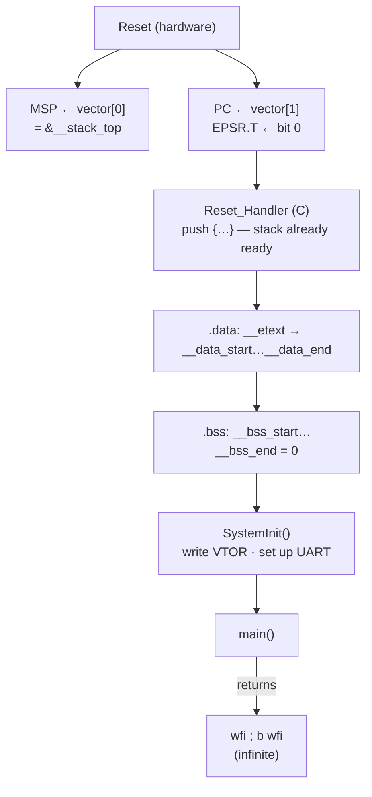

**Language:** English | [Türkçe](README.tr.md)

# Lesson 11 — Startup: Reset → main()

`[STANDARD]` · Day 5 · Estimated time: 75–90 min

> **Teaching cycle:** TEACH → SHOW → RUN → OBSERVE → MODIFY → BREAK → DEBUG → VERIFY

---

## Why This Matters

*(TEACH)*

Lesson 10 ended with a question: `.data`'s initial values are in FLASH,
variables in RAM — who bridges them? And if the CPU never reads
`ENTRY(Reset_Handler)`, where does it find its first instruction?

This lesson asks:

> **What actually happens between Cortex-M reset and reaching C code in `main()`?**

If a board fails to start, never reaches `main`, or a global variable
“sometimes” starts incorrectly, the bug is likely within these few dozen
instructions.

---

## Core Idea

*(TEACH)*

### Six labels

| Label | Meaning | Example |
|---|---|---|
| **ARCHITECTURE** | Armv8-M rule (DDI 0553) | Reset takes `EPSR.T` from reset vector bit 0 |
| **ABI** | AAPCS32 | SP mod 8 = 0 at a call boundary |
| **ELF / LINKER** | ELF format, GNU ld | `ENTRY` only sets ELF `e_entry` |
| **REPOSITORY DESIGN** | This repository's choice | `.data` → `.bss` → `SystemInit` → `main` |
| **TOOLCHAIN OBSERVATION** | What this GCC generated | `Reset_Handler` begins with `push {r3, lr}` |
| **QEMU OBSERVATION** | This emulator's behavior | RAM starts zeroed |

A QEMU observation **is not** an architectural rule.

### What hardware does, what software does

```text
HARDWARE (ARCHITECTURE)                      SOFTWARE (REPOSITORY DESIGN)
------------------------------------        ------------------------------------------
Reset into Secure state                        Reset_Handler (C):
Thread mode selected                           1) .data: __etext -> __data_start..__data_end
Secure main stack (MSP_S) selected             2) .bss : __bss_start..__bss_end = 0
MSP  <- vector[0]                             3) SystemInit()   (write VTOR, set up UART)
PC   <- reset vector (vector[1])             4) main()
EPSR.T <- vector[1] bit 0                     5) if main returns: wfi loop
LR   <- 0xFFFFFFFF  (Main Extension)
                     |
                     +--> first instruction: Reset_Handler
```

**Reset_Handler does not set up MSP.** Hardware has already loaded MSP from
`vector[0]` before the first instruction executes.

### Architecture: what Arm specifies

Source: *Armv8-M Architecture Reference Manual* (Arm DDI 0553A.g). This
lesson read the following rules directly from the source:

| Rule | Content (summary) |
|---|---|
| `RPLNS` | Cold and Warm reset load PC with the reset handler start address |
| `RKSCH` | Reset sets `EPSR.T` from reset vector bit[0] |
| `RSQLX` | Executing an instruction with `EPSR.T = 0` causes an INVSTATE UsageFault (Main Extension) |
| `RCMQP` | Reset selects Thread mode |
| `RHWFV` | A PE with the Security Extension resets into Secure state |
| `RMDXK` | Reset selects and initializes the Secure main stack (`MSP_S`) on a PE with the Security Extension |
| `RPLRT` | With the Main Extension, Warm reset sets LR to `0xFFFFFFFF` |
| `RXPWM` | MSP/PSP bit[1:0] are always RES0 — stack pointers are word-aligned |

Arm's Armv8-M user guide (Arm 107565) explicitly identifies `vector[0]`
as the initial MSP value: the first word of the vector table initializes MSP.

**Not verified, therefore retained as QEMU observations:** reset values of
`MSPLIM`/`PSPLIM`, APSR flags (the Z bit in measured `xPSR = 0x41000000`),
and the numeric value of `CONTROL`. This lesson **does not present** these
as architectural rules.

**VTOR's reset value** is implementation-dependent (externally supplied on
Cortex-M33). QEMU measured `0x10000000` on this target — **target configuration**.

---

## Mental Model

*(TEACH)*

**Reset is a relay-baton handoff.** Hardware hands over three things:
a stack (MSP), an address (PC), and a state (Thumb). Everything after that
is software's responsibility:

- C assumes globals **already hold their initial values** → someone must
  copy `.data`.
- C assumes zero-initialized `static`/global variables **are zero** →
  someone must zero `.bss`.
- Hardware **does neither**. Initial RAM contents after reset are undefined
  on physical hardware.

Startup bridges “the world hardware leaves behind” and “the world C assumes.”
The linker script specifies what must be established: startup and linker
script share **a contract**.

---

## Visual

*(SHOW)*



---

## Tiny Example

*(SHOW)*

Sources: [`example/`](example/).

| File | Purpose | Target |
|---|---|---|
| [`main_entry.S`](example/main_entry.S) | `main` shim: captures entry SP/LR | `11-startup` |
| [`main.c`](example/main.c) | `l11_main`: measures, checks, **returns** | `11-startup` |
| [`fixtures.c`](example/fixtures.c) | `g_l11_init = 0x11C0FFEE` (`.data`), `g_l11_zero` (`.bss`) | all |
| [`l11_vectors.c`](example/l11_vectors.c) | Lesson-local vector table, weak aliases, poisoning helper | custom startup |
| [`l11_reset.c`](example/l11_reset.c) | Configurable lesson-local `Reset_Handler` | `11-startup-broken`, probes |
| [`l11_main.c`](example/l11_main.c) | `main` for custom-startup targets | custom startup |

### Actual startup: `platform/mps2-an505/src/startup_mps2_an505.c`

`11-startup` uses this file **unchanged**. Its essence:

```c
void Reset_Handler(void)
{
    uint32_t *src = &__etext;                 /* 1) .data */
    uint32_t *dst = &__data_start;
    while (dst < &__data_end) { *dst++ = *src++; }

    dst = &__bss_start;                       /* 2) .bss */
    while (dst < &__bss_end) { *dst++ = 0U; }

    SystemInit();                             /* 3) */
    (void)main();                             /* 4) */
    for (;;) { __WFI(); }                     /* 5) main donerse */
}
```

Three **REPOSITORY DESIGN** choices to notice:

- `Reset_Handler` is a **C** function. C may use the stack — fine, because
  hardware already initialized MSP. It **cannot rely on** `.data`/`.bss`,
  which are not ready yet.
- Copying and zeroing use **words** (4 bytes). This depends on boundaries
  aligned to 4, guaranteed by `ALIGN(4)` in the linker script. Word copying
  is this repository's choice, not a universal CRT rule.
- Order: `.data` → `.bss` → `SystemInit` → `main`. Other startup code may
  call `SystemInit` first, for example to raise the clock speed beforehand.

### The `main` shim: capture before the prologue

By the first source line of a C `main`, the compiler has already changed SP.
Here, `main` is therefore a three-instruction assembly gateway:

```asm
main:
    mov     r0, sp          @ bl main anindaki SP (BL, SP'yi degistirmez)
    mov     r1, lr          @ Reset_Handler'a donus adresi (Thumb bitli)
    b.w     l11_main        @ kuyruk dallanmasi: LR ve SP'ye dokunulmaz
```

AAPCS-compliant: arguments in r0/r1, no callee-saved registers touched,
SP and LR unchanged. When `l11_main` returns, it returns directly to
`Reset_Handler` — exactly equivalent to “main returned.”

---

## Build & Run

*(RUN)*

```bash
cmake --preset debug
cmake --build --preset debug --target 11-startup
./scripts/run-qemu.sh build/debug/lessons/11-startup/11-startup.elf
```

| Target | Startup | Purpose |
|---|---|---|
| `11-startup` | **Shared, actual** | Observe the production startup path |
| `11-startup-broken` | Lesson-local | `.bss` not zeroed |
| `11-exercise-startup` | Lesson-local | Write the two loops yourself |
| `11-solution-startup` | Lesson-local | Reference |

---

## Expected Output

*(RUN)*

Actual output (arm-none-eabi-gcc 13.2.1, QEMU 8.2.2, mps2-an505, `debug`):

```text
===== LESSON 11: STARTUP (RESET -> main) =====
[1] Vektor tablosu ve ilk MSP
[  vector[0]] 0x30008000
[  &__stack_top] 0x30008000
[  vector[1]] 0x10000335
[  Reset_Handler komut adresi] 0x10000334
[  VTOR] 0x10000000
[  MSPLIM (repo programlamiyor)] 0x00000000
[2] C calisma ortami (.data / .bss)
[  g_l11_init] 0x11C0FFEE
[  g_l11_zero] 0x00000000
  NOT: .bss'in main'de sifir olmasi tek basina KANIT DEGIL -
       QEMU RAM'i sifirla baslatiyor. Kanit: README, GDB durak D.
[3] main'e devir (main_entry.S shim'i)
[  SP main girisinde] 0x30007FF8
[  LR main girisinde] 0x10000363
[  LR hedefindeki halfword] 0x0000BF30
[  CONTROL] 0x00000000
[  IPSR] 0x00000000
[  UART0 BAUDDIV] 173
[4] Kontroller
[  CHECK_VECTOR0_EQ_STACK_TOP] PASS
[  CHECK_VECTOR1_EQ_RESET_HANDLER] PASS
[  CHECK_VECTOR1_THUMB_BIT] PASS
[  CHECK_DATA_INIT] PASS
[  CHECK_BSS_ZERO] PASS
[  CHECK_MAIN_SP_ALIGNED] PASS
[  CHECK_MAIN_SP_BELOW_STACK_TOP] PASS
[  CHECK_MAIN_LR_IN_RESET_HANDLER] PASS
[  CHECK_SYSTEMINIT_UART] PASS
[  CHECK_VTOR_IS_VECTORS] PASS
[  CHECK_THREAD_MODE_PRIVILEGED] PASS
===== END =====
main donuyor -> Reset_Handler'in WFI dongusu
```

All eleven checks also PASS in `release` and `minsize`. Addresses are
build-specific.

Reading notes:

- **`vector[1] = 0x10000335`, `Reset_Handler` instruction address `0x10000334`.**
  The stored table value also carries Thumb state (bit 0 = 1). The instruction
  itself is at an even address. The same distinction as Lesson 10:
  **stored entry value** ≠ **aligned instruction address**.
- **`LR hedefindeki halfword = 0xBF30`** (halfword at the LR target) — the encoding of `WFI`. When `main`
  returns, execution reaches the infinite `wfi` loop in `Reset_Handler`.
- **`CHECK_BSS_ZERO PASS` is not proof.** Stop D in *Observe in GDB* and the
  *Experiment* section below provide actual proof.

---

## Vector Table and Initial MSP

*(OBSERVE)*

This repository's table (**REPOSITORY DESIGN**): 16 entries, 64 bytes,
in `.vectors`, with `ALIGN(512)` + `KEEP(*(.vectors))` in the linker script.
IRQ entries (16+) are not defined. Other Cortex-M systems use much longer tables.

All 16 entries as read from the `11-startup` (`debug`) ELF:

| Entry | Meaning | Value (`debug`) | Type |
|---|---|---|---|
| 0 | Initial MSP | `0x30008000` | **Address value**, not a handler |
| 1 | Reset | `0x10000335` | `Reset_Handler` + Thumb bit — **strong**, not an alias |
| 2 | NMI | `0x10000331` | weak alias → `Default_Handler` |
| 3 | HardFault | `0x10000331` | weak alias → `Default_Handler` |
| 4 | MemManage | `0x10000331` | weak alias → `Default_Handler` |
| 5 | BusFault | `0x10000331` | weak alias → `Default_Handler` |
| 6 | UsageFault | `0x10000331` | weak alias → `Default_Handler` |
| 7 | SecureFault | `0x10000331` | weak alias → `Default_Handler` |
| 8 | *reserved* | `0x00000000` | **Constant zero**, no symbol |
| 9 | *reserved* | `0x00000000` | **Constant zero**, no symbol |
| 10 | *reserved* | `0x00000000` | **Constant zero**, no symbol |
| 11 | SVCall | `0x10000331` | weak alias → `Default_Handler` |
| 12 | DebugMonitor | `0x10000331` | weak alias → `Default_Handler` |
| 13 | *reserved* | `0x00000000` | **Constant zero**, no symbol |
| 14 | PendSV | `0x10000331` | weak alias → `Default_Handler` |
| 15 | SysTick | `0x1000005f` | **Strong override in this target** (`main.c`) |

Four distinct types — do not confuse them:

- **`vector[0]`** is a stack-pointer **value**, not a function.
- **`vector[1]`**, `Reset_Handler`: startup itself, **not** part of the
  weak-alias group.
- **Handler entries** (2–7, 11, 12, 14, 15): each has a **symbol** defined
  in startup with `__attribute__((weak, alias("Default_Handler")))`.
  Without an override, they carry `Default_Handler`'s address; if a strong
  definition with the same name exists, the linker chooses it. `11-startup`
  deliberately overrides `SysTick_Handler`.
- **Reserved entries** (8, 9, 10, 13): **constant `0`** written into the table.
  There is no underlying symbol to override. They **are not** weak aliases.

The same structure was measured in `release`, `minsize`, and the lesson-local
`l11_vectors.c` table (different addresses; reserved entries always zero).
Exception **behavior** belongs to Lesson 07.

**Initial MSP — three measurements, one value:**

```text
&__stack_top (linker)                       0x30008000
vector[0]                                   0x30008000
MSP at Reset_Handler's first instruction         0x30008000
```

`__stack_top = ORIGIN(RAM) + LENGTH(RAM)` — **one past** RAM. The stack is
**full-descending**: `push` decrements SP before writing. The first `push`
therefore writes RAM's last word (`0x30007FFC`), never `0x30008000`.

### MSPLIM ≠ `__stack_limit`

| | Meaning | In this repository |
|---|---|---|
| `__stack_limit` | Linker symbol: `__stack_top − 4K` = `0x30007000` | Used only in a link-time `ASSERT` |
| `MSPLIM` | Hardware register: SP below it causes STKOF UsageFault | **Not programmed**. Measured: `0x00000000` (**QEMU OBSERVATION**) |

A number in the linker does not protect hardware. Lesson 04 explicitly
programs **`PSPLIM`** for its PSP task stack to demonstrate a stack limit;
that is **not** evidence that `MSPLIM` was programmed. The shared startup
in this repository does not program `MSPLIM`.

---

## Startup ↔ Linker Contract

*(OBSERVE)*

Startup **does not know addresses**; it obtains everything from linker-script
symbols. Both sides must speak the same language:

| Startup expects | Linker script provides | If they disagree |
|---|---|---|
| `__etext` = `.data` initial values | `__etext = LOADADDR(.data)` | Wrong bytes copied |
| `__data_start` / `__data_end`, aligned to 4 | `ALIGN(4)` + assignments within `.data` | Word loop skips final bytes or overruns |
| `__bss_start` / `__bss_end`, aligned to 4 | `ALIGN(4)` + assignments within `.bss` | `.bss` only partly zeroed |
| Identical LMA and VMA layout for `.data` | One `.data > RAM AT > FLASH` | Linear copy maps incorrectly |
| `vector[0]` = `&__stack_top` | `__stack_top = ORIGIN(RAM) + LENGTH(RAM)` | Invalid MSP → first `push` faults |
| Table at `0x10000000`, survives GC | `.vectors` first, `ALIGN(512)`, `KEEP` | Table discarded or misplaced (measured in Lesson 10) |
| Stack does not overlap `.data`/`.bss` | `ASSERT(__stack_limit >= __heap_end)` | **Link** error, not runtime protection |

And one **misconception**:

| | Meaning | Used by CPU? |
|---|---|---|
| `ENTRY(Reset_Handler)` | `e_entry` in the ELF header (**ELF / LINKER**) | **No**, for debugger/loader |
| `vector[1]` | Reset vector (**ARCHITECTURE**) | **Yes**, supplies PC at reset |

Symbols measured in this build:

```text
__etext       0x100008c8   (= LOADADDR(.data))
__data_start  0x30000000   __data_end  0x30000004   (.data = 4 bytes: g_l11_init)
__bss_start   0x30000004   __bss_end   0x30000008   (.bss  = 4 bytes: g_l11_zero)
__stack_top   0x30008000   __stack_limit 0x30007000
```

---

## Observe in GDB

*(OBSERVE)*

```bash
cmake --build --preset debug --target debug-11-startup      # QEMU, GDB bekliyor
```

```gdb
gdb-multiarch -q build/debug/lessons/11-startup/11-startup.elf
set architecture armv8-m.main
target remote :3333
disassemble Reset_Handler        # adresleri KENDI build'inden al
```

The addresses below are **measured example output from this build**.
For exact stops, use `b *adres`: a symbolic breakpoint such as `b main`
may land **after** the compiler prologue.

### A — First instruction of Reset_Handler

With QEMU started using `-S`, the processor stops at the first instruction
after reset.

```gdb
(gdb) x/1i $pc
(gdb) printf "PC=%#x MSP=%#x LR=%#x xPSR=%#x CONTROL=%#x MSPLIM=%#x PSPLIM=%#x\n", $pc, $msp, $lr, $xpsr, $control, $msplim, $psplim
(gdb) x/2wx 0x10000000
(gdb) p &__stack_top
```

```text
=> 0x10000334 <Reset_Handler>:  push {r3, lr}
PC=0x10000334 MSP=0x30008000 LR=0xffffffff xPSR=0x41000000 CONTROL=0 MSPLIM=0 PSPLIM=0
0x10000000:  0x30008000  0x10000335
&__stack_top = 0x30008000
```

| Observation | Label |
|---|---|
| `MSP == vector[0] == &__stack_top` | ARCHITECTURE (value supplied by linker) |
| `PC == vector[1] & ~1`, `xPSR` bit 24 (T) = 1 | ARCHITECTURE (`RPLNS`, `RKSCH`) |
| `LR = 0xFFFFFFFF` | ARCHITECTURE (`RPLRT`, Main Extension), also observed in QEMU |
| `CONTROL = 0` → privileged, MSP | QEMU OBSERVATION (Thread mode and MSP_S selection are architectural: `RCMQP`, `RMDXK`) |
| Z flag in `xPSR`, `MSPLIM = PSPLIM = 0` | QEMU OBSERVATION |

The first instruction is a `push`: `Reset_Handler` uses the stack
**immediately** (**TOOLCHAIN OBSERVATION**). This is safe because hardware
initialized MSP.

### B — First `.data` copy iteration

```gdb
(gdb) break *0x1000033c          # dongunun ilk ldr.w komutu
(gdb) continue
(gdb) printf "src=%#x dst=%#x [src]=%#x [dst]=%#x\n", $r2, $r3, *(unsigned*)$r2, *(unsigned*)$r3
(gdb) stepi 2
(gdb) p/x g_l11_init
```

```text
src=0x100008c8 dst=0x30000000 [src]=0x11c0ffee [dst]=0
$1 = 0x11c0ffee          <- first word copied; src/dst advanced by 4
```

Source: `__etext` (LMA, FLASH). Destination: `__data_start` (VMA, RAM).

### C — `.data` complete

```gdb
(gdb) break *0x1000034a          # .bss dongusunun basi
(gdb) continue
(gdb) p/x g_l11_init
```

```text
$2 = 0x11c0ffee
```

### D — `.bss` zeroing: actual proof

`g_l11_zero` being zero in `main` **is not proof**: QEMU already starts RAM
at zero. To prove the loop works, inject a nonzero value and catch the
instruction that clears it:

```gdb
(gdb) set var g_l11_zero = 0xCAFEBABE
(gdb) watch g_l11_zero
(gdb) continue
(gdb) x/1i $pc-4
```

```text
Hardware watchpoint 3: g_l11_zero
Old value = 3405691582          <- 0xCAFEBABE
New value = 0
   0x10000350 <Reset_Handler+28>:  str.w  r2, [r3], #4
```

The instruction writing zero is identified: `str.w` in the shared
`Reset_Handler`'s `.bss` loop. This particular watchpoint observation is
local GDB evidence. Current CI **does run GDB**, but it is not claimed to
execute this exact Lesson 11 watchpoint scenario; see *Experiment* for the
other persistent CI evidence.

### E — SystemInit

```gdb
(gdb) break *0x1000035a          # bl SystemInit
(gdb) continue
(gdb) printf "VTOR=%#x BAUDDIV=%u\n", *(unsigned*)0xE000ED08, *(unsigned*)0x50200010
(gdb) break *0x1000035e          # SystemInit'ten sonra
(gdb) continue
(gdb) printf "VTOR=%#x BAUDDIV=%u\n", *(unsigned*)0xE000ED08, *(unsigned*)0x50200010
```

```text
VTOR=0x10000000 BAUDDIV=0       <- before
VTOR=0x10000000 BAUDDIV=173     <- after
```

`SystemInit` **writes** `0x10000000` to VTOR, but that was already its value.
There is no visible change; this **explicitly establishes the address**.
UART provides the observable effect: `BAUDDIV` goes from `0` → `173`.
`SystemInit` is the only caller of `board_uart_init`.

### F — First instruction of `main`

```gdb
(gdb) break *0x10000040          # main (shim) - prolog yok
(gdb) continue
(gdb) printf "SP=%#x SPmod8=%u LR=%#x IPSR=%u CONTROL=%#x\n", (unsigned)$sp, (unsigned)$sp & 7, (unsigned)$lr, $xpsr & 0x1ff, $control
(gdb) x/1i ($lr & ~1)
```

```text
SP=0x30007ff8 SPmod8=0 LR=0x10000363 IPSR=0 CONTROL=0
   0x10000362 <Reset_Handler+46>:  wfi
```

| Observation | Label |
|---|---|
| `main()` called without arguments; no `argc`/`argv` | REPOSITORY DESIGN (not hosted C) |
| SP mod 8 = 0 | ABI (AAPCS32, public interface) |
| `SP = __stack_top − 8` | TOOLCHAIN OBSERVATION (`Reset_Handler`'s `push {r3, lr}`), not a rule |
| Thread mode (`IPSR = 0`), privileged, MSP (`CONTROL = 0`) | ARCHITECTURE (Thread) + repository changes none of these |
| LR → `wfi` in `Reset_Handler` | REPOSITORY DESIGN |

### G — After `main` returns

```gdb
(gdb) break *0x10000362
(gdb) continue
(gdb) x/2i $pc
```

```text
=> 0x10000362 <Reset_Handler+46>:  wfi
   0x10000364 <Reset_Handler+48>:  b.n  0x10000362 <Reset_Handler+46>
```

There is no `exit()`, operating system, or place to return to: when `main`
returns, `Reset_Handler` enters an infinite `wfi` loop. This is **REPOSITORY
DESIGN**; another startup could choose reset, trap, or error reporting.

---

## Experiment

*(OBSERVE / MODIFY)*

### Experiment 1 — QEMU can hide a startup bug

A startup missing `.bss` zeroing may **appear to work** in QEMU because
RAM is already zero. Lesson-local startup therefore first fills the
`.data`/`.bss` range with `0xA5A5A5A5`:

> **EDUCATIONAL TEST INSTRUMENT.** `l11_poison_ram()` is **not production
> startup policy** and is absent from shared `startup_mps2_an505.c`.
> It only deterministically imitates “undefined RAM” on physical hardware.

`tests/build-probes.sh` (L11b) measures four cases in every build:

| Case | Startup | `CHECK_DATA_INIT` | `CHECK_BSS_ZERO` |
|---|---|---|---|
| A | complete + poison | PASS | PASS |
| B | no `.bss` + poison | PASS | **FAIL** (`0xA5A5A5A5`) |
| C | no `.bss` + **no poison** | PASS | **PASS ← bug hidden** |
| D | no `.data` + poison | **FAIL** | PASS |

Row C is a **QEMU OBSERVATION**, not architecture: on hardware that does
not zero RAM, the same broken startup would leave a random value in `g_l11_zero`.

### Experiment 2 — Weak alias, strong override

```bash
arm-none-eabi-nm build/debug/lessons/11-startup/11-startup.elf | \
    grep -E " (Default_Handler|NMI_Handler|SysTick_Handler|SystemInit)$"
```

| Symbol | `nm` | What happened |
|---|---|---|
| `NMI_Handler` | `W`, **same address** as `Default_Handler` | Weak alias; no override |
| `SysTick_Handler` | `T`, **different address**, in `vector[15]` | Strong definition in `main.c` replaced the weak alias |
| `SystemInit` | `T` | Strong definition in `system_init.c` selected |

Map file, under *Discarded input sections*: `.text.SystemInit …
startup_mps2_an505.c.obj` — startup's **weak**, empty `SystemInit` was discarded.
The strong `SVC_Handler` and fault handlers in Lessons 05–08 entered the
table through the same mechanism. (Exception behavior belongs to Lesson 07.)

### Experiment 3 — Modify

*(MODIFY)* Add `uint32_t g_l11_second = 0x22222222u;` to `example/fixtures.c`
and read it once in `main.c`. **Predict first:** how do `__data_end`,
`__bss_start`, and `__etext` change? How many iterations does the `.data`
loop perform? Then measure at GDB stop B. Revert afterward.

---

## Break It

*(BREAK)*

```bash
cmake --build --preset debug --target 11-startup-broken
./scripts/run-qemu.sh build/debug/lessons/11-startup/11-startup-broken.elf
```

`11-startup-broken` compiles lesson-local `l11_reset.c` with
`L11_BROKEN_SKIP_BSS`: **only the `.bss` zeroing loop is missing**.

Actual output (same verdict in three presets):

```text
===== LESSON 11: STARTUP (BROKEN: .bss sifirlanmiyor) =====
[  g_l11_init] 0x11C0FFEE
[  g_l11_zero] 0xA5A5A5A5
[  g_l11_phase] 0x00000123
[  vector[0]] 0x30008000
[  CHECK_DATA_INIT] PASS
[  CHECK_BSS_ZERO] FAIL
[  CHECK_PHASE_ORDER] PASS
[  CHECK_VECTOR0_EQ_STACK_TOP] PASS
===== END =====
```

Deterministic: no crash, timeout, or randomness.

---

## Debug It

*(DEBUG)*

1. `g_l11_zero = 0xA5A5A5A5`. Where did this value come from? Why is it
   neither `0` nor random?
2. Temporarily remove `l11_poison_ram()` from `l11_reset.c`
   (`-DL11_NO_POISON` does the same). What happens to `CHECK_BSS_ZERO`?
   Does that show the broken startup is **correct**?
3. Why is `.bss` wrong when `.data` is correct? Are the loops independent?
4. `CHECK_PHASE_ORDER PASS`. Why was the phase record unaffected by poison,
   even though it is in `.bss`? (Hint: **when** is `g_l11_phase` written?)
5. What symptoms would the same broken startup produce on a physical board?
   Why might it “sometimes” work?

---

## Exercise

*(VERIFY)*

### Exercise 01 — Complete the Reset Sequence

[`exercises/01-reset-sequence/l11_reset.c`](exercises/01-reset-sequence/l11_reset.c):
the vector table, poisoning, and calls to `SystemInit` and `main` are ready.
Two steps are missing: `.data` copying and `.bss` zeroing.

```bash
cmake --build --preset debug --target 11-exercise-startup
./scripts/run-qemu.sh build/debug/lessons/11-startup/11-exercise-startup.elf
```

Initial output (actual; console works with both loops missing):

```text
===== LESSON 11 EXERCISE 01 =====
[  g_l11_init] 0xA5A5A5A5
[  g_l11_zero] 0xA5A5A5A5
[  g_l11_phase] 0x00000123
[  vector[0]] 0x30008000
[  CHECK_DATA_INIT] FAIL
[  CHECK_BSS_ZERO] FAIL
[  CHECK_PHASE_ORDER] PASS
[  CHECK_VECTOR0_EQ_STACK_TOP] PASS
===== END =====
```

Details: [exercise README](exercises/01-reset-sequence/README.md).

---

## Reference Solution

| What | Where | Target |
|---|---|---|
| Exercise 01 solution | [`solutions/01-reset-sequence/`](solutions/01-reset-sequence/) | `11-solution-startup` |

```text
===== LESSON 11 SOLUTION 01 =====
[  g_l11_init] 0x11C0FFEE
[  g_l11_zero] 0x00000000
[  g_l11_phase] 0x00000123
[  vector[0]] 0x30008000
[  CHECK_DATA_INIT] PASS
[  CHECK_BSS_ZERO] PASS
[  CHECK_PHASE_ORDER] PASS
[  CHECK_VECTOR0_EQ_STACK_TOP] PASS
===== END =====
```

---

## Custom Startup Targets (Deep Dive)

`add_firmware()` links shared `platform-mps2-an505` to every target; that
library adds `startup_mps2_an505.c` as **source**. Its `Reset_Handler` and
`__vector_table` are not weak: a target supplying its own `Reset_Handler`
would receive “multiple definition.”

Therefore, [`CMakeLists.txt`](CMakeLists.txt) contains a lesson-local helper,
`l11_add_custom_startup_firmware()`. It reproduces the platform library's
**non-startup** components (`system_init.c`, UART, console, `tiny_libc`,
include directories, CMSIS, `-T` linker script, `libgcc`) and
`add_firmware` artifacts (`.bin/.map/.lst/size`, `run-`/`debug-` targets).
Shared CMake remains untouched.

Verified: compile flags are **identical** to `11-startup`; link flags and
libraries form the same set (only `-T` and `-Map` order differs).
`tests/build-probes.sh` checks that the three custom targets **do not link**
the shared startup object and that their sole `.vectors` input section
comes from `l11_vectors.c`.

---

## What I Learned

> This section is yours.

**The boundary between hardware reset work and startup-code work:**

<!-- -->

**Why zero `.bss` in main is not proof:**

<!-- -->

**One item in the startup/linker-script contract:**

<!-- -->

**The question I am taking into Lesson 12:**

<!-- -->

---

## Quick Check

1. What are `vector[0]` and `vector[1]` used for at reset? Which is a function
   and which is not?
2. **(Reasoning)** `Reset_Handler` begins with `push`. If nobody set up MSP,
   why is this safe?
3. `vector[1] = 0x10000335`, but `Reset_Handler`'s instruction address is
   `0x10000334`. What is the difference? What if bit 0 were 0?
4. **(Reasoning)** Would deleting `ENTRY(Reset_Handler)` from the linker
   script change reset behavior?
5. Why must `.data` be copied and `.bss` zeroed? Does hardware do this?
6. **(Reasoning)** `g_l11_zero` is zero in `main`. Does that prove startup
   zeroed it? How would you prove it?
7. Why can this repository's startup copy word by word? Which linker-script
   lines permit this?
8. What exactly does `SystemInit` do here? Does it change VTOR?
9. **(Reasoning)** At `main` entry, SP mod 8 = 0 and `SP = __stack_top − 8`
   were measured. Which is a rule, which an observation?
10. What happens if `main` returns in this repository?
11. Why do `NMI_Handler` and `Default_Handler` share an address? Why does
    `SysTick_Handler` differ in this target?
12. **(Reasoning)** Reset measurements found `LR = 0xFFFFFFFF` and
    `MSPLIM = 0`. Which is architectural, which only a QEMU observation?
    How do you know?

> Answers: [`answers/quick-check.md`](answers/quick-check.md)

---

## Takeaway

- **Hardware supplies three things:** MSP from `vector[0]`, PC and `EPSR.T`
  from `vector[1]`. The reset handler does not set up MSP.
- **Stored table value ≠ instruction address:** `vector[1]` carries Thumb state.
- **Startup satisfies C's assumptions:** copies `.data`, zeros `.bss`.
  Hardware does neither.
- **Startup and linker script share a contract:** `__etext`, `__data_*`,
  `__bss_*`, `__stack_top`, alignment.
- **`ENTRY` is for ELF; reset uses `vector[1]`.**
- **“Zero in main” is not proof** — QEMU zeroes RAM initially and can hide
  a broken startup.
- This repository's sequence (`.data` → `.bss` → `SystemInit` → `main` → `wfi`)
  is **design**, not architecture.
- `__stack_limit` is a linker symbol; `MSPLIM` a hardware register —
  this repository does not program it.

---

## Official References

- **Armv8-M Architecture Reference Manual** (Arm DDI 0553A.g) — B1.1 *Resets*;
  B3.1 *PE modes* (`RCMQP`); B3.3 *Registers* (`RPLRT`, `RPLNS`); B3.5.2 *EPSR*
  (`RKSCH`, `RSQLX`); B3.6 *Security states* (`RHWFV`); B3.8 *Stack pointer*
  (`RMDXK`, `RXPWM`); B3.28 *Vector tables*.
- **Armv8-M Memory Model and Memory Protection User Guide** (Arm 107565) —
  first vector-table word = initial MSP value.
- **AAPCS32** — *Stack constraints at a public interface*.
- **GNU ld manual** — `ENTRY`, `KEEP`, `LOADADDR`, `ALIGN`, `ASSERT`.
- Repository: [`platform/mps2-an505/src/startup_mps2_an505.c`](../../platform/mps2-an505/src/startup_mps2_an505.c),
  [`platform/mps2-an505/src/system_init.c`](../../platform/mps2-an505/src/system_init.c),
  [`platform/mps2-an505/linker/mps2-an505-secure.ld`](../../platform/mps2-an505/linker/mps2-an505-secure.ld).
- Measurement environment: `arm-none-eabi-gcc 13.2.1`, `QEMU 8.2.2`, `mps2-an505 / cortex-m33`.

---

## Known Boundaries

- All addresses are build-specific; GDB command addresses are measured examples.
- Reset values of `MSPLIM`/`PSPLIM`, APSR flags, and `CONTROL` were measured
  only in QEMU, not verified against the architecture source.
- QEMU initially zeroing RAM is an emulator property.
- Poisoning (`l11_poison_ram`) is an educational instrument, not production policy.
- The vector table has 16 entries; IRQs and NVIC belong to Lesson 14.

---

**Previous:** [10 — Linker, ELF & Memory](../10-linker-elf-memory/)
**Next:** [12 — Debug & DWT](../12-debug-dwt/)
