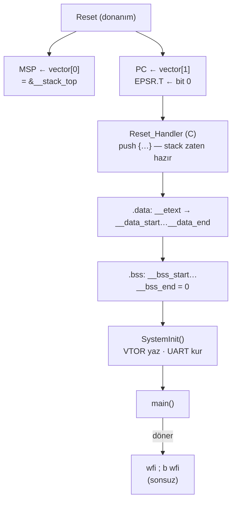

**Dil:** [English](README.md) | Türkçe

# Lesson 11 — Startup: Reset → main()

`[STANDARD]` · Day 5 · Tahmini süre: 75–90 dk

> **Öğretim döngüsü:** TEACH → SHOW → RUN → OBSERVE → MODIFY → BREAK → DEBUG → VERIFY

---

## Why This Matters

*(TEACH)*

Ders 10 bir soruyla bitti: `.data`'nın ilk değerleri FLASH'ta, değişkenler
RAM'de — aradaki köprüyü kim kuruyor? Ve CPU, `ENTRY(Reset_Handler)`'ı hiç
okumuyorsa, ilk komutu nereden buluyor?

Bu dersin sorusu:

> **Cortex-M reset'ten C kodu `main()`'e ulaşana kadar gerçekte ne oluyor?**

Board açılmıyorsa, `main`'e hiç gelinmiyorsa, bir global değişken "bazen"
yanlış başlıyorsa — hata büyük ihtimalle bu birkaç düzine komutun içindedir.

---

## Core Idea

*(TEACH)*

### Altı etiket

| Etiket | Anlamı | Örnek |
|---|---|---|
| **ARCHITECTURE** | Armv8-M kuralı (DDI 0553) | Reset `EPSR.T`'yi reset vektörünün bit 0'ından alır |
| **ABI** | AAPCS32 | Çağrı sınırında SP mod 8 = 0 |
| **ELF / LINKER** | ELF biçimi, GNU ld | `ENTRY` yalnızca ELF `e_entry`'yi ayarlar |
| **REPOSITORY DESIGN** | Bu repo'nun seçimi | `.data` → `.bss` → `SystemInit` → `main` |
| **TOOLCHAIN OBSERVATION** | Bu GCC'nin ürettiği | `Reset_Handler` önce `push {r3, lr}` yapıyor |
| **QEMU OBSERVATION** | Bu emülatörün davranışı | RAM sıfırla başlıyor |

Bir QEMU gözlemi bir mimari kural **değildir**.

### Donanımın yaptığı, yazılımın yaptığı

```text
DONANIM (ARCHITECTURE)                      YAZILIM (REPOSITORY DESIGN)
------------------------------------        ------------------------------------------
Secure state'e reset                        Reset_Handler (C):
Thread mode secilir                           1) .data: __etext -> __data_start..__data_end
Secure main stack (MSP_S) secilir             2) .bss : __bss_start..__bss_end = 0
MSP  <- vector[0]                             3) SystemInit()   (VTOR yaz, UART kur)
PC   <- reset vektoru (vector[1])             4) main()
EPSR.T <- vector[1] bit 0                     5) main donerse: wfi dongusu
LR   <- 0xFFFFFFFF  (Main Extension)
                     |
                     +--> ilk komut: Reset_Handler
```

**Reset_Handler MSP'yi kurmaz.** MSP, ilk komut çalışmadan önce donanım
tarafından `vector[0]`'dan yüklenmiş olur.

### Mimari: Arm'ın söyledikleri

Kaynak: *Armv8-M Architecture Reference Manual* (Arm DDI 0553A.g). Bu ders
şu kuralları doğrudan kaynaktan okudu:

| Kural | İçerik (özet) |
|---|---|
| `RPLNS` | PC, Cold ve Warm reset'te reset handler başlangıç adresiyle yüklenir |
| `RKSCH` | Reset, `EPSR.T`'yi reset vektörünün bit[0]'ına ayarlar |
| `RSQLX` | `EPSR.T = 0` iken komut çalıştırmak INVSTATE UsageFault üretir (Main Extension) |
| `RCMQP` | Reset'te Thread mode seçilir |
| `RHWFV` | Security Extension'lı PE, Secure state'e reset olur |
| `RMDXK` | Security Extension'lı PE'de reset'te Secure main stack (`MSP_S`) seçilir ve başlatılır |
| `RPLRT` | Main Extension varsa LR, Warm reset'te `0xFFFFFFFF` olur |
| `RXPWM` | MSP/PSP'nin bit[1:0]'ı her zaman RES0 — stack pointer'lar word hizalı |

`vector[0]`'ın ilk MSP değeri olduğunu Arm'ın Armv8-M kullanım kılavuzu
(Arm 107565) açıkça söyler: vektör tablosunun ilk word'ü MSP'nin başlangıç
değeridir.

**Doğrulanamayan ve bu yüzden QEMU gözlemi olarak kalanlar:** reset'te
`MSPLIM`/`PSPLIM` değeri, APSR bayrakları (ölçülen `xPSR = 0x41000000`'daki
Z biti) ve `CONTROL`'ün sayısal değeri. Bu ders bunları mimari kural diye
**sunmuyor**.

**VTOR'un reset değeri** uygulamaya bağlıdır (Cortex-M33'te dışarıdan
verilir). Bu hedefte QEMU'da `0x10000000` ölçüldü — **hedef yapılandırması**.

---

## Mental Model

*(TEACH)*

**Reset, bir koşu bayrağının devri gibidir.** Donanım bayrağı üç şeyle
teslim eder: bir stack (MSP), bir adres (PC) ve bir durum (Thumb). Ondan
sonrası tamamen yazılımın sorumluluğudur:

- C, global değişkenlerin **zaten ilk değerlerinde** olduğunu varsayar →
  biri `.data`'yı kopyalamalı.
- C, `static`/global sıfır değişkenlerin **sıfır** olduğunu varsayar →
  biri `.bss`'i sıfırlamalı.
- Donanım bu ikisini **yapmaz**. RAM'in reset sonrası içeriği fiziksel
  donanımda tanımsızdır.

Startup kodu, "donanımın bıraktığı dünya" ile "C'nin varsaydığı dünya"
arasındaki boşluğu dolduran koddur. Neyi doldurması gerektiğini linker
script söyler: startup ile linker script arasında bir **sözleşme** vardır.

---

## Visual

*(SHOW)*



---

## Tiny Example

*(SHOW)*

Kaynaklar: [`example/`](example/).

| Dosya | Ne | Hangi hedef |
|---|---|---|
| [`main_entry.S`](example/main_entry.S) | `main` shim'i: girişteki SP/LR'yi yakalar | `11-startup` |
| [`main.c`](example/main.c) | `l11_main`: ölçer, kontrol eder, **döner** | `11-startup` |
| [`fixtures.c`](example/fixtures.c) | `g_l11_init = 0x11C0FFEE` (`.data`), `g_l11_zero` (`.bss`) | hepsi |
| [`l11_vectors.c`](example/l11_vectors.c) | Ders-yerel vektör tablosu, weak alias'lar, zehirleme aracı | özel startup |
| [`l11_reset.c`](example/l11_reset.c) | Ders-yerel, ayarlanabilir `Reset_Handler` | `11-startup-broken`, probe'lar |
| [`l11_main.c`](example/l11_main.c) | Özel startup hedeflerinin `main`'i | özel startup |

### Gerçek startup: `platform/mps2-an505/src/startup_mps2_an505.c`

`11-startup` bu dosyayı **değiştirmeden** kullanıyor. Özü:

```c
void Reset_Handler(void)
{
    uint32_t *src = &__etext;                 /* 1) .data */
    uint32_t *dst = &__data_start;
    while (dst < &__data_end) { *dst++ = *src++; }

    dst = &__bss_start;                       /* 2) .bss */
    while (dst < &__bss_end) { *dst++ = 0U; }

    SystemInit();                             /* 3) */
    (void)main();                             /* 4) */
    for (;;) { __WFI(); }                     /* 5) main donerse */
}
```

Dikkat edilecek üç **REPOSITORY DESIGN** seçimi:

- `Reset_Handler` bir **C** fonksiyonu. C stack kullanabilir — sorun değil,
  çünkü MSP donanım tarafından zaten kurulmuş. Ama `.data`/`.bss`'e
  **dayanamaz**: onlar henüz hazır değil.
- Kopyalama ve sıfırlama **word** (4 byte) birimiyle. Bu, sınırların 4'e
  hizalı olmasına dayanıyor; linker script bunu `ALIGN(4)` ile garanti ediyor.
  Word kopyalama evrensel bir CRT kuralı değil; bu repo'nun seçimi.
- Sıra: `.data` → `.bss` → `SystemInit` → `main`. Başka startup'lar
  `SystemInit`'i önce çağırabilir (örneğin önce saati hızlandırmak için).

### `main` shim'i: prologdan önce yakala

C'de yazılmış bir `main`'in ilk satırında derleyici SP'yi çoktan
değiştirmiştir. Bu yüzden `main` üç komutluk bir assembly kapısı:

```asm
main:
    mov     r0, sp          @ bl main anindaki SP (BL, SP'yi degistirmez)
    mov     r1, lr          @ Reset_Handler'a donus adresi (Thumb bitli)
    b.w     l11_main        @ kuyruk dallanmasi: LR ve SP'ye dokunulmaz
```

AAPCS'e uygun: argümanlar r0/r1'de, callee-saved register'lara dokunulmuyor,
SP ve LR değişmiyor. `l11_main` döndüğünde doğrudan `Reset_Handler`'a
döner — yani "main döndü" ile birebir aynı.

---

## Build & Run

*(RUN)*

```bash
cmake --preset debug
cmake --build --preset debug --target 11-startup
./scripts/run-qemu.sh build/debug/lessons/11-startup/11-startup.elf
```

| Hedef | Startup | Amaç |
|---|---|---|
| `11-startup` | **Paylaşılan, gerçek** | Üretim startup yolunu gözle |
| `11-startup-broken` | Ders-yerel | `.bss` sıfırlanmıyor |
| `11-exercise-startup` | Ders-yerel | İki döngüyü sen yaz |
| `11-solution-startup` | Ders-yerel | Referans |

---

## Expected Output

*(RUN)*

Gerçek çıktı (arm-none-eabi-gcc 13.2.1, QEMU 8.2.2, mps2-an505, `debug`):

```text
===== LESSON 11: STARTUP (RESET -> main) =====
[1] Vektor tablosu ve ilk MSP
[  vector[0]] 0x30008000
[  &__stack_top] 0x30008000
[  vector[1]] 0x10000335
[  Reset_Handler komut adresi] 0x10000334
[  VTOR] 0x10000000
[  MSPLIM (repo programlamiyor)] 0x00000000
[2] C calisma ortami (.data / .bss)
[  g_l11_init] 0x11C0FFEE
[  g_l11_zero] 0x00000000
  NOT: .bss'in main'de sifir olmasi tek basina KANIT DEGIL -
       QEMU RAM'i sifirla baslatiyor. Kanit: README, GDB durak D.
[3] main'e devir (main_entry.S shim'i)
[  SP main girisinde] 0x30007FF8
[  LR main girisinde] 0x10000363
[  LR hedefindeki halfword] 0x0000BF30
[  CONTROL] 0x00000000
[  IPSR] 0x00000000
[  UART0 BAUDDIV] 173
[4] Kontroller
[  CHECK_VECTOR0_EQ_STACK_TOP] PASS
[  CHECK_VECTOR1_EQ_RESET_HANDLER] PASS
[  CHECK_VECTOR1_THUMB_BIT] PASS
[  CHECK_DATA_INIT] PASS
[  CHECK_BSS_ZERO] PASS
[  CHECK_MAIN_SP_ALIGNED] PASS
[  CHECK_MAIN_SP_BELOW_STACK_TOP] PASS
[  CHECK_MAIN_LR_IN_RESET_HANDLER] PASS
[  CHECK_SYSTEMINIT_UART] PASS
[  CHECK_VTOR_IS_VECTORS] PASS
[  CHECK_THREAD_MODE_PRIVILEGED] PASS
===== END =====
main donuyor -> Reset_Handler'in WFI dongusu
```

On bir kontrolün hepsi `release` ve `minsize`'da da PASS. Adresler build'e
özeldir.

Okuma notları:

- **`vector[1] = 0x10000335`, `Reset_Handler` komut adresi `0x10000334`.**
  Tabloda saklanan değer, fonksiyonun Thumb durumunu da taşır (bit 0 = 1).
  Komutun kendisi çift adreste. Ders 10'daki ayrımın aynısı: **saklanan
  giriş değeri** ≠ **hizalı komut adresi**.
- **`LR hedefindeki halfword = 0xBF30`** — bu `WFI` komutunun kodlaması.
  `main` döndüğünde gidilecek yer `Reset_Handler`'ın sonsuz `wfi` döngüsü.
- **`CHECK_BSS_ZERO PASS` bir kanıt değil.** Aşağıda *Observe in GDB* durak D
  ve *Experiment* bunu gerçekten kanıtlıyor.

---

## Vector Table and Initial MSP

*(OBSERVE)*

Bu repo'nun tablosu (**REPOSITORY DESIGN**): 16 giriş, 64 byte, `.vectors`
section'ında, linker script'te `ALIGN(512)` + `KEEP(*(.vectors))`. IRQ
girişleri (16+) tanımlı değil. Başka Cortex-M sistemleri çok daha uzun
tablolar kullanır.

16 girişin tamamı, `11-startup` (`debug`) ELF'inden okunmuş hali:

| Giriş | Ne | Değer (`debug`) | Tür |
|---|---|---|---|
| 0 | İlk MSP | `0x30008000` | **Adres değeri** — handler değil |
| 1 | Reset | `0x10000335` | `Reset_Handler` + Thumb biti — **güçlü**, alias değil |
| 2 | NMI | `0x10000331` | weak alias → `Default_Handler` |
| 3 | HardFault | `0x10000331` | weak alias → `Default_Handler` |
| 4 | MemManage | `0x10000331` | weak alias → `Default_Handler` |
| 5 | BusFault | `0x10000331` | weak alias → `Default_Handler` |
| 6 | UsageFault | `0x10000331` | weak alias → `Default_Handler` |
| 7 | SecureFault | `0x10000331` | weak alias → `Default_Handler` |
| 8 | *ayrılmış* | `0x00000000` | **Sabit sıfır** — sembol yok |
| 9 | *ayrılmış* | `0x00000000` | **Sabit sıfır** — sembol yok |
| 10 | *ayrılmış* | `0x00000000` | **Sabit sıfır** — sembol yok |
| 11 | SVCall | `0x10000331` | weak alias → `Default_Handler` |
| 12 | DebugMonitor | `0x10000331` | weak alias → `Default_Handler` |
| 13 | *ayrılmış* | `0x00000000` | **Sabit sıfır** — sembol yok |
| 14 | PendSV | `0x10000331` | weak alias → `Default_Handler` |
| 15 | SysTick | `0x1000005f` | **Bu hedefte güçlü override** (`main.c`) |

Dört ayrı tür var — karıştırma:

- **`vector[0]`** bir stack pointer **değeri**; bir fonksiyon değil.
- **`vector[1]`**, `Reset_Handler`: startup'ın kendisi; weak alias grubunun
  parçası **değil**.
- **Handler girişleri** (2–7, 11, 12, 14, 15): startup'ta her biri
  `__attribute__((weak, alias("Default_Handler")))` ile tanımlı bir **sembol**.
  Kimse override etmezse `Default_Handler`'ın adresini taşırlar; aynı adlı
  güçlü bir tanım varsa linker onu seçer. `11-startup`'ta `SysTick_Handler`
  bilerek override edildi.
- **Ayrılmış girişler** (8, 9, 10, 13): tabloya **sabit `0`** olarak yazılmış.
  Arkalarında sembol yok; override edilecek bir şey yok. Bir weak alias
  **değiller**.

Bu tablo `release` ve `minsize`'da ve ders-yerel `l11_vectors.c` tablosunda
da aynı yapıda ölçüldü (adresler farklı; ayrılmış girişler hep sıfır).
Exception'ların **davranışı** ders 07'nin konusu.

**İlk MSP — üç ölçüm, tek değer:**

```text
&__stack_top (linker)                       0x30008000
vector[0]                                   0x30008000
MSP, Reset_Handler'in ilk komutunda         0x30008000
```

`__stack_top = ORIGIN(RAM) + LENGTH(RAM)` — RAM'in **bir sonrası**. Stack
**full-descending**: `push` önce SP'yi azaltır, sonra yazar. İlk `push` bu
yüzden RAM'in son word'üne (`0x30007FFC`) yazar; `0x30008000`'e hiç yazılmaz.

### MSPLIM ≠ `__stack_limit`

| | Nedir | Bu repo'da |
|---|---|---|
| `__stack_limit` | Linker sembolü: `__stack_top − 4K` = `0x30007000` | Yalnızca bir link-zamanı `ASSERT`'inde kullanılıyor |
| `MSPLIM` | Donanım register'ı: SP bunun altına inerse STKOF UsageFault | **Programlanmıyor**. Ölçülen: `0x00000000` (**QEMU OBSERVATION**) |

Linker'daki bir sayı, donanımı korumaz. Ders 04'te `MSPLIM` açıkça
programlanınca stack taşması yakalanmıştı; bu repo'nun startup'ı bunu
yapmıyor.

---

## Startup ↔ Linker Contract

*(OBSERVE)*

Startup kodu adres **bilmez**; her şeyi linker script'in tanımladığı
sembollerden alır. İki taraf aynı dili konuşmak zorunda:

| Startup bekler | Linker script sağlar | Uyuşmazsa |
|---|---|---|
| `__etext` = `.data`'nın ilk değerleri | `__etext = LOADADDR(.data)` | Yanlış byte'lar kopyalanır |
| `__data_start` / `__data_end`, 4'e hizalı | `.data` içinde `ALIGN(4)` + atamalar | Word döngüsü son byte'ları atlar veya taşar |
| `__bss_start` / `__bss_end`, 4'e hizalı | `.bss` içinde `ALIGN(4)` + atamalar | `.bss` kısmen sıfırlanır |
| `.data`'nın LMA ve VMA düzeni aynı | Tek bir `.data > RAM AT > FLASH` | Düz kopyalama yanlış eşler |
| `vector[0]` = `&__stack_top` | `__stack_top = ORIGIN(RAM) + LENGTH(RAM)` | Geçersiz MSP → ilk `push` fault |
| Tablo `0x10000000`'da, GC'den sağ | `.vectors` ilk, `ALIGN(512)`, `KEEP` | Tablo atılır veya yanlış yerde (ders 10'da ölçüldü) |
| Stack, `.data`/`.bss` ile çakışmaz | `ASSERT(__stack_limit >= __heap_end)` | **Link** hatası — çalışma zamanı koruması değil |

Ve bir **yanlış anlama**:

| | Nedir | CPU kullanır mı? |
|---|---|---|
| `ENTRY(Reset_Handler)` | ELF başlığındaki `e_entry` (**ELF / LINKER**) | **Hayır** — debugger/yükleyici için |
| `vector[1]` | Reset vektörü (**ARCHITECTURE**) | **Evet** — reset'te PC buradan gelir |

Bu build'de ölçülen semboller:

```text
__etext       0x100008c8   (= LOADADDR(.data))
__data_start  0x30000000   __data_end  0x30000004   (.data = 4 byte: g_l11_init)
__bss_start   0x30000004   __bss_end   0x30000008   (.bss  = 4 byte: g_l11_zero)
__stack_top   0x30008000   __stack_limit 0x30007000
```

---

## Observe in GDB

*(OBSERVE)*

```bash
cmake --build --preset debug --target debug-11-startup      # QEMU, GDB bekliyor
```

```gdb
gdb-multiarch -q build/debug/lessons/11-startup/11-startup.elf
set architecture armv8-m.main
target remote :3333
disassemble Reset_Handler        # adresleri KENDI build'inden al
```

Aşağıdaki adresler bu build'in **ölçülmüş örnek çıktısıdır**. Kesin
duraklar için `b *adres` kullan: `b main` gibi bir sembol breakpoint'i
derleyici prologundan **sonrasına** yerleşebilir.

### A — Reset_Handler'ın ilk komutu

QEMU `-S` ile başladığında işlemci reset'ten sonraki ilk komutta duruyor.

```gdb
(gdb) x/1i $pc
(gdb) printf "PC=%#x MSP=%#x LR=%#x xPSR=%#x CONTROL=%#x MSPLIM=%#x PSPLIM=%#x\n", $pc, $msp, $lr, $xpsr, $control, $msplim, $psplim
(gdb) x/2wx 0x10000000
(gdb) p &__stack_top
```

```text
=> 0x10000334 <Reset_Handler>:  push {r3, lr}
PC=0x10000334 MSP=0x30008000 LR=0xffffffff xPSR=0x41000000 CONTROL=0 MSPLIM=0 PSPLIM=0
0x10000000:  0x30008000  0x10000335
&__stack_top = 0x30008000
```

| Gözlem | Etiket |
|---|---|
| `MSP == vector[0] == &__stack_top` | ARCHITECTURE (değer: linker) |
| `PC == vector[1] & ~1`, `xPSR` bit 24 (T) = 1 | ARCHITECTURE (`RPLNS`, `RKSCH`) |
| `LR = 0xFFFFFFFF` | ARCHITECTURE (`RPLRT`, Main Extension) — QEMU de böyle |
| `CONTROL = 0` → ayrıcalıklı, MSP | QEMU OBSERVATION (Thread mode ve MSP_S seçimi mimari: `RCMQP`, `RMDXK`) |
| `xPSR` içindeki Z bayrağı, `MSPLIM = PSPLIM = 0` | QEMU OBSERVATION |

İlk komut bir `push`: `Reset_Handler` stack'i **hemen** kullanıyor
(**TOOLCHAIN OBSERVATION**). Bu güvenli, çünkü MSP'yi donanım kurdu.

### B — İlk `.data` kopyalama iterasyonu

```gdb
(gdb) break *0x1000033c          # dongunun ilk ldr.w komutu
(gdb) continue
(gdb) printf "src=%#x dst=%#x [src]=%#x [dst]=%#x\n", $r2, $r3, *(unsigned*)$r2, *(unsigned*)$r3
(gdb) stepi 2
(gdb) p/x g_l11_init
```

```text
src=0x100008c8 dst=0x30000000 [src]=0x11c0ffee [dst]=0
$1 = 0x11c0ffee          <- ilk word kopyalandi; src/dst 4 ilerledi
```

Kaynak `__etext` (LMA, FLASH), hedef `__data_start` (VMA, RAM).

### C — `.data` bitti

```gdb
(gdb) break *0x1000034a          # .bss dongusunun basi
(gdb) continue
(gdb) p/x g_l11_init
```

```text
$2 = 0x11c0ffee
```

### D — `.bss` sıfırlama: gerçek kanıt

`g_l11_zero`'nun `main`'de sıfır olması **kanıt değil**: QEMU RAM'i zaten
sıfırla başlatıyor. Kanıt için sıfır olmayan bir değer enjekte edip onu
sıfırlayan komutu yakalıyoruz:

```gdb
(gdb) set var g_l11_zero = 0xCAFEBABE
(gdb) watch g_l11_zero
(gdb) continue
(gdb) x/1i $pc-4
```

```text
Hardware watchpoint 3: g_l11_zero
Old value = 3405691582          <- 0xCAFEBABE
New value = 0
   0x10000350 <Reset_Handler+28>:  str.w  r2, [r3], #4
```

Sıfırı yazan komut adıyla belli: paylaşılan `Reset_Handler`'ın `.bss`
döngüsündeki `str.w`. Bu kanıt yereldir (GDB); CI'da GDB yok — CI için
kalıcı kanıt *Experiment* bölümünde.

### E — SystemInit

```gdb
(gdb) break *0x1000035a          # bl SystemInit
(gdb) continue
(gdb) printf "VTOR=%#x BAUDDIV=%u\n", *(unsigned*)0xE000ED08, *(unsigned*)0x50200010
(gdb) break *0x1000035e          # SystemInit'ten sonra
(gdb) continue
(gdb) printf "VTOR=%#x BAUDDIV=%u\n", *(unsigned*)0xE000ED08, *(unsigned*)0x50200010
```

```text
VTOR=0x10000000 BAUDDIV=0       <- once
VTOR=0x10000000 BAUDDIV=173     <- sonra
```

`SystemInit` VTOR'a `0x10000000` **yazıyor** — ama değer zaten oydu. Görünür
bir değişim yok; bu, adresi **açıkça beyan etmektir**. Gözlenebilir etki UART:
`BAUDDIV` `0` → `173`. `board_uart_init`'in tek çağıranı `SystemInit`.

### F — `main`'in ilk komutu

```gdb
(gdb) break *0x10000040          # main (shim) - prolog yok
(gdb) continue
(gdb) printf "SP=%#x SPmod8=%u LR=%#x IPSR=%u CONTROL=%#x\n", (unsigned)$sp, (unsigned)$sp & 7, (unsigned)$lr, $xpsr & 0x1ff, $control
(gdb) x/1i ($lr & ~1)
```

```text
SP=0x30007ff8 SPmod8=0 LR=0x10000363 IPSR=0 CONTROL=0
   0x10000362 <Reset_Handler+46>:  wfi
```

| Gözlem | Etiket |
|---|---|
| `main()` argümansız çağrılıyor; `argc`/`argv` yok | REPOSITORY DESIGN (hosted C değil) |
| SP mod 8 = 0 | ABI (AAPCS32, public interface) |
| `SP = __stack_top − 8` | TOOLCHAIN OBSERVATION (`Reset_Handler`'ın `push {r3, lr}`'si) — kural değil |
| Thread mode (`IPSR = 0`), ayrıcalıklı, MSP (`CONTROL = 0`) | ARCHITECTURE (Thread) + repo hiçbirini değiştirmiyor |
| LR → `Reset_Handler`'daki `wfi` | REPOSITORY DESIGN |

### G — `main` döndükten sonra

```gdb
(gdb) break *0x10000362
(gdb) continue
(gdb) x/2i $pc
```

```text
=> 0x10000362 <Reset_Handler+46>:  wfi
   0x10000364 <Reset_Handler+48>:  b.n  0x10000362 <Reset_Handler+46>
```

`exit()` yok, bir işletim sistemi yok, geri dönülecek bir yer yok: `main`
döndüğünde `Reset_Handler` sonsuz bir `wfi` döngüsüne girer. Bu **REPOSITORY
DESIGN**; başka bir startup reset, trap veya hata raporu seçebilirdi.

---

## Experiment

*(OBSERVE / MODIFY)*

### Deney 1 — QEMU bir startup hatasını gizleyebilir

`.bss` sıfırlamasını unutan bir startup QEMU'da **çalışıyor gibi görünür**,
çünkü RAM zaten sıfır. Ders-yerel startup bu yüzden `.data`/`.bss`
aralığını önce `0xA5A5A5A5` ile doldurur:

> **EĞİTİM AMAÇLI TEST ARACI.** `l11_poison_ram()` bir üretim startup
> politikası **değildir** ve paylaşılan `startup_mps2_an505.c`'de yoktur.
> Yalnızca fiziksel donanımdaki "tanımsız RAM"i deterministik olarak taklit
> eder.

`tests/build-probes.sh` (L11b) dört vakayı her build'de ölçüyor:

| Vaka | Startup | `CHECK_DATA_INIT` | `CHECK_BSS_ZERO` |
|---|---|---|---|
| A | tam + zehir | PASS | PASS |
| B | `.bss` yok + zehir | PASS | **FAIL** (`0xA5A5A5A5`) |
| C | `.bss` yok + **zehir yok** | PASS | **PASS ← hata gizlendi** |
| D | `.data` yok + zehir | **FAIL** | PASS |

C satırı bir **QEMU OBSERVATION**'dır, mimari değil: aynı bozuk startup,
RAM'i sıfırlamayan bir donanımda `g_l11_zero` için rastgele bir değer
bırakırdı.

### Deney 2 — Weak alias, güçlü override

```bash
arm-none-eabi-nm build/debug/lessons/11-startup/11-startup.elf | \
    grep -E " (Default_Handler|NMI_Handler|SysTick_Handler|SystemInit)$"
```

| Sembol | `nm` | Ne oldu |
|---|---|---|
| `NMI_Handler` | `W`, `Default_Handler` ile **aynı adres** | Weak alias, kimse override etmedi |
| `SysTick_Handler` | `T`, **farklı adres**, `vector[15]`'te | `main.c`'deki güçlü tanım weak alias'ın yerini aldı |
| `SystemInit` | `T` | `system_init.c`'deki güçlü tanım seçildi |

Map dosyası: *Discarded input sections* altında `.text.SystemInit …
startup_mps2_an505.c.obj` — startup'taki **weak** boş `SystemInit` atıldı.
Ders 05–08'de güçlü `SVC_Handler` ve fault handler'ları da aynı mekanizmayla
tabloya girmişti. (Exception davranışı ders 07'nin konusu.)

### Deney 3 — Değiştir

*(MODIFY)* `example/fixtures.c`'ye `uint32_t g_l11_second = 0x22222222u;`
ekle ve `main.c`'den bir kez oku. Önce **tahmin et**: `__data_end`,
`__bss_start` ve `__etext` nasıl değişir? `.data` döngüsü kaç iterasyon
yapar? Sonra GDB durak B ile ölç. Bitince geri al.

---

## Break It

*(BREAK)*

```bash
cmake --build --preset debug --target 11-startup-broken
./scripts/run-qemu.sh build/debug/lessons/11-startup/11-startup-broken.elf
```

`11-startup-broken`, ders-yerel `l11_reset.c`'yi `L11_BROKEN_SKIP_BSS` ile
derliyor: **tek eksik**, `.bss` sıfırlama döngüsü.

Gerçek çıktı (üç preset'te aynı karar):

```text
===== LESSON 11: STARTUP (BROKEN: .bss sifirlanmiyor) =====
[  g_l11_init] 0x11C0FFEE
[  g_l11_zero] 0xA5A5A5A5
[  g_l11_phase] 0x00000123
[  vector[0]] 0x30008000
[  CHECK_DATA_INIT] PASS
[  CHECK_BSS_ZERO] FAIL
[  CHECK_PHASE_ORDER] PASS
[  CHECK_VECTOR0_EQ_STACK_TOP] PASS
===== END =====
```

Deterministik: çökme yok, zaman aşımı yok, rastgelelik yok.

---

## Debug It

*(DEBUG)*

1. `g_l11_zero = 0xA5A5A5A5`. Bu değer nereden geldi? Neden `0` değil de
   rastgele de değil?
2. `l11_reset.c`'de `l11_poison_ram()` satırını geçici olarak kaldır
   (`-DL11_NO_POISON` da aynı işi görür). `CHECK_BSS_ZERO` ne olur? Bu, bozuk
   startup'ın **doğru** olduğunu mu gösterir?
3. `.data` doğru olduğu halde `.bss` neden yanlış? İki döngü birbirinden
   bağımsız mı?
4. `CHECK_PHASE_ORDER PASS`. Faz kaydı neden `.bss`'te olduğu halde
   zehirden etkilenmedi? (İpucu: `g_l11_phase`'e **ne zaman** yazılıyor?)
5. Fiziksel bir kartta aynı bozuk startup hangi belirtiyi verirdi? Neden
   "bazen" çalışabilirdi?

---

## Exercise

*(VERIFY)*

### Exercise 01 — Complete the Reset Sequence

[`exercises/01-reset-sequence/l11_reset.c`](exercises/01-reset-sequence/l11_reset.c):
vektör tablosu, zehirleme, `SystemInit` ve `main` çağrıları hazır. İki adım
eksik: `.data` kopyalama ve `.bss` sıfırlama.

```bash
cmake --build --preset debug --target 11-exercise-startup
./scripts/run-qemu.sh build/debug/lessons/11-startup/11-exercise-startup.elf
```

Başlangıç çıktısı (gerçek, iki döngü birden eksikken konsol çalışıyor):

```text
===== LESSON 11 EXERCISE 01 =====
[  g_l11_init] 0xA5A5A5A5
[  g_l11_zero] 0xA5A5A5A5
[  g_l11_phase] 0x00000123
[  vector[0]] 0x30008000
[  CHECK_DATA_INIT] FAIL
[  CHECK_BSS_ZERO] FAIL
[  CHECK_PHASE_ORDER] PASS
[  CHECK_VECTOR0_EQ_STACK_TOP] PASS
===== END =====
```

Ayrıntılar: [exercise README](exercises/01-reset-sequence/README.tr.md).

---

## Reference Solution

| Ne | Nerede | Hedef |
|---|---|---|
| Exercise 01 çözümü | [`solutions/01-reset-sequence/`](solutions/01-reset-sequence/README.tr.md) | `11-solution-startup` |

```text
===== LESSON 11 SOLUTION 01 =====
[  g_l11_init] 0x11C0FFEE
[  g_l11_zero] 0x00000000
[  g_l11_phase] 0x00000123
[  vector[0]] 0x30008000
[  CHECK_DATA_INIT] PASS
[  CHECK_BSS_ZERO] PASS
[  CHECK_PHASE_ORDER] PASS
[  CHECK_VECTOR0_EQ_STACK_TOP] PASS
===== END =====
```

---

## Custom Startup Targets (Deep Dive)

`add_firmware()` her hedefe paylaşılan `platform-mps2-an505` kütüphanesini
bağlar; o kütüphane `startup_mps2_an505.c`'yi **kaynak** olarak ekler.
Oradaki `Reset_Handler` ve `__vector_table` weak değil: kendi
`Reset_Handler`'ını getiren bir hedef "multiple definition" hatası alır.

Bu yüzden [`CMakeLists.txt`](CMakeLists.txt) içinde ders-yerel bir
`l11_add_custom_startup_firmware()` yardımcısı var. Platform kütüphanesinin
**startup dışındaki** parçalarını (`system_init.c`, UART, konsol,
`tiny_libc`, include dizinleri, CMSIS, `-T` linker script, `libgcc`) ve
`add_firmware`'ın yan ürünlerini (`.bin/.map/.lst/size`, `run-`/`debug-`
hedefleri) tekrarlar. Paylaşılan CMake'e dokunmaz.

Doğrulandı: derleme bayrakları `11-startup` ile **birebir aynı**; link
bayrakları ve kütüphaneleri küme olarak aynı (yalnızca `-T` ile `-Map`'in
sırası farklı). `tests/build-probes.sh` üç özel hedefin paylaşılan startup
nesnesini **link etmediğini** ve tek `.vectors` input section'ının
`l11_vectors.c`'den geldiğini denetliyor.

---

## What I Learned

> Bu bölüm senin.

**Donanımın reset'te yaptığı ile startup kodunun yaptığı arasındaki sınır:**

<!-- -->

**`.bss`'in main'de sıfır olması neden kanıt değil:**

<!-- -->

**Startup ile linker script arasındaki sözleşmeden bir satır:**

<!-- -->

**Ders 12'ye taşıdığım soru:**

<!-- -->

---

## Quick Check

1. Reset'te `vector[0]` ve `vector[1]` ne olarak kullanılır? Hangisi bir
   fonksiyon, hangisi değil?
2. **(Reasoning)** `Reset_Handler`'ın ilk komutu bir `push`. MSP'yi kimse
   kurmadıysa bu neden güvenli?
3. `vector[1] = 0x10000335`, `Reset_Handler`'ın komut adresi `0x10000334`.
   Aradaki fark ne? Bit 0 = 0 olsaydı ne olurdu?
4. **(Reasoning)** `ENTRY(Reset_Handler)` linker script'ten silinse reset
   davranışı değişir mi?
5. `.data` neden kopyalanmak, `.bss` neden sıfırlanmak zorunda? Donanım
   bunları yapar mı?
6. **(Reasoning)** `g_l11_zero` `main`'de sıfır. Bu, startup'ın onu
   sıfırladığını kanıtlar mı? Nasıl kanıtlarsın?
7. Bu repo'nun startup'ı neden word word kopyalayabiliyor? Hangi linker
   script satırları buna izin veriyor?
8. `SystemInit` bu repo'da tam olarak ne yapıyor? VTOR'u değiştiriyor mu?
9. **(Reasoning)** `main`'in girişinde SP mod 8 = 0 ve `SP = __stack_top − 8`
   ölçüldü. Hangisi bir kural, hangisi bir gözlem?
10. Bu repo'da `main` dönerse ne olur?
11. `NMI_Handler` ile `Default_Handler` neden aynı adreste? `SysTick_Handler`
    neden bu hedefte farklı?
12. **(Reasoning)** Reset'te `LR = 0xFFFFFFFF` ve `MSPLIM = 0` ölçüldü.
    Hangisi mimari bir kural, hangisi yalnızca QEMU gözlemi? Nereden
    biliyorsun?

> Cevaplar: [`answers/quick-check.md`](answers/quick-check.tr.md)

---

## Takeaway

- **Donanım üç şey verir:** `vector[0]`'dan MSP, `vector[1]`'den PC ve
  `EPSR.T`. Reset handler MSP'yi kurmaz.
- **Tabloda saklanan değer ≠ komut adresi:** `vector[1]` Thumb biti taşır.
- **C'nin varsayımlarını startup karşılar:** `.data` kopyalanır, `.bss`
  sıfırlanır. Donanım bunları yapmaz.
- **Startup ile linker script bir sözleşmedir:** `__etext`, `__data_*`,
  `__bss_*`, `__stack_top`, hizalama.
- **`ENTRY` ELF içindir; reset `vector[1]`'i kullanır.**
- **"main'de sıfır" bir kanıt değildir** — QEMU RAM'i sıfırla başlatıyor ve
  bozuk bir startup'ı gizleyebiliyor.
- Bu repo'nun sırası (`.data` → `.bss` → `SystemInit` → `main` → `wfi`)
  bir **tasarım**, mimari kural değil.
- `__stack_limit` bir linker sembolüdür; `MSPLIM` bir donanım register'ı —
  bu repo onu programlamıyor.

---

## Official References

- **Armv8-M Architecture Reference Manual** (Arm DDI 0553A.g) — B1.1 *Resets*;
  B3.1 *PE modes* (`RCMQP`); B3.3 *Registers* (`RPLRT`, `RPLNS`); B3.5.2 *EPSR*
  (`RKSCH`, `RSQLX`); B3.6 *Security states* (`RHWFV`); B3.8 *Stack pointer*
  (`RMDXK`, `RXPWM`); B3.28 *Vector tables*.
- **Armv8-M Memory Model and Memory Protection User Guide** (Arm 107565) —
  vektör tablosunun ilk word'ü = MSP başlangıç değeri.
- **AAPCS32** — *Stack constraints at a public interface*.
- **GNU ld manual** — `ENTRY`, `KEEP`, `LOADADDR`, `ALIGN`, `ASSERT`.
- Repo: [`platform/mps2-an505/src/startup_mps2_an505.c`](../../platform/mps2-an505/src/startup_mps2_an505.c),
  [`platform/mps2-an505/src/system_init.c`](../../platform/mps2-an505/src/system_init.c),
  [`platform/mps2-an505/linker/mps2-an505-secure.ld`](../../platform/mps2-an505/linker/mps2-an505-secure.ld).
- Ölçüm ortamı: `arm-none-eabi-gcc 13.2.1`, `QEMU 8.2.2`, `mps2-an505 / cortex-m33`.

---

## Known Boundaries

- Tüm adresler bu build'e özgüdür; GDB komutlarındaki adresler ölçülmüş
  örneklerdir.
- `MSPLIM`/`PSPLIM`, APSR bayrakları ve `CONTROL`'ün reset değerleri
  yalnızca QEMU'da ölçüldü; mimari kaynaktan doğrulanmadı.
- QEMU'nun RAM'i sıfırla başlatması bir emülatör özelliğidir.
- Zehirleme (`l11_poison_ram`) bir eğitim aracıdır, üretim politikası değil.
- Vektör tablosu 16 girişli; IRQ'lar ve NVIC ders 14'ün konusu.

---

**Previous:** [10 — Linker, ELF & Memory](../10-linker-elf-memory/README.tr.md)
**Next:** [12 — Debug & DWT](../12-debug-dwt/README.tr.md)
