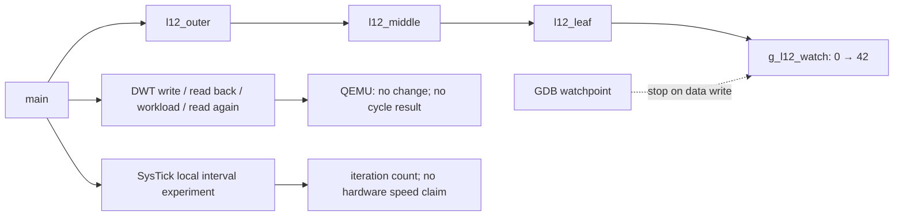

**Language:** English | [Türkçe](README.tr.md)

# Lesson 12 — Debugging & DWT Profiling

`[STANDARD]` · Day 5 · **STATUS: implemented; local validation recorded below**

This lesson asks: **Why is a value wrong, and why can we trust a measurement?**
Work sequence: **TEACH → SHOW → RUN → OBSERVE → MODIFY → BREAK → DEBUG → VERIFY**.
Prerequisites: [AAPCS](../09-compiler-aapcs/), [ELF](../10-linker-elf-memory/),
and [startup](../11-startup/).

## Why This Matters — TEACH

"The program reached the end" is not proof of correctness. A legal RAM write can
produce a wrong result without causing any fault. A breakpoint focuses on a
particular execution location; a watchpoint focuses on particular data.

Being able to read a register does not show that it counts actual CPU cycles.
CYCCNT does not advance on this target. We do not report a zero difference as "very fast."

## Core Idea

- **ARCHITECTURE:** DWT features are implementation-dependent. NOCYCCNT, enable bits,
  and CYCDISS in Secure state matter for the cycle counter. Access/debug permissions
  must also be examined separately on hardware.
- **QEMU OBSERVATION:** in the version below, DEMCR/CTRL enable writes did not read
  back, and CYCCNT remained zero across two reads. Do not generalize to every M33;
  measure again on another target/version.
- **DEBUGGER:** QEMU TCG system emulation provides watchpoints through the gdbstub.
  GDB's "Hardware watchpoint" message does not mean physical DWT is working or
  that unlimited comparators exist.
- **REPOSITORY DESIGN:** Secure, privileged Thread Mode/MSP is preserved. PSP, MPU,
  EXC_RETURN, and the exception-frame format are not changed. SysTick demonstrates
  only local timer progress; it is not a scheduler.

## Mental Model

The debugger helps us find where the wrong value is written. A counter is a
separate measurement tool: first verify that it works and what it counts.
Having a good debugger does not mean having an accurate stopwatch.

## Visual



## Tiny Example — SHOW

The smallest behavior in [`debug_chain.c`](example/debug_chain.c):

```c
g_l12_watch = value;
return g_l12_watch;
```

The normal version writes 42 through `l12_outer(42)`. `12-debug-dwt-broken` writes
43 to the same address. Because this is a valid memory access, CFSR/HFSR stay zero;
`CHECK_WATCH_VALUE` FAILs. The watchpoint identifies the writer, `l12_leaf`.

Functions are kept separate using `noinline, noipa`; a compiler barrier after the
call prevents tail-call transformation. This is not a hardware DMB/DSB.
The C compiler manages stack frames and callee-saved registers.

[`workload.c`](example/workload.c) sums `3*x + 1` for runtime inputs.
Inputs 1…16 give 424. The result is written to a volatile sink; `noipa` prevents
constant folding from the call site. `volatile` neither makes a cycle measurement
valid nor provides general synchronization.

## Build & Run — RUN

From the repository root in a Linux/MSYS2/WSL terminal:

```bash
cmake --preset debug
cmake --build --preset debug
./scripts/run-qemu.sh build/debug/lessons/12-debug-dwt/12-debug-dwt.elf
```

For the same ELF in Windows PowerShell:

```powershell
qemu-system-arm -M mps2-an505 -cpu cortex-m33 -nographic -monitor none -serial stdio -kernel build/debug/lessons/12-debug-dwt/12-debug-dwt.elf
```

A WFI loop follows END; exit QEMU with `Ctrl-A`, then `X`.
Repeat with `release` or `minsize` instead of `debug`.

Seven firmware targets:

- `12-debug-dwt`: correct data write and measurement limits.
- `12-debug-dwt-broken`: only the incorrect data write.
- `12-profile-io`: a variant with console I/O added inside the measurement interval.
- `12-profile-o0`, `12-profile-o2`: `-O0` / `-O2` only for `workload.c`.
- `12-exercise-measurement`: incomplete classifier; 0/12 expected.
- `12-solution-measurement`: separate reference solution; 12/12 expected.

## Recorded Output

2026-10-23, Windows, xPack GCC 15.2.1, QEMU
`11.1.0 (v11.1.0-12130-ge470268ff4)`, `mps2-an505 / cortex-m33`, debug.
The following is an actual run; `LOCAL_ITERATIONS` varies between runs.

```text
===== LESSON 12: DEBUG AND MEASUREMENT =====
[WATCH_VALUE] 42
[CHECK_WATCH_VALUE] PASS
[DEMCR_READBACK] 0x00000000
[DWT_CTRL_READBACK] 0x00000000
[DWT_T0] 0
[DWT_T1] 0
[DWT_CHANGED] NO
[CYCLE_BENCHMARK] NOT VALIDATED ON QEMU
[CHECKSUM] 424
[CHECK_WORKLOAD] PASS

[CHECK_TIMER_CONFIG] PASS
[LOCAL_TICKS] 4
[LOCAL_ITERATIONS] 17012
[IO_CALLS_IN_WINDOW] 0
[CHECK_TIMER_PROGRESS] PASS
[CHECK_CLEAN_WINDOW] PASS
[CHECK_NO_FAULT] PASS
[TIMING_SCOPE] QEMU local ticks; no cycles, speed ranking or WCET
===== END =====
```

The firmware attempts the write, then records **readback**; it does not simply
print the requested enable value. Even a changing CYCCNT would not establish QEMU
as a cycle-accurate model. This example does not replace the target capability probe.

## Observe in GDB — OBSERVE

In the first terminal:

```bash
./scripts/debug-qemu.sh build/debug/lessons/12-debug-dwt/12-debug-dwt.elf
```

In the second terminal:

```text
arm-none-eabi-gdb build/debug/lessons/12-debug-dwt/12-debug-dwt.elf
(gdb) target remote :3333
(gdb) tbreak main
(gdb) continue
(gdb) watch -l g_l12_watch
(gdb) continue
```

Observed stop: `Old value = 0`, `New value = 42`, function `l12_leaf`.
In the broken target, `New value = 43`. Setting the watchpoint at `main` avoids
confusing startup's `.bss` clearing with this experiment.

```text
(gdb) bt
(gdb) info frame
(gdb) info registers sp lr pc
(gdb) x/8wx $sp
(gdb) disassemble /r l12_leaf
(gdb) disassemble /r l12_middle
(gdb) disassemble /r l12_outer
```

The chain observed in all three presets: `l12_leaf → l12_middle → l12_outer → main`.
In the Debug build, `l12_leaf` uses `str`, `ldr`, `bx lr` without allocating a
frame; `l12_middle`/`l12_outer` save registers around their calls. Match the saved PC
reported by `info frame` to the instruction address after `bl`. Not every
Flash-like word on the stack is a return address. A leaf's own LR can remain in
the register; the first stack word is not always the saved LR. Preserve the
distinction between a pointer value with the Thumb bit and an instruction address.
GDB can display literal-pool data as instructions; compare with ELF-mapping-aware
`objdump -d` and `.word` lines.

After stopping at the write, use a read watchpoint and single-step:

```text
(gdb) delete breakpoints
(gdb) rwatch -l g_l12_watch
(gdb) continue
(gdb) delete breakpoints
(gdb) stepi
(gdb) tbreak l12_done
(gdb) continue
(gdb) p/x g_l12_demcr
(gdb) p/x g_l12_dwt_ctrl
(gdb) p g_l12_dwt_start
(gdb) p g_l12_dwt_end
(gdb) p g_l12_ticks
(gdb) x/wx 0xE000ED28
(gdb) x/wx 0xE000ED2C
```

The first stop is at the `return g_l12_watch` read. `stepi` advances PC.
`l12_done` is called after the timer is disabled and END is printed; CFSR/HFSR are
zero. Because the DWT configuration is restored, inspect the recorded readback
instead of live registers to understand the enable attempt. Reading SysTick CTRL
clears COUNTFLAG; do not use a run paused by the debugger inside the interval as a
duration measurement.

## Experiment — MODIFY

### 1. Change optimization in one place

```bash
arm-none-eabi-nm -S build/debug/lessons/12-debug-dwt/12-profile-o0.elf
arm-none-eabi-objdump -d --disassemble=l12_workload build/debug/lessons/12-debug-dwt/12-profile-o0.elf
arm-none-eabi-objdump -d --disassemble=l12_workload build/debug/lessons/12-debug-dwt/12-profile-o2.elf
```

Workload measured with GCC 15.2.1 across three presets: O0 **70 bytes / 35 static
instructions**, O2 **32 bytes / 13 static instructions**. Driver/platform preset
flags remain the same; only the workload object's final `-O` flag changes. The
test checks this through `compile_commands.json`. The count is static instruction
lines in disassembly (including alignment NOPs, if present), not dynamic execution
count or CPU cycle count. It may change with another GCC version.

### 2. SysTick local interval

20 MHz is **this QEMU platform's contract**, not a universal M33 constant.
`SysTick_Config(SystemCoreClock / 1000)` sets the nominal timer period.
In a normal run, the handler increments a volatile tick counter. Main performs
work until at least four ticks or the 200000-iteration limit; a stopped timer
produces `CHECK_TIMER_PROGRESS` FAIL instead of silently hanging. The test does
not expect an exact iteration count or a speed ranking between builds. The
observed handler count does not automatically account for multiple missed periods;
this is not a high-accuracy elapsed-time API.

### 3. CMSIS and the small teaching header

[`header_probe.c`](example/header_probe.c) is compiled twice. The section bytes of
`l12_read_cycle` and `l12_read_ipsr` matched exactly in all three presets. Complete
header equivalence is not claimed. The test is in `lesson12-check.py`.

## Break It

1. `12-debug-dwt-broken`: wrong data, legal access, `CHECK_WATCH_VALUE` FAIL,
   CFSR/HFSR zero.
2. `12-profile-io`: prints dots inside the interval; `IO_CALLS_IN_WINDOW > 0`,
   `CHECK_CLEAN_WINDOW` FAIL. The checksum is still 424. One debug run measured
   33 console calls and 8275 iterations; this ratio cannot be carried over to
   hardware and need not recur in the next run.
3. Try the stopped, disabled, and wrap inputs in the
   [exercise](exercises/01-valid-measurement/). Do not report a cycle result for
   equal endpoints or a disabled counter.

## Debug It

For wrong data, inspect the result first, then the writing instruction and call
chain. Not every incorrect result is an exception. For measurements, inspect
readback first, then endpoints, then other work inside the interval. Do not
confuse UART overhead with a nonworking counter; they are separate defects.

## Verify

```bash
python3 tests/lesson12-check.py debug
python3 tests/lesson12-check.py release
python3 tests/lesson12-check.py minsize
./tests/smoke-test.sh debug
./tests/build-probes.sh debug
python3 tests/check-links.py
```

On Windows, the Python invocation can be `py -3`. The test requires
`arm-none-eabi-gdb` or `gdb-multiarch`; GDB's Python extension is not required.
The script closes each QEMU process itself and selects a free local port for GDB.
Raw UART, GDB scripts/logs, and disassembly are written under ignored
`build/<preset>/lesson12-evidence/`. A missing tool is not presented as success/SKIP.

Seven targets and the GDB negative example were verified on debug/release/minsize.
In the normal example, a `console_putc` call while the timer is running fails the
GDB check; the configuration message is also printed only after the timer stops.
The same GDB guard is tested with a negative control that actually rejects the I/O
variant. In an additional negative check, GDB sets the RAM request
`g_l12_stop_timer` to 1 at the first SysTick handler entry; the handler stops the
timer using actual CPU MMIO writes. This request is zero during normal operation.
Direct debugger register writes are not relied upon because QEMU 8.2.2's GDB
memory-write path does not apply MMIO writes. The test does not change tick/
iteration counters: exactly one tick and 200000 iterations are expected, with
`CHECK_TIMER_PROGRESS` FAIL and END. The starter remains incomplete; the
[reference solution](solutions/01-valid-measurement/) passes the same 12 synthetic
cases in a separate target. A new CI step runs the same lesson test across three
presets; remote execution results are reported separately.

## What I Learned

This area is the student's own record; it is not filled automatically.

- What surprised me:
- The instruction that wrote the wrong value:
- Why the measurement was invalid:
- The call chain I saw in the debugger:

## Quick Check

1. Why is a watchpoint different from a source breakpoint?
2. What does NOCYCCNT=0 and CYCCNT=0 **not prove**?
3. What is the difference `0xFFFFFFF0 → 0x10`, and under what precondition is it meaningful?
4. Why is smaller O2 code not evidence of hardware speed?
5. What scope changes when console output is added to the measurement window?
6. Why are `bt` and reading arbitrary stack words not the same thing?
7. How much does producing the same bytes in two header probes prove?

[Answers](answers/quick-check.md).

## Takeaway

- A watchpoint identifies the writer of incorrect data; not every bug is a fault.
- A counter's definition, readback, and progress are separate evidence.
- Code size/static instruction count are not dynamic instruction count/cycles/WCET.
- A QEMU timer experiment and hardware performance measurement are different claims.

## References

- [Armv8-M ARM DDI0553B.y, D1.2.58: DWT_CTRL / CYCDISS](https://community.arm.com/cfs-file/__key/communityserver-discussions-components-files/471/DDI0553B_5F00_y_5F00_armv8m_5F00_arm.pdf)

- [Arm Cortex-M33 TRM, DWT programmers model, chapter 12](https://documentation-service.arm.com/static/641b2edcde84571cc27f3caa)
- [Arm Cortex-M33 Devices Generic User Guide, SysTick and debug](https://documentation-service.arm.com/static/5f16e93d20b7cf4bc524af1d)
- [GNU GDB — Set Watchpoints](https://www.sourceware.org/gdb/current/onlinedocs/gdb.html/Set-Watchpoints.html)
- [QEMU — GDB usage, TCG breakpoint/watchpoint support](https://www.qemu.org/docs/master/system/gdb.html)
- [QEMU — Instruction counting is not cycle-accurate](https://www.qemu.org/docs/master/devel/tcg-icount.html)
- [Measurement methodology](../../docs/PERFORMANCE_MEASUREMENT.md),
  [target capabilities](../../docs/TARGET_CAPABILITIES.md).

**Previous:** [11 — Startup](../11-startup/)
**Next:** [13 — Synchronization, FPU & DSP](../13-sync-fpu-dsp/)
