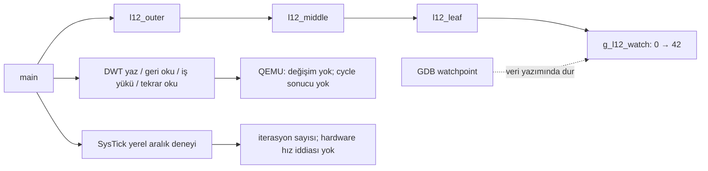

# Lesson 12 — Debugging & DWT Profiling

`[STANDARD]` · Day 5 · **STATUS: implemented; local validation recorded below**

Bu dersin sorusu: **Bir değer neden yanlış ve bir ölçüme neden güvenebiliriz?**
Çalışma sırası: **TEACH → SHOW → RUN → OBSERVE → MODIFY → BREAK → DEBUG → VERIFY**.
Önkoşullar: [AAPCS](../09-compiler-aapcs/), [ELF](../10-linker-elf-memory/)
ve [startup](../11-startup/).

## Why This Matters — TEACH

"Program sona ulaştı" doğruluk kanıtı değildir. Yasal bir RAM yazımı yanlış
sonuç üretebilir ve hiçbir fault oluşmayabilir. Breakpoint yürütmenin belli
bir yerine, watchpoint ise belli bir veriye odaklanır.

Bir register'ı okuyabilmek, onun gerçek CPU cycle'larını saydığını göstermez.
Bu hedefte CYCCNT ilerlemiyor. Sıfır farkı "çok hızlı" diye raporlamıyoruz.

## Core Idea

- **ARCHITECTURE:** DWT özellikleri implementasyona bağlıdır. Cycle counter
  için NOCYCCNT, enable bitleri ve Secure durumdaki CYCDISS anlamlıdır.
  Donanımda erişim/debug izinleri de ayrıca incelenmelidir.
- **QEMU OBSERVATION:** aşağıdaki sürümde DEMCR/CTRL enable yazıları geri
  okunmadı ve CYCCNT iki okumada sıfır kaldı. Bütün M33'lere genelleme yapma;
  başka target/sürümde yeniden ölç.
- **DEBUGGER:** QEMU TCG system emulation, gdbstub üzerinden watchpoint sunar.
  GDB'nin "Hardware watchpoint" mesajı fiziksel DWT'nin çalıştığı veya
  sınırsız comparator bulunduğu anlamına gelmez.
- **REPOSITORY DESIGN:** Secure, privileged Thread Mode/MSP korunur. PSP,
  MPU, EXC_RETURN veya exception frame formatı değiştirilmez. SysTick yalnızca
  yerel zamanlayıcı ilerlemesini gösterir; scheduler değildir.

## Mental Model

Debugger yanlış değerin yazıldığı yeri bulmamıza yardım eder. Sayaç ayrı
bir ölçüm aracıdır: önce çalıştığı ve neyi saydığı doğrulanır. İyi bir
debugger'ın varlığı doğru bir kronometremiz olduğu anlamına gelmez.

## Visual



## Tiny Example — SHOW

[`debug_chain.c`](example/debug_chain.c) içindeki en küçük davranış:

```c
g_l12_watch = value;
return g_l12_watch;
```

Normal sürüm `l12_outer(42)` ile 42 yazar. `12-debug-dwt-broken` aynı adrese
43 yazar. Geçerli bir bellek erişimi olduğundan CFSR/HFSR sıfır kalır;
`CHECK_WATCH_VALUE` FAIL olur. Watchpoint, yazan `l12_leaf`'i bulur.

Fonksiyonlar `noinline, noipa` ile ayrı tutulur; çağrıdan sonraki compiler
barrier tail-call dönüşümünü engeller. Bu bir donanım DMB/DSB değildir.
Stack frame ve callee-saved register yönetimi C derleyicisine aittir.

[`workload.c`](example/workload.c), runtime girdiler için `3*x + 1` toplamını
hesaplar. 1…16 girdisi 424 verir. Sonuç volatile sink'e yazılır; `noipa`
çağrı yerinden sabit katlamayı önler. `volatile` cycle ölçümünü geçerli
kılan veya genel senkronizasyon sağlayan bir araç değildir.

## Build & Run — RUN

Repository kökünden Linux/MSYS2/WSL terminalinde:

```bash
cmake --preset debug
cmake --build --preset debug
./scripts/run-qemu.sh build/debug/lessons/12-debug-dwt/12-debug-dwt.elf
```

Windows PowerShell'de aynı ELF için:

```powershell
qemu-system-arm -M mps2-an505 -cpu cortex-m33 -nographic -monitor none -serial stdio -kernel build/debug/lessons/12-debug-dwt/12-debug-dwt.elf
```

END sonrasında WFI döngüsü vardır; QEMU'dan `Ctrl-A`, ardından `X` ile çık.
`debug` yerine `release` veya `minsize` koyarak tekrarla.

Yedi firmware hedefi:

- `12-debug-dwt`: doğru veri yazımı ve ölçüm sınırları.
- `12-debug-dwt-broken`: yalnızca yanlış veri yazımı.
- `12-profile-io`: ölçüm aralığına console I/O eklenmiş varyant.
- `12-profile-o0`, `12-profile-o2`: sadece `workload.c` için `-O0` / `-O2`.
- `12-exercise-measurement`: eksik sınıflandırıcı; 0/12 beklenir.
- `12-solution-measurement`: ayrı referans çözüm; 12/12 beklenir.

## Recorded Output

2026-10-23, Windows, xPack GCC 15.2.1, QEMU
`11.1.0 (v11.1.0-12130-ge470268ff4)`, `mps2-an505 / cortex-m33`, debug.
Aşağıdaki gerçek bir koşudur; `LOCAL_ITERATIONS` tekrarlar arasında değişir.

```text
===== LESSON 12: DEBUG AND MEASUREMENT =====
[WATCH_VALUE] 42
[CHECK_WATCH_VALUE] PASS
[DEMCR_READBACK] 0x00000000
[DWT_CTRL_READBACK] 0x00000000
[DWT_T0] 0
[DWT_T1] 0
[DWT_CHANGED] NO
[CYCLE_BENCHMARK] NOT VALIDATED ON QEMU
[CHECKSUM] 424
[CHECK_WORKLOAD] PASS

[CHECK_TIMER_CONFIG] PASS
[LOCAL_TICKS] 4
[LOCAL_ITERATIONS] 17012
[IO_CALLS_IN_WINDOW] 0
[CHECK_TIMER_PROGRESS] PASS
[CHECK_CLEAN_WINDOW] PASS
[CHECK_NO_FAULT] PASS
[TIMING_SCOPE] QEMU local ticks; no cycles, speed ranking or WCET
===== END =====
```

Firmware yazmayı dener, sonra **readback** kaydeder; yalnızca istenen enable
değerini yazdırmaz. CYCCNT değişse bile QEMU'yu cycle-accurate model ilan
etmez. Bu örnek target capability probe'un yerine geçmez.

## Observe in GDB — OBSERVE

İlk terminalde:

```bash
./scripts/debug-qemu.sh build/debug/lessons/12-debug-dwt/12-debug-dwt.elf
```

İkinci terminalde:

```text
arm-none-eabi-gdb build/debug/lessons/12-debug-dwt/12-debug-dwt.elf
(gdb) target remote :3333
(gdb) tbreak main
(gdb) continue
(gdb) watch -l g_l12_watch
(gdb) continue
```

Ölçülen durma: `Old value = 0`, `New value = 42`, fonksiyon `l12_leaf`.
Bozuk hedefte `New value = 43`. Watchpoint'i `main`'de kurmak startup'ın
`.bss` sıfırlamasını bu deneyle karıştırmaz.

```text
(gdb) bt
(gdb) info frame
(gdb) info registers sp lr pc
(gdb) x/8wx $sp
(gdb) disassemble /r l12_leaf
(gdb) disassemble /r l12_middle
(gdb) disassemble /r l12_outer
```

Üç preset'te gözlenen zincir: `l12_leaf → l12_middle → l12_outer → main`.
Debug build'de `l12_leaf` frame ayırmadan `str`, `ldr`, `bx lr` yolunu
kullanır; `l12_middle`/`l12_outer` ise çağrıları çevresinde register kaydeder.
`info frame`'in saved PC bilgisini `bl` sonrasındaki komut adresiyle eşleştir.
Stack'teki her Flash benzeri word dönüş adresi değildir. Leaf'in kendi
LR'si register'da kalabilir; ilk stack word'ü her zaman saved LR değildir.
Pointer'ın Thumb bitli değeriyle instruction adresi ayrımını koru.
GDB literal pool verisini komut gibi gösterebilir; ELF mapping bilgili
`objdump -d` ve `.word` satırlarıyla karşılaştır.

Yazma noktasında durduktan sonra read watchpoint ve single-step:

```text
(gdb) delete breakpoints
(gdb) rwatch -l g_l12_watch
(gdb) continue
(gdb) delete breakpoints
(gdb) stepi
(gdb) tbreak l12_done
(gdb) continue
(gdb) p/x g_l12_demcr
(gdb) p/x g_l12_dwt_ctrl
(gdb) p g_l12_dwt_start
(gdb) p g_l12_dwt_end
(gdb) p g_l12_ticks
(gdb) x/wx 0xE000ED28
(gdb) x/wx 0xE000ED2C
```

İlk durma `return g_l12_watch` okumasındadır. `stepi` PC'yi ilerletir.
`l12_done`, timer kapatılıp END yazıldıktan sonra çağrılır; CFSR/HFSR sıfırdır.
DWT konfigürasyonu geri yüklendiğinden enable denemesini anlamak için canlı
register yerine kaydedilen readback'e bak. SysTick CTRL okumaları COUNTFLAG'i
temizler; aralıkta debugger ile durdurduğun koşuyu süre ölçümü olarak kullanma.

## Experiment — MODIFY

### 1. Optimizasyonu tek yerde değiştir

```bash
arm-none-eabi-nm -S build/debug/lessons/12-debug-dwt/12-profile-o0.elf
arm-none-eabi-objdump -d --disassemble=l12_workload build/debug/lessons/12-debug-dwt/12-profile-o0.elf
arm-none-eabi-objdump -d --disassemble=l12_workload build/debug/lessons/12-debug-dwt/12-profile-o2.elf
```

GCC 15.2.1 ile üç preset'te ölçülen iş yükü: O0 **70 byte / 35 statik
komut**, O2 **32 byte / 13 statik komut**. Driver/platform preset flag'leri
aynı kalır; yalnızca workload object'inin son `-O` flag'i değişir. Test bunu
`compile_commands.json` üzerinden kontrol eder. Sayım disassembly'deki
statik instruction satırlarıdır (varsa alignment NOP dahil); dinamik icra
sayısı veya CPU cycle sayısı değildir. Başka GCC sürümünde sayı değişebilir.

### 2. SysTick yerel aralığı

20 MHz **bu QEMU platform sözleşmesidir**; evrensel M33 sabiti değildir.
`SysTick_Config(SystemCoreClock / 1000)` nominal timer periyodunu kurar.
Handler sadece volatile tick sayacını artırır. Main en az dört tick veya
200000 iterasyon sınırına kadar iş yapar; durdurulan timer sessizce hang
yerine `CHECK_TIMER_PROGRESS` FAIL üretir. Test tam iterasyon sayısını
veya iki build arasında hız sıralamasını beklemez. Gözlenen handler sayısı
kaçırılmış birden çok periyodu otomatik saymaz; bu yüksek doğruluklu elapsed-time API değildir.

### 3. CMSIS ve küçük öğretim header'ı

[`header_probe.c`](example/header_probe.c) iki kez derlenir. `l12_read_cycle`
ve `l12_read_ipsr` section byte'ları üç preset'te birebir eşleşti. Tam header
uyumluluğu iddia edilmez. Test `lesson12-check.py` içindedir.

## Break It

1. `12-debug-dwt-broken`: veri yanlış, erişim yasal, `CHECK_WATCH_VALUE` FAIL,
   CFSR/HFSR sıfır.
2. `12-profile-io`: aralıkta noktalar yazdırır; `IO_CALLS_IN_WINDOW > 0`,
   `CHECK_CLEAN_WINDOW` FAIL. Checksum hâlâ 424. Bir debug koşusunda 33 console
   çağrısı ve 8275 iterasyon ölçüldü; bu oran donanıma taşınamaz, sonraki
   koşuda aynı çıkmak zorunda değildir.
3. [Alıştırmadaki](exercises/01-valid-measurement/) stopped, disabled ve wrap
   girdilerini dene. Eşit uçlar veya disabled sayaç için cycle sonucu verme.

## Debug It

Yanlış veri için önce sonucu, sonra yazan instruction'ı ve çağrı zincirini
incele. Her yanlış sonuç exception değildir. Ölçüm için önce readback,
sonra uç değerler, sonra aralıktaki yan işleri denetle. UART maliyetini
counter'ın çalışmamasıyla karıştırma; iki ayrı kusurdur.

## Verify

```bash
python3 tests/lesson12-check.py debug
python3 tests/lesson12-check.py release
python3 tests/lesson12-check.py minsize
./tests/smoke-test.sh debug
./tests/build-probes.sh debug
python3 tests/check-links.py
```

Windows'ta Python çağrısı `py -3` olabilir. Test için `arm-none-eabi-gdb`
veya `gdb-multiarch` gerekir; GDB'nin Python eklentisi gerekmez. Script her
QEMU sürecini kendisi kapatır, GDB için boş yerel port seçer. Ham UART,
GDB script/kayıtları ve disassembly ignored `build/<preset>/lesson12-evidence/`
altına yazılır. Eksik araç bir başarı/SKIP gibi sunulmaz.

Yedi hedef ve GDB negatif örneği debug/release/minsize üzerinde doğrulandı.
Normal örnekte timer açıkken `console_putc` çağrısı olursa GDB kontrolü
başarısız olur; konfigürasyon mesajı da timer kapatıldıktan sonra yazılır.
Aynı GDB koruması I/O varyantını gerçekten reddeden negatif kontrolle sınanır.
Ek negatif kontrolde ilk SysTick handler girişinde timer durdurulur;
200000 iterasyonda `CHECK_TIMER_PROGRESS` FAIL ve END beklenir.
Starter eksik kalır; [referans çözüm](solutions/01-valid-measurement/) ayrı
hedefte aynı 12 sentetik vakayı geçirir. Yeni CI adımı aynı lesson testini
üç preset'te çalıştırır; uzak çalıştırma sonucu ayrıca raporlanır.

## What I Learned

Bu alan öğrencinin kendi kaydıdır; otomatik doldurulmaz.

- Beni şaşırtan şey:
- Yanlış değeri yazan instruction:
- Geçersiz ölçümün nedeni:
- Debugger'da gördüğüm çağrı zinciri:

## Quick Check

1. Watchpoint neden source breakpoint'ten farklıdır?
2. NOCYCCNT=0 ve CYCCNT=0 hangi sonucu **kanıtlamaz**?
3. `0xFFFFFFF0 → 0x10` farkı nedir; hangi önkoşulla anlamlıdır?
4. Daha küçük O2 kodu niçin hardware hız kanıtı değildir?
5. Ölçüm penceresine console eklenince hangi kapsam değişir?
6. `bt` ile rastgele stack word'lerini okumak neden aynı şey değildir?
7. İki header probe'unun aynı byte'ları üretmesi ne kadarını kanıtlar?

[Cevaplar](answers/quick-check.md).

## Takeaway

- Yanlış verinin yazarı watchpoint ile bulunur; her hata fault değildir.
- Sayacın tanımı, readback'i ve ilerlemesi ayrı kanıtlardır.
- Kod boyutu/statik komut sayısı, dynamic instruction count/cycle/WCET değildir.
- QEMU timer deneyi ve donanım performans ölçümü farklı iddialardır.

## References

- [Armv8-M ARM DDI0553B.y, D1.2.58: DWT_CTRL / CYCDISS](https://community.arm.com/cfs-file/__key/communityserver-discussions-components-files/471/DDI0553B_5F00_y_5F00_armv8m_5F00_arm.pdf)

- [Arm Cortex-M33 TRM, DWT programmers model, bölüm 12](https://documentation-service.arm.com/static/641b2edcde84571cc27f3caa)
- [Arm Cortex-M33 Devices Generic User Guide, SysTick ve debug](https://documentation-service.arm.com/static/5f16e93d20b7cf4bc524af1d)
- [GNU GDB — Set Watchpoints](https://www.sourceware.org/gdb/current/onlinedocs/gdb.html/Set-Watchpoints.html)
- [QEMU — GDB usage, TCG breakpoint/watchpoint desteği](https://www.qemu.org/docs/master/system/gdb.html)
- [QEMU — Instruction counting cycle-accurate değildir](https://www.qemu.org/docs/master/devel/tcg-icount.html)
- [Ölçüm metodolojisi](../../docs/PERFORMANCE_MEASUREMENT.md),
  [target kabiliyetleri](../../docs/TARGET_CAPABILITIES.md).

**Previous:** [11 — Startup](../11-startup/)
**Next:** [13 — Synchronization, FPU & DSP](../13-sync-fpu-dsp/)
