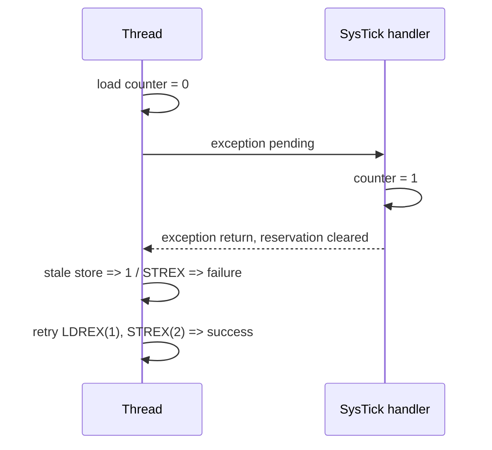

**Language:** English | [Türkçe](README.tr.md)

# Lesson 13 — Synchronization, FPU & DSP

`[DEEP]` · Day 6 · **STATUS: on main; Debug/Release/MinSize CI PASS (11fde900)**

**TEACH → SHOW → RUN → OBSERVE → MODIFY → BREAK → DEBUG → VERIFY**

Prerequisites: [AAPCS](../09-compiler-aapcs/), [exceptions](../07-exceptions/),
[faults](../08-faults/), and [measurement limits](../12-debug-dwt/).
The target is unchanged: Cortex-M33 / QEMU `mps2-an505`, Secure privileged Thread/MSP.

## Why This Matters — TEACH

Two seemingly correct `++` operations on a shared counter can produce a total of 1.
The FPU may be present with access permission disabled; enabling it does not mean
every exception writes FP registers to the stack. Even a correct DSP result in
QEMU does not establish physical hardware speed.

This lesson tests these three claims in separate, controlled experiments. Shared
runtime, startup, linker, CMSIS, and earlier lessons' flags remain unchanged.
No scheduler, Non-secure transition, or general-purpose atomic library is created.

## Core Idea

- **ARCHITECTURE:** aligned load/store atomicity differs from read–modify–write
  atomicity. LDREX/STREX use the same address and size; a failed store does not
  write, and the entire read–modify–write is retried. An exception clears the local reservation.
- **MASK:** the previous PRIMASK is restored. The scope is maskable exceptions in
  this Secure single-core lab; it does not protect against NMI/HardFault or DMA.
- **ORDER:** DMB addresses memory ordering, DSB completion, and ISB execution
  context. None adds mutual exclusion to read–modify–write. QEMU is not a tool
  for verifying weak memory ordering or real-time behavior here.
- **FP:** CPACR permissions and compiler ABI are different layers. ASPEN/FPCA,
  LSPEN/LSPACT, and EXC_RETURN.FType are observed together.
- **DSP:** signed 16-bit lane operations and saturation results are verified
  against plain C; no instruction/cycle-count or speed advantage is claimed.

## Mental Model / Visual



`volatile` helps keep accesses visible; this alone is not an atomicity or general
thread-synchronization contract. The C/assembly here is written for the GCC/CMSIS
bare-metal interrupt model; it is not presented as portable C11 atomics.

## Tiny Example — SHOW

[`sync_ops.S`](example/sync_ops.S) places one SysTick exception between the first
LDREX and STREX. The Handler increments the counter. The first STREX fails;
the successful path starts again with a new LDREX. The experiment makes the
exception pending through ICSR; it does not configure the periodic SysTick timer.

```asm
ldrex r2, [r4]
/* controlled exception once; hardware preserves interrupted r2 */
adds r2, r2, #1
strex r3, r2, [r4]
/* r3 != 0: retry the load as well as the store */
```

The actual source preserves registers, keeps SP 8-byte aligned, and bounds all
wait and retry paths. It returns an error if the attempt budget is exhausted.
This example gives no progress or WCET guarantee under an interrupt storm.
The SRAM counter is word-aligned; exclusive accesses are not tested on MMIO.

## Build & Run — RUN

From the repository root in a Linux/MSYS2/WSL terminal:

```bash
cmake --preset debug
cmake --build --preset debug
./scripts/run-qemu.sh build/debug/lessons/13-sync-fpu-dsp/13-sync-fpu-dsp.elf
```

The same ELF can be run directly in PowerShell:

```powershell
qemu-system-arm -M mps2-an505 -cpu cortex-m33 -nographic -monitor none -serial stdio -kernel build/debug/lessons/13-sync-fpu-dsp/13-sync-fpu-dsp.elf
```

WFI follows END; exit QEMU with `Ctrl-A`, then `X`. Repeat with `release` and
`minsize`. Nine new targets:

- `13-sync-fpu-dsp`: lost update, exclusive retry, DSP/QADD.
- `13-sync-broken`: only one attempt; the correct final total FAILs.
- `13-exercise-critical`: incomplete starter, 2/6.
- `13-solution-critical`: separate reference solution, 6/6.
- `13-fpu-basic`: CPACR enabled, no FP used before SVC.
- `13-fpu-eager`: active FP, lazy disabled; softfp C helper.
- `13-fpu-lazy`: active FP, lazy enabled; the first handler FP instruction triggers the save.
- `13-fpu-denied`: CPACR disabled; NOCP at the first FP instruction.
- `13-fpu-hard`: eager-context experiment, entire image compiled with the hard-float ABI.

## Recorded Output

2026-10-24, Windows, xPack GCC 15.2.1, QEMU
`11.1.0 (v11.1.0-12130-ge470268ff4)`, from an actual Debug run:

```text
===== LESSON 13: SYNCHRONIZATION AND DSP =====
[RACY_TOTAL] 1
[CHECK_LOST_UPDATE] PASS
[EXCLUSIVE_TOTAL] 2
[FIRST_STREX_STATUS] 1
[RETRIES] 1
[CHECK_INTERRUPTED_RESERVATION] PASS
[CHECK_ATOMIC_TOTAL] PASS
[DOT_C] 0xFFFF7360
[DOT_DSP] 0xFFFF7360
[SATURATION_AND_Q] PASS
[CHECK_DSP] PASS
[CHECK_BASELINE_SOFT] PASS
[CHECK_NO_FAULT] PASS
===== END =====
```

`0xFFFF7360` is -36000 as a signed 32-bit value. In the broken variant,
`EXCLUSIVE_TOTAL=1`, `CHECK_ATOMIC_TOTAL=FAIL`; other checks remain PASS.

## Observe in GDB — OBSERVE

Start the relevant ELF with `scripts/debug-qemu.sh` in the first terminal.
In the second terminal:

```text
arm-none-eabi-gdb build/debug/lessons/13-sync-fpu-dsp/13-sync-fpu-dsp.elf
(gdb) target remote :3333
(gdb) tbreak main
(gdb) continue
(gdb) tbreak l13_exclusive_increment
(gdb) continue
(gdb) disassemble /r l13_exclusive_increment
(gdb) tbreak SysTick_Handler
(gdb) continue
(gdb) info registers sp lr xpsr
(gdb) x/8wx $sp
(gdb) tbreak l13_done
(gdb) continue
(gdb) p g_l13_first_status
(gdb) p g_l13_retries
(gdb) p g_l13_counter
```

IPSR=15 and a basic MSP-origin EXC_RETURN are observed in the Handler. `r2` is
an interrupted register; the exception stack preserves it. Do not confuse it
with the handler's C temporaries. Final expectations are status=1, retries=1,
counter=2. The automated GDB test also compares R4–R11 and SP before/after
the primitive call.

## Experiment 1 — Critical section / MODIFY

The [exercise](exercises/01-critical-update/) makes the same IRQ pending between
read and write. Protect the update by restoring the previous PRIMASK. The driver
tests both an initially unmasked call and one that was already masked.
Unconditional enable violates the contract in the second case. Do not wait for
an IRQ while masked.

## Experiment 2 — FPU permission and context

[`fp_main.c`](example/fp_main.c) uses `-mgeneral-regs-only` for setup/reporting;
the compiler cannot silently emit FP operations before permission is enabled.
The separate [`abi_add.c`](example/abi_add.c) actually produces FP instructions
from C. The FP assembly in [`fp_ops.S`](example/fp_ops.S) sets S0=1.5, S1=2.0, S2=3.5.

This image is for Secure→Secure/MSP. FPCCR.TS and CLRONRET are explicitly cleared,
ASPEN is enabled; LSPEN is enabled only in the lazy target. This choice is not a
recommendation for general TrustZone/OS configuration. It is not claimed to save
S16–S31 on behalf of a scheduler; they are callee-saved in AAPCS, and this assembly
uses only S0–S2. In active-FP targets, the caller selects an FPSCR.FZ=1 environment
through the explicit `l13_fp_set_environment()` support function. The worker does
not clear control bits. Saved FPSCR and the post-call value must be `0x01000000`;
this tests control preservation, not denormal arithmetic behavior.

Measured distinction (three presets):

- Basic: CPACR=`0x00F00000`, CONTROL=`0x00000000`, EXC_RETURN=`0xFFFFFFF9`,
  frame **32 bytes**. FPU permission alone does not create active FP context.
- Eager/hard: CONTROL=`0x0000000C` (FPCA and Secure SFPA),
  EXC_RETURN=`0xFFFFFFE9`, frame **104 bytes**, LSPACT=0.
- Lazy: the same extended EXC_RETURN and size; FPCCR is `0xC000041D` on entry,
  `0xC000041C` after the first handler FP instruction. The essential assertion is
  LSPACT 1→0; the register's entire bit pattern is not generalized to every target.

104 bytes: 8 core words + 18 words for S0–S15/FPSCR/reserved. Core R0 is at entry
SP+0; the FP S0 slot is at entry SP+32. In this Armv8-M experiment, do not place FP
data before the core frame using an assumed 72-byte offset. Since SP was already
8-byte aligned, stacked xPSR.STKALIGN=0 and there is no padding. The FP slot is not
read in the basic target; 0 in the raw-slot report is a sentinel. If TS, security
transition, stack selection, or alignment changes, this decoder is insufficient.

The worker temporarily allocates 104 bytes of stack space, fills it with
`0xA5A5A5A5`, restores SP, and executes SVC. No C frame or MSP→PSP transition is
used. On lazy entry, the raw S0 slot still contains the marker; **it is not yet
interpreted as valid FP data**. The Handler's `vmov.f32 s0,#8.0` instruction starts
lazy saving. The stack contains the old Thread S0=`0x3FC00000`, while live S0=8.0.
On exception return, S0=1.5, S2=3.5, and the caller's FPSCR control state return.
No meaning is assigned to the reserved word. No other interrupt is enabled in
the experiment.

In GDB with the lazy ELF:

```text
(gdb) tbreak *SVC_Handler
(gdb) continue
(gdb) set $frame = (unsigned int)$sp
(gdb) p/x $lr
(gdb) x/wx 0xE000EF34
(gdb) x/26wx $frame
(gdb) tbreak *l13_frame_ready
(gdb) continue
(gdb) x/26wx $frame
(gdb) p/x g_l13_fpccr_after
(gdb) p $s0
(gdb) tbreak *(unsigned int)&l13_after_svc
(gdb) continue
(gdb) p $s0
(gdb) p $s2
```

`l13_after_svc` is an assembly label whose address is used in C; select its address
with `&` in GDB. Accidentally resolving `*label` as char contents can set the wrong
breakpoint. The SVC wrapper saves EXC_RETURN before BL; do not confuse its own
8-byte frame with the hardware frame. The earlier `cm-frame` tool retains its
basic-frame scope; this extended experiment is verified using lesson-local
snapshots and raw GDB reads.

## Experiment 3 — Compiler ABI

Baseline lessons remain `-mfloat-abi=soft`. Softfp permits FP instructions and
passes float parameters/results through base AAPCS. Hard uses the VFP calling
convention. CPACR is a separate runtime permission.

The assembly `l13_abi_call_bits(uint32_t,uint32_t)` takes the bit patterns of two
floats. It passes them to the C helper in R0/R1 for softfp and S0/S1 for hard;
the result is 3.5 (`0x40600000`). This explicit adapter does not legitimize
arbitrary ABI mixing. All C objects in the hard target, including startup/console,
use the hard ABI; the integer-only setup/reporting flag is separately preserved.
The test checks final compiler flags, ELF ABI attributes, and actual FP disassembly.
Two matching-ABI link probes pass; two mixed-ABI probes must fail.
`--no-warn-mismatch` is not used.

## Experiment 4 — DSP

[`dsp.c`](example/dsp.c) multiplies four signed 16-bit sensor samples by four
coefficients. SMLAD uses two packed signed lanes. Packing uses unsigned shifts;
there is no left shift of a negative signed value. Inputs are bounded, and the
plain C sum does not overflow signed arithmetic. QADD is tested with positive and
negative saturation; sticky APSR.Q is cleared and read, then its previous state
is restored. NZCV flags are not assumed preserved across a normal AAPCS call.
Accumulator bounds must be designed separately for larger real FIR data.

```bash
arm-none-eabi-objdump -d --disassemble=l13_dot_dsp build/debug/lessons/13-sync-fpu-dsp/13-sync-fpu-dsp.elf
arm-none-eabi-readelf -A build/debug/lessons/13-sync-fpu-dsp/13-fpu-hard.elf
```

Because the DWT cycle counter does not work in QEMU, no cycle benchmark or DSP speed
ratio is reported. Result equality and instruction presence are separate evidence.

## Break It / Debug It

1. `13-sync-broken`: do not ignore failed STREX; inspect status, retries, and the
   final total separately. Adding DMB does not eliminate the need to retry.
2. In the exercise, use unconditional enable instead of the saved PRIMASK:
   explain why the nested-mask check breaks.
3. `13-fpu-denied`: measured CFSR=`0x00080000`, HFSR=0, IPSR=6. NOCP UsageFault is
   enabled; the stacked PC points to the first `vmov` instruction. The permission-
   denied reporter does not use FP; it does not return from the exception and
   repeatedly fault on the same instruction.
4. Do not interpret the allocated slot on lazy entry as valid S0. Inspect LSPACT
   and raw memory together before/after the first FP instruction.
5. Read the negative link probes mixing softfp/hard objects. Do not suppress the
   linker error and treat the result as working.

## Verify

```bash
python3 tests/lesson13-check.py debug
python3 tests/lesson13-check.py release
python3 tests/lesson13-check.py minsize
./tests/smoke-test.sh debug
./tests/build-probes.sh debug
python3 tests/check-links.py
```

On Windows, the Python invocation can be `py -3`. The lesson test depends on Python
stdlib, Arm GCC/binutils, QEMU, and Arm GDB/gdb-multiarch. Missing tools are not
SKIP or success. The test closes each QEMU process; the debugger uses a free
loopback port. UART/GDB/ABI/disassembly records are stored under ignored
`build/<preset>/lesson13-evidence/`; CI uploads them.

The behavior and GDB observations of nine targets were verified locally across
three presets. The final clean build produced 64 ELF/preset and 0 warnings/errors;
full smoke **566/0**, existing build probes **47/0/0 SKIP**, link checker **358/0**.
The earlier Lesson 12 GDB check also passed again in all three presets.
CI results are checked separately after publication. Previous regression checks
were not reduced. The exercise remains incomplete; the solution is linked
separately. The test also compiles and runs two incorrect solutions in a temporary
directory: an unprotected update fails `OPEN_TOTAL`, and unconditional enable
fails `NESTED_MASK`; both give 5/6. Actual starter/solution sources are not modified.

## What I Learned

The student's own record; not filled on behalf of delivery.

- The instruction interval where the update was lost:
- My mistake after the first failed STREX:
- The lazy slot's before/after contents:
- Evidence distinguishing NOCP from HardFault:
- What I could prove and what I did not measure for DSP:

## Quick Check

1. Why do volatile and DMB not make `counter++` atomic?
2. Is retrying only the store sufficient after failed STREX?
3. Why is restoring the entry mask different from unconditional enable?
4. Does enabled CPACR guarantee an extended frame?
5. Why can earlier RAM data still be present in a lazy slot?
6. Under which conditions can NOCP appear as UsageFault or through escalation?
7. Where do the softfp and hard ABIs carry parameters/results?
8. Why are SMLAD and QADD results not evidence of hardware speed?

[Separate answers](answers/quick-check.md).

## Takeaway

A controlled exception makes a lost update visible; correct retry rereads the
new data. FP permissions, active context, save timing, and ABI are separate
contracts. DSP correctness, overflow bounds, and performance measurement require
separate evidence.

## References

- [Arm Cortex-M33 TRM, exclusive monitor and FPU chapters](https://documentation-service.arm.com/static/641b2edcde84571cc27f3caa)
- [Armv8-M ARM DDI0553B.y: exception entry, PushStack, FPCCR, exclusive access](https://community.arm.com/cfs-file/__key/communityserver-discussions-components-files/471/DDI0553B_5F00_y_5F00_armv8m_5F00_arm.pdf)
- [Arm AAPCS32: VFP register and parameter rules](https://github.com/ARM-software/abi-aa/blob/main/aapcs32/aapcs32.rst)
- [GCC Arm options: soft / softfp / hard](https://gcc.gnu.org/onlinedocs/gcc/ARM-Options.html)
- [Vendored CMSIS provenance](../../external/README.md),
  [target capabilities](../../docs/TARGET_CAPABILITIES.md),
  [measurement limits](../../docs/PERFORMANCE_MEASUREMENT.md).

**Previous:** [12 — Debugging & DWT](../12-debug-dwt/)
**Next:** [14 — SysTick & PendSV](../14-systick-pendsv/)
