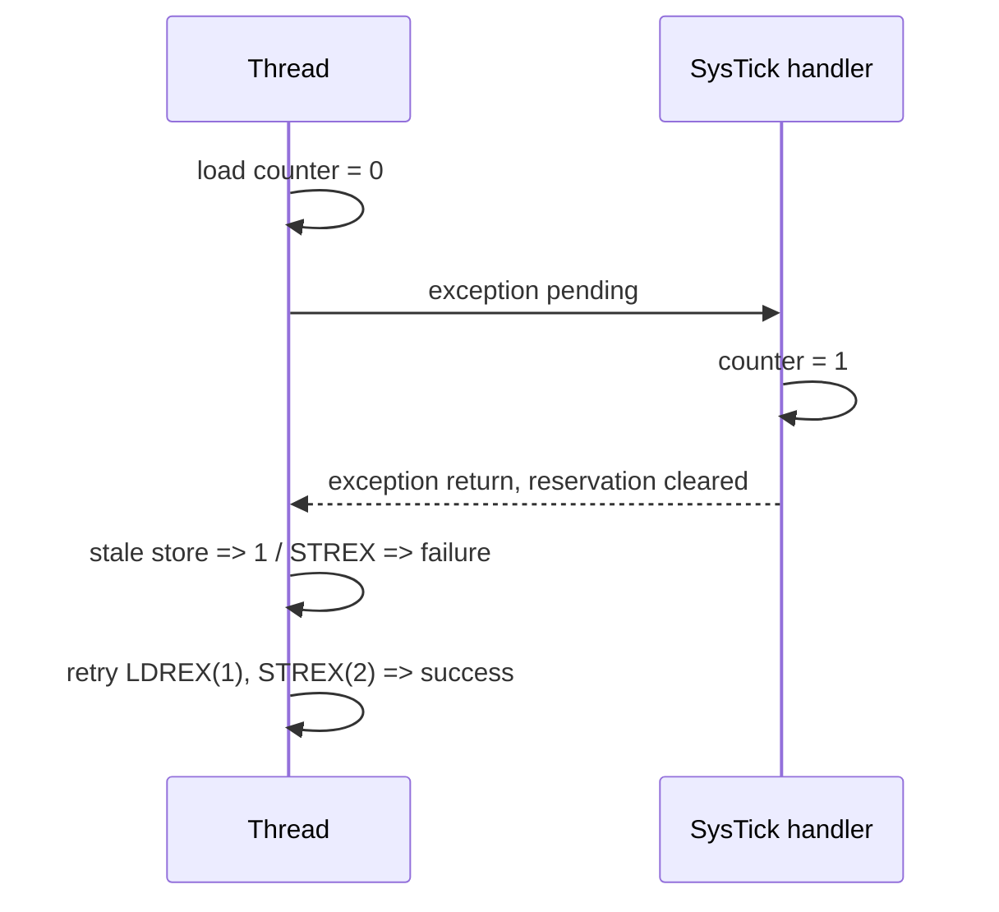

**Dil:** [English](README.md) | Türkçe

# Lesson 13 — Synchronization, FPU & DSP

`[DEEP]` · Day 6 · **STATUS: main üzerinde; Debug/Release/MinSize CI PASS (11fde900)**

**TEACH → SHOW → RUN → OBSERVE → MODIFY → BREAK → DEBUG → VERIFY**

Önkoşullar: [AAPCS](../09-compiler-aapcs/README.tr.md), [exceptions](../07-exceptions/README.tr.md),
[faults](../08-faults/README.tr.md) ve [ölçüm sınırları](../12-debug-dwt/README.tr.md).
Hedef aynı: Cortex-M33 / QEMU `mps2-an505`, Secure privileged Thread/MSP.

## Why This Matters — TEACH

Paylaşılan sayaç için iki doğru görünen `++` işlemi toplam 1 üretebilir.
FPU mevcut olsa da erişim izni kapalı olabilir; açık olması ise her exception'ın
FP register'larını stack'e yazacağı anlamına gelmez. DSP sonucu doğru olsa
bile QEMU çıktısı fiziksel donanım hızını kanıtlamaz.

Bu ders bu üç iddiayı ayrı, kontrollü deneylerle sınar. Shared runtime,
startup, linker, CMSIS ve önceki derslerin flag'leri değişmez. Scheduler,
Non-secure geçiş veya genel amaçlı atomik kütüphanesi oluşturulmaz.

## Core Idea

- **ARCHITECTURE:** aligned load/store ile read–modify–write atomikliği farklıdır.
  LDREX/STREX aynı adres ve boyutla kullanılır; başarısız store yazmaz ve tüm
  read–modify–write yeniden denenir. Exception local reservation'ı temizler.
- **MASK:** önceki PRIMASK geri yüklenir. Kapsam bu Secure single-core lab'ındaki
  maskelenebilir exception'lardır; NMI/HardFault veya DMA koruması değildir.
- **ORDER:** DMB bellek sıralaması, DSB tamamlanma, ISB yürütme bağlamı içindir.
  Hiçbiri read–modify–write'a karşılıklı dışlama eklemez. QEMU burada zayıf
  bellek sıralaması veya gerçek zaman davranışı doğrulama aracı değildir.
- **FP:** CPACR izinleri ile compiler ABI farklı katmanlardır. ASPEN/FPCA,
  LSPEN/LSPACT ve EXC_RETURN.FType birlikte gözlenir.
- **DSP:** signed 16-bit lane işlemleri ve saturation sonuçları düz C ile
  doğrulanır; instruction/cycle sayısı veya hız üstünlüğü iddiası yoktur.

## Mental Model / Visual



`volatile` erişimin görünür kalmasına yardım eder; bu tek başına atomiklik
veya genel thread senkronizasyon sözleşmesi değildir. Buradaki C/assembly,
GCC/CMSIS bare-metal kesme modeli için yazılmıştır; portable C11 atomikleri
olarak sunulmaz.

## Tiny Example — SHOW

[`sync_ops.S`](example/sync_ops.S) ilk LDREX ile STREX arasına tek SysTick
exception'ı yerleştirir. Handler sayacı artırır. İlk STREX başarısız olur;
başarılı yol yeni LDREX ile tekrar başlar. Deney exception'ı ICSR üzerinden
pending yapar; periyodik SysTick zamanlayıcısı kurmaz.

```asm
ldrex r2, [r4]
/* controlled exception once; hardware preserves interrupted r2 */
adds r2, r2, #1
strex r3, r2, [r4]
/* r3 != 0: retry the load as well as the store */
```

Gerçek kaynak register'ları korur, SP'yi 8-byte hizalı tutar, tüm bekleme ve
retry yollarını sınırlar. Attempt bütçesi tükenirse hata döndürür. Bu örnek
interrupt storm altında ilerleme veya WCET garantisi vermez. SRAM sayacı
word-aligned'dır; MMIO üzerinde exclusive deneyi yapılmaz.

## Build & Run — RUN

Repository kökünden Linux/MSYS2/WSL terminalinde:

```bash
cmake --preset debug
cmake --build --preset debug
./scripts/run-qemu.sh build/debug/lessons/13-sync-fpu-dsp/13-sync-fpu-dsp.elf
```

PowerShell'de aynı ELF doğrudan çalıştırılabilir:

```powershell
qemu-system-arm -M mps2-an505 -cpu cortex-m33 -nographic -monitor none -serial stdio -kernel build/debug/lessons/13-sync-fpu-dsp/13-sync-fpu-dsp.elf
```

END sonrası WFI vardır; QEMU'dan `Ctrl-A`, sonra `X` ile çık. `release` ve
`minsize` ile tekrarla. Dokuz yeni hedef:

- `13-sync-fpu-dsp`: kayıp güncelleme, exclusive retry, DSP/QADD.
- `13-sync-broken`: yalnız bir attempt; doğru final toplamı FAIL olur.
- `13-exercise-critical`: eksik starter, 2/6.
- `13-solution-critical`: ayrı referans çözüm, 6/6.
- `13-fpu-basic`: CPACR açık, SVC öncesi FP kullanılmamış.
- `13-fpu-eager`: aktif FP, lazy kapalı; softfp C helper.
- `13-fpu-lazy`: aktif FP, lazy açık; ilk handler FP komutu save'i tetikler.
- `13-fpu-denied`: CPACR kapalı; ilk FP komutunda NOCP.
- `13-fpu-hard`: eager bağlam deneyi, bütün imaj hard-float ABI ile derlenir.

## Recorded Output

2026-10-24, Windows, xPack GCC 15.2.1, QEMU
`11.1.0 (v11.1.0-12130-ge470268ff4)`, Debug gerçek koşusundan:

```text
===== LESSON 13: SYNCHRONIZATION AND DSP =====
[RACY_TOTAL] 1
[CHECK_LOST_UPDATE] PASS
[EXCLUSIVE_TOTAL] 2
[FIRST_STREX_STATUS] 1
[RETRIES] 1
[CHECK_INTERRUPTED_RESERVATION] PASS
[CHECK_ATOMIC_TOTAL] PASS
[DOT_C] 0xFFFF7360
[DOT_DSP] 0xFFFF7360
[SATURATION_AND_Q] PASS
[CHECK_DSP] PASS
[CHECK_BASELINE_SOFT] PASS
[CHECK_NO_FAULT] PASS
===== END =====
```

`0xFFFF7360`, signed 32-bit olarak -36000'dır. Bozuk varyantta
`EXCLUSIVE_TOTAL=1`, `CHECK_ATOMIC_TOTAL=FAIL`; diğer kontroller PASS kalır.

## Observe in GDB — OBSERVE

İlk terminalde ilgili ELF'i `scripts/debug-qemu.sh` ile başlat. İkinci terminal:

```text
arm-none-eabi-gdb build/debug/lessons/13-sync-fpu-dsp/13-sync-fpu-dsp.elf
(gdb) target remote :3333
(gdb) tbreak main
(gdb) continue
(gdb) tbreak l13_exclusive_increment
(gdb) continue
(gdb) disassemble /r l13_exclusive_increment
(gdb) tbreak SysTick_Handler
(gdb) continue
(gdb) info registers sp lr xpsr
(gdb) x/8wx $sp
(gdb) tbreak l13_done
(gdb) continue
(gdb) p g_l13_first_status
(gdb) p g_l13_retries
(gdb) p g_l13_counter
```

Handler'da IPSR=15 ve basic MSP-origin EXC_RETURN gözlenir. `r2`, interrupted
register'dır; exception stack onu korur, handler'ın C temporaries'iyle karıştırma.
Sonuçta status=1, retries=1, counter=2 beklenir. Otomatik GDB testi primitive
çağrısının öncesi/sonrası R4–R11 ve SP'yi de karşılaştırır.

## Experiment 1 — Critical section / MODIFY

[Alıştırma](exercises/01-critical-update/README.tr.md) aynı IRQ'yu read ile write arasında
pending yapar. Önceki PRIMASK'ı geri yükleyerek güncellemeyi koru. Sürücü hem
maskesi açık çağrıyı hem maskesi zaten kapalı çağrıyı sınar. Koşulsuz enable
ikinci durumda sözleşmeyi bozar. Maskeliyken IRQ bekleme.

## Experiment 2 — FPU permission and context

[`fp_main.c`](example/fp_main.c) setup/reporting için `-mgeneral-regs-only`
kullanır; permission açılmadan derleyici gizlice FP işlemi üretemez. Ayrı
[`abi_add.c`](example/abi_add.c) gerçekten C'den FP komutu üretir. FP assembly'si
[`fp_ops.S`](example/fp_ops.S) S0=1.5, S1=2.0, S2=3.5 kurar.

Bu imaj Secure→Secure/MSP içindir. FPCCR.TS ve CLRONRET açıkça temizlenir,
ASPEN açılır; yalnız lazy hedefte LSPEN açılır. Bu seçim genel TrustZone/OS
konfigürasyonu önerisi değildir. S16–S31'i scheduler adına sakladığı iddia
edilmez; AAPCS'de onlar callee-saved'dir, bu assembly yalnız S0–S2 kullanır.
Aktif-FP hedeflerinde çağıran, açık `l13_fp_set_environment()` destek
fonksiyonuyla FPSCR.FZ=1 ortamını seçer. Worker kontrol bitlerini sıfırlamaz.
Kaydedilen FPSCR ve çağrı sonrası değer `0x01000000` olmalı; bu kontrol
koruması testidir, denormal aritmetik davranışı deneyi değildir.

Ölçülen ayrım (üç preset):

- Basic: CPACR=`0x00F00000`, CONTROL=`0x00000000`, EXC_RETURN=`0xFFFFFFF9`,
  frame **32 byte**. FPU izni tek başına active FP context oluşturmaz.
- Eager/hard: CONTROL=`0x0000000C` (FPCA ve Secure SFPA),
  EXC_RETURN=`0xFFFFFFE9`, frame **104 byte**, LSPACT=0.
- Lazy: aynı extended EXC_RETURN ve boyut; FPCCR girişte `0xC000041D`,
  ilk handler FP komutundan sonra `0xC000041C`. Esas assertion LSPACT 1→0'dır;
  register'ın tüm bitleri her hedefe genellenmez.

104 byte: core 8 word + S0–S15/FPSCR/reserved için 18 word. Core R0,
entry SP+0'dadır; FP S0 slot'u entry SP+32'dir. Bu Armv8-M deneyinde
FP verisini core frame'in önüne varsayımsal 72-byte offset ile yerleştirme.
SP önceden 8-byte hizalı olduğundan stacked xPSR.STKALIGN=0, padding yoktur.
Basic hedefte FP slot'u okunmaz; raw-slot raporundaki 0 bir sentinel
değeridir. TS, güvenlik geçişi, stack seçimi veya hizalama değişirse bu
decoder yeterli değildir.

Worker geçici olarak 104 byte stack alanı ayırıp `0xA5A5A5A5` ile doldurur,
SP'yi geri yükler ve SVC yapar. C frame'i veya MSP→PSP geçişi kullanılmaz.
Lazy girişte ham S0 slot'u hâlâ işaretleyicidir; **henüz geçerli FP verisi
olarak yorumlanmaz**. Handler'ın `vmov.f32 s0,#8.0` komutu lazy save'i
başlatır. Stack'te eski Thread S0=`0x3FC00000`, canlı S0=8.0 olur.
Exception dönüşünde S0=1.5, S2=3.5 ve çağıranın FPSCR kontrol durumu geri
gelir. Reserved word'e anlam yüklenmez. Deneyde başka kesme etkinleştirilmez.

Lazy ELF ile GDB'de:

```text
(gdb) tbreak *SVC_Handler
(gdb) continue
(gdb) set $frame = (unsigned int)$sp
(gdb) p/x $lr
(gdb) x/wx 0xE000EF34
(gdb) x/26wx $frame
(gdb) tbreak *l13_frame_ready
(gdb) continue
(gdb) x/26wx $frame
(gdb) p/x g_l13_fpccr_after
(gdb) p $s0
(gdb) tbreak *(unsigned int)&l13_after_svc
(gdb) continue
(gdb) p $s0
(gdb) p $s2
```

`l13_after_svc`, C'de adresi kullanılan bir assembly label'ıdır; GDB'de
`&` ile adresini seç. `*label` ifadesini yanlışlıkla char içeriği gibi
çözümlemek yanlış breakpoint kurabilir. SVC wrapper EXC_RETURN'ü BL'den
önce saklar; kendi 8-byte frame'ini hardware frame ile karıştırma.
Önceki `cm-frame` aracı basic-frame kapsamını korur; bu extended deney
lesson-local snapshot ve ham GDB okumalarıyla doğrulanır.

## Experiment 3 — Compiler ABI

Baseline dersler `-mfloat-abi=soft` kalır. Softfp FP komutlarına izin verir,
float parametre/sonuçları base AAPCS ile aktarır. Hard, VFP çağrı düzenini
kullanır. CPACR bunlardan ayrı runtime iznidir.

Assembly `l13_abi_call_bits(uint32_t,uint32_t)` iki float'ın bit desenlerini
alır. Softfp'de C helper'a R0/R1 ile, hard'da S0/S1 ile aktarır; sonuç 3.5
(`0x40600000`) çıkar. Bu açık adaptör rastgele ABI karışımını meşrulaştırmaz.
Hard hedefin startup/console dahil tüm C nesneleri hard ABI kullanır;
integer-only setup/reporting flag'i ayrıca korunur. Test son compiler
flag'lerini, ELF ABI attributes ve gerçek FP disassembly'sini denetler.
İki matching ABI link probe'u geçer; iki mixed ABI probe'u hata vermelidir.
`--no-warn-mismatch` kullanılmaz.

## Experiment 4 — DSP

[`dsp.c`](example/dsp.c) dört signed 16-bit sensör örneğini dört katsayıyla
çarpar. SMLAD packed iki signed lane'i kullanır. Paketleme unsigned shift
ile yapılır; negatif signed değeri sola kaydırma yoktur. Girdiler sınırlıdır,
düz C toplamında signed overflow yoktur. QADD pozitif ve negatif saturation
ile sınanır; sticky APSR.Q temizlenip okunur ve önceki Q durumu geri yüklenir.
NZCV bayrakları normal AAPCS çağrısında korunmuş kabul edilmez.
Daha büyük gerçek FIR verisinde accumulator sınırları ayrıca tasarlanmalıdır.

```bash
arm-none-eabi-objdump -d --disassemble=l13_dot_dsp build/debug/lessons/13-sync-fpu-dsp/13-sync-fpu-dsp.elf
arm-none-eabi-readelf -A build/debug/lessons/13-sync-fpu-dsp/13-fpu-hard.elf
```

QEMU'da DWT cycle counter çalışmadığından cycle benchmark veya DSP hız
oranı raporlanmaz. Sonuç eşitliği ve komut varlığı iki ayrı kanıttır.

## Break It / Debug It

1. `13-sync-broken`: failed STREX'i yok sayma; status, retries ve final toplamı
   ayrı incele. DMB eklemek retry ihtiyacını ortadan kaldırmaz.
2. Alıştırmada kaydedilen PRIMASK yerine koşulsuz enable kullan: nested-mask
   kontrolünün neden bozulduğunu açıkla.
3. `13-fpu-denied`: CFSR=`0x00080000`, HFSR=0, IPSR=6 ölçüldü. NOCP UsageFault
   etkin; stacked PC ilk `vmov` komutunu gösterir. İzin kapalı raporlayıcı FP
   kullanmaz; exception'dan dönüp aynı komuta tekrar fault üretmez.
4. Lazy girişindeki ayrılmış slot'u geçerli S0 diye yorumlama. İlk FP
   komutunun öncesi/sonrası LSPACT ile raw memory'yi birlikte incele.
5. Softfp/hard nesnelerini karıştıran negatif link probe'larını oku. Linker
   hatasını bastırarak çalışıyor kabul etme.

## Verify

```bash
python3 tests/lesson13-check.py debug
python3 tests/lesson13-check.py release
python3 tests/lesson13-check.py minsize
./tests/smoke-test.sh debug
./tests/build-probes.sh debug
python3 tests/check-links.py
```

Windows Python çağrısı `py -3` olabilir. Lesson testinin bağımlılıkları Python
stdlib, Arm GCC/binutils, QEMU ve Arm GDB/gdb-multiarch'tır. Araç yokluğu SKIP
veya başarı değildir. Her QEMU süreci test tarafından kapatılır, debugger
boş loopback port kullanır. UART/GDB/ABI/disassembly kayıtları ignored
`build/<preset>/lesson13-evidence/` altında saklanır; CI bunları upload eder.

Yerel üç preset'te dokuz hedefin davranışı ve GDB gözlemleri doğrulandı.
Son temiz build 64 ELF/preset ve 0 uyarı/hata; tam smoke **566/0**, mevcut
build probe'ları **47/0/0 SKIP**, link checker **358/0**. Önceki Lesson 12
GDB kontrolü de üç preset'te tekrar geçti.
CI sonucu yayınlama sonrasında ayrıca kontrol edilir. Önceki regresyon
kontrolleri azaltılmadı. Alıştırma eksik tutulur; çözüm ayrı linklenir.
Test ayrıca geçici dizinde iki yanlış çözüm derleyip çalıştırır: korumasız
güncelleme `OPEN_TOTAL`, koşulsuz enable `NESTED_MASK` kontrolünden kalır;
ikisi de 5/6 verir. Gerçek starter/çözüm kaynakları değiştirilmez.

## What I Learned

Öğrencinin kendi kaydı; teslim adına doldurulmaz.

- Kayıp güncellemenin olduğu instruction aralığı:
- İlk failed STREX sonrası yaptığım hata:
- Lazy slot'un önceki/sonraki içeriği:
- NOCP'yi HardFault'tan ayıran kanıt:
- DSP için kanıtlayabildiğim ve ölçmediğim şey:

## Quick Check

1. Volatile ve DMB neden `counter++` işlemini atomik yapmıyor?
2. Failed STREX'ten sonra yalnız store'u tekrarlamak yeterli mi?
3. Giriş maskesini geri yüklemek neden koşulsuz enable'dan farklı?
4. CPACR açık olması extended frame'i garanti eder mi?
5. Lazy slot'ta önceki RAM verisi niçin hâlâ bulunabilir?
6. NOCP hangi koşulda UsageFault, hangi koşulda escalation ile görülebilir?
7. Softfp ve hard ABI parametre/sonuçları nerede taşır?
8. SMLAD ve QADD sonucu niçin hardware hız kanıtı değildir?

[Ayrı cevaplar](answers/quick-check.tr.md).

## Takeaway

Kontrollü bir exception kayıp güncellemeyi görünür kılar; doğru retry yeni
veriyi yeniden okur. FP izinleri, aktif context, saklama zamanı ve ABI ayrı
sözleşmelerdir. DSP doğruluğu, overflow sınırları ve performans ölçümü ayrı
kanıtlar gerektirir.

## References

- [Arm Cortex-M33 TRM, exclusive monitor ve FPU bölümleri](https://documentation-service.arm.com/static/641b2edcde84571cc27f3caa)
- [Armv8-M ARM DDI0553B.y: exception entry, PushStack, FPCCR, exclusive access](https://community.arm.com/cfs-file/__key/communityserver-discussions-components-files/471/DDI0553B_5F00_y_5F00_armv8m_5F00_arm.pdf)
- [Arm AAPCS32: VFP register ve parametre kuralları](https://github.com/ARM-software/abi-aa/blob/main/aapcs32/aapcs32.rst)
- [GCC Arm options: soft / softfp / hard](https://gcc.gnu.org/onlinedocs/gcc/ARM-Options.html)
- [Vendored CMSIS provenance](../../external/README.tr.md),
  [target kabiliyetleri](../../docs/TARGET_CAPABILITIES.tr.md),
  [ölçüm sınırları](../../docs/PERFORMANCE_MEASUREMENT.tr.md).

**Previous:** [12 — Debugging & DWT](../12-debug-dwt/README.tr.md)
**Next:** [14 — SysTick & PendSV](../14-systick-pendsv/README.tr.md)
