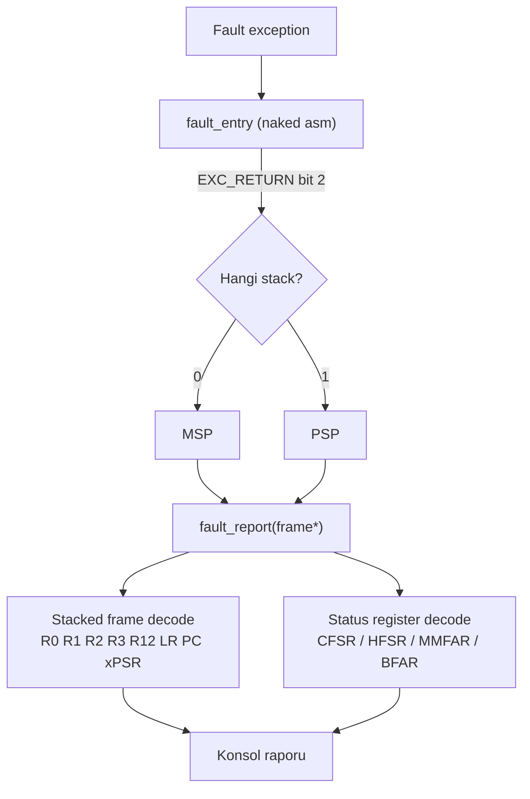

# Project — Fault Analyzer

**STATUS: planned** · Bağımlı dersler: 07, 08

> Bu proje ilerleyen tüm derslerde **yeniden kullanılacak**. Ders 08'den sonra
> yazılır, ders 15'teki mini kernel'da hâlâ işe yarar.

---

## Problem

Cortex-M'de bir crash'in varsayılan görüntüsü şudur: işlemci sonsuz döngüde
bekleyen bir `Default_Handler` içindedir ve hiçbir şey söylemez. Bu oturumda
ölçülen gerçek bir örnekte elde edilen tek ham veri şuydu:

```text
IPSR = 3        (HardFault)
CFSR = 0x00009200
HFSR = 0x40000000
BFAR = 0xFFFFFFF8
LR   = 0xFFFFFFFD
```

Bu sayılar bir insana hiçbir şey anlatmaz. Fault Analyzer'ın işi bunları
şuna çevirmektir:

```text
===== FAULT REPORT =====
TYPE     : HardFault (escalated)
CAUSE    : BusFault - precise data bus error during exception stacking
BFAR     : 0xFFFFFFF8 (valid)
RETURN   : Handler Mode, MSP, no FP context
NOTE     : stacking failed -> stacked frame is NOT trustworthy
========================
```

---

## Architecture



Kritik detay: hangi stack pointer'ın frame'i taşıdığını **tahmin edemezsin**;
`EXC_RETURN`'ün (yani handler girişindeki `LR`'nin) 2. biti bunu söyler. Bu
yüzden giriş noktası `__attribute__((naked))` bir asm parçasıdır — derleyicinin
prolog üretmesine izin verirsen `LR` bozulur.

---

## Yapılacaklar (student)

1. `fault_entry` — naked; `LR`'yi inceleyip doğru SP'yi `R0`'a koyar ve
   `fault_report`'a dallanır.
2. `struct exception_frame` — donanımın ittiği 8 word'ün tam sırası.
   (Soft-float kullanıyoruz, yani frame 8 word. FPU açılırsa değişir — bunu
   ders 13'te göreceğiz.)
3. `decode_cfsr()` — MMFSR / BFSR / UFSR alanlarını ayrı ayrı bas, `*VALID`
   bitlerini kontrol etmeden `MMFAR`/`BFAR`'a güvenme.
4. `decode_exc_return()` — mod, stack, FP context, security state.
5. `decode_hfsr()` — `FORCED` bitinin anlamı: HardFault aslında başka bir
   fault'un yükseltilmiş (escalated) halidir.

`TODO(student)` blokları `src/` içinde hazır olacak; decode tabloları
**verilmeyecek**, referans kılavuzdan sen çıkaracaksın.

---

## Acceptance criteria

- [ ] Analyzer dört farklı senaryoyu doğru sınıflandırıyor:
      hizasız erişim (UsageFault), geçersiz adres (BusFault),
      MPU ihlali (MemManage), tanımsız komut (UsageFault).
- [ ] Rapor, escalated HardFault ile doğrudan HardFault'u ayırt ediyor.
- [ ] `*VALID` biti 0 iken adres register'ı "geçersiz" olarak raporlanıyor.
- [ ] Stacking'in kendisi başarısız olduğunda (`BFSR.STKERR`) rapor,
      frame'in güvenilmez olduğunu **açıkça** söylüyor.

Son madde bu oturumda ölçülen gerçek senaryodan geliyor: stacking başarısız
olduğunda stack üzerinde okuduğun değerler anlamsızdır. Çoğu basit fault
handler bunu kaçırır ve yanlış PC raporlar.

---

## Yeniden kullanım

Bitince kaynak `common/` altına taşınabilir; sonraki tüm lesson firmware'leri
aynı analyzer'ı linkleyebilir. Portfolio açısından da en gösterilebilir
parçalardan biri: crash diagnostics yazabilmek, embedded'de doğrudan iş
becerisidir.

---

## References

- Armv8-M Architecture Reference Manual — Fault handling, `CFSR`, `HFSR`
- Cortex-M33 Devices Generic User Guide — System Control Block register'ları
- [`docs/DEBUGGING.md`](../../docs/DEBUGGING.md) — CFSR bit tablosu

---

[← projects/](../README.md) · [Ders 08 — Faults](../../lessons/08-faults/README.md)
