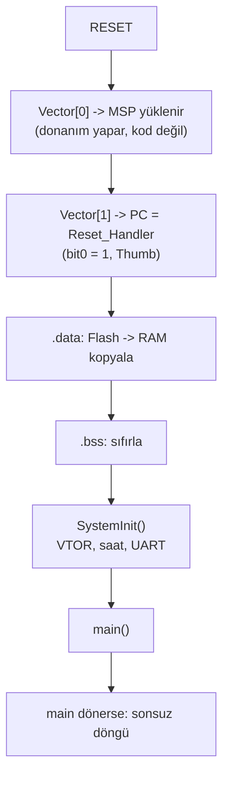

# Project — From Reset to Main

**STATUS: planned** · Bağımlı dersler: 10, 11

> `platform/mps2-an505/` altında zaten çalışan bir startup var. Bu proje onu
> kullanmak değil, **sıfırdan kendin yazmak** için. İkisi bilinçli olarak
> ayrı tutuldu: biri altyapı, diğeri öğrenme hedefi.

---

## Problem

`main()` çağrıldığında şunların hepsi zaten doğru olmak zorundadır:

- stack pointer geçerli bir RAM adresini gösteriyor,
- ilk değer verilmiş global'ler (`.data`) Flash'tan RAM'e kopyalanmış,
- sıfırlanması gereken global'ler (`.bss`) gerçekten sıfır,
- vektör tablosu doğru yerde ve `VTOR` onu gösteriyor.

Bunları yapan kod, C çalışma ortamı **henüz kurulmamışken** çalışır. Yani
kendi kurallarını ihlal edemez: global'e yazamaz, `memcpy` çağıramaz
(çağırırsa neden çağırabildiğini bilmek zorundadır), `main`'e dönemez.

---

## Architecture



Linker'ın verdiği semboller ile startup kodunun ilişkisi:

```text
linker script                     startup kodu
-------------                     ------------
__data_load_start  (LMA, Flash)   kopyalama kaynağı
__data_start       (VMA, RAM)     kopyalama hedefi
__data_end                        kopyalama sonu
__bss_start                       sıfırlama başı
__bss_end                         sıfırlama sonu
__stack_top                       vector[0]
```

LMA (load memory address — yükleme adresi) ile VMA (virtual memory address —
çalışma adresi) ayrımını anlamadan `.data` kopyalaması anlaşılmaz. Bu projenin
asıl öğrettiği şey budur.

---

## Yapılacaklar (student)

1. `startup.c` — vektör tablosunu, `Reset_Handler`'ı ve weak handler'ları
   kendin yaz. Mevcut platform startup'ına bakmadan dene; takılırsan bak.
2. `custom.ld` — kendi linker script'ini yaz. En az: `MEMORY` blokları,
   `.vectors`, `.text`, `.rodata`, `.data` (`AT>` ile LMA), `.bss`, stack.
3. Bilinçli deney: `.bss` sıfırlamasını kaldır ve sıfır beklediğin global'in
   ne olduğunu gözlemle. QEMU'da RAM sıfır gelebilir — bu gerçek donanımda
   **garantisi olmayan** bir davranıştır ve tam olarak bu yüzden tehlikelidir.
4. `__stack_top` konumunu değiştirip `ASSERT` ile taşma kontrolü ekle.

---

## Acceptance criteria

- [ ] Kendi startup + kendi linker script ile firmware QEMU'da boot ediyor.
- [ ] `arm-none-eabi-objdump -h` çıktısında `.data`'nın LMA'sı Flash'ta,
      VMA'sı RAM'de.
- [ ] Map file'da `__data_load_start` ile `.data` VMA'sının farkı
      açıklanabiliyor.
- [ ] GDB'de `Reset_Handler`'a breakpoint konup `.data` kopyalaması
      adım adım izlenebiliyor.
- [ ] Bir global'in adresi map file'dan bulunup GDB'de doğrulanabiliyor.

---

## Doğrulama

```text
info registers
b Reset_Handler
si
x/8wx 0x10000000     # vektör tablosu
p/x $msp
```

Bu oturumda ölçülen referans değerler (mevcut platform startup'ı için):
vector[0] = `0x30008000`, vector[1] = `0x10000221`, `Reset_Handler` =
`0x10000220`. Kendi script'in farklı adresler üretecek — önemli olan
**ilişkinin** aynı kalması: vector[1] = handler adresi + 1.

---

## References

- Armv8-M Architecture Reference Manual — Reset behaviour, vector table
- Cortex-M33 Devices Generic User Guide — `VTOR`
- GNU ld manual — `AT>`, `MEMORY`, `SECTIONS`, `ASSERT`
- [`docs/MEMORY_MAP.md`](../../docs/MEMORY_MAP.md)

---

[← projects/](../README.md) · [Ders 11 — Startup](../../lessons/11-startup/README.md)
