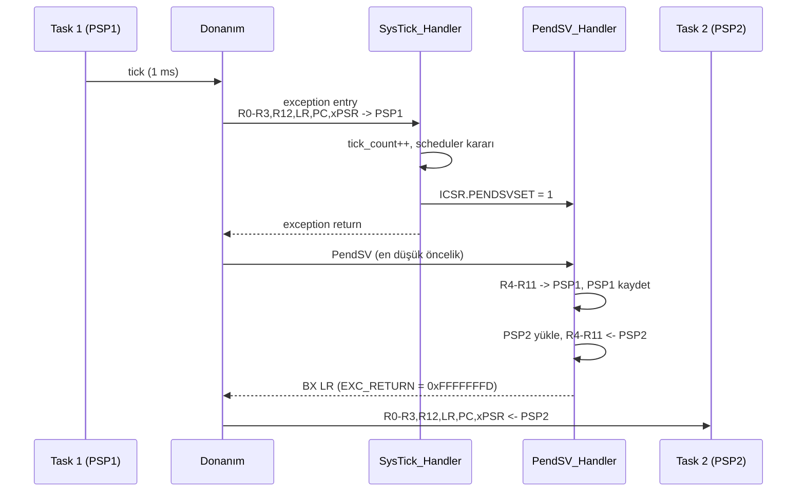

# Project — Educational Mini Kernel

**STATUS: planned** · Bağımlı dersler: 14, 15

> Amaç production RTOS yazmak **değil**. Amaç: context switch'in neden
> PendSV'de yapıldığını, `EXC_RETURN`'ün ne işe yaradığını ve R4–R11'i kimin
> kaydetmesi gerektiğini kendi kodunda görmek.

---

## Problem

İki görev aynı işlemcide dönüşümlü çalışacak. İşlemcide iki set register
yok — tek set var. Yani "aynı anda çalışıyormuş gibi" görünmesi tamamen
**register'ları doğru zamanda doğru stack'e saklamaya** bağlı.

Donanım bu işin yarısını yapar (R0–R3, R12, LR, PC, xPSR otomatik stacked).
Diğer yarısı (R4–R11) senin sorumluluğundadır. Kernel'ın tamamı bu tek
cümlenin etrafında döner.

---

## Architecture

Neden SysTick içinde doğrudan switch yapılmıyor? Çünkü SysTick yüksek
öncelikli olabilir ve başka bir handler'ın ortasında tetiklenebilir; switch
o noktada yapılırsa yarım kalmış bir handler'ın bağlamı kaybolur. PendSV en
düşük önceliğe konur ve **tüm diğer handler'lar bittikten sonra** çalışır.
Bu, Cortex-M'in klasik tasarım desenidir.

---

## Yapılacaklar (student)

1. `task_stack_init()` — bir görevin ilk stack frame'ini elle kur. Görev hiç
   çalışmadığı için stack'te sahte bir exception frame olmalı: `PC` görev
   fonksiyonu, `xPSR` içinde T biti 1, `LR` güvenli bir dönüş adresi.
   T bitini unutmak en sık yapılan hatadır ve sonucu doğrudan UsageFault'tur.
2. `PendSV_Handler` — `__attribute__((naked))`. C prolog'u bağlamı bozar.
3. `scheduler_next()` — round-robin; şimdilik blocking yok.
4. `svc_yield()` — görev gönüllü olarak CPU'yu bıraksın.
5. Extension: görevleri unprivileged yap, her görevin stack'ini MPU ile izole
   et. Bir görev diğerinin stack'ine yazmaya çalışınca MemManage bekle.

---

## Acceptance criteria

- [ ] İki görev konsola dönüşümlü çıktı basıyor.
- [ ] GDB'de her iki görevin PSP'si ayrı ayrı incelenebiliyor.
- [ ] `EXC_RETURN` değeri `0xFFFFFFFD` (Thread Mode, PSP) olarak doğrulandı.
- [ ] Görev stack'lerinde kaydedilmiş R4–R11 memory'de gösterilebiliyor.
- [ ] `svc_yield()` çağrısı beklenen anda switch üretiyor.
- [ ] (Extension) MPU izolasyonu ihlal denemesinde MemManage üretiyor.

---

## Kasıtlı olarak yapılmayacaklar

Bu bir öğrenme kernel'ı. Şunlar **kapsam dışı**: priority inheritance,
mutex/semaphore, dinamik bellek, tickless idle, SMP, power management.
Gerçek uygulama için FreeRTOS veya Zephyr kullanılır — bkz.
[`docs/ROADMAP.md`](../../docs/ROADMAP.md).

---

## References

- Armv8-M Architecture Reference Manual — exception entry/return, `EXC_RETURN`
- Cortex-M33 Devices Generic User Guide — SysTick, `ICSR.PENDSVSET`
- AAPCS — callee-saved register kuralları (R4–R11)

---

[← projects/](../README.md) · [Ders 15 — Mini Kernel](../../lessons/15-mini-kernel/README.md)
