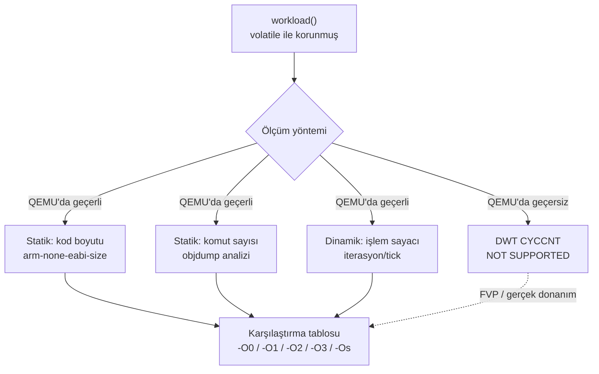

# Project — Performance Profiler

**STATUS: planned** · Bağımlı dersler: 09, 12

> ⚠️ Bu projenin ilk gerçeği: **DWT CYCCNT bu hedefte saymıyor.**
> Ölçüldü, uydurulmadı — bkz. [`docs/TARGET_CAPABILITIES.md`](../../docs/TARGET_CAPABILITIES.md).
> Proje bu kısıtın etrafında kurulmuştur, kısıtı gizleyerek değil.

---

## Problem

"Bu fonksiyon hızlı mı?" sorusu, ölçme yöntemi tanımlanmadan cevaplanamaz.
Embedded'de yanlış ölçüm, yanlış optimizasyondan daha pahalıdır: insanlar
gerçekte var olmayan bir kazanç için okunabilirliği feda eder.

Bu projede öğrenilecek şey bir sayı üretmek değil, **ölçümün ne kadarına
güvenilebileceğini bilmek**.

---

## Ölçülen gerçek: DWT durumu

Capability probe çıktısından (QEMU 8.2.2, mps2-an505, cortex-m33):

```text
[DWT_CYCCNT_IMPLEMENTED] YES
[T0] 0x00000000
[T1] 0x00000000
[DWT_CYCCNT_COUNTING]    NO
```

Register var, yazılabiliyor, okunabiliyor — ama saymıyor.

```text
DWT cycle counting: NOT SUPPORTED ON CURRENT TARGET (QEMU mps2-an505)
```

Bu, "QEMU bozuk" demek değil. QEMU fonksiyonel bir emülatördür; komutları
doğru yürütür, **zamanlamayı modellemez**. Cycle-accurate ölçüm için gereken
yol: Arm FVP, ya da gerçek donanım + SWO/ETM trace.

---

## Architecture



---

## Yapılacaklar (student)

1. `workload()` — optimize edilip yok edilmeyecek bir iş yaz. `volatile`
   olmadan `-O2`'de fonksiyonun tamamen silinebileceğini önce **gör**,
   sonra düzelt.
2. `measure_static()` — build çıktılarından kod boyutu ve komut sayısını
   toplayan script.
3. `measure_relative()` — SysTick ile "sabit sürede kaç iterasyon" ölçümü.
   Bu QEMU'da mutlak zaman vermez ama karşılaştırma için kullanılabilir;
   neden kullanılabildiğini README'ye kendi cümlelerinle yaz.
4. Ölçüm bölgesinin içinde **console I/O yapma**. UART, ölçmek istediğin
   işten kat kat pahalıdır.

---

## Acceptance criteria

- [ ] Aynı `workload()` beş optimizasyon seviyesinde build ediliyor.
- [ ] Kod boyutu ve komut sayısı tablosu gerçek çıktıdan üretiliyor.
- [ ] `volatile`'ın etkisi disassembly üzerinden gösteriliyor.
- [ ] Rapor, hangi metriğin QEMU'da anlamlı hangisinin anlamsız olduğunu
      açıkça yazıyor.
- [ ] Hiçbir yerde uydurulmuş "x2.3 hızlanma" iddiası yok.

---

## Dürüstlük kuralı

Bu projede yazılacak her performans cümlesi şu testten geçmeli:

> Bu sayıyı nasıl ölçtüm, ölçüm hangi varsayıma dayanıyor ve bu varsayım
> gerçek donanımda da geçerli mi?

Cevap veremiyorsan cümleyi silmek, cümleyi hedge'lemekten iyidir.

---

## References

- Armv8-M Architecture Reference Manual — DWT
- Cortex-M33 Devices Generic User Guide — DWT register'ları
- QEMU documentation — Arm system emulation, mps2 boards
- [`docs/PERFORMANCE_MEASUREMENT.md`](../../docs/PERFORMANCE_MEASUREMENT.md)
- [`docs/LIMITATIONS.md`](../../docs/LIMITATIONS.md)

---

[← projects/](../README.md) · [Ders 12 — Debug & DWT](../../lessons/12-debug-dwt/README.md)
