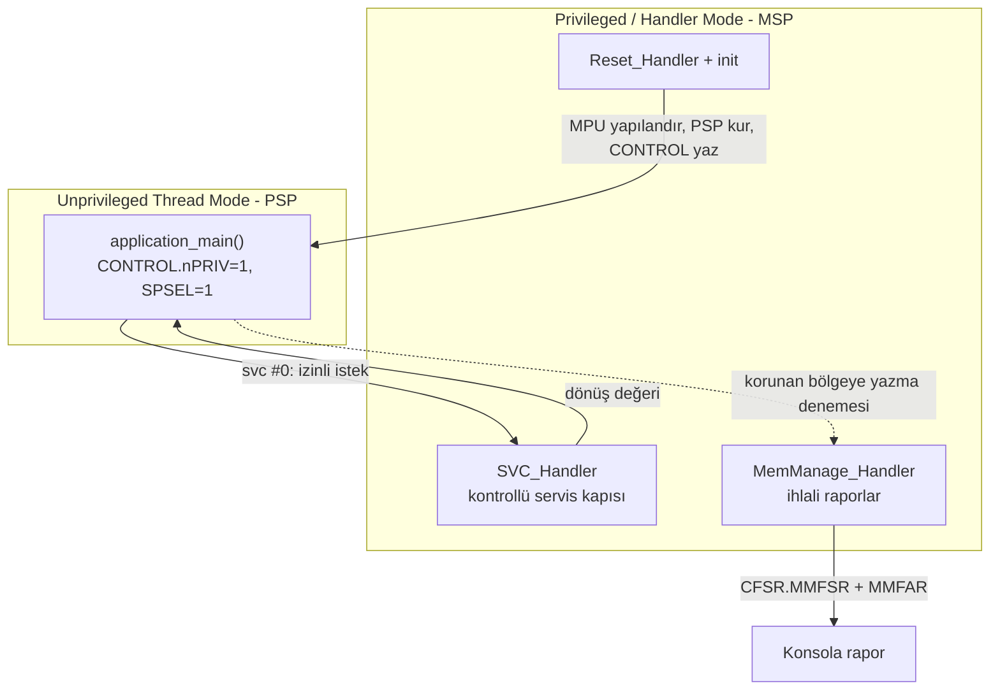

# Project — Protected Cortex-M Application

**STATUS: planned** · Bağımlı dersler: 04, 05, 06, 07, 08

> Bu projeye, MPU ve SVC derslerini bitirmeden başlama. Kod yazılmamıştır;
> aşağıdaki tanım projenin sözleşmesidir.

---

## Problem

Tek bir binary içinde çalışan uygulama kodu, sistemin tamamına sınırsız
erişime sahiptir. Uygulama katmanındaki bir pointer hatası kernel verisini
bozabilir, konfigürasyonun üzerine yazabilir, vektör tablosunu ezebilir.

Gerçek firmware'de bunu engelleyen şey iyi niyet değil, **donanımsal ayrım**:
unprivileged execution (ayrıcalıksız çalıştırma) + MPU (memory protection
unit — bellek koruma birimi) + kontrollü bir servis kapısı (SVC).

Bu proje o ayrımı en küçük çalışan haliyle kurar.

---

## Architecture



Bellek planı (hedeflenen):

```text
0x30000000  +---------------------------+
            | kernel_data   (privileged |  MPU: privileged RW,
            |                only)      |       unprivileged NO ACCESS
            +---------------------------+
            | app_data                  |  MPU: full RW
            +---------------------------+
            | app_stack (PSP)           |  MPU: full RW, XN
            +---------------------------+
0x30008000  | kernel_stack (MSP)        |  MPU: privileged RW
            +---------------------------+
```

---

## Yapılacaklar (student)

1. `mpu_configure()` — bölgeleri `MPU_RBAR`/`MPU_RLAR` ve `MPU_MAIR` ile kur.
   Armv8-M MPU'da bölgeler **base + limit** ile tanımlanır; Armv7-M'deki
   `size` alanı yoktur. Bu farkı atlamak en sık yapılan hatadır.
2. `drop_to_unprivileged()` — PSP'yi yükle, `CONTROL`'ü yaz, `ISB` ile
   senkronize et. `ISB` olmadan davranış tanımsızdır.
3. `svc_request()` — inline asm ile `svc #n`, AAPCS'ye uygun argüman geçişi.
4. `SVC_Handler` — hangi stack'in kullanıldığını `EXC_RETURN`'den çöz,
   stacked frame'den SVC numarasını ve argümanları oku.
5. `MemManage_Handler` — `CFSR` ve `MMFAR`'ı decode edip rapor bas.

---

## Acceptance criteria

Proje "bitti" sayılır ancak şu beşi birden doğrulanırsa:

- [ ] Konsolda `CONTROL = 0x00000003` (nPRIV=1, SPSEL=1) görülüyor.
- [ ] Uygulama `app_data`'ya yazabiliyor, `kernel_data`'ya yazamıyor.
- [ ] İzinsiz yazma **HardFault değil, MemManage** üretiyor
      (yani `SHCSR.MEMFAULTENA` gerçekten set edilmiş).
- [ ] `MMFAR` tam olarak ihlal edilen adresi gösteriyor.
- [ ] SVC üzerinden yapılan istek başarılı dönüyor; aynı işlemin doğrudan
      yapılması fault üretiyor.

---

## Doğrulama

```bash
cmake --build --preset debug --target run-protected-application
# ve ayrı bir terminalde
cmake --build --preset debug --target debug-protected-application
```

GDB'de bakılacaklar:

```text
cm-mode         # Thread/Handler + privilege
p/x $control    # 0x3 bekleniyor
cm-mpu          # aktif bölgeler
cm-fault        # ihlal sonrası CFSR/MMFAR
```

---

## References

- Armv8-M Architecture Reference Manual — PMSAv8 (MPU) bölümü
- Cortex-M33 Devices Generic User Guide — MPU, SVC, System Control Block
- CMSIS-Core: `ARM_MPU_SetRegion`, `__set_CONTROL`, `__ISB`

---

[← projects/](../README.md) · [Ders 06 — MPU](../../lessons/06-mpu/README.md)
